# CascadeCode Design

A 3-tier, artifact-driven multi-agent engineering system.

CascadeCode organizes work the way a mature engineering organization does: **Epic (Strategic) → Feature (Tactical) → Task (Execution)**. Planning agents never share a chat room. They negotiate through markdown artifacts and narrow LangGraph queues. Coding agents never see the strategy debate — they receive a sealed task spec, commit one bounded change to the Feature branch, and disappear.

This keeps architecture from collapsing into implementation detail, and it keeps ephemeral SWE agents from building against a flawed interface.

---

## 1. Problem

Single-agent coding loops fail in two opposite ways:

1. **Too high.** The agent debates architecture while you need a kernel written.
2. **Too low.** The agent starts writing code against an interface that is still wrong.

A flat todo list cannot express this. A single chat window cannot isolate it. CascadeCode treats the filesystem as a Kanban board and each tier as a separately scoped LangGraph subgraph with its own lifetime, tools, and context window.

---

## 2. Goals

- **Hierarchy over chatter.** Epic, Feature, and Task are first-class work objects with parent/child links, not tags on a flat ticket.
- **Filesystem is the board.** Moving a `.md` file is a state transition. Agents and the UI both watch directories.
- **Artifact-driven messaging.** Tiers do not share transcripts. They communicate through document diffs and typed queue messages.
- **Human is mobile across persisting teams.** Default home is the Epic War Room, but the operator can drop into any live Epic or Feature team, comment on that team's design, and read why decisions were locked. Task teams stay ephemeral.
- **Decisions outlive the chat.** Every persisting team keeps an append-only decision log on its `.md`. Dropping in later still answers "why," even if the transcript is gone.
- **Context isolation.** Agents only load the documents and messages required for their tier. The human may attach to several graphs; those graphs still cannot see each other.
- **Upward negotiation.** A Feature may not silently violate Epic constraints. It must propose an amendment and wait.
- **Approval boundaries, automatic execution.** The human approves a brief by merging its MR, activates the resulting backlog epic, and reviews feature MRs. The watchdog automatically starts eligible Feature and Task teams between those boundaries.
- **Forge-backed review.** The runtime stays local, while GitHub or GitLab holds brief approvals, draft feature reviews, and reviewer discussion. Cascade uses the operator's authenticated `gh` or `glab` session.

Non-goals for v1:

- Multi-user auth / hosted SaaS / any remote UI
- Hosted agent runtimes or cloud checkpointers
- Automatic merging of feature MRs without normal repository review/merge policy
- Cross-repo orchestration (one `cascade up` supervises a single git root; see §9.4)

---

## 2.1 Product workflow

The War Room begins with **Create brief**, not a pre-existing board card. The form captures intent, success criteria, constraints, provider, and separate model choices for the Epic Manager and Epic Architect. Project provider/model defaults prefill the form and short guidance explains what each role needs.

Submitting a brief creates `cascade/brief/epic_NNN`, commits the new backlog Epic document, pushes that brief branch, and opens a GitHub PR or GitLab MR with `cascade/brief/epic_NNN` as the source and `main` as the target (the resolved product trunk). The response contains the review URL. The brief does not appear in the local backlog until that change is merged.

When automation is enabled, `cascade up` polls the configured remote product trunk every `automation.poll_seconds` (default 15 seconds), fetches through normal Git operations, and atomically refreshes a read-only backlog snapshot under `.cascade/backlog_snapshot` without checking out, merging, or resetting the operator trunk. The War Room **Pull main** button uses the same refresh path. Newly merged remote briefs appear in the supervisor board from that snapshot; epic activation cuts integration branches from the fetched revision recorded in snapshot provenance. Refresh failure retains the last valid snapshot. This path never pushes `main`, `master`, a Feature branch, or any other branch. When automation is disabled, **Pull main** keeps the prior behavior: fetch plus fast-forward on the checked-out product trunk only, refusing a non-trunk checkout or non-fast-forward update.

```mermaid
flowchart LR
  FORM[Create brief] --> BRANCH[brief branch + commit]
  BRANCH --> MR[Brief MR]
  MR -->|human merges| POLL[War Room pulls trunk]
  POLL --> BACKLOG[Epic backlog]
  BACKLOG -->|human activates| EPIC[Epic Team plans]
  EPIC -->|human approves plan| FEATURES[Features dispatched in dependency order]
  FEATURES --> TASKS[Tasks planned and automatically dispatched]
  TASKS --> COMMITS[Task commits merged to feature branch]
  COMMITS --> DRAFT[Draft feature MR]
  DRAFT -->|review comment| TEAM[Feature Team + fixer tasks]
  TEAM --> DRAFT
  DRAFT -->|merged| CLOSE[Feature closes; Epic continues]
```



After activation the Epic Team starts planning immediately. Its Feature documents remain queued until the human selects **Approve plan** on the active Epic. That approval is durable in `.cascade/approvals.json` and releases automatic, dependency-ordered Feature execution.

Feature completion first pushes the target `epic/{epic_id}` branch and source `feat/{feature_id}` branch, then opens a draft MR from `feat/{feature_id}` to `epic/{epic_id}` when the configured forge CLI is available. It does not push `main`. The watchdog polls tracked MRs. New review comments become `MergeRequestComment` events for the persistent Feature Team, including the MR URL and comment identity. The team evaluates the comment against the whole Feature plan, mints fixer Tasks when code must change, and can answer through `reply_merge_request_comment`. A merged MR releases the feature closeout gate and informs the Epic Team. Without a recognized/authenticated forge CLI, Cascade retains the local merge path for offline workspaces.

Configuration:

```toml
[automation]
enabled = true
poll_seconds = 15
remote = "origin"
```

`cascade init` enables automation for new workspaces. Existing workspaces without an `[automation]` table retain their manual lifecycle until they opt in. Setting `automation.enabled = false` restores manual dispatch and task-merge controls for recovery or debugging.

---

## 3. The 3-Tier Directory Structure

```
/docs
├── /epics       # strategic: macro-architecture, cross-module constraints
│   ├── /1_backlog
│   ├── /2_active
│   └── /3_completed
├── /features    # tactical: data structures, API contracts, logic flow
│   ├── /1_backlog
│   ├── /2_active
│   └── /3_completed
└── /tasks       # execution: one bounded commit-sized unit of work
    ├── /1_backlog
    ├── /2_active
    └── /3_completed
```

Directory membership **is** status. Agents must not invent a parallel status store that can drift from the board. In-document frontmatter carries metadata (parent links, readiness, owners); the folder carries lifecycle.

| Folder | Meaning |
|---|---|
| `1_backlog` | Accepted as work, not yet staffed |
| `2_active` | A team is live against this document |
| `3_completed` | Done; children complete (Epic/Feature) or commit merged to its Feature branch (Task) |

A fourth *logical* state, **ready to plan**, lives in frontmatter (`status: ready_to_plan`) while the file remains in `1_backlog`. Moving to `2_active` is what boots the team. Who may flip those bits is restricted (see §5.0).

```
backlog ──(authorized principal marks ready_to_plan)──► ready to plan
              │
              └──(watchdog boots team, mv to 2_active)──► active
                                                            │
               amendment / blocked ──► still in 2_active, status: blocked
                                                            │
                    all children done / local branch merged ──► 3_completed
```

---

## 4. Document Contract

Every work object is a single Markdown file with YAML frontmatter. Filenames are stable IDs.

```
epic_001_core_pipeline.md
feat_001_usd_lod_schema.md
task_001_splat_partition_node.md
```

IDs are allocated by the creating tier (Epic Team mints feature IDs; Feature Team mints task IDs). Never rename an ID; retitle in frontmatter instead.

### 4.1 Shared frontmatter

```yaml
---
id: feat_001
title: OpenUSD LoD spatial partitioning schema
tier: feature                  # epic | feature | task
status: ready_to_plan          # backlog | ready_to_plan | active | blocked | completed
parent: epic_001               # required for feature + task
children: []                   # filled as children are minted
depends_on: []                 # sibling IDs that must be completed before dispatch
owners: [feature_lead, feature_architect]
skills: []                     # tasks: additive SKILL.md paths; empty = SWE + role defaults
parent_rev: null               # git SHA of the parent doc last read (feature + task)
created: 2026-10-09
updated: 2026-10-09
---
```

`depends_on` is required to be listed in both frontmatter and the body's breakdown section. The watchdog will not dispatch a Feature or Task whose dependencies are not all in `3_completed`. Cycles are illegal and fail validation.

`skills` is a list of **in-repo paths** to `SKILL.md` files (Cursor-style playbooks). It is meaningful on Tasks. Empty Task `skills` means the general SWE agent plus default in-repo role philosophy playbooks (frugal engineering, software developer, code reviewer); listed paths are additive specialization on top of those defaults. There is no `stack` enum — a path is the playbook, a label is not. Feature Team may fill `skills` when minting. Human or Boss may add, replace, or clear the list at dispatch; that list is merged with SWE role defaults at boot. A path that is missing or outside the repo fails dispatch (no silent skip).

### 4.2 Epic body (strategic)

An Epic defines **constraints**, not implementations.

Required sections:

1. **Intent** — why this exists, success criteria
2. **Macro-architecture** — module boundaries, pipeline stages
3. **Cross-module constraints** — build system, languages, ABI, memory layout, compatibility
4. **Core dependencies** — mandated tooling (e.g. Bazel, C++/CUDA)
5. **Feature breakdown** — list of child feature IDs (mirrors `children`) and any `depends_on` edges between them
6. **Open questions** — unresolved strategic calls
7. **Decision log** — append-only: choice, rationale, author, date, constraints considered
8. **Amendment log** — accepted/rejected Feature proposals (also mirrored as decision entries)

Epics do **not** contain function signatures, file-level task lists, or test names.

### 4.3 Feature body (tactical)

A Feature is a sealed contract for one domain, derived from its parent Epic.

Required sections:

1. **Parent Epic** — link + the constraints this feature must honor
2. **Scope** — in / out
3. **Data structures** — exact types, layouts, ownership
4. **API contracts** — signatures, error models, versioning
5. **Logic flow** — sequence / state diagrams in mermaid
6. **Task breakdown** — child task IDs, one-sentence purpose, and `depends_on` edges
7. **Risks & upward questions** — items that may require `propose_epic_amendment`
8. **Decision log** — append-only: choice, rationale, author, date, parent Epic constraints honored

Features do **not** contain the implementation of those APIs.

### 4.4 Task body (execution)

A Task is one Merge Request.

Required sections:

1. **Parent Feature** — link (and, transitively, the Epic) plus `parent_rev` git SHA
2. **Depends on** — task IDs that must merge before this one may be dispatched
3. **Acceptance criteria** — testable, reviewable on the local branch
4. **Files likely touched**
5. **Implementation notes** — only what the SWE agent needs
6. **Skills** — same paths as frontmatter `skills` (may be empty)
7. **Test plan**
8. **Out of scope** — explicit, to stop drive-by refactors

The Task agent may read the parent Feature for types and APIs. It may **not** read sibling tasks, Feature comment threads, or the Epic amendment debate. Tasks have no durable team chat; they are not a drop-in target.

---

## 5. Agent Lifecycles

Each tier is a LangGraph subgraph with its own checkpointer namespace. Subgraphs do not inherit transcripts.

### 5.0 Authority and automation boundaries

Planning teams write specs and never move their own children. The human starts an Epic and approves its Feature plan; after that, the deterministic watchdog/Boss issues legal Feature and Task start events automatically.

| Action | Human | Boss | Epic Team | Feature Team |
|---|---|---|---|---|
| Epic → `ready_to_plan` / `2_active` | yes | no | no | no |
| Feature → `ready_to_plan` / `2_active` | optional override | automatic watchdog | no | no |
| Task → `2_active` (dispatch) | optional retry | automatic watchdog | no | no |
| Mint Feature into `1_backlog` | yes | no | yes | no |
| Mint Task into `1_backlog` | yes | no | no | yes |

Planning teams still cannot move their own children into `2_active`. They mint complete plans into backlog. The watchdog is the single transition authority: after an epic is activated, it dispatches the next dependency-ready Feature, then dispatches that Feature's ready Tasks up to `task_parallelism`. Only one Feature plan per Epic runs at once so its output and questions can be incorporated into the Epic context before the next plan starts.

Human dispatch routes remain recovery controls for blocked work. They are not part of the normal flow.

### 5.0.1 The Boss

A single long-lived workspace agent. Not a planner. Not a coder.

| | |
|---|---|
| **Lifecycle** | As long as the local app is running. |
| **Reads** | Board status, dependency edges, parallelism slot count, human orders. |
| **Does not read** | Planning transcripts, Task implementation chats, Epic amendment debate. |
| **Role** | Continuously dispatch dependency-ready Feature planning and Task execution after epic activation; apply the parallelism cap and stop at human review boundaries. |
| **Output** | `FeatureReadyToPlan` / `TaskDispatched` events. Never `.md` body text. |

The Boss honors `depends_on` and the parallelism cap. It cannot override a missing human Epic activation. It cannot merge code.

### 5.1 Tier 1 — Epic Team (Strategic Hub)

| | |
|---|---|
| **Lifecycle** | Long-lived. Alive for as long as the Epic file is in `/docs/epics/2_active/`. |
| **Roster** | Epic Manager, Epic Architect. Human operator is a first-class participant. |
| **Reads** | The Epic `.md`, its decision log, its comment threads, child Feature titles/status, amendment diffs. |
| **Does not read** | Task bodies, Feature planning transcripts, Feature comment threads, PR diffs. |
| **Role** | Macro-architecture, cross-module constraints, core dependencies. |
| **Output** | Feature `.md` files dropped into `/docs/features/1_backlog/`. Decision-log entries whenever a constraint is locked or an amendment is resolved. |

The Epic Manager mints Feature files into `/docs/features/1_backlog/`. The watchdog starts them sequentially as dependencies allow. The Epic Architect owns constraint text. The human is a first-class participant in this graph, is the only principal who may activate the Epic, and may leave section-anchored comments on the Epic doc.

### 5.2 Tier 2 — Feature Team (Tactical Sub-Hub)

| | |
|---|---|
| **Lifecycle** | Medium-lived. Booted when a Feature is `ready_to_plan` (then moved to `2_active`). Dies when every child Task is in `3_completed` and the Feature itself is moved to completed. |
| **Roster** | Feature Lead, Feature Architect. |
| **Reads** | Parent Epic at `parent_rev` (git SHA) plus that commit's decision log, own Feature doc, own decision log, own comment threads, own Task list. |
| **Does not read** | Other Features' planning transcripts or comments, Task implementation chats, unrelated Epics, the Epic War Room transcript. |
| **Role** | Scope the feature, lock data structures / APIs / logic flow, decompose into tasks, reply to human comments on this Feature. |
| **Output** | Task `.md` files in `/docs/tasks/1_backlog/` (the watchdog moves eligible tasks to `2_active`). Decision-log entries whenever an API, type, or flow is locked. |

If the Feature Architect discovers that the Epic's constraints cannot support a required design (e.g. a spatial acceleration hierarchy that violates a mandated memory layout), they **do not write code and they do not silently edit the Epic**. They call `propose_epic_amendment` (see §7).

While an amendment is pending, the Feature subgraph enters `status: blocked` and stops minting tasks.

The human may attach to this graph at any time it is persisting (see §10). Attachment does not pause the team unless the human's comment or chat explicitly asks them to wait.

### 5.3 Tier 3 — Task Team (Ephemeral Execution)

| | |
|---|---|
| **Lifecycle** | Ephemeral. The watchdog starts a team as soon as its plan and dependencies are ready. The graph ends when its commit is automatically merged to the Feature branch (or the task blocks). |
| **Roster** | One specialized SWE agent (routing is an open discussion — §15). |
| **Reads** | The Task `.md` and the linked parent Feature `.md` at `parent_rev`. |
| **Does not read** | Epic body, other Features, other Tasks, War Room chat. |
| **Role** | Work in the task integration worktree (`.cascade/worktrees/task_{id}` on branch `task/{task_id}`). Implement, test, commit there. |
| **Output** | Local commits on `task/{task_id}`. A successful turn automatically runs `merge_task_branch` into `feat/{parent_feature_id}`; the operator `--root` checkout stays on the product trunk. On success the Task `.md` moves to `3_completed`. |

Task agents have no amendment, comment, or dispatch tools. If a Task fails, the failure event automatically starts a Feature Team turn. That supervisor owns recovery: it inspects the child in the context of the whole Feature, uses `revise_task` when the plan is wrong, and uses `retry_task` to send its own blocked child back through the normal dispatch gates. A pre-execution stale parent pin is refreshed and retried deterministically by the watchdog. Ordinary successful Tasks need no manual merge or dispatch step.

---

## 6. LangGraph Topology

```
                    ┌──────────────────────────────────┐
                    │  Workspace (local)               │
                    │  Human + Boss                    │
                    │  dispatch authority              │
                    └─────────────┬────────────────────┘
                                  │ activate epic (human only)
                                  ▼
                    ┌──────────────────────────────────┐
                    │  Epic graph (War Room)           │
                    │  Human + Epic Team               │
                    │  checkpointer: epic_{id}         │
                    └─────────────┬────────────────────┘
                                  │ mint feature (backlog only)
                                  │ Feature ready_to_plan = human | boss
                                  ▼
                    ┌──────────────────────────────────┐
                    │  Feature subgraph                │
                    │  Feature Lead + Architect        │
                    │  checkpointer: feat_{id}         │
                    └─────────────┬────────────────────┘
                                  │ mint task (backlog only)
                                  │ Task dispatch = human | boss
                                  ▼
                    ┌──────────────────────────────────┐
                    │  Task subgraph (watchdog)        │
                    │  SWE agent                       │
                    │  checkpointer: task_{id}         │
                    └──────────────────────────────────┘
```

Rules:

1. **One subgraph per work object**, not per tier. Two active Features are two isolated graphs.
2. **No shared message list** across tiers. Cross-tier events are typed messages on a queue (see §8).
3. **Filesystem is the durable store** for plans. Plan edits are **git commits** on the local repo. Feature/Task graphs pin `parent_rev` to the SHA they last read. The LangGraph checkpointer is only for in-flight agent state and may be dropped; the committed `.md` remains.
4. **Human messages enter the graph the operator is attached to.** Default attachment is the Epic graph. Attaching to a Feature graph delivers messages only to that Feature team. The human may be attached to several persisting graphs at once; agents in those graphs still cannot see each other's transcripts. Task graphs do not accept drop-in chat.
5. **Minting feeds the supervisor.** A child in `1_backlog` starts when its dependencies, parent lifecycle, review gates, and capacity allow. An Epic still requires explicit human activation.

### 6.1 Spawning trigger (happy path)

1. Human marks the Epic `ready_to_plan`. Watchdog moves it to `/docs/epics/2_active/` and boots the Epic graph.
2. Epic Manager writes `feat_001_usd_schema.md` into `/docs/features/1_backlog/` (with `depends_on` if any).
3. Human reviews the Epic plan and selects **Approve plan**. Watchdog selects the next dependency-ready Feature for this Epic, moves it to `2_active`, boots `feat_001`, and informs the Epic Team.
4. Feature Team reads the parent Epic at `parent_rev`, drafts structures/APIs, writes Task files into `/docs/tasks/1_backlog/` with `depends_on`. Stops.
5. Watchdog dispatches each Task whose dependencies are complete without exceeding the parallelism cap.
6. Watchdog boots that Task subgraph. SWE agent commits on `task/{task_id}`.
7. Cascade merges the successful Task branch locally. Task → `3_completed`. When all children complete, it opens a draft Feature MR. Review comments return to the Feature Team; merging that MR completes the Feature. When all Features complete, the Epic Team proposes close and the human confirms.

---

## 7. Upward Negotiation — `propose_epic_amendment`

Feature Teams cannot patch Epic constraints in place. Amendments are a protocol.

### 7.1 Tool signature

```text
propose_epic_amendment(
    target_file: "epic_001_core_pipeline.md",
    section: "Memory Layout",
    proposed_text: "...",
    rationale: "..."
)
```

Effects:

1. Feature subgraph sets `status: blocked` and stops task generation.
2. A unified diff is written to `/docs/epics/2_active/_amendments/feat_001_memory_layout.diff.md` (sidecar, not a board column).
3. A `AmendmentProposed` message is pushed onto the Epic graph's queue.
4. The local chat UI shows a War Room alert:

   > Feature Team 1 requests an amendment to the **Memory Layout** section. [Review Diff]

### 7.2 Resolution

The human and Epic Architect review the diff in the War Room.

| Decision | Effect |
|---|---|
| **Accept** | Epic `.md` is updated and **committed**. An entry is appended to the Epic's **Amendment log**. `AmendmentApproved` (with the new git SHA) is queued to the Feature graph. Feature updates `parent_rev`, `status` returns to `active`, and the Feature Team re-reads that commit. |
| **Reject** | Epic unchanged. `AmendmentRejected` + reason queued to Feature. Feature must redesign within existing constraints or escalate a narrower amendment. |
| **Revise** | Epic Architect edits the proposal; Feature is asked to acknowledge the counter-proposal before unblocking. |

No Feature graph may leave `blocked` without one of these messages.

---

## 8. Artifact-Driven Messaging

Tiers communicate in two channels only:

1. **Documents** — the current truth (Epic / Feature / Task `.md`).
2. **Typed queue messages** — short, structured events. Never raw chat logs.

```text
FeatureMinted          { feature_id, epic_id }
FeatureReadyToPlan     { feature_id, by }                 # by = human | boss
FeatureBlocked         { feature_id, reason }
AmendmentProposed      { feature_id, epic_id, section, diff_path }
AmendmentApproved      { feature_id, epic_id, epic_rev }  # epic_rev = git SHA
AmendmentRejected      { feature_id, epic_id, reason }
HumanAttached          { graph_id, tier }
HumanDetached          { graph_id, tier }
CommentPosted          { doc_id, section, comment_id, author }
CommentReplied         { doc_id, comment_id, author }
CommentResolved        { doc_id, comment_id, resolution }
DecisionRecorded       { doc_id, decision_id, section }
TasksMinted            { feature_id, task_ids[] }
TaskDispatched         { task_id, feature_id, by, skills }  # by = human | boss; skills = effective paths
TaskActivated          { task_id, feature_id }
TaskMerged             { task_id, branch, merge_sha }
TaskFailed             { task_id, reason }
FeatureCompleted       { feature_id }
EpicCompleted          { epic_id }
```

Queue messages are the only thing that crosses a subgraph boundary. They are stored as ignored runtime JSONL under `/docs/_queue/{dest_graph_id}.jsonl`. Agents load new events at their next turn; they do not subscribe to another team's tokens. Work-graph queues remain in place while work is active or blocked because their dispatch event is authorization evidence; the watchdog removes them after the work reaches `3_completed` (after a Feature review closes, when review is enabled). The Boss queue persists its acknowledgement under `.cascade/` and removes a fully consumed file, preventing stale dispatch replay after restart. The `war_room` queue is retained because browser toast cursors are not durable acknowledgements.

This is what keeps context windows isolated:

- Epic Team thinks about **macro constraints**.
- Feature Team thinks about **one API and its task breakdown**.
- Task agents think about **one bounded implementation change**.

---

## 9. Watchdog

A single process watches the board directories (fs events or a short poll).

| Event | Action |
|---|---|
| Human marks Epic `ready_to_plan` | `mv` to `2_active`, start Epic graph. Boss cannot do this. |
| Epic plan approved and an eligible Feature is in backlog | If `depends_on` are completed and no sibling Feature is active: `mv` to `2_active`, start Feature subgraph |
| Eligible Task appears in backlog | If `depends_on` completed **and** `# status=active Tasks in 2_active < parallelism`: `mv` to `2_active`, start Task subgraph |
| `TaskFailed` | Set status `blocked` (stay in `2_active`), preserve its worktree for diagnosis, and enqueue the failure to the Feature Team. The next watchdog tick starts a Feature Team recovery turn. A pre-execution `stale_parent_rev` is reconciled and re-dispatched deterministically; other failures remain blocked until the Feature Team revises/retries or replaces the child. `blocked` does not consume a slot. |
| Successful Task turn (task → `feat/{parent}`) | Run `merge_task_branch`, `mv` Task to `3_completed`, enqueue `TaskMerged` |
| All child Tasks of a Feature completed | Open/update draft Feature MR; poll review comments and merge state |
| Feature MR merged | Complete Feature locally and enqueue `FeatureCompleted` to its Epic |
| All child Features of an Epic completed | War Room prompt: close the Epic? |
| Feature calls `propose_epic_amendment` | Sidecar diff + War Room alert + Epic queue event |
| Illegal `mv` into a child `2_active` by a planning team | Reject, log, toast |

The watchdog is not an LLM. It is a deterministic supervisor. It is also the enforcement point for dispatch authority, dependencies, and the parallelism cap.

### 9.1 Parallelism and dependencies

Workspace config (local file, e.g. `cascade.toml`):

```toml
task_parallelism = 4
```

Default is **4** concurrent Task subgraphs against the repo. Configurable. The watchdog counts Tasks in `/docs/tasks/2_active/` whose status is `active`. `blocked` (failed, awaiting a retry) does not count. Work beyond the cap stays in backlog and starts on a later tick.

Dependencies live on the plan, not in the watchdog's head:

- Feature and Task frontmatter: `depends_on: [id, …]`
- Repeated in the body's breakdown / Depends-on section
- A node is dispatchable only when every listed ID is in `3_completed`
- The Boss may sequence work; it may not invent edges that are not on the `.md`

### 9.2 Git as the revision store

No integer `rev` field. Plan edits are ordinary local commits.

- Creating or updating an Epic/Feature/Task `.md` is committed (`docs: update feat_001 …`).
- Accepting an amendment commits the Epic; `AmendmentApproved.epic_rev` is that SHA.
- Feature and Task files store `parent_rev` as the SHA they last read.
- If the parent moved and `parent_rev` is stale, the Feature re-reads it. Before Task execution, the supervisor refreshes the Task pin and fast-forwards an untouched Task branch; a conflict or already-modified child fails closed for Feature Team recovery.

### 9.3 Failure policy

| Kind | Action |
|---|---|
| Infra/tool flake in a **live** Task subgraph | Retry up to **2** times, then `TaskFailed` |
| Test failure or bad spec | Fail closed immediately → `TaskFailed` |
| Finished turn with no deliverable commit | Fail closed as `no_task_changes`; never merge an empty lifecycle-only branch |
| Scoped verification | `swe_run_tests` accepts guarded pytest argv so the Task follows its test plan instead of forcing the entire repository suite |
| Recoverable SWE tool error | Deny the attempted action and return the error to the agent for correction within the turn; final delivery/test gates still fail closed |
| `TaskFailed` | Graph torn down. Doc stays in `2_active` with `status: blocked`. Toast Feature room + War Room. Slot freed (`blocked` not counted). |
| Stale parent before execution | Supervisor refreshes the Task's `parent_rev`, fast-forwards its untouched branch to the current Feature tip, and re-dispatches it. |
| Other failures | `TaskFailed` automatically authorizes a Feature Team turn. The supervisor diagnoses the failed child holistically, then revises and retries it or replaces the plan. The deterministic watchdog does not blindly loop unchanged implementation work. |

### 9.4 Workspace supervisor

Canonical feature spec: [`docs/features/3_completed/feat_014_workspace_contract.md`](docs/features/3_completed/feat_014_workspace_contract.md). Provider backends and credentials: [`docs/features/3_completed/feat_015_provider_backends.md`](docs/features/3_completed/feat_015_provider_backends.md). This section records the **implemented** operator contract (tasks 063–069, provider sync in task_076).

Cascade is a Python tool pointed at a **workspace** — one git repo root. Dogfood is when the tool checkout and the workspace are the same directory; a foreign repo passes `--root` to the other checkout.

| Lives in the tool | Lives in the workspace |
|---|---|
| `cascade` package, War Room static assets | `docs/` board, plans, comments, queues |
| | `cascade.toml` (optional; read from the **trunk** checkout only) |
| | `.cascade/` checkpointers, worktrees, locks (gitignored) |
| | in-repo `SKILL.md` paths, stacked integration branches |

Filesystem membership is the board. The supervisor **merged board** view reads the trunk `docs/` tree plus each registered integration worktree; there is no second status store.

**CLI**

```text
cascade init [--root PATH]     # default PATH = cwd
cascade up   [--root PATH] [--host 127.0.0.1] [--port 8765]
```

- **`init`** — requires a git repo. Creates missing `docs/{epics,features,tasks}/{1_backlog,2_active,3_completed}`, writes `cascade.toml` only when absent (`task_parallelism = 4`; automation enabled with a 15-second `origin` poll; `[providers]` with `default = "cursor"` and per-provider `epic` / `feature` / `task` keys **blank** so boot fails closed until filled), appends `.cascade/` to `.gitignore` when missing. Does not start agents, activate epics, or overwrite existing plans.
- **`up`** — requires board layout and a git repo. The checkout at `--root` must be the **product trunk**; refuses `epic/*`, `feat/*`, or `task/*`. Binds War Room on loopback (`127.0.0.1` by default) and the watchdog to the same root, takes `.cascade/supervisor.lock` (a second `up` on that root refuses), and runs `resume_legally_active_graphs` (repair missing worktrees, continue interrupted turns only) before normal watchdog ticks dispatch newly eligible work. It does not check out integration branches in `--root`. Entry point is `cascade up`, not a standalone War Room process alone.

**Product trunk** — `resolve_product_trunk`: `main` when that branch exists; otherwise the unique local branch that is not `epic/*`, `feat/*`, or `task/*` and is an ancestor of every other non-integration branch. If ambiguous, `up` and activation refuse.

**Stacked branches and worktrees**

```text
{product trunk}          # e.g. main
  └── epic/{id}          # epic integration line
        └── feat/{id}    # feature line
              └── task/{id}
```

Registry: `.cascade/worktrees.json`. Paths: `.cascade/worktrees/epic_{id}`, `.cascade/worktrees/feat_{id}`, `.cascade/worktrees/task_{id}`. Each team's live board is that worktree's `docs/` tree, not the operator checkout.

After **`activate_epic`**, the trunk copy of the epic becomes a **pointer** (`integration_branch` + `integration_worktree` frontmatter, stub body); the live spec commits on the epic worktree. Plan edits, minted features, and amendments commit there.

**Credentials and models**

- **Backends (local only).** Three provider backends, one child process per authorized model turn: **`cursor`** (in-process Python `cursor-sdk`), **`claude`** and **`codex`** (local CLI subprocesses when the binary is on `PATH`; Cascade does not install them). No remote agent runtime, cloud VMs, or hosted vendor threads — see §2 non-goals and feat_015 locked calls.
- **Credential resolution** (one resolver per provider; first match wins): process environment (`CURSOR_API_KEY`, `ANTHROPIC_API_KEY`, `OPENAI_API_KEY`) → user-level `~/.cascade/credentials` (mode `0600`, written by the War Room **Providers** pane) → existing CLI login session for Claude/Codex only (`~/.claude/.credentials.json`, `~/.codex/auth.json`). Cursor v1 has no CLI-session source. The adapter never reads workspace paths, `cascade.toml`, plans, dotenv, `.netrc`, or Cursor `setting_sources`; tokens are never logged.
- **Never store secrets in:** the repo, trunk `cascade.toml`, plan markdown, dotenv, `.netrc`, or anything under the workspace root.
- **War Room Providers** (loopback only): per-provider status (installed / authenticated / source), paste token or forget (user-store entry only). GET status never echoes secret values.
- **Model ids:** per-provider tables in trunk `cascade.toml` `[providers]` (legacy sole `[models]` table is treated as the **cursor** table when `[providers]` is absent; both tables in one file is invalid). Optional document frontmatter `provider`, `model`, and `models` (feat_010 order within the resolved provider). Blank `init` template never becomes `auto`; a feature does not inherit its epic's provider or model. Resolution failure toasts and **does not** call the model.
- One supervisor process shares the same resolver outcomes for every role in that workspace (not one global key — env/user-store/CLI may differ per provider).

**Kickoff — boot vs model turn**

**Boot** attaches a graph (models, checkpointer, role context). **A roster model call runs only through `kickoff_turn`** (`model_turn_authorized` gate).

| Edge | What runs |
|---|---|
| `activate_epic` | Epic worktree + boot + opening turn (after brief on trunk) |
| `dispatch_feature` / `dispatch_task` | Cut branch/worktree + boot + opening / implementation turn |
| Human chat or comment on live epic/feature | One turn of that team |
| Queue event the graph must answer | One turn after ingest |
| `up` resume | Re-attach checkpointer; **recreate missing worktrees and active TaskRun records**; active Tasks resume execution while idle Epic/Feature graphs stay idle |

Cursor SWE turns receive guarded in-process custom tools because the Cursor bridge does not reliably expose stdio MCP. CLI providers use the equivalent out-of-process SWE MCP server; before dispatching a tool it reconstructs the scoped active `TaskRun` from the worktree registry. Both paths operate on the same Task branch as the watchdog. A failed Task keeps its worktree for supervisor diagnosis and retry; successful merge teardown removes it after the graph invocation has finished checkpointing, including when the merge runs in a LangGraph worker thread.

`cascade up` and the compatibility command `python -m cascade.war_room` both start the combined War Room HTTP server and watchdog. There is no passive UI entry point that can leave an active board without its supervisor. The HTTP server binds before graph recovery begins, so the War Room remains reachable while a resumed agent turn is running.

| `dispatch_task` on `blocked` task | New implementation turn (new order) |

These do **not** directly start a model turn: the mint tool call itself; War Room open/refresh, Attach, View plan; watchdog poll with no new queue or newly eligible work; task-targeted chat (tasks have no room). A minted child may become eligible on the same or next watchdog tick.

**War Room reads — `resolve_doc_worktree`**

Does not create worktrees. Attach on backlog feature is refused (`dispatch the feature to open its room`). Missing epic/feature directories are repaired on attach or `up` without a new dispatch.

| Work object | Resolved checkout |
|---|---|
| Backlog epic (no pointer) | Trunk |
| Active epic | Epic worktree |
| Feature with registered `feat/{id}` worktree | Feature worktree |
| Backlog / undispatched feature | Parent epic worktree (View plan reads minted spec there) |
| Task spec | Parent feature worktree |

**Flight report** — `flight_report` / `GET /api/flight`: for each in-flight integration entry (`2_active` on merged board), `git diff --name-only` from `base_sha` to branch tip. Overlaps are **path intersections** (feature–feature; feature vs epic commits after feature cut). Overlap toasts are informational. No model call; no merge, rebase, or dispatch block.

**Integration and review targets** (git operations run in integration worktrees; operator `--root` stays on trunk):

| Action | Target |
|---|---|
| Automatic `merge_task_branch` after a green Task turn | `task/{id}` → `feat/{parent}` |
| Draft Feature MR after all Tasks complete | push `epic/{parent}` and `feat/{id}`; MR `feat/{id}` → `epic/{parent}` |
| Offline `merge_feature_branch` fallback | `feat/{id}` → `epic/{parent}` |
| `promote_epic_to_trunk` (human epic complete) | `epic/{id}` → product trunk |

---

## 10. Human Interaction

The human is not locked to the Epic graph. Persisting teams (Epic, Feature) are rooms you can enter. Plans are documents you can annotate. The "why" lives on the document so you can arrive late and still reconstruct the call.

Task teams are not rooms. They are jobs. You inspect their commits through the Feature diff and draft MR, not the SWE agent's inner monologue.

### 10.1 Surfaces

| Surface | What it is | You use it to |
|---|---|---|
| **War Room (Epic chat)** | Default home. Human + Epic Manager + Epic Architect. | Shape constraints, mint Features, resolve amendments, close the Epic. |
| **Feature room** | Live chat of one Feature Team, after you attach. | Question an API, push a redesign, hear the Architect justify a type. |
| **Design comments** | Threads anchored to a section of an Epic or Feature `.md`. | Leave review notes that persist after you detach, and that the owning team must answer. |
| **Decision log** | Append-only section on every Epic/Feature `.md`. | Understand why a decision was locked without replaying the transcript. |
| **Board** | The `/docs` columns. | Activate an Epic, approve its plan, see automatic child progress and recovery, and watch rollup. |
| **Amendment pane** | Split diff of an Epic section. | Accept / Reject / Revise a Feature proposal. |
| **Stacked branches** | `task/{id}` on its worktree; automatic Task merges land in `feat/{id}`; the draft Feature MR targets `epic/{id}`; Epic promotion targets trunk. | Review Feature diffs and MR discussion while the operator checkout stays on trunk. |

The War Room still shows the board and toasts (amendments, new comments on the Epic, blocked Features, failed Tasks, merged MRs). Feature rooms show that Feature's doc, comments, decision log, and child Tasks.

### 10.2 Drop-in

Any **persisting** team can be attached:

1. You open a Feature (or another Epic) from the board.
2. The UI attaches you to that subgraph and emits `HumanAttached`.
3. You receive a **briefing pack**, not a raw token dump:
   - current `.md`
   - its decision log
   - open comment threads
   - parent Epic constraints (when attaching to a Feature)
   - last N team messages, if the graph is still live
4. Your subsequent chat messages enter **only that graph**.
5. Detach emits `HumanDetached`. The team keeps working. Your comments and their decision log remain on disk.

You may stay attached to the Epic War Room and one or more Feature rooms at the same time. Each room is a separate transcript. Agents never receive another team's transcript via your attachment.

Drop-in is how you get the *conversation*. The decision log is how you get the *reasoning* after the conversation is gone. Feature graphs are archived when the Feature completes; the `.md` (including the decision log) and comment sidecar are kept.

### 10.3 Comments on designs

Comments are first-class artifacts, not chat. They survive detach, graph archive, and UI refresh.

Storage: one sidecar per doc, not inline in the plan (keeps the contract readable):

```
/docs/_comments/{doc_id}.jsonl
```

Each line:

```json
{
  "id": "cmt_014",
  "doc_id": "feat_001",
  "section": "API contracts",
  "anchor": "SplatPartitionNode::insert",
  "author": "human",
  "body": "This insert signature cannot express a failed occupancy write.",
  "parent": null,
  "state": "open",
  "blocking": false,
  "created": "2026-10-09T18:04:00Z"
}
```

Effects of `comment(target_file, section, body, blocking=false)`:

1. Append to the sidecar. `blocking` defaults to false. Only the human may set `blocking: true`.
2. Enqueue `CommentPosted` to the **owning** team's graph only (Feature comments → that Feature team; Epic comments → Epic team).
3. Toast in the War Room if you are not currently in that room.
4. Owning team must reply in-thread or patch the doc and `CommentResolved`.
5. If `blocking` is true and the thread is still open, `mint_task` on that Feature refuses. Dispatch of already-minted Tasks is unchanged.

Unresolved human comments (blocking or not) also block Feature/Epic completion.

The human can comment without attaching to the live room. Attach is optional; comment is the async path.

### 10.4 Decision log (the durable "why")

Agents must write a decision entry when they **lock** something: a constraint, an API, a type, a flow, or an amendment resolution. Scratch debate stays in the checkpointer and may be dropped.

```markdown
## Decision log

- `dec_012` · 2026-10-09 · Feature Architect · **API contracts**
  Chose `insert(Node*, Splat) -> Result<Handle, OccupancyError>` over a void write.
  Rationale: the parent Epic's memory-layout constraint implies occupancy can fail.
  Honors: `epic_001` § Memory Layout.
  In reply to: `cmt_014`.
```

When you drop into a team you were not part of, you read this section first. That is the designed answer to "why did they decide that?" — not a replay of every tool call.

### 10.5 What stays hidden

Not visible unless you explicitly inspect:

- Feature subgraph traces (tool calls, hidden reasoning)
- Task agent traces / terminal
- Raw generated-code diffs (the local branch diff is preferred)

Inspect exists for debugging. It is not the interaction model.

The War Room and checkpointers remain local. GitHub/GitLab stores review state and discussion; the repository and Markdown plans remain the product source of truth.

---

## 11. Tool Inventory (v1)

### Human (workspace)

- `activate_epic` — the only way an Epic leaves backlog
- `dispatch_feature` / `dispatch_task` — recovery overrides; normal child progression is automatic after Epic plan approval
- `attach` / `detach` — join or leave an Epic or Feature graph
- `comment` — section-anchored note; optional `blocking` (human-only; pauses `mint_task`)
- `read_doc` — briefing pack for the attached team
- `merge_task_branch` — recovery override for `task/{task_id}` → `feat/{parent}`; successful Task turns call it automatically
- Epic close / promote — `promote_epic_to_trunk` merges `epic/{id}` into the product trunk

### Boss

- `dispatch_feature` / `dispatch_task` — same gates as the human (deps + cap). Cannot `activate_epic`.
- `list_board` — status + `depends_on` + free parallelism slots
- no `write_doc`, no mint, no merge, no amendment tools

### Epic Team

- `read_doc` / `write_doc` — scoped to the active Epic and its Feature backlog
- `mint_feature` — create a Feature `.md` in `/docs/features/1_backlog/` only
- `resolve_amendment` — accept / reject / revise (commits the Epic)
- `record_decision` — append to the Epic decision log
- `reply_comment` / `resolve_comment` — Epic-doc threads only
- `list_children` — Feature status rollup
- **no** `dispatch_*`, **no** `set_feature_ready`, **no** `activate_epic`

### Feature Team

- `read_doc` — parent Epic at `parent_rev` + own Feature + own Tasks + own comments
- `write_doc` — own Feature only
- `mint_task` — create a Task `.md` in `/docs/tasks/1_backlog/` only
- `propose_epic_amendment` — §7
- `record_decision` — append to the Feature decision log
- `reply_comment` / `resolve_comment` — this Feature's threads only
- `reply_merge_request_comment` — answer the tracked feature MR after assessing the review holistically
- `revise_task` / `retry_task` — repair and restart this Feature's own blocked child after diagnosing `TaskFailed`
- `list_children` — Task status rollup
- **no** general `dispatch_*`; retry is limited to an owned blocked child

### Task Team

- guarded `swe_read` / `swe_write` — scoped file access in the active `task/{task_id}` worktree
- guarded `swe_run_tests` / `swe_commit` / `fail_task` — verify, commit, or block the active Task
- `read_doc` — own Task + parent Feature at `parent_rev` (read-only; no comment sidecar, no Epic)
- skill playbooks listed on the Task (in-repo `SKILL.md` paths), loaded at boot
- no write access to `/docs/epics` or `/docs/features`
- no amendment, comment, drop-in, or dispatch tools

Cursor receives these as in-process `cursor-sdk` custom tools. CLI providers receive the same registry through the stdio MCP server, which reconstructs the active `TaskRun` in its own process before dispatch.

A path sandbox enforces the above. Prompting alone is not sufficient.

---

## 12. Completion Rules

| Object | Completes when |
|---|---|
| Task | `task/{id}` is merged into `feat/{parent}` (tests green) and the file is in `3_completed` |
| Feature | Every `children` Task is completed, **no open human comment threads**, the Feature Architect writes a one-paragraph closeout, and the draft feature MR is merged (forge-backed mode) |
| Epic | Every `children` Feature is completed, **no open human comment threads**, and the human confirms in the War Room |

Orphans are illegal: a Feature without `parent`, a Task whose Feature is completed, a completed Epic with an active child. The watchdog flags these; it does not auto-repair strategy.

---

## 13. Worked Example

Epic: *Re-architect the core pipeline into modular libraries.*

1. You create a `cascade/brief/epic_001` branch and MR targeting `main`, merge it, select **Pull main** (or wait for polling), and activate its backlog card. Pull main fetches the merged brief and never pushes a branch. Epic Team writes the Epic (Bazel + C++/CUDA, memory-layout rule) and mints `feat_001_usd_lod_schema.md` into the Feature backlog.
2. You review and approve the Epic plan. The watchdog starts the next dependency-ready Feature. Its Architect reads the Epic at `parent_rev`, designs the OpenUSD LoD schema, and realizes the Epic's memory layout cannot host the acceleration hierarchy they need.
3. Feature Team calls `propose_epic_amendment(target_file="epic_001_core_pipeline.md", section="Memory Layout", ...)`.
4. War Room alert: review diff. Human + Epic Architect accept. Epic file is committed. Queue: `AmendmentApproved` with the new SHA.
5. Feature Team unblocks, updates `parent_rev`, locks APIs, records `dec_012`. You drop into the Feature room and comment on **API contracts**.
6. Feature Architect replies, revises the signature, resolves `cmt_014`, and mints `task_001_splat_partition_node.md` (and any `depends_on`) into the Task backlog. Stops.
7. The watchdog dispatches `task_001` once dependencies are done and a parallelism slot is free. The SWE agent implements, tests, and commits on `task/task_001`; Cascade merges it into `feat/feat_001` and marks the Task completed.
8. When all Tasks finish, Cascade pushes `epic/epic_001` and `feat/feat_001`, then opens a draft MR from the Feature branch to the Epic branch. Review comments return to the Feature Team, which mints and dispatches fixer Tasks as needed and replies on the MR. Merging the MR completes the Feature and lets the Epic proceed to its next Feature.

At no point did the SWE agent see the memory-layout debate, and at no point did the Epic Architect see CUDA kernel drafts.

---

## 14. Suggested Implementation Order

1. **Board + schemas** — create `/docs/{epics,features,tasks}/{1_backlog,2_active,3_completed}` and a Markdown/frontmatter validator.
2. **Watchdog** — directory watcher that emits the typed events in §8.
3. **Epic graph + War Room** — human chat, `mint_feature`, board view.
4. **Feature graph** — boot on `ready_to_plan`, `mint_task`, `propose_epic_amendment`, `record_decision`.
5. **Drop-in + comments** — attach/detach, briefing pack, section-anchored comment sidecars, resolve-before-complete.
6. **Amendment pane** — diff review, resolve tool, downward queue message.
7. **Task graph + local branch** — ephemeral SWE agent, automatic task-to-feature merge → `3_completed`.
8. **Forge review + rollup completion** — brief MR creation, trunk polling, draft Feature MRs, review-comment delivery, and Feature/Epic closeout gates.

---

## 15. Locked decisions and remaining discussion

### Locked

| Topic | Decision |
|---|---|
| Epic activation | **Human only.** The Boss cannot mark an Epic `ready_to_plan`. |
| Feature planning start | **Automatic after Epic plan approval.** Watchdog starts one dependency-ready Feature per Epic at a time. |
| Task dispatch | **Automatic after planning.** Watchdog starts dependency-ready Tasks up to the parallelism cap. |
| Parallelism | Configurable (`task_parallelism`, default **4**). Watchdog enforces. |
| Dependencies | Declared on the `.md` (`depends_on` in frontmatter and body). Dispatch is illegal until they are `3_completed`. |
| Doc versioning | **Git commits.** Children pin `parent_rev` to a SHA. No integer rev counter. |
| Deployment | **Local runtime with forge review.** Local UI/checkpointers plus GitHub (`gh`) or GitLab (`glab`) for brief and feature MRs. |
| Comment severity | Default **non-blocking**. Human may mark `blocking`, which pauses `mint_task` only. Agents cannot set it. Open human threads still gate completion. |
| Task specialization | **No enum.** Optional in-repo `SKILL.md` paths on the Task. Empty = general SWE agent. Human/Boss may override the list at dispatch. Missing/out-of-repo paths fail dispatch. No classifier. |
| Failure policy | Live-run infra flakes retry **2** times. A pre-execution stale parent pin is refreshed and retried automatically. Spec/test misses fail closed and automatically wake the Feature Team, which can revise and retry its own blocked child; the blocked Task does **not** count toward the cap. |

All DESIGN.md §15 questions are locked.
