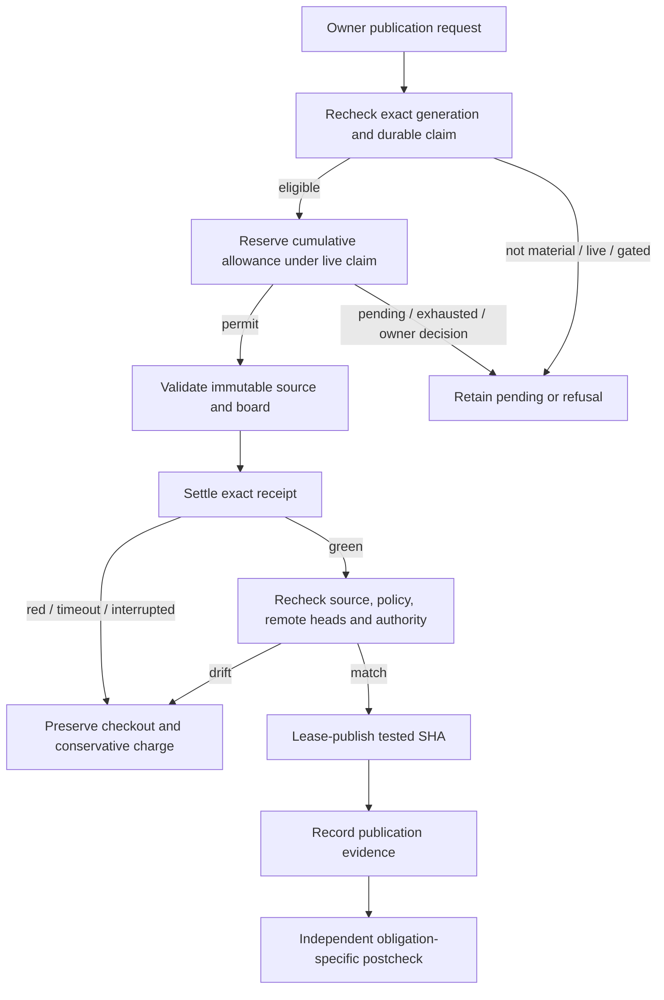
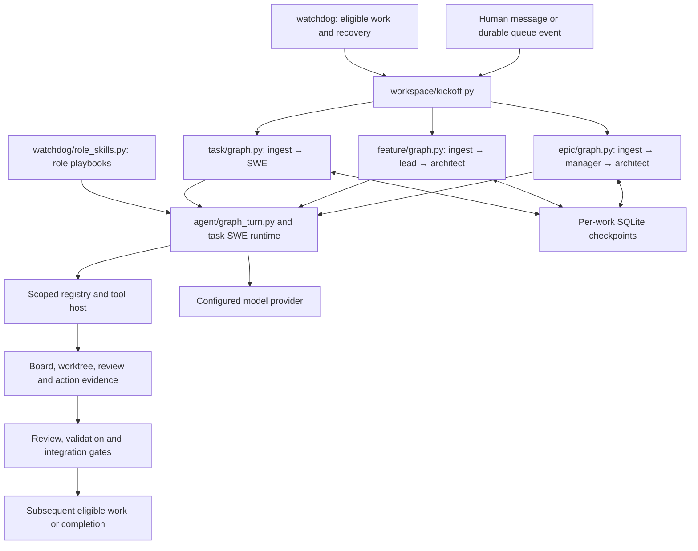
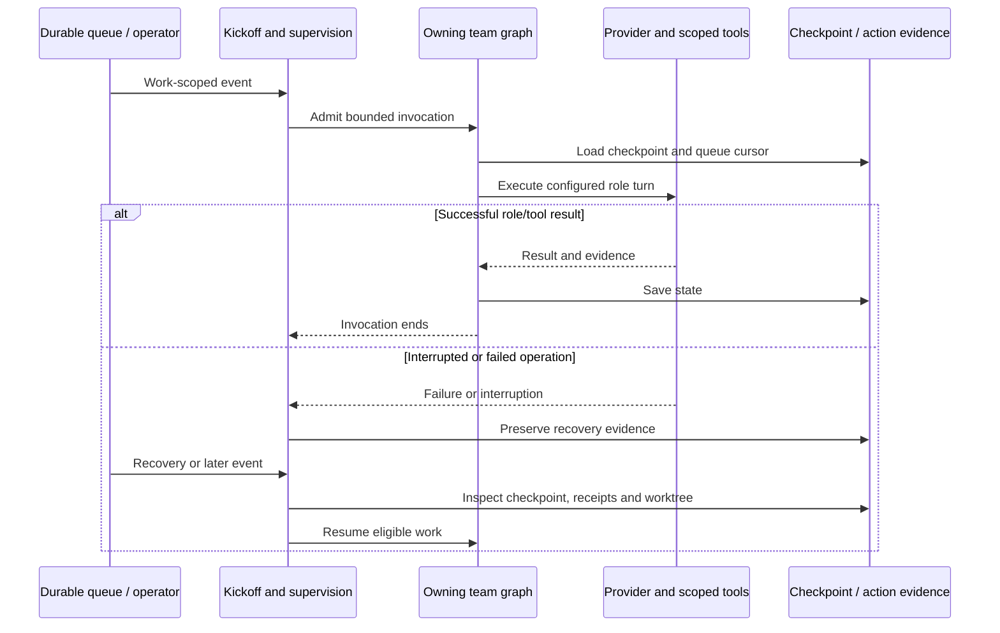
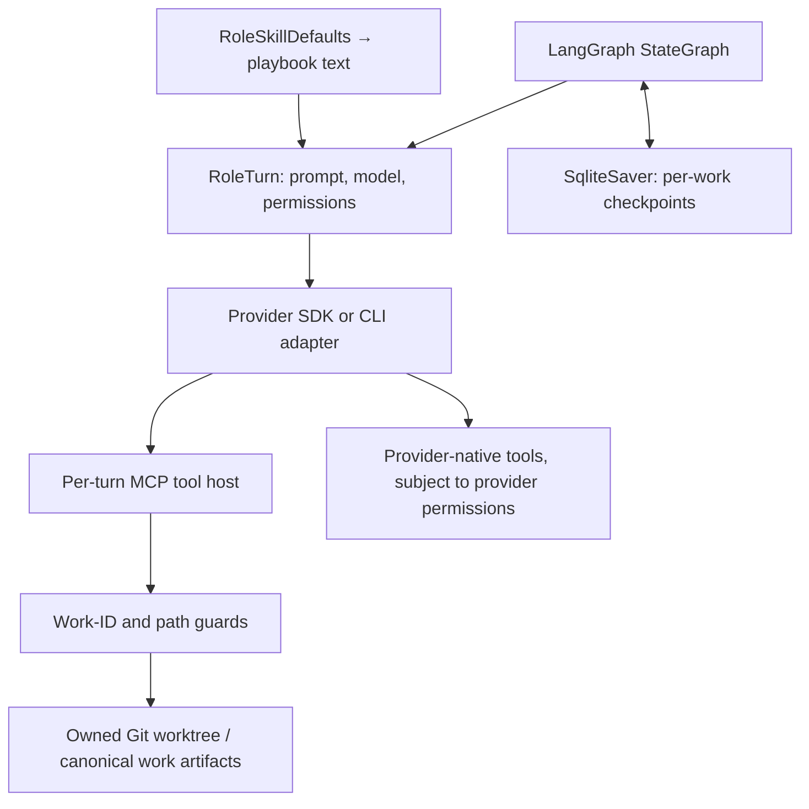
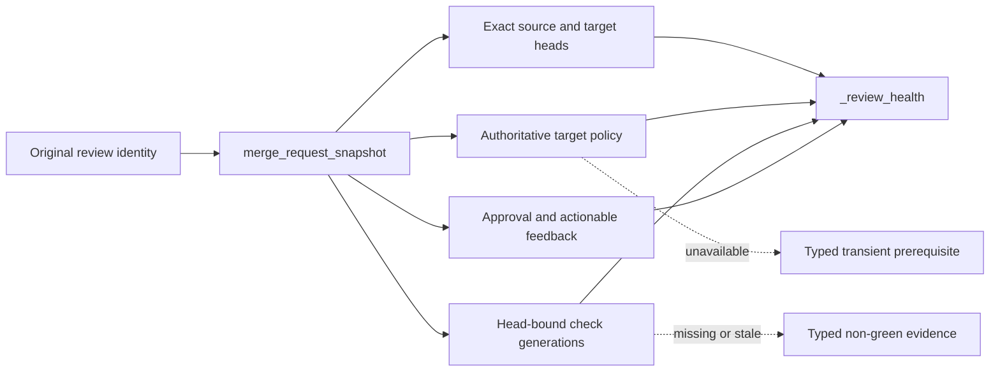
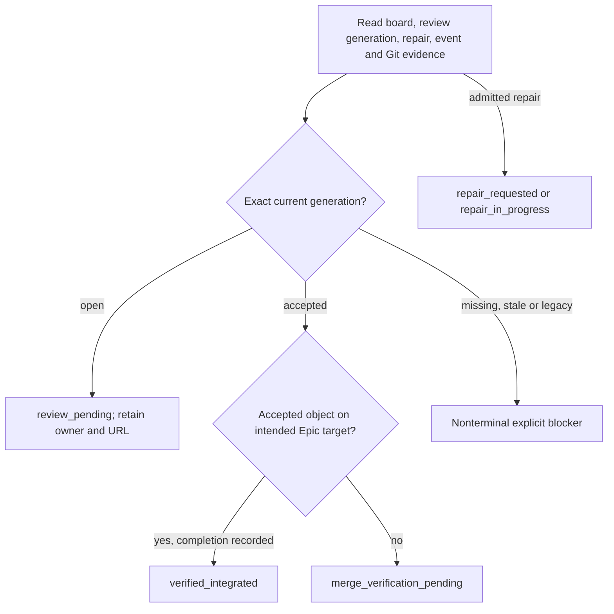

# Cascade package design

Purpose: expose the Python package and CLI composition root for repository-local delivery. Interfaces are `cascade.cli` and the domain packages below. Owns `REQ-CASCADE-001` (one local composition root) and `DEC-CASCADE-001` (domain packages remain independently testable).

Known gaps: authoritative recovery source ledgers remain monolithic, so source
write and replay cost is measured rather than claimed to be byte-bounded.

## Parent interfaces

The package boundary reconciles the leaf owners without moving their requirement or
decision IDs. `cascade.board` is the filesystem lifecycle authority; Epic, Feature,
Task, Watchdog, Boss, comments, and War Room consumers use that authority rather
than maintaining another status store. `cascade.workspace` resolves repository and
architecture destinations and supplies revision-pinned context, bounded replay,
owned proposal staging, and closeout receipts. Agent/provider execution consumes
those scoped contexts but cannot accept an architecture proposal or bypass its
owner review.

Verification references live with each owning design; unavailable evidence does
not establish a successful lifecycle transition.

## Feature approval authority

`REQ-CASCADE-APPROVAL-001`: Human authorization is durable independently of an
execution attempt. A saved approval does not establish dispatch readiness, and
an execution refusal cannot erase a saved approval. The approval service owns
mutation; [Feature evidence](feature/DESIGN.md#approval-evidence-and-readiness)
owns receipt interpretation; [Watchdog](watchdog/DESIGN.md) owns admission.

`DEC-CASCADE-APPROVAL-001`: Keep approval orchestration in the existing local
service and reuse board timestamps and Feature receipts. A separate scheduler or
approval ledger would split authority. The process lock serializes approval
checks and writes; it is not a transaction across Git and JSON or an OS sandbox.

| Entry point | Responsibility and failure boundary |
|---|---|
| [`approve_feature`, `approve_epic_plan`](approvals.py) | Resolve the canonical owning document, refresh dependency evidence, preflight selected providers, and require corrective-plan and lifecycle review checks before new approval writes. Individual approval accepts only satisfied predecessors or known `dependency_incomplete` waits in legal noncancelled lifecycle state, then refreshes the owner and declaration again before writing. Epic approval checks the Epic dependency declaration and its current child set with the strict policy. |
| [`evaluate_action_dependencies`, `require_action_dependencies`, `require_feature_approval_dependencies`](planning_action_dependencies.py) | Refresh the merged board and evaluate canonical dependency status/column evidence. The strict adapter refuses every unsatisfied dependency for minting, sign-off, Epic approval and dispatch-related planning boundaries. The individual-approval adapter permits only legal incompleteness; unknown sources, missing work, cancellation, illegal status/column evidence, or a changed owner/declaration refuse with stable reasons and affected IDs. |
| [`require_lifecycle_review_gate`](lifecycle_review_gate.py) | Apply comment and architecture gates; enforce the displayed exact review context when rollout policy requires it. |
| [`_set_feature_approved`](approvals.py) | Commit the owning Feature timestamp, then write its revision receipt through the Feature evidence owner. |
| [`reconcile_approval_dispatch`](automation.py) | Use Boss ordering and canonical Watchdog dispatch after approval when automation is enabled; later reconciliation can retry a wait. |
| [`WarRoomRequestHandler._handle_approve_feature`](war_room/server.py) | Decode the submitted review context and serialize approval/refusal. Provider and dependency failures have typed payloads; other exceptions use the generic conflict response. |

The individual HTTP result preserves `ok`, `feature_id`, `newly_approved`,
`dispatch_pending`, `dispatch_outcome`, and existing refusal fields. Additive
fields separate the authorization result from execution: `approval_result` is
`approved`, `refused`, or `unknown`; `approval_state` is the receipt-backed
`approved`, `unapproved`, `stale`, or `unknown` state; `approval_explanation`
contains a stable code and message; and `affected_work_ids` names the current
scope or wait. `execution_state` reports `waiting`, `admitted`, `completed`, or
`unknown`; `admitted` describes the canonical active board lane rather than a
claim about provider execution. A current receipt can therefore return HTTP
success with `execution_state: waiting` and `dispatch_pending: true` without
claiming that Feature execution started.

Epic plan approval additionally uses
[`require_epic_plan_ready_for_approval`](epic/plan_readiness.py), including
software prerequisite readiness and revision-bound role sign-offs. The individual
Feature handler is a local operator action but does not call the request-scoped
human identity verifier. A receipt is not proof of request authentication.

```mermaid
sequenceDiagram
    participant HTTP as Approval HTTP handler
    participant Approval as Approval service
    participant Board as Owning board document
    participant Receipt as Feature evidence
    participant Dispatch as Boss / Watchdog
    HTTP->>Approval: Feature ID and displayed review context
    Approval->>Board: Lock, refresh owner and dependency rows
    alt dependency or authorization refusal
        Approval-->>HTTP: Typed refusal before approval writes
    else satisfied or known legal predecessor wait and authorization checks pass
        Approval->>Board: Recheck unchanged owner and declaration
        Approval->>Board: Commit approved_at
        Approval->>Receipt: Persist matching revision receipt
        Approval->>Dispatch: Existing reconciliation when enabled
        Dispatch->>Receipt: Require current approval evidence
        Dispatch-->>HTTP: Admission or dispatch wait; saved approval remains
    end
    Note over Board,Receipt: Interrupted writes can leave unknown evidence; restart must not infer approval from the timestamp alone
```

Navigate `cascade-context` → `cascade-containers` →
`cascade-supervisor-components` → `cascade-approval-code` in the
[authoritative C4 views](../architecture/target-9f61bc6d6f8ae8cb7d196c8b327650d5/views.dsl).
The component `element.component.approval` owns approval orchestration and the
shared planning dependency/review adapters. Its collaborators remain distinct
components, not independently deployed processes. Feature receipt and readiness
nodes belong to `element.component.feature-team` in `cascade-feature-code`;
Watchdog admission stays in `cascade-watchdog-code`. HTTP and dashboard nodes
remain under their War Room owners.

Verification references: [approval tests](../tests/test_approvals.py),
[dependency action tests](../tests/test_planning_action_dependencies.py),
[dispatch integration](../tests/test_approval_dispatch_integration.py), and
[provider refusal tests](../tests/test_approval_selection_gate.py). These are
inspectable test locations, not a claim that an unimplemented policy is verified.

## Health-audit read boundary

`REQ-CASCADE-002`: Dashboard audit reads consume a bounded, immutable projection
epoch. The Watchdog owns source classification, reconciliation, aggregate coverage,
and publication; the War Room owns HTTP pagination and presentation. A dashboard
read cannot invoke lifecycle observation, recovery, Git, or provider work. A
missing, invalid, expired, or repository-mismatched epoch is pending or unknown,
never proof of health or authority for repair.

`DEC-CASCADE-002`: Keep producer and consumer within the existing Watchdog and
War Room components, using the product repository projection root as their shared
local interface. This preserves one source of incident authority and one read
budget at the UI boundary without a new service or C4 relationship. The producer
contract is owned by [Watchdog](watchdog/DESIGN.md#health-audit-projection-contract)
and the route contract by [War Room](war_room/DESIGN.md#health-audit-http-consumer).
The repository-owned architecture source remains
[`architecture/target-9f61bc6d6f8ae8cb7d196c8b327650d5/`](../architecture/target-9f61bc6d6f8ae8cb7d196c8b327650d5/README.md).

Verification locations: [producer tests](../tests/watchdog/test_audit_projection.py)
and [consumer tests](../tests/war_room/test_health_audit_routes.py) cover each side
of the boundary. The [integrated fixture](../tests/war_room/test_audit_integrated_experience.py) verifies the shared interface
from retained recovery sources through an immutable epoch and loopback HTTP reads.
The representative large-ledger work and byte counts are recorded by
the [producer benchmark](../tests/watchdog/benchmark_audit_producer.py) and
[GET benchmark](../tests/war_room/benchmark_audit_get.py).

## Review publication safeguards

`REQ-REVIEW-PUBLISH-001`: a Git conflict resolution is not publishable until its
physical checkout contains valid lifecycle documents with unique IDs, repository
checks succeed within a finite budget, and the admitted remote heads and source
lease still match. `review_validation.validate_publication_board` scans the actual
source checkout, including in split-repository sessions; it does not redirect to a
tracking root or silently omit malformed drafts as a normal board projection may.
Duplicate backlog/completed copies are rejected without choosing or deleting one.
This check establishes document consistency, not full Epic acceptance. It
runs on the guarded review-publication source worktree; it is not a universal
precondition on every forge merge of a changed target. Successful source
publication or forge merge alone does not prove that the actual merged target
has unique board IDs or passes its own configured CI. An independent target
check and local/remote trunk convergence remain separate evidence.

`DEC-REVIEW-PUBLISH-001`: `review_rebase.check_and_publish_review_rebase` checks the
board before spawning validation. Review publication uses changed Python test files,
direct tests for changed modules, and the review publication safeguard tests.
An explicit repository-owned `validation.command` takes precedence; Task validation
keeps its existing command. `validation.review_timeout_seconds` defaults to 300
seconds and accepts 1–3600 seconds. Validation runs without a shell in its own
process group, with file-backed output and bounded 64 KiB diagnostic tails. Timeout or cancellation
kills the check group and reaps its leader. Failure preserves the checkout and
returns a typed blocker; it never falls back to weaker checks or publishes anyway.
A hard kill of the hosting process can still orphan validator children; the owning
team must inspect those before another attempt.

`REQ-REVIEW-PUBLISH-002`: a process-interrupted publication must become actionable
rather than remain indefinitely running. Publication claims record process PID,
Linux boot identity and process start ticks. Before board-dependent work on each
watchdog pass, proven-dead owners are reconciled under the lifecycle lock: preserve
the attempt, close it as failed, clear the execution claim and enqueue one
claim-specific owner investigation. No Git operation occurs in this reconciliation.
Live owners are never reclaimed merely because a nominal lease expired. Unknown
legacy owners and unreadable process identity remain untouched, requiring operator
inspection. This is intentionally not a time-based automatic retry.

The team must re-evaluate local/remote heads, remaining validators and validation
results before publishing again. A new attempt gets a new owner-decision identity;
resolved decisions from previous attempts cannot strand the action. Existing source
lease, remote-target revalidation, authorization and approval gates remain in force.
The supervisor may report publication completed only from actual publication or
verified reconciliation evidence, never merely from an enqueued investigation.

Validation: `tests/test_review_publication_safeguards.py`,
`tests/test_review_rebase.py`, and `tests/task/test_action_recovery.py` cover invalid
boards, unchanged remotes on refusal, bounded checks, descendant cleanup, abrupt
owner exit, PID reuse, live/unknown owners and durable exactly-once handoff.

These safeguards remain inside the existing supervisor, lifecycle-recovery and
review-publication components; they add no C4 container or external service.
The Task lifecycle lock and tracking-root ledger are local serialization and
persistence boundaries, not operating-system isolation for validators or remote
provider work. Landscape/context and container boundaries are unchanged because
the budget adds no person, external system, runtime process, database or network
path; the supervisor component view shows Watchdog consuming Task's gate.

`REQ-CASCADE-RECOVERY-002`: a bounded recovery journey exposes durable stage
receipts for detected, admitted, assigned, executing, validating, publishing,
verifying, resolved, and waiting states. Every receipt identifies its actor,
scoped capability, permitted input names, authority revision and durable result.
Owner execution, provider completion, queue acknowledgement, or push is never
resolution. Only Watchdog may append `resolved`, after a fresh postcheck of the
original obligation and exact authoritative generation.

The stage envelope is additive to the existing tracking-root action and incident
records. Task remains the sole incident-budget authority; tier teams remain the
repair and publication owners; Watchdog owns independent verification. Restart
reuses the claim, generation, operation and immutable receipt identities. Native
shell, child processes and remote provider work are not isolated by this local
ledger or by C4 component boundaries.

Every production validator is admitted separately from its material publication
generation. `publish_team_review_resolution` binds the canonical incident and
policy-bearing generation, then resolves a named validation profile and reserves
the approved worst-case validator runtime
under one top-level claim and one unique operation receipt. A changed source,
target, validation profile, policy version, or interpreter environment can make a
generation materially eligible, but only remaining incident-wide allowance grants
a permit. The profile binds exact argv, coverage class, policy owner, approval
revision and finite timeout/attempt budget; executable and working-directory
feasibility is checked before spawn. Clocks and diagnostic reports are absent
from the generation. Unknown classification fails closed. A deterministic
`review_rebase` validator failure fences the settled receipt's validation
material (source tree, command, timeout, policy and runtime identity), not the
remaining incident allowance. Previously failed material stays fenced across
restart and A–B–A changes. Legacy receipts without verified material remain
conservative. Validators linked to a different original action retain the
incident-wide deterministic failure gate. Transient failure retains persisted
bounded backoff and at most three operations.
The legacy action attempt bound is never enlarged by generation admission.

`run_review_validation` verifies the live receipt before `Popen`, starts a local
process group, and settles known runtime on green, red, launch failure and timeout.
Timeout or interruption stops the complete local group; interruption retains the
worst-case reservation conservatively. Provider work is metered separately at
the shared Agent adapter boundary, which reserves a paid turn and worst-case model
runtime before dispatch and settles one normalized invocation receipt. A green check
is still insufficient to publish after source, target, validation policy,
authorization, credentials or remote lease drift. Remote ancestry reconciliation
is the authoritative completion check after an interrupted push.

### Publication implementation and recovery

The [model](../architecture/target-9f61bc6d6f8ae8cb7d196c8b327650d5/model.dsl)
and [views](../architecture/target-9f61bc6d6f8ae8cb7d196c8b327650d5/views.dsl)
connect `cascade-supervisor-components` → `cascade-teams-code` to the shared
publication pipeline. `element.component.teams` owns that pipeline;
`element.component.task-team` owns the action ledger in `cascade-task-code`.

| Source entry | Responsibility |
|---|---|
| [publish_team_review_resolution](team_review_recovery.py) | Carry canonical incident, claim and validator-operation identities from material admission through publication. |
| [admit_review_publication_generation / resume_action](task/action_recovery.py) | Preserve decisions and attempts; record material evidence without granting allowance or growing the attempt bound. |
| [bind_incident_budget / read_incident_budget](task/incident_budget.py) | Anchor every linked action and material generation to one original incident policy and expose its bounded restart-safe projection. |
| [reserve_incident_operation / settle_incident_operation](task/incident_budget.py) | Atomically issue one bounded receipt under the live claim and charge actual or conservatively retained use exactly once. |
| [admit_provider_turn / settle_provider_turn](agent/provider_metering.py) | Consume the Task-owned allowance immediately around an incident-related provider dispatch and retain normalized invocation evidence plus the validated launch route without granting route-specific allowance. |
| [extend_incident_budget / record_incident_budget_exhaustion](task/incident_budget.py) | Retain one exhaustion escalation and accept only independently authenticated finite additions within trusted maxima. |
| [reserve_budgeted_operation / settle_budgeted_operation](watchdog/reservations.py) | Consume the Task gate after a distinct Watchdog capability claim without owning another allowance. |
| [check_and_publish_review_rebase](review_rebase.py) | Check the immutable local source, validate, recheck policy/remote authority and push that SHA under the source lease. |
| [reserve_review_validation / run_review_validation](review_validation.py) | Reserve worst-case runtime before spawn, optionally bind the receipt to its live provider parent, verify the receipt, stop the process group, bound diagnostics and settle every exit. |



The action ledger and review registry survive restart. A reserved operation whose
owner disappears remains charged and cannot be replayed as a fresh permit. An
interruption after a remote effect requires independent remote-SHA observation
before another execution; publication evidence alone does not close the original
delivery obligation.
For split product/tracking roots, planning readiness and completed-child identity
come from the tracking owner, while immutable source history, validation, remote
leases and pushes remain product-worktree operations. Board cache invalidation
expires both repository-role projections so a newly minted or moved tracking
document is immediately visible to product-side dispatch and recovery.
The [Watchdog postcheck](watchdog/DESIGN.md#recovery-admission-and-active-path-authority)
owns that distinction. [The real publication journey](../tests/test_review_recovery_journey.py)
exercises timeout, restart, exhausted decisions and immutable publication.

### Historical review reconciliation and queue retention

Requirement: pruning a terminal Epic's queue must not trigger replay of all its
closed Feature reviews. Queue absence is not evidence that accepted work needs
another closeout authorization. Reconciliation reads one operator-trunk board
snapshot and treats a closed review as historical when its Feature and target
Epic are both in `3_completed` with completed status and the Feature's parent
matches that target. It skips event replay in that case; it does not synthesize
new completion events or bypass a gate for unfinished work.

Stacked integration-gap checks and repair of an incomplete registered Epic-target
copy retain priority over this fast path. Active parents, incomplete Features,
and mismatched parent relationships retain normal replay and all authorization
checks. This prevents an endless prune/replay cycle from performing full semantic
gate scans under the global lifecycle lock and starving War Room reads. No lock
is removed and no snapshot survives the reconciliation call.

Regression coverage: `tests/test_feature_closeout_flow.py` exercises absent parent
feeds, active and incomplete documents, parent mismatches, and target repair.

Legacy accepted Features can retain their completed document only in a source
worktree after a squash merge; source-tip ancestry is not a reliable acceptance
check for those records. When a closed Feature review's document is absent from
operator trunk, reconciliation may also skip historical replay if its canonical,
non-pointer terminal Epic explicitly lists that child and the merged board has a
completed child copy with the matching parent. Missing children, active copies,
unlisted children, parent mismatches, and trunk pointer Epics do not qualify.
This is only a no-op for historical replay: no completion event or lifecycle
transition is synthesized. Target-copy repair and stacked-gap checks still run
first. The source board is acquired lazily once per reconciliation call.

## Architecture navigation

Start in `cascade-context` and follow containers → components → Code. The
[C4 guide](../architecture/target-9f61bc6d6f8ae8cb7d196c8b327650d5/README.md#reading-the-implementation)
describes the levels and declaration labels. The designs below document the
behavior and verification behind each Code view.

| Container | Component | Code view | Design |
|---|---|---|---|
| Operator CLI | Workspace commands | `cascade-workspace-commands-code` | [Cascade package](DESIGN.md), [Workspace](workspace/DESIGN.md) |
| Operator CLI | Repository diagnostics | `cascade-diagnostics-code` | [Probe](probe/DESIGN.md) |
| War Room | HTTP and operator identity | `cascade-war-room-http-code` | [War Room](war_room/DESIGN.md) |
| War Room | Architecture browser | `cascade-architecture-browser-code` | [Source inspection](war_room/DESIGN.md#integrated-c4-exploration-and-source-inspection) |
| War Room | Diagram comparison | `cascade-diagram-review-code` | [Plan preview](war_room/DESIGN.md#committed-planning-comparisons-and-project-previews) |
| War Room | Dashboard and audit reads | `cascade-dashboard-code` | [Audit HTTP](war_room/DESIGN.md#health-audit-http-consumer), [recovery and transcripts](war_room/DESIGN.md#recovery-summaries-and-planning-transcripts) |
| Service | Approval authority | `cascade-approval-code` | [Approval authority](#feature-approval-authority) |
| Service | Board | `cascade-board-code` | [Board](board/DESIGN.md) |
| Service | Agent runtime | `cascade-agent-code` | [Agent](agent/DESIGN.md) |
| Service | Tier teams | `cascade-teams-code` | [Team execution](#team-execution) |
| Service | Epic team | `cascade-epic-code` | [Epic](epic/DESIGN.md#implementation-and-navigation) |
| Service | Feature team | `cascade-feature-code` | [Feature](feature/DESIGN.md#implementation-and-navigation) |
| Service | Task team | `cascade-task-code` | [Task](task/DESIGN.md#implementation-and-navigation) |
| Service | Watchdog | `cascade-watchdog-code` | [Watchdog](watchdog/DESIGN.md) |
| Service | Boss | `cascade-boss-code` | [Boss](boss/DESIGN.md) |
| Service | Workspace | `cascade-workspace-code`, `cascade-comparison-render-code` | [Workspace](workspace/DESIGN.md#c4-code-model-and-rendering-contract) |
| Service | Comments and amendments | `cascade-collaboration-code` | [Comments](comments/DESIGN.md), [Amendments](amendments/DESIGN.md) |

Current recovery progress crosses the Task, Watchdog and Dashboard boundaries:
Task retains authoritative transition receipts, Watchdog joins exact live and
postcheck evidence into immutable work-addressed pages, and Dashboard owns the
safe versioned presentation contract. The producer and restart/failure flow is
owned by the [Recovery progress design](recovery_progress/DESIGN.md); the
[Watchdog summary](watchdog/DESIGN.md#current-recovery-progress-publication)
describes its supervisor integration without duplicating that ownership.

## Team execution

A team is a persisted graph plus scoped tools, role configuration, and an owned
work context. It is not a collection of permanently running independent agents.
Epic and Feature graphs each sequence two role turns; Task graphs run one SWE
turn. Repeated invocations continue a work item's checkpointed state.



The graph's END is an invocation boundary. It does not replace lifecycle gates.
Work creation tools establish the Epic → Feature → Task hierarchy; parent roles
coordinate children through canonical artifacts and events, rather than calling
a child graph as a nested function.



Recovery must distinguish a completed external action from a failed invocation;
blindly repeating a Git publication or lifecycle transition is unsafe.
[Team supervision](team_supervision.py), [branch action recovery](team_branch_recovery.py),
and [review recovery](team_review_recovery.py) own the shared recovery boundaries.
Per-tier designs link the graph, state, checkpoint, registry and wiring modules.
The [Workspace invocation boundary](workspace/DESIGN.md#graph-invocation-and-transcript-handoff)
owns process-local turn evidence; the [Task action ledger](task/DESIGN.md#action-evidence-and-transcript-boundary)
owns durable claims and attempts plus the exact executor-entry projection.
Invocation and executor tokens are short-lived observations bound to the current
worker process generation; queue ownership, PID existence, a legacy owner, or an
inaccessible process cannot establish execution and the observations never grant
repair authority. The [War Room transcript](war_room/DESIGN.md#recovery-summaries-and-planning-transcripts)
records presentable replies after invocation return and receipt-keyed recovery
milestones. Its historical HTTP surface reads only writer-published immutable
pages and bounded oversized-message chunks; authoritative JSONL and the writer
index are not GET surfaces. These separate facts do not establish independently
verified recovery completion.

## Team libraries, wiring, and isolation

The team implementation uses Python, LangGraph's `StateGraph` for role sequencing,
and `langgraph-checkpoint-sqlite`'s `SqliteSaver` for resumable state. Dependency
constraints live in [pyproject.toml](../pyproject.toml). Graph compilation and
checkpoint caching happen in each tier's `graph.py` and `checkpoint.py`.
The graph invokes roles sequentially; parallel work comes from separately
admitted work items, not parallel nodes within one team invocation.

[Planning turns](agent/graph_turn.py) load role playbooks, construct the scoped
prompt, and delegate to [provider execution](agent/planning_turn.py).
[Task wiring](task/wiring.py) creates the worktree, loads SWE playbooks into
checkpoint state, and installs lifecycle hooks. [SWE turns](task/swe_turn.py)
construct a `RoleTurn` and expose the [SWE MCP tools](task/swe_mcp.py).
Registries bind work IDs and repository roots to the permitted tools; provider
adapters translate the turn into the configured SDK or CLI invocation.



Isolation has several distinct boundaries:

| Boundary | What it guarantees and what it does not |
|---|---|
| [Planning scratch directory](agent/planning_sandbox.py) | Materializes planning context into a temporary working directory. This is context isolation, not an OS security sandbox. |
| [Task worktree](task/worktree.py) | Separates Git changes for a Task. A worktree does not isolate the host filesystem, processes, or network. |
| [Task tool guard](task/guard.py) | Checks reads/writes through Cascade tools, rejects paths escaping the worktree and symlink bypasses, and restricts lifecycle document access. It does not mediate every provider-native shell operation. |
| [Epic guard](epic/guard.py) / [Feature guard](feature/guard.py) | Restricts planning tool access to the owning work scope and permitted related documents. |
| [Codex adapter](agent/codex_cli.py) | SWE uses `workspace-write` unless permission mode is `yolo`; `yolo` explicitly bypasses approvals and sandboxing. |
| [Claude adapter](agent/claude_cli.py) | Supplies scoped MCP configuration and, in `yolo` mode, requests permission bypass. It does not establish a universal Cascade OS sandbox. |
| [Preflight](agent/execution_preflight.py) | Checks provider capabilities before execution. It does not prove that every provider implements identical isolation. |

Do not infer container-level isolation from a C4 container, a planning scratch
directory, or a Task worktree. Actual native-tool restrictions depend on the
selected provider and permission configuration. Supervised validation and
delivery gates are correctness controls, separate from process isolation.

Integrated Structurizr fourth-level views: `cascade-teams-code`, `cascade-epic-code`, `cascade-feature-code`, and `cascade-task-code`. Explore the corresponding component directly to inspect its functions/types, wiring, checkpoint library, tool guards, and provider adapter; select a node to open pinned source.


## Architecture contract ownership

The [War Room](war_room/DESIGN.md#integrated-c4-exploration-and-source-inspection)
owns fourth-level navigation, pinned source previews and browser interaction.
[Workspace](workspace/DESIGN.md#c4-code-model-and-rendering-contract) owns
semantic scope, validation, bounded rendering and historical snapshot identity.
The plan page's [single-diagram comparison](war_room/DESIGN.md#single-diagram-architecture-differences)
uses Workspace's [derived comparison artifacts](workspace/DESIGN.md#derived-comparison-rendering);
these display changes across two pinned revisions without replacing either
revision's authored model or its acceptance evidence.
[Watchdog role skills](watchdog/DESIGN.md#architecture-authoring-skill-delivery)
provide the authoring contract to planning, implementation and completion-review
roles. These are linked requirements, not duplicate ownership declarations.

## Delivery and review boundaries

`REQ-REVIEW-EVIDENCE-001`: [merge_request_snapshot](tracking.py) preserves the
original forge review identity while reporting the observed URL and route, exact
source and target heads, mergeability, human approval or actionable feedback,
and required-check policy and results. Required checks come only from the target
branch's authoritative forge policy. An empty check listing is not an empty
policy; an empty policy is valid only when the policy endpoint or project
configuration confirms it. Policy, target-head, result and feedback failures
remain explicit unavailable evidence.

`REQ-REVIEW-EVIDENCE-002`: Check results retain their forge check-run or pipeline
generation and source head. The newest generation for each required name wins,
so an older green result cannot mask a newer failure. Classification distinguishes
failed, pending, missing, stale, green, approval-only wait, actionable human
feedback, conflicting or moving heads, transient unavailable evidence and terminal
review disposition. Forge response text is data and is never used as a shell or
validation command.

`DEC-REVIEW-EVIDENCE-001`: Keep forge normalization at the existing scripted
Runner boundary in `cascade.tracking`. Fixed `gh api` and `glab api` argument
vectors make production adapters replaceable by deterministic tests without a
second forge client, credential store, scheduler or persistence boundary.



Normal evidence flow is exercised by the GitHub and GitLab scripted transport
cases in [tracking adapter tests](../tests/test_tracking_find.py), including a
confirmed empty target policy and newest-generation selection. The same tests
cover unavailable policy, a missing required result, stale source evidence and a
newer failure after an older success. The integrated Watchdog Code view is
[`cascade-watchdog-code`](../architecture/target-9f61bc6d6f8ae8cb7d196c8b327650d5/views.dsl)
and its source contract pins both normalization and classification symbols.
The [Watchdog open-review contract](watchdog/DESIGN.md#open-review-observation)
owns the next boundary: actionable normalized evidence joins one Feature repair
generation, while pending, missing, stale, approval-only and unavailable evidence
remains a non-provider wait. The existing team adapter and Feature action ledger
own admission and restart deduplication; this package boundary adds no scheduler,
CI runner, provider launcher or merge authority.
Watchdog bounds each current normalized observation and persists it in the
canonical review registry before classification can route work. The
[War Room projection contract](war_room/DESIGN.md#accountable-open-review-projection)
defines the lossless check-name, generation and serialized-size limits. Persistence failure remains
a typed evidence-unavailable wait, so War Room and delivery projections never
derive repair authority from an observation they cannot inspect after restart.
The shared [`feature_review_views`](review.py) reader applies the same lossless
name, generation and normalized-payload bounds to current rows and to legacy,
repair-request and verification-postcheck fallbacks. It returns at most twenty
sorted checks plus an omitted count. An invalid fallback cannot retain green,
verified or fresh presentation and instead names `refresh_review_observation`;
Board, Feature-room and HTTP consumers receive that same result without a forge,
provider, lifecycle or ledger write.
Affected queued Task actions in same-Epic dependent Features retain the upstream
blocker, exact review route and material evidence generation through the
[Task delivery fence](task/DESIGN.md#durable-delivery-collaborators).
Watchdog observes evidence, Task owns retry charging, and the independent repair
postcheck remains the only release evidence.

After restart the registry and action ledger remain the only inputs to this
passive path. [`_review_health`](tracking.py) requires the exact review identity,
head pair and a non-boolean generation-bearing result for every required check;
[`_route_actionable_review_health`](review_health.py) binds those facts to one
repair generation. [`_required_checks`](watchdog/incident_postcheck.py) repeats
the exact-head and generation checks against fresh forge evidence, and
[`mark_feature_repair_verified`](feature/repair.py) accepts only its matching
independent receipt. Display row omission never changes those authoritative
comparisons.

`REQ-CASCADE-RECOVERY-001`: Scoped parent supervision verifies the direct-child
relationship before delegating recovery. Durable attempts, acknowledgements and
verified lifecycle results are distinct evidence.
`REQ-REVIEW-REPAIR-001`: Review acceptance is evidence about a forge review and
its observed revisions; publication uses the guarded review workflow. Each
Feature registry entry retains immutable generation rows and one current
compatibility projection. Only a callback matching the current generation,
URL and source/target route can satisfy closeout; historical acceptance remains
inspectable but cannot approve later repair code.
`REQ-REVIEW-REPAIR-002`: Repair publication observes the recorded review at the
forge before selecting a route. A scoped open-review repair can refresh only its
admitted original URL, forge and source/target route; its observed generation and
heads must match before the first push, and replay joins the checkpointed action.
Merged, closed, missing or changed original reviews fail closed without creating
a follow-up. Legacy accepted-review follow-up remains a distinct route and cannot
be selected by this scoped action. Reconciliation binds callbacks to their
immutable generation and exact accepted source/target heads, while independent
target integration remains a separate closeout obligation.
Independent repair verification obtains policy and check results from the same
fresh normalized snapshot as the observed original review. Registry-cached check
facts and a prior verified phase cannot satisfy Boss closeout; the accepted merge
remains on the fresh intended Epic target.
`REQ-REVIEW-DELIVERY-001`: [feature_delivery_view](review.py) and its bulk form
derive a Feature's delivery phase from the canonical board row, current immutable
review generation, admitted repair action, completion event, and local
intended-target ancestry. The projection retains the accountable Feature team and
original review URL while evidence is nonterminal. `generation` includes the
admitted obligation; nullable `published_generation` identifies the independently
persisted review receipt (including generation zero), so delivery does not mistake
a pending repair for a published review. Missing, legacy, stale, or
closed-unmerged evidence cannot create accepted heads or report verified
integration. Review-disabled delivery uses the same completion-event and local
ancestry proof. These reads do not poll the forge, publish a review, admit repair,
or mutate lifecycle stores.

`DEC-REVIEW-DELIVERY-001`: Integration-required execution consumers use
[`feature_delivery_satisfies_integration`](review.py) over one current projection
per decision. Watchdog Task dispatch, Feature recovery dispatch, Boss Task
visibility and serial Feature dispatch wait on every nonterminal delivery phase.
The separate lifecycle dependency evaluator remains a planning-readiness
projection. Explicit stacked Feature dispatch may execute from its selected
predecessor branch while the predecessor is not yet integrated into the Epic;
no other consumer treats that exception as verified target delivery.

Verification for `REQ-REVIEW-DELIVERY-001` is in the
[review-generation tests](../tests/feature/test_review_generations.py), including
missing and closed-unmerged evidence, active versus published generations,
intended-target ancestry and read-only projection behavior.
The real-Git [delivery consumer tests](../tests/test_feature_delivery_consumer_gates.py)
verify Watchdog, recovery, Boss and serial/stacked Feature decisions against the
same current evidence.



If a process stops after pushing and opening a review but before storing its
generation, recovery may reuse the discovered review only after a fresh forge
snapshot reports the exact source and target refs and heads for the prepared
publication and an open state. Missing or changed authoritative evidence keeps
the generation unpublished; a route-shaped review alone is not a receipt.
`DEC-CASCADE-RECOVERY-001`: Preserve a single local lifecycle authority across
team adapters, watchdog claims and Boss delivery, with repository-specific state
resolved through Workspace.

Lifecycle callers use Workspace's exact mutation-owner contract before changing
planning documents. The merged board remains suitable for status projection and
selection display, but its preferred row cannot authorize a write; ambiguity or
changed registry/branch identity fails closed with a recovery action.

Parent-checkout retirement uses that same owner contract to enumerate terminal
descendants. For a Feature it first consumes the shared delivery projection and
requires verified current-generation intended-Epic integration or an explicit
supported terminal disposition. Only then may it verify descendant Task delivery
or Feature completion evidence, persist absent Markdown records to the authorized
parent destination, and re-read them before removal. Boss remains the lifecycle
caller; Workspace owns the proof and existing board, execution, review, Git and
registry artifacts remain the only durable state. Refusal preserves the source
branch, checkout and registry.

[team_supervision.py::supervise_child](team_supervision.py) delegates Task
recovery to [Feature recovery](feature/recovery.py). A queued Task merge refused
with `not_active` while its Feature is completed is a
`parent_lifecycle_mismatch`, not a transient merge. The original action retains
its validation pair, refusal and attempts; its canonical generation binds exact
owner/status, delivery and repair identities, tested heads, review obligation,
approval/comment/dependency gates, and execution lease. An unchanged supervisor
sweep observes that generation without claiming another merge attempt. Feature
recovery passes the exact generation through the existing `feature_repair`
inspect/admit/resume operation and reports request, acknowledgement, execution,
refusal and authoritative verification as separate fields.
Feature-child recovery otherwise inspects incidents and queues a deduplicated
team wakeup.
[epic/recovery.py::recover_feature](epic/recovery.py) exposes that immediate-parent
adapter. An exact open-review request is routed through
[request_feature_review_repair](team_supervision.py), which admits the shared
Feature action before asking Workspace to deliver its stable queue event. Direct
Epic authority must match the Feature parent; authenticated-human authority must
be minted by the human boundary. The projection keeps requested, admitted,
acknowledged, executing/executed, waiting/refused and verification
pending/verified states distinct and binds the action ID and generation. Queue
acknowledgement never claims execution or verification. Epic supervision also
verifies the registered Feature owner and direct Task relationship, then invokes
the same generation-bound Feature repair adapter;
other incidents retain the deduplicated handoff path. Audit recovery resolves a
`feature.feature_repair` capability for the exact Task/Feature pair, reserves and
accepts one claim, and only then invokes that adapter. Missing capability creates
one bounded investigation handoff when an eligible planning owner exists, or
retains the probe's exact operator prerequisite. A wakeup, message, or accepted
claim does not by itself perform or verify a completed-to-active transaction.
The Watchdog-owned postcheck rereads canonical owner, board, action, execution,
review and worktree registries and changes only the exact deferred incident to
verified history after every owed generation fact is proven. Projection
publication and War Room GET consume that result; neither performs the postcheck
or schedules recovery.
[review.py::ensure_feature_review](review.py) and
[reconcile_feature_review_completions](review.py) persist review state and consume
forge acceptance. Generation rows bind the repair action, forge identity,
source/target refs and observed heads, accepted merge SHA, publication action and
reconciliation status. Legacy rows are represented as generation zero; absent
accepted heads remain unknown rather than being inferred from completed board
position or a historical URL. GitHub observations request the CLI-supported
`commits` field and pin the source revision to the final commit OID; an empty or
malformed commit list is unavailable evidence. Repair publication also requires
that observed OID to equal the generation's recorded source head, so a moving
source branch is refused before publication.
Late delivery can carry a superseded completed Feature path back onto the source
branch. Review preparation restores only the exact active path named by the
durable repair receipt before pinning the tested publication SHA. After forge
acceptance, target closeout mutates the Epic checkout directly; an accepted
stacked-review projection cannot bypass that target postcondition. Boss consumes
the same delivery projection before its completed-document fast path: only exact
current-generation acceptance whose merge is reachable from the intended Epic
target can emit normal completion or release retirement. Callback flags, green
checks, closed-unmerged rows and stale source/target heads remain nonterminal.
For an admitted open-review repair, Watchdog additionally binds the original
review identity, current corrected source head, authoritative normalized required
check policy/results and Epic-target integration before Boss may record the
generation verified or retire its owner checkout. Unavailable policy, check or
forge evidence remains a typed prerequisite in the existing repair action.

Implementation ownership and integrated Code views are in
[Workspace](workspace/DESIGN.md#work-ownership-and-retirement),
[Boss](boss/DESIGN.md#delivery-and-closeout),
[Watchdog](watchdog/DESIGN.md#recovery-admission-and-active-path-authority),
[Feature](feature/DESIGN.md), [Epic](epic/DESIGN.md) and [Task](task/DESIGN.md).
The authoritative [model](../architecture/target-9f61bc6d6f8ae8cb7d196c8b327650d5/model.dsl)
keeps these in the existing supervisor and repository containers; Python modules
are not separately deployed services. Guarded tools constrain agent operations;
repository locks serialize mutations, without claiming OS filesystem isolation.
Verification: [supervision tests](../tests/test_planning_manifest_and_team_controls.py),
[review health](../tests/test_review_health.py), and
[tracking adapter](../tests/test_tracking_find.py). The real-repository
[late-repair convergence test](../tests/test_late_repair_convergence.py) injects
the post-push/pre-receipt stop and checks unavailable, changed and exact replay
evidence across colocated and split roots.
