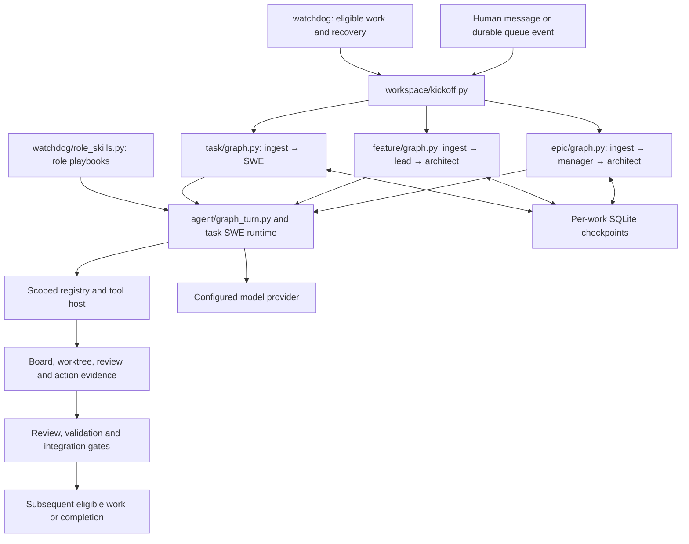
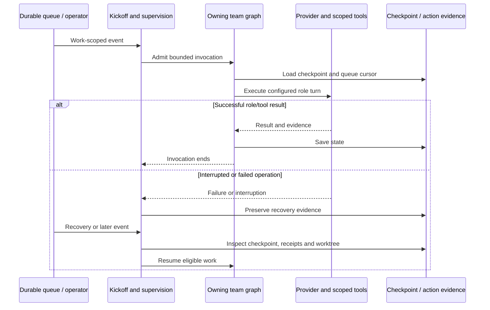
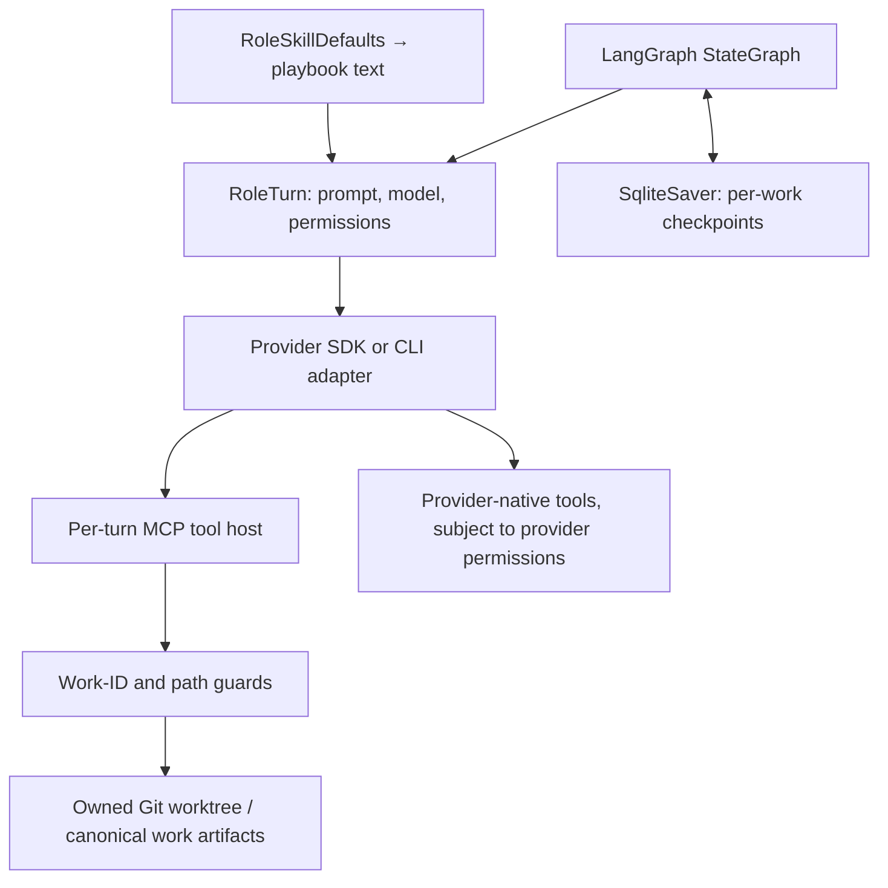

# Cascade package design

Purpose: expose the Python package and CLI composition root for repository-local delivery. Interfaces are `cascade.cli` and the domain packages below. Owns `REQ-CASCADE-001` (one local composition root) and `DEC-CASCADE-001` (domain packages remain independently testable).

## Parent interfaces

The package boundary reconciles the leaf owners without moving their requirement or
decision IDs. `cascade.board` is the filesystem lifecycle authority; Epic, Feature,
Task, Watchdog, Boss, comments, and War Room consumers use that authority rather
than maintaining another status store. `cascade.workspace` resolves repository and
architecture destinations and supplies revision-pinned context, bounded replay,
owned proposal staging, and closeout receipts. Agent/provider execution consumes
those scoped contexts but cannot accept an architecture proposal or bypass its
owner review.

Verification references live with each owning design; unavailable evidence does
not establish a successful lifecycle transition.

## Health-audit read boundary

`REQ-CASCADE-002`: Dashboard audit reads consume a bounded, immutable projection
epoch. The Watchdog owns source classification, reconciliation, aggregate coverage,
and publication; the War Room owns HTTP pagination and presentation. A dashboard
read cannot invoke lifecycle observation, recovery, Git, or provider work. A
missing, invalid, expired, or repository-mismatched epoch is pending or unknown,
never proof of health or authority for repair.

`DEC-CASCADE-002`: Keep producer and consumer within the existing Watchdog and
War Room components, using the product repository projection root as their shared
local interface. This preserves one source of incident authority and one read
budget at the UI boundary without a new service or C4 relationship. The producer
contract is owned by [Watchdog](watchdog/DESIGN.md#health-audit-projection-contract)
and the route contract by [War Room](war_room/DESIGN.md#health-audit-http-consumer).
The repository-owned architecture source remains
[`architecture/target-9f61bc6d6f8ae8cb7d196c8b327650d5/`](../architecture/target-9f61bc6d6f8ae8cb7d196c8b327650d5/README.md).

Verification locations: [producer tests](../tests/watchdog/test_audit_projection.py)
and [consumer tests](../tests/war_room/test_health_audit_routes.py) cover each side
of the boundary. The [integrated fixture](../tests/war_room/test_audit_integrated_experience.py) verifies the shared interface
from retained recovery sources through an immutable epoch and loopback HTTP reads.
The representative large-ledger work and byte counts are recorded by
the [producer benchmark](../tests/watchdog/benchmark_audit_producer.py) and
[GET benchmark](../tests/war_room/benchmark_audit_get.py).

## Review publication safeguards

`REQ-REVIEW-PUBLISH-001`: a Git conflict resolution is not publishable until its
physical checkout contains valid lifecycle documents with unique IDs, repository
checks succeed within a finite budget, and the admitted remote heads and source
lease still match. `review_validation.validate_publication_board` scans the actual
source checkout, including in split-repository sessions; it does not redirect to a
tracking root or silently omit malformed drafts as a normal board projection may.
Duplicate backlog/completed copies are rejected without choosing or deleting one.
This check establishes document consistency, not full Epic acceptance.

`DEC-REVIEW-PUBLISH-001`: `review_rebase.check_and_publish_review_rebase` checks the
board before spawning validation. Review publication uses changed Python test files,
direct tests for changed modules, and the review publication safeguard tests.
An explicit repository-owned `validation.command` takes precedence; Task validation
keeps its existing command. `validation.review_timeout_seconds` defaults to 300
seconds and accepts 1–3600 seconds. Validation runs without a shell in its own
process group, with file-backed output and bounded 64 KiB diagnostic tails. Timeout or cancellation
kills the check group and reaps its leader. Failure preserves the checkout and
returns a typed blocker; it never falls back to weaker checks or publishes anyway.
A hard kill of the hosting process can still orphan validator children; the owning
team must inspect those before another attempt.

`REQ-REVIEW-PUBLISH-002`: a process-interrupted publication must become actionable
rather than remain indefinitely running. Publication claims record process PID,
Linux boot identity and process start ticks. Before board-dependent work on each
watchdog pass, proven-dead owners are reconciled under the lifecycle lock: preserve
the attempt, close it as failed, clear the execution claim and enqueue one
claim-specific owner investigation. No Git operation occurs in this reconciliation.
Live owners are never reclaimed merely because a nominal lease expired. Unknown
legacy owners and unreadable process identity remain untouched, requiring operator
inspection. This is intentionally not a time-based automatic retry.

The team must re-evaluate local/remote heads, remaining validators and validation
results before publishing again. A new attempt gets a new owner-decision identity;
resolved decisions from previous attempts cannot strand the action. Existing source
lease, remote-target revalidation, authorization and approval gates remain in force.
The supervisor may report publication completed only from actual publication or
verified reconciliation evidence, never merely from an enqueued investigation.

Validation: `tests/test_review_publication_safeguards.py`,
`tests/test_review_rebase.py`, and `tests/task/test_action_recovery.py` cover invalid
boards, unchanged remotes on refusal, bounded checks, descendant cleanup, abrupt
owner exit, PID reuse, live/unknown owners and durable exactly-once handoff.

These safeguards remain inside the existing supervisor, lifecycle-recovery and
review-publication components; they add no C4 container or external service.

### Historical review reconciliation and queue retention

Requirement: pruning a terminal Epic's queue must not trigger replay of all its
closed Feature reviews. Queue absence is not evidence that accepted work needs
another closeout authorization. Reconciliation reads one operator-trunk board
snapshot and treats a closed review as historical when its Feature and target
Epic are both in `3_completed` with completed status and the Feature's parent
matches that target. It skips event replay in that case; it does not synthesize
new completion events or bypass a gate for unfinished work.

Stacked integration-gap checks and repair of an incomplete registered Epic-target
copy retain priority over this fast path. Active parents, incomplete Features,
and mismatched parent relationships retain normal replay and all authorization
checks. This prevents an endless prune/replay cycle from performing full semantic
gate scans under the global lifecycle lock and starving War Room reads. No lock
is removed and no snapshot survives the reconciliation call.

Regression coverage: `tests/test_feature_closeout_flow.py` exercises absent parent
feeds, active and incomplete documents, parent mismatches, and target repair.

Legacy accepted Features can retain their completed document only in a source
worktree after a squash merge; source-tip ancestry is not a reliable acceptance
check for those records. When a closed Feature review's document is absent from
operator trunk, reconciliation may also skip historical replay if its canonical,
non-pointer terminal Epic explicitly lists that child and the merged board has a
completed child copy with the matching parent. Missing children, active copies,
unlisted children, parent mismatches, and trunk pointer Epics do not qualify.
This is only a no-op for historical replay: no completion event or lifecycle
transition is synthesized. Target-copy repair and stacked-gap checks still run
first. The source board is acquired lazily once per reconciliation call.

## Architecture navigation

Start in `cascade-context` and follow containers → components → Code. The
[C4 guide](../architecture/target-9f61bc6d6f8ae8cb7d196c8b327650d5/README.md#reading-the-implementation)
describes the levels and declaration labels. The designs below document the
behavior and verification behind each Code view.

| Container | Component | Code view | Design |
|---|---|---|---|
| Operator CLI | Workspace commands | `cascade-workspace-commands-code` | [Cascade package](DESIGN.md), [Workspace](workspace/DESIGN.md) |
| Operator CLI | Repository diagnostics | `cascade-diagnostics-code` | [Probe](probe/DESIGN.md) |
| War Room | HTTP and operator identity | `cascade-war-room-http-code` | [War Room](war_room/DESIGN.md) |
| War Room | Architecture browser | `cascade-architecture-browser-code` | [Source inspection](war_room/DESIGN.md#integrated-c4-exploration-and-source-inspection) |
| War Room | Diagram comparison | `cascade-diagram-review-code` | [Plan preview](war_room/DESIGN.md#committed-planning-comparisons-and-project-previews) |
| War Room | Dashboard and audit reads | `cascade-dashboard-code` | [Audit HTTP](war_room/DESIGN.md#health-audit-http-consumer) |
| Service | Board | `cascade-board-code` | [Board](board/DESIGN.md) |
| Service | Agent runtime | `cascade-agent-code` | [Agent](agent/DESIGN.md) |
| Service | Tier teams | `cascade-teams-code` | [Team execution](#team-execution) |
| Service | Epic team | `cascade-epic-code` | [Epic](epic/DESIGN.md#implementation-and-navigation) |
| Service | Feature team | `cascade-feature-code` | [Feature](feature/DESIGN.md#implementation-and-navigation) |
| Service | Task team | `cascade-task-code` | [Task](task/DESIGN.md#implementation-and-navigation) |
| Service | Watchdog | `cascade-watchdog-code` | [Watchdog](watchdog/DESIGN.md) |
| Service | Boss | `cascade-boss-code` | [Boss](boss/DESIGN.md) |
| Service | Workspace | `cascade-workspace-code`, `cascade-comparison-render-code` | [Workspace](workspace/DESIGN.md#c4-code-model-and-rendering-contract) |
| Service | Comments and amendments | `cascade-collaboration-code` | [Comments](comments/DESIGN.md), [Amendments](amendments/DESIGN.md) |

## Team execution

A team is a persisted graph plus scoped tools, role configuration, and an owned
work context. It is not a collection of permanently running independent agents.
Epic and Feature graphs each sequence two role turns; Task graphs run one SWE
turn. Repeated invocations continue a work item's checkpointed state.

The graph's END is an invocation boundary. It does not replace lifecycle gates.
Work creation tools establish the Epic → Feature → Task hierarchy; parent roles
coordinate children through canonical artifacts and events, rather than calling
a child graph as a nested function.

Recovery must distinguish a completed external action from a failed invocation;
blindly repeating a Git publication or lifecycle transition is unsafe.
[Team supervision](team_supervision.py), [branch action recovery](team_branch_recovery.py),
and [review recovery](team_review_recovery.py) own the shared recovery boundaries.
Per-tier designs link the graph, state, checkpoint, registry and wiring modules.

## Team libraries, wiring, and isolation

The team implementation uses Python, LangGraph's `StateGraph` for role sequencing,
and `langgraph-checkpoint-sqlite`'s `SqliteSaver` for resumable state. Dependency
constraints live in [pyproject.toml](../pyproject.toml). Graph compilation and
checkpoint caching happen in each tier's `graph.py` and `checkpoint.py`.
The graph invokes roles sequentially; parallel work comes from separately
admitted work items, not parallel nodes within one team invocation.

[Planning turns](agent/graph_turn.py) load role playbooks, construct the scoped
prompt, and delegate to [provider execution](agent/planning_turn.py).
[Task wiring](task/wiring.py) creates the worktree, loads SWE playbooks into
checkpoint state, and installs lifecycle hooks. [SWE turns](task/swe_turn.py)
construct a `RoleTurn` and expose the [SWE MCP tools](task/swe_mcp.py).
Registries bind work IDs and repository roots to the permitted tools; provider
adapters translate the turn into the configured SDK or CLI invocation.

Isolation has several distinct boundaries:

| Boundary | What it guarantees and what it does not |
|---|---|
| [Planning scratch directory](agent/planning_sandbox.py) | Materializes planning context into a temporary working directory. This is context isolation, not an OS security sandbox. |
| [Task worktree](task/worktree.py) | Separates Git changes for a Task. A worktree does not isolate the host filesystem, processes, or network. |
| [Task tool guard](task/guard.py) | Checks reads/writes through Cascade tools, rejects paths escaping the worktree and symlink bypasses, and restricts lifecycle document access. It does not mediate every provider-native shell operation. |
| [Epic guard](epic/guard.py) / [Feature guard](feature/guard.py) | Restricts planning tool access to the owning work scope and permitted related documents. |
| [Codex adapter](agent/codex_cli.py) | SWE uses `workspace-write` unless permission mode is `yolo`; `yolo` explicitly bypasses approvals and sandboxing. |
| [Claude adapter](agent/claude_cli.py) | Supplies scoped MCP configuration and, in `yolo` mode, requests permission bypass. It does not establish a universal Cascade OS sandbox. |
| [Preflight](agent/execution_preflight.py) | Checks provider capabilities before execution. It does not prove that every provider implements identical isolation. |

Do not infer container-level isolation from a C4 container, a planning scratch
directory, or a Task worktree. Actual native-tool restrictions depend on the
selected provider and permission configuration. Supervised validation and
delivery gates are correctness controls, separate from process isolation.

Integrated Structurizr fourth-level views: `cascade-teams-code`, `cascade-epic-code`, `cascade-feature-code`, and `cascade-task-code`. Explore the corresponding component directly to inspect its functions/types, wiring, checkpoint library, tool guards, and provider adapter; select a node to open pinned source.

## Architecture contract ownership

The [War Room](war_room/DESIGN.md#integrated-c4-exploration-and-source-inspection)
owns fourth-level navigation, pinned source previews and browser interaction.
[Workspace](workspace/DESIGN.md#c4-code-model-and-rendering-contract) owns
semantic scope, validation, bounded rendering and historical snapshot identity.
The plan page's [single-diagram comparison](war_room/DESIGN.md#single-diagram-architecture-differences)
uses Workspace's [derived comparison artifacts](workspace/DESIGN.md#derived-comparison-rendering);
these display changes across two pinned revisions without replacing either
revision's authored model or its acceptance evidence.
[Watchdog role skills](watchdog/DESIGN.md#architecture-authoring-skill-delivery)
provide the authoring contract to planning, implementation and completion-review
roles. These are linked requirements, not duplicate ownership declarations.

## Delivery and review boundaries

`REQ-CASCADE-RECOVERY-001`: Scoped parent supervision verifies the direct-child
relationship before delegating recovery. Durable attempts, acknowledgements and
verified lifecycle results are distinct evidence.
`REQ-REVIEW-REPAIR-001`: Review acceptance is evidence about a forge review and
its observed revisions; publication uses the guarded review workflow. Each
Feature registry entry retains immutable generation rows and one current
compatibility projection. Only a callback matching the current generation,
URL and source/target route can satisfy closeout; historical acceptance remains
inspectable but cannot approve later repair code.
`REQ-REVIEW-REPAIR-002`: Repair publication observes the recorded review at the
forge before selecting a route. A confirmed open review can be refreshed at the
same URL; a confirmed merged review requires a linked follow-up from the retained
Feature branch to its owning Epic branch. Unknown or conflicting state fails
closed. Reconciliation binds callbacks to their immutable generation and exact
accepted source/target heads, while independent target integration remains a
separate closeout obligation.
`DEC-CASCADE-RECOVERY-001`: Preserve a single local lifecycle authority across
team adapters, watchdog claims and Boss delivery, with repository-specific state
resolved through Workspace.

Lifecycle callers use Workspace's exact mutation-owner contract before changing
planning documents. The merged board remains suitable for status projection and
selection display, but its preferred row cannot authorize a write; ambiguity or
changed registry/branch identity fails closed with a recovery action.

Parent-checkout retirement uses that same owner contract to enumerate terminal
descendants, verify their existing Task delivery or Feature completion/review
evidence, persist absent Markdown records to the authorized parent destination,
and re-read them before removal. Boss remains the lifecycle caller; Workspace
owns the proof and existing board, execution, review, Git and registry artifacts
remain the only durable state. Refusal preserves the source branch and checkout.

[team_supervision.py::supervise_child](team_supervision.py) delegates Task
recovery to [Feature recovery](feature/recovery.py). A queued Task merge refused
with `not_active` while its Feature is completed is a
`parent_lifecycle_mismatch`, not a transient merge. The original action retains
its validation pair, refusal and attempts; its canonical generation binds exact
owner/status, delivery and repair identities, tested heads, review obligation,
approval/comment/dependency gates, and execution lease. An unchanged supervisor
sweep observes that generation without claiming another merge attempt. Feature
recovery passes the exact generation through the existing `feature_repair`
inspect/admit/resume operation and reports request, acknowledgement, execution,
refusal and authoritative verification as separate fields.
Feature-child recovery otherwise inspects incidents and queues a deduplicated
team wakeup.
[epic/recovery.py::recover_feature](epic/recovery.py) exposes that immediate-parent
adapter. A wakeup does not perform a completed-to-active transaction.
[review.py::ensure_feature_review](review.py) and
[reconcile_feature_review_completions](review.py) persist review state and consume
forge acceptance. Generation rows bind the repair action, forge identity,
source/target refs and observed heads, accepted merge SHA, publication action and
reconciliation status. Legacy rows are represented as generation zero; absent
accepted heads remain unknown rather than being inferred from completed board
position or a historical URL.

Implementation ownership and integrated Code views are in
[Workspace](workspace/DESIGN.md#work-ownership-and-retirement),
[Boss](boss/DESIGN.md#delivery-and-closeout),
[Watchdog](watchdog/DESIGN.md#recovery-admission-and-active-path-authority),
[Feature](feature/DESIGN.md), [Epic](epic/DESIGN.md) and [Task](task/DESIGN.md).
The authoritative [model](../architecture/target-9f61bc6d6f8ae8cb7d196c8b327650d5/model.dsl)
keeps these in the existing supervisor and repository containers; Python modules
are not separately deployed services. Guarded tools constrain agent operations;
repository locks serialize mutations, without claiming OS filesystem isolation.
Verification: [supervision tests](../tests/test_planning_manifest_and_team_controls.py),
[review health](../tests/test_review_health.py), and
[tracking adapter](../tests/test_tracking_find.py).
