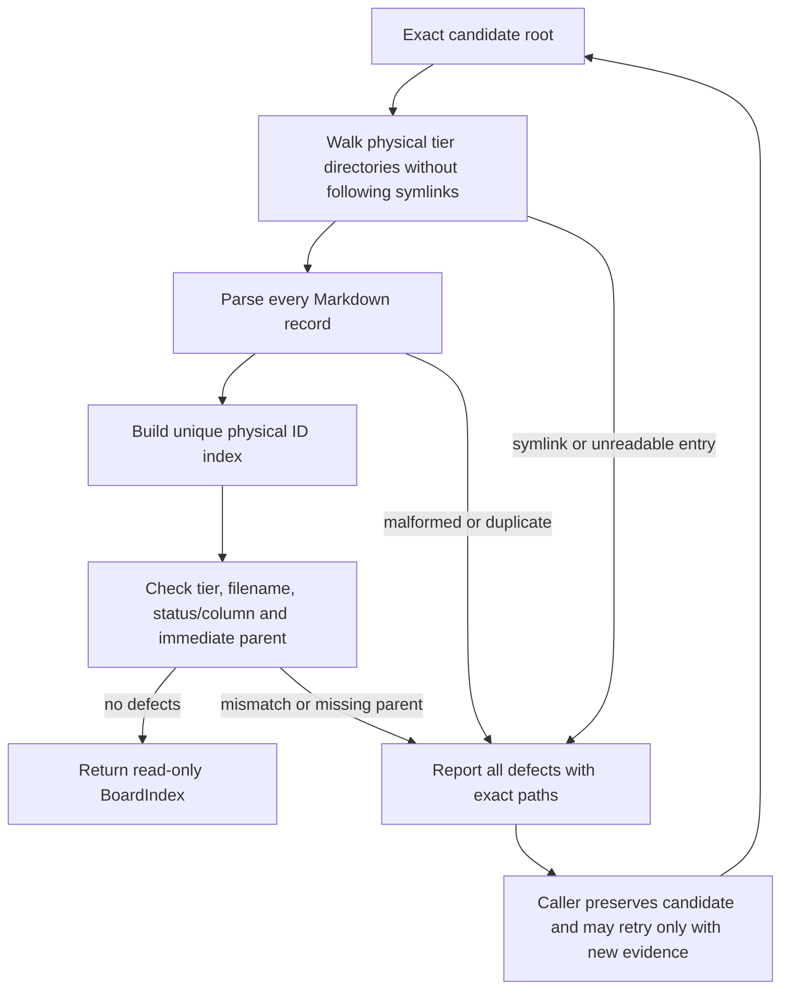

# Board design

Purpose: make Markdown work documents and directory columns canonical lifecycle state. Interfaces are `WorkDoc`/`WorkMeta`, parse/validate, board stores, moves, indexing, and hierarchical ID allocation. Owns `REQ-BOARD-001` (filesystem state is authoritative) and `DEC-BOARD-001` (folder/frontmatter mismatches fail closed).

Implementation: [types](types.py), [parser](parse.py), [schema validation](validate.py),
[store](store.py) and [ID allocation](work_ids.py). Verification is in
[board tests](../../tests/board/) and the
[physical publication safeguards](../../tests/test_review_publication_safeguards.py).

## Lifecycle mutation owner interface

Board columns and frontmatter remain the lifecycle truth under `REQ-BOARD-001`,
but a merged board row is a read projection across several checkouts. Board-store
Lifecycle moves obtain their filesystem root through Workspace's
[`resolve_mutation_owner`](../workspace/integration_worktree.py); column rank and
historical completed copies cannot grant write authority. Missing or conflicting
registered ownership fails before a document move or write. The exact ownership
contract and typed refusal belong to
[`REQ-WORKSPACE-OWNER-001`](../workspace/DESIGN.md#work-ownership-and-retirement).

[`list_board`](store.py) rejects two parseable files with the same work ID in one
physical checkout, including stale backlog and completed copies. It does not
pick a winner or mutate files. The merged-board projection can combine
historical copies from distinct checkouts and intentionally omits malformed
drafts from ordinary reads.

[`scan_physical_board`](store.py) is the fail-closed candidate-tree interface for
`REQ-BOARD-001`. It recursively reads Markdown records beneath every physical
tier without following symlinks, aggregates malformed records and duplicate IDs,
then applies [`validate_physical_identity`](validate.py) to tier, filename,
status/column and immediate-parent identity. Every refusal includes the exact
physical path, and duplicate records remain unselected. The supplied root is the
complete evidence boundary: the scan never calls tracking-root resolution or a
merged-board projection. In a split-repository deployment the caller must supply
the applicable physical tracking checkout; an absent second root is unavailable
evidence rather than permission to infer, redirect, repair or delete records.
Terminal-history and cancellation-provenance comparison remains a separate
admission proof.

Schema parsing is visible in `cascade-board-code`; the calling publication
scan is owned by Teams in
[cascade-teams-code](../../architecture/target-9f61bc6d6f8ae8cb7d196c8b327650d5/views.dsl)
and [the package publication contract](../DESIGN.md#publication-implementation-and-recovery).
The [model](../../architecture/target-9f61bc6d6f8ae8cb7d196c8b327650d5/model.dsl)
links Teams' `validate_publication_board` to the Board-owned physical scanner,
parser and identity validator. Neither projection ranking nor physical
validation grants lifecycle mutation authority.

## Safe frontmatter scan performance

Worktree board scans may read thousands of records during a cold War Room request.
Use the available libyaml `CSafeLoader`, falling back to Python `SafeLoader`, with
unchanged schema parsing and safe-constructor restrictions. No loader may construct
Python objects from a work document. Existing file identity/mtime caches remain
unchanged, and mutations still validate current authoritative state. Tests exercise
both loaders, round trips and rejection of unsafe tags.
