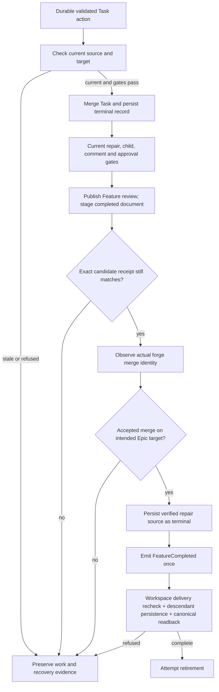
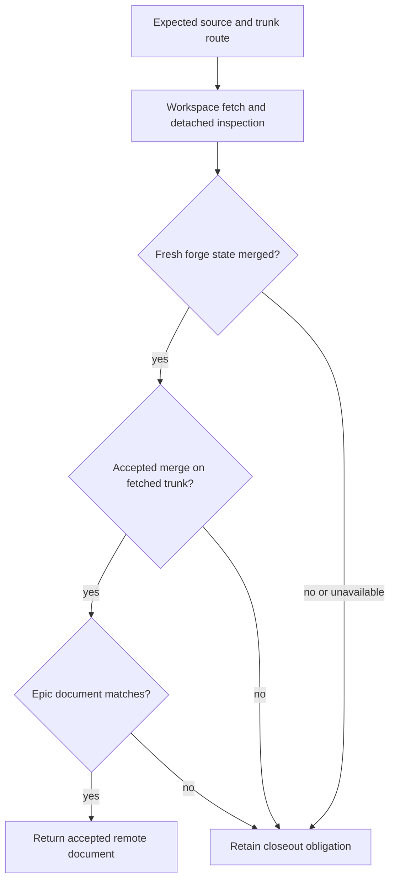

# Boss orchestration design

Purpose: coordinate cross-tier rollups, Task merges, completion gates, and operator status. Interfaces are the boss graph, `merge_task_branch`, completion/rollup handlers, orphan detection, and `BossView`. Owns `REQ-BOSS-001` (integration respects tier gates) and `DEC-BOSS-001` (merge authority stays outside ephemeral Task agents).

## Delivery and closeout

`REQ-BOSS-CLOSEOUT-001`: Normal Feature closeout checks child completion,
comments and review gates under the canonical lifecycle lock. A completed-path
Feature can still have an open review; document position alone is not forge
acceptance. [current_feature_obligation](rollup.py) also requires the current
repair generation's reserved or original child to be terminal without a live lease, the
current approval and dependencies. For review-enabled delivery it consumes the
shared [Feature delivery projection](../review.py) and requires exact acceptance
of the current generation plus independent ancestry of that merge on the
intended Epic branch. A merge callback, green checks, a closed forge row, stale
heads, or an accepted merge that is absent from the target cannot authorize the
completion event. Open-review repair first asks Watchdog for a fresh independent
postcheck outside the lifecycle critical section; only the resulting exact action,
generation, corrected-head, required-check and Epic-integration receipt can make
that repair historical. Boss consumes the fresh return value instead of trusting
the action's prior verified phase, so a later failed run, target drift or
unavailable policy blocks completion. Review-disabled delivery retains its
supervised local merge proof. This predicate runs before the completed fast path
and its result gates both `FeatureCompleted` and checkout retirement.
Repair publication deliberately retains an active Feature document in its source
checkout. After the independent receipt verifies the accepted merge on the
intended Epic target, Boss moves that exact source document to completed before
retirement proof. Admission, green checks, publication, or forge acceptance alone
cannot perform this terminal source mutation.
In split-root operation, a completed tracking projection with an exact
delivery-pending repair can still enter guarded review publication; it is not
mistaken for terminal delivery merely because the tracking copy is completed.
For the legacy repair route, the active delivery generation may exist before its
review is published.
Once the exact repair child is delivered and all current gates pass, a missing
or older published generation is `review_not_published`, selecting idempotent
review publication/recovery even for a completed-path Feature (including split
tracking/product roots). An open current review or newer mismatched publication
cannot authorize closeout or trigger a replacement review; scoped open-review
repairs still use the independent postcheck and original-review publication path.

Epic closeout accepts a Feature in `3_completed` with status `cancelled` only
when cleanup completed without error and the canonical Epic contains the matching
resolved `continue_reduced_scope` feedback (same child, parent, reason and
cancellation timestamp). The cancelled Feature remains historical, not delivered;
missing, stale, unresolved, replacement/replan or parent-cancellation dispositions
still block this gate. The publication checkout must not contain an open child copy.
All normal review, architecture, and comment gates continue to apply.
`DEC-BOSS-CLOSEOUT-001`: Keep supervised Git integration and rollup outside the
Task agent, preserving validation evidence and returning refusals to its durable
queue instead of discarding the source checkout.
Under `REQ-BOSS-001`, Boss invokes Workspace's descendant-aware retirement proof under
the existing lifecycle authority after accepted Feature/Epic closeout. Boss logs
the proof's missing evidence and owner action and leaves the branch, checkout and
registry intact on refusal; it does not rank board copies or maintain a second
retirement ledger. Workspace independently rereads the same shared Feature
delivery projection before it persists descendants, so a stale callback or an
unsynchronized intended Epic target cannot exploit time between Boss closeout
and checkout retirement.

The [model](../../architecture/target-9f61bc6d6f8ae8cb7d196c8b327650d5/model.dsl)
and [views](../../architecture/target-9f61bc6d6f8ae8cb7d196c8b327650d5/views.dsl)
connect `cascade-context` → `cascade-containers` →
`cascade-supervisor-components` → `cascade-boss-code` for
`element.component.boss`. [Workspace](../workspace/DESIGN.md#work-ownership-and-retirement)
owns branch preflight and retirement; [Task](../task/DESIGN.md) owns validation
and durable attempts; [package review contracts](../DESIGN.md#delivery-and-review-boundaries)
own forge state. These functions collaborate within the local supervisor.

| Entry point | Responsibility |
|---|---|
| [merge_task_branch](merge.py) | Lifecycle lock; validate current delivery, target, comments and architecture; merge and persist completion. |
| [retry_pending_task_merges](../task_rollup.py) | Resume durable queued actions; retain source/target validation metadata and attempt history. |
| [try_complete_feature](rollup.py) | Serialize rollup; stage completed document for review and reconcile accepted closeout. |
| [_complete_verified_repair_source](rollup.py) | After the fresh closeout gate, persist the retained active source document as completed before retirement; absent or already terminal source is an idempotent no-op. |
| [reconcile_open_review_repair](../watchdog/incident_postcheck.py) | Collect fresh forge/check evidence before the lifecycle lock and persist an unchanged exact-generation verification receipt. |
| [current_feature_obligation](rollup.py) | Fence completed closeout and retirement to the current repair and review generation. |
| [_current_open_review_postcheck_matches](rollup.py) | Bind the fresh postcheck result to the greatest scoped repair action before any closeout side effect. |
| [feature_delivery_view](../review.py) | Derive retained Feature ownership and delivery phase from current local review, repair, completion, and target evidence without polling the forge. |
| [feature_review_generation](../review.py) | Read immutable per-generation review facts; top-level fields remain the current compatibility projection. |
| [feature_review_pending](../review.py) | Read an unclosed registry row or the completed-document preparation window; missing acceptance is not a completed delivery receipt. |
| [_require_repair_review_route](../review.py) | Compare a repair review's URL and source/target route with fresh forge facts before reuse or acceptance. |
| [_require_open_review_repair_identity](../review.py) | Join scoped repair publication to the admitted original review identity, observation or checkpointed action. |
| [matching_exact_result_receipt](../review.py) | Re-read the Task-owned settled receipt and compare complete candidate, review, profile and runtime identity before acceptance and independent repair verification. |
| [_actual_accepted_merge_identity](../review.py) | Require forge URL, route, source, actual merge SHA and observed target head for the current review generation without substituting ancestry or the prospective candidate. |
| [ensure_feature_review / reconcile_feature_review_completions](../review.py) | Publish and observe current forge evidence; call closeout after acceptance. |
| [task_lifecycle_lock](../task/lifecycle_lock.py) | Reentrant process lock then tracking-trunk `flock`; synchronizes execution, actions and lifecycle mutation. |
| [prove_terminal_retirement](../workspace/integration_worktree.py) | Recheck terminal shared Feature delivery, then verify and canonically persist every terminal descendant before best-effort checkout retirement. |

An admitted scoped open-review repair reuses the original review only when its
durable URL, forge, source/target route, observed generation and heads still
agree with the registry and a fresh forge snapshot. Its current generation then
records the newly published source and target heads under the same URL and
publication action. Merged, closed, missing, unknown or conflicting forge facts
stop this route before push or review creation. Other already-admitted legacy
delivery routes may retain their linked follow-up behavior; they cannot be
selected by an open-review repair action. Registry writes are atomic, so restart
joins the checkpointed repair generation without creating a duplicate review.

Actions in `executions.json` retain authoritative delivery and repair evidence;
the pending merge list is a scheduling index. Feature records in `reviews.json`
have a schema version, immutable `generations`, and `current_generation`; their
top-level fields project the current generation for compatibility. A generation
binds its repair action, route, observed heads, accepted merge, publication
action and reconciliation status. Restart retries queued actions and polls the
same current row. A stale callback fails its generation/URL/ref fence and cannot
close or retire a newer obligation. A queued Task merge refused with `not_active`
because its Feature is completed is a `parent_lifecycle_mismatch`. The durable
action retains its validation evidence and authoritative generation; unchanged
observations do not claim another merge attempt. The immediate parent routes
that generation through Feature repair admission before delivery resumes.

Verification: [merge tests](../../tests/boss/test_merge.py),
[rollup tests](../../tests/boss/test_rollup.py),
[queue tests](../../tests/task/test_rollup_queue.py), and
[completion integration](../../tests/test_completion_rollup_integration.py).
The [late-repair convergence journey](../../tests/test_late_repair_convergence.py)
exercises parent admission, one reserved repair Task, current-head publication,
fresh checks, human merge, independent postcheck, terminal source persistence,
and retirement against real temporary Git repositories.

## Epic remote acceptance

Under `REQ-BOSS-001`, [`_merged_epic_review_landed`](epic_complete.py) requires
the expected Epic source and configured trunk target. It obtains a
[fresh detached remote-trunk workspace](../workspace/DESIGN.md#remote-trunk-inspection-and-synchronization),
observes the forge review as merged, and requires its accepted merge SHA to be
an ancestor of that fetched revision. It then checks the Epic document: an
active document must match the source blob, while a completed document must
match title, children and body. Missing registration, unavailable forge evidence,
wrong route, absent merge ancestry or document mismatch returns no accepted
document. The caller retains the closeout obligation.

This proves acceptance and document presence on the observed remote revision;
it does not independently establish required CI on the accepted merge SHA,
validate every physical board record, or synchronize the operator checkout.
The review registry and Git remain the evidence stores. Restart repeats remote
inspection, and normal context-manager exit cleans the private checkout.

The [model](../../architecture/target-9f61bc6d6f8ae8cb7d196c8b327650d5/model.dsl)
and [views](../../architecture/target-9f61bc6d6f8ae8cb7d196c8b327650d5/views.dsl)
connect `cascade-boss-code` → `element.code.boss.merged-epic` → Workspace's
`element.code.workspace.verified-trunk`. These are collaborators in one local
runtime, not isolated services. The shared
[review evidence contract](../DESIGN.md#delivery-and-review-boundaries) owns
forge normalization; [Workspace](../workspace/DESIGN.md) owns checkout cleanup.

## Feature approval and dispatch

Feature approval authorizes the Epic-authored Feature scope, not an immutable
copy of every planning detail. The standard Data structures, API contracts,
Logic flow, Task breakdown, Risks & upward questions, Decision log and
Candidate repair and delivery handoff sections are delegated planning/handoff
sections. Updates there retain the existing
human approval. Scope, acceptance requirements, other document sections,
title, parent and model/provider/reasoning selections remain authorization
inputs. Dependencies are independently re-evaluated at dispatch; new children
remain unapproved, including late corrective children. Corrective dispositions
requiring current-revision dual sign-off retain exact-plan approval.

[Approval evidence](../feature/readiness_evidence.py) retains the original
timestamp and full approved revision, and separately binds the approved scope.
The supervisor can migrate legacy records from an exact matching current or
bounded historical owning-document revision; missing proof never authorizes
work. This migration is action-boundary work, not a board poll. Existing
architecture tuple, affected-work, comment, provider and dependency gates
remain authoritative.

[BossView](view.py) identifies candidates without a forge poll. Its Task
dependency filter consumes the same
persisted [Feature delivery projection](../review.py) as canonical dispatch, so
a closed row, missing or stale generation, or accepted commit absent from the
intended target is not advertised as dispatchable. The projection's local Git
ancestry check is bounded and read-only. [Canonical dispatch](../watchdog/dispatch.py) rechecks all
gates and [plans the base](../stacked_dispatch.py), including multiple
predecessors; it never starts a branch lacking required ancestry. A previously
selected base can be replanned only before an integration checkout exists.

A review merged into a still-open stacked predecessor is accepted by the forge,
but is not yet delivered to the Epic. The review ledger retains that merge's
original URL/base, generation and accepted commit; the board shows **Merged ·
awaiting upstream integration** and the child disappears from the open-review
queue without releasing integration-dependent gates. After the predecessor is
accepted on the Epic, close the child only if its merge is in Epic ancestry or
the predecessor's exact accepted source contains it and its accepted integration
commit is reachable from the Epic. Otherwise the existing stacked-review gap
recovery remains authoritative.
