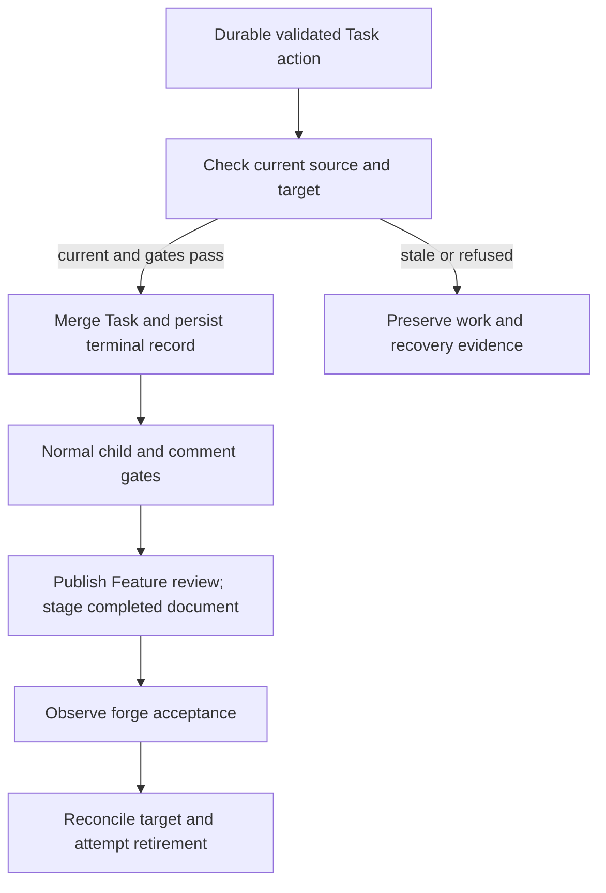

# Boss orchestration design

Purpose: coordinate cross-tier rollups, Task merges, completion gates, and operator status. Interfaces are the boss graph, `merge_task_branch`, completion/rollup handlers, orphan detection, and `BossView`. Owns `REQ-BOSS-001` (integration respects tier gates) and `DEC-BOSS-001` (merge authority stays outside ephemeral Task agents).

## Delivery and closeout

`REQ-BOSS-CLOSEOUT-001`: Normal Feature closeout checks child completion,
comments and review gates under the canonical lifecycle lock. A completed-path
Feature can still have an open review; document position alone is not forge
acceptance.
`DEC-BOSS-CLOSEOUT-001`: Keep supervised Git integration and rollup outside the
Task agent, preserving validation evidence and returning refusals to its durable
queue instead of discarding the source checkout.

The [model](../../architecture/target-9f61bc6d6f8ae8cb7d196c8b327650d5/model.dsl)
and [views](../../architecture/target-9f61bc6d6f8ae8cb7d196c8b327650d5/views.dsl)
connect `cascade-context` → `cascade-containers` →
`cascade-supervisor-components` → `cascade-boss-code` for
`element.component.boss`. [Workspace](../workspace/DESIGN.md#work-ownership-and-retirement)
owns branch preflight and retirement; [Task](../task/DESIGN.md) owns validation
and durable attempts; [package review contracts](../DESIGN.md#delivery-and-review-boundaries)
own forge state. These functions collaborate within the local supervisor.

| Entry point | Responsibility |
|---|---|
| [merge_task_branch](merge.py) | Lifecycle lock; validate current delivery, target, comments and architecture; merge and persist completion. |
| [retry_pending_task_merges](../task_rollup.py) | Resume durable queued actions; retain source/target validation metadata and attempt history. |
| [try_complete_feature](rollup.py) | Serialize rollup; stage completed document for review and reconcile accepted closeout. |
| [ensure_feature_review / reconcile_feature_review_completions](../review.py) | Publish and observe current forge evidence; call closeout after acceptance. |
| [task_lifecycle_lock](../task/lifecycle_lock.py) | Reentrant process lock then tracking-trunk `flock`; synchronizes execution, actions and lifecycle mutation. |

Actions in `executions.json` retain authoritative delivery evidence; the pending
merge list is a scheduling index. Review records live in `reviews.json`. Restart
retries queued actions and polls reviews. `not_active` is currently treated with
transient merge waits. The already-completed closeout branch runs before normal
child gates and may retire on a merged-review callback; it does not establish a
separate later repair obligation. These are concrete limits of the current flow.

Verification: [merge tests](../../tests/boss/test_merge.py),
[rollup tests](../../tests/boss/test_rollup.py),
[queue tests](../../tests/task/test_rollup_queue.py), and
[completion integration](../../tests/test_completion_rollup_integration.py).
