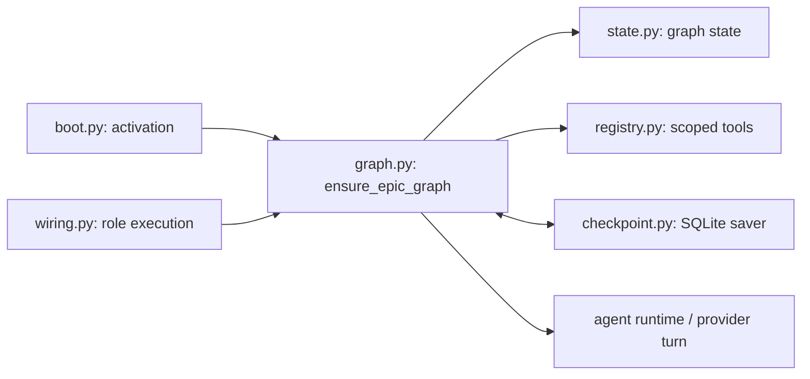

# Epic team design

Purpose: run the persistent strategic team that owns Epic planning, decisions, approvals, and Feature coordination. Interfaces are Epic graph/boot/wiring, guarded tools, approvals, briefing/checkpoint state, and amendment reads. Owns `REQ-EPIC-001` (strategic context persists) and `DEC-EPIC-001` (Epic tools are scope-guarded).

Evidence: `cascade/epic/` and `tests/epic/` at baseline `d932f48764cc0ceb2f4810cdd4487bef0c9ef084`; inventory digest `d86a5977ca42a2fd7da1ca80dc7b3251a8522f1a427e836c0abed741a816f1b6`.

Known gaps: exact child Task revisions for the A-F handoff remain unavailable.

## Readiness projection versus authorization

The board API calls `project_epic_plan_readiness` with its coherent response board
snapshot. This avoids one complete registered-worktree scan per visible unapproved
Epic. The public compute/require paths used for action authorization continue to
refresh dependencies and do not trust that UI snapshot, even when a caller supplies
a cached board. Both paths share the same readiness calculation and explanations;
only their evidence acquisition differs.

## Implementation and navigation

The [C4 team view](../../architecture/target-9f61bc6d6f8ae8cb7d196c8b327650d5/views.dsl) has key
`cascade-team-components`; the parent view is `cascade-supervisor-components`.
See the [cross-team execution diagram](../DESIGN.md#team-execution).
This team is a checkpointed LangGraph, not a separate operating-system service.
The manager and architect execute within the supervisor's bounded turn lifecycle.

| Implementation | Responsibility |
|---|---|
| [boot.py](boot.py) | Seeds activation context and model selections. |
| [graph.py](graph.py) | Compiles the graph, ingests events, and executes role turns. |
| [state.py](state.py) | Defines checkpointed role, message, and queue state. |
| [checkpoint.py](checkpoint.py) | SQLite state under `.cascade/checkpoints/<work-id>.sqlite`; thread ID is the work ID. |
| [registry.py](registry.py) and [wiring.py](wiring.py) | Scoped tool registration and execution wiring. |
| [role skills](../watchdog/role_skills.py) | Resolves the default playbooks, including design authoring/review. |

## Turn lifecycle

Ending an invocation does not mean the work item is complete. Later events resume
the work's graph state. Queue offsets prevent already consumed events from being
treated as new input. Checkpoints retain execution context; Markdown work state,
Git history, and durable action receipts remain the delivery evidence.

Provider failures, tool authorization failures, and blocked review gates do not
authorize advancing lifecycle state. Recovery inspects durable state and the
preserved worktree before resuming the owning team. See
[shared supervision](../team_supervision.py) and
[branch recovery](../team_branch_recovery.py).

Verification: [graph and lifecycle tests](../../tests/epic/).

The two roles run sequentially within each invocation. Their durable context survives child work turnover; the graph does not spawn a parallel role process for each node.

Libraries, provider/MCP wiring, and the precise sandbox boundaries are described in [Team libraries, wiring, and isolation](../DESIGN.md#team-libraries-wiring-and-isolation).

The integrated Structurizr code view is `cascade-epic-code`. From the supervisor components view, Explore **Epic team**; select a code node for its pinned source. This view is the navigable implementation structure; the diagrams above supplement it with lifecycle context.
