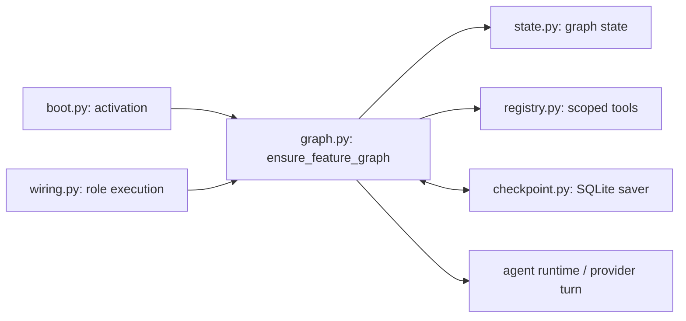
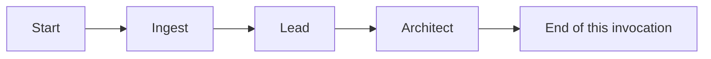
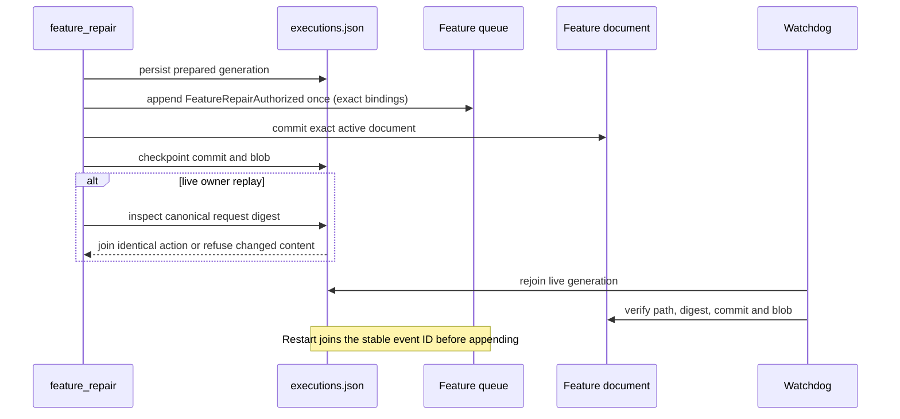
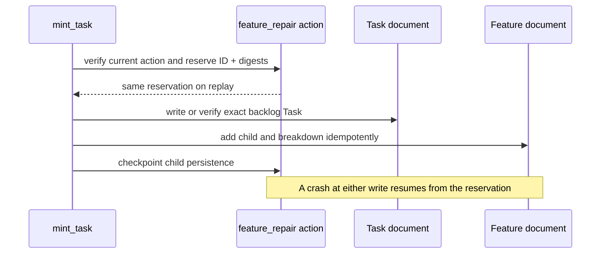

# Feature team design

Purpose: run the persistent tactical team that decomposes Features, responds to review, and coordinates Task integration. Interfaces are Feature graph/boot/wiring, guarded Task creation, publication/review polling, comments, briefing, and branch recovery. Owns `REQ-FEATURE-001` (Feature context survives Task turnover) and `DEC-FEATURE-001` (Task writes and ancestor reads are guarded).

## Implementation and navigation

The [C4 team view](../../architecture/target-9f61bc6d6f8ae8cb7d196c8b327650d5/views.dsl) has key
`cascade-team-components`; the parent view is `cascade-supervisor-components`.
See the [cross-team execution diagram](../DESIGN.md#team-execution).
This team is a checkpointed LangGraph, not a separate operating-system service.
The lead and architect execute within the supervisor's bounded turn lifecycle.

| Implementation | Responsibility |
|---|---|
| [boot.py](boot.py) | Seeds activation context and model selections. |
| [graph.py](graph.py) | Compiles the graph, ingests events, executes role turns, and assigns each authored lead/architect reply a durable ID before checkpoint persistence. |
| [state.py](state.py) | Defines checkpointed role, message, and queue state. |
| [checkpoint.py](checkpoint.py) | SQLite state under `.cascade/checkpoints/<work-id>.sqlite`; thread ID is the work ID. |
| [registry.py](registry.py) and [wiring.py](wiring.py) | Scoped tool registration and execution wiring. |
| [repair.py](repair.py) | Persists generation-bound admission, idempotent authority, child identity, and delivery progress; its read model projects the latest open-review repair generation for operator views. |
| [role skills](../watchdog/role_skills.py) | Resolves the default playbooks, including design authoring/review. |

## Turn lifecycle

Ending an invocation does not mean the work item is complete. Later events resume
the work's graph state. Queue offsets prevent already consumed events from being
treated as new input. Checkpoints retain execution context; Markdown work state,
Git history, and durable action receipts remain the delivery evidence. The reply
ID stored with each authored message is reused by direct transcript append and
explicit backfill, so identical text from separate role nodes remains separate.

Provider failures, tool authorization failures, and blocked review gates do not
authorize advancing lifecycle state. Recovery inspects durable state and the
preserved worktree before resuming the owning team. See
[shared supervision](../team_supervision.py) and
[branch recovery](../team_branch_recovery.py).
An incident-related lead or architect turn carries the original incident, claim
and unique provider-operation identity through the shared Agent runner; missing
or refused Task-owned budget admission launches no provider.
Watchdog assignment names the exact Feature owner, registered capability,
permitted evidence keys and capability-authority revision. Feature repair and
publication write owner evidence but cannot mark the originating incident
resolved; the independent Watchdog postcheck owns that terminal receipt.

Verification: [graph and lifecycle tests](../../tests/feature/).

## Generation-bound late repair

`REQ-FEATURE-REPAIR-002`: [feature_repair](repair.py) records each request in the
existing action ledger before it emits `FeatureRepairAuthorized`. The event and
receipt bind one generation to the exact owner, active path, source/target refs,
and document digest. [Watchdog authorization](../watchdog/loop.py) admits the
active introduction only while all of those bindings and, after checkpointing,
the introducing commit and blob still agree.

[admit_open_review_repair](repair.py) admits a scoped parent or authenticated
human request against the original open Feature review without manufacturing a
Task delivery mismatch. Before queue authority, its action records the stable
request ID and canonical content digest, reason and evidence, accountable
Feature, authority, approval and scope references, review URL/forge/route,
observed source and target heads, immutable review generation, and any existing
claim and incident-budget identities. The lifecycle transaction re-reads the
mutation owner, Feature and parent status, approval, dependencies, governing
comments, review registry, heads, claim and finite budget. The review request's
own governing comment may remain open only when its root identity agrees across
the stable request ID, scope reference and request evidence; caller-supplied
comment lists cannot exempt unrelated blocking comments, which remain waiting.
Changed content under the same request ID is a terminal typed refusal; stale or
missing prerequisites return a typed next prerequisite without emitting queue
authority. A current repair writer is joined or deferred to instead of creating
a competing generation. Completed/open review records without an explicit
current generation use generation zero as their observed identity and follow
the same admission path.
[The shared request adapter](../team_supervision.py) supplies either the exact
direct Epic parent or an `AuthenticatedHuman`, then schedules the already-durable
event through Workspace. It does not infer work from acknowledgement: the
action projection independently reports admission, queue acknowledgement,
execution and authoritative verification. Replay after an adapter crash reuses
this action ID, generation and event. When the Feature graph already owns the
turn, [inspect_open_review_repair](repair.py) reads the canonical action under
the lifecycle read lock and compares the complete request digest before the
adapter joins that owner. An identical request reuses the action; changed
content under the same request ID returns the terminal
`request_content_changed` prerequisite without enqueueing or mutating it.

The `FeatureRepairAuthorized` payload also binds the open-review request digest,
review identity and generation, observed heads, claim and budget identity.
[repair_event_authorizes](repair.py) joins those fields back to the greatest
live action, current registered mutation owner and exact committed introduction;
the event is not independently executable authority. A stale event cannot
authorize an older generation even when its marker and commit remain in history.

[latest_feature_repair_records](repair.py) reads the canonical action ledger once
for a set of Features and retains each Feature's greatest open-review repair
generation, including waiting, refused and verified phases that no longer grant
execution authority. This read model lets board, room and open-review consumers
explain the latest durable outcome without creating lifecycle state or treating
an older active generation as current. An unavailable ledger yields no repair
projection; the review and delivery projections remain explicit rather than
manufacturing an action from browser state.

The two roles run sequentially within each invocation. Their durable context survives child work turnover; the graph does not spawn a parallel role process for each node.

In a split project, Feature and Task lifecycle documents remain in the tracking
checkout while their implementation branches and worktrees remain in the product
repository. Dispatch records the registered product branch/worktree on the
tracking document without relocating a second mutable copy. Review readiness and
completed-child enumeration read tracking; publication history, leases, validation
and pushes continue to use the physical product Feature worktree.

Libraries, provider/MCP wiring, and the precise sandbox boundaries are described in [Team libraries, wiring, and isolation](../DESIGN.md#team-libraries-wiring-and-isolation).

The integrated Structurizr code view is `cascade-feature-code`. From the supervisor components view, Explore **Feature team**; select a code node for its pinned source. This view is the navigable implementation structure; the diagrams above supplement it with lifecycle context.

## Child admission and recovery

`REQ-FEATURE-REPAIR-001`: Task recovery preserves direct-child scope and checks
current execution ownership before resuming delivery.
`DEC-FEATURE-REPAIR-001`: Use the existing supervised Task recovery and final
validation boundary; a Feature tool cannot declare its own merge successful.
[mint_task](mint.py) serializes child creation with the lifecycle lock and refuses
blocked parents. Ordinary active Features allocate and persist a child directly.
An active repair generation additionally requires its admitted request identity;
[reserve_repair_child](repair.py) stores the Task ID, request fingerprint and
rendered specification digest in `executions.json` before the Task or parent
document is written. Restart reuses that reservation, verifies an existing Task
against the digest, and idempotently repairs the parent child list and
`TasksMinted` event. A completed Feature cannot mint without first passing the
generation-bound repair admission and becoming the exact authorized active copy.
The lifecycle lock covers reservation, Task/parent repair and event replay, so
concurrent callers join the reserved identity rather than allocating another
child or advertising another dispatch. The normal Task team remains responsible
for provider admission and final validation; replay does not create a parallel
repair executor or reset either finite operation identity.
[recover_task](recovery.py) delegates ordinary Task failures to
[supervisor_recover_task_delivery](../task/supervisor_recovery.py). For a
completed-parent delivery mismatch it instead verifies the queued action's exact
authoritative generation and invokes [feature_repair](repair.py) with the stable
queued-action request ID. The repair operation rechecks direct parentage,
mutation ownership, approval, comments, dependencies, checkout state, heads and
the execution lease under the lifecycle lock. Its typed projection keeps
selection, request/admission, acknowledgement, execution, refusal and verified
postcheck evidence distinct; parent reactivation alone is never verified
delivery.
For open-review repair, [Watchdog](../watchdog/DESIGN.md#recovery-admission-and-active-path-authority)
marks the exact generation verified before closeout after independently checking
the original review identity, corrected head, normalized current required checks
and intended Epic integration. [mark_feature_repair_verified](repair.py) accepts
only that generation-bound receipt and persists it in the existing action; Boss
cannot synthesize verification from delivery or publication. Missing or stale
evidence leaves the action, owner claim, child reservation and finite budget
identities intact across restart. The completed-parent Task-mismatch route keeps
its existing terminal incident postcheck after retirement. Feature recovery
cannot clear the shared incident or substitute an older accepted review generation.
Both entries appear in `cascade-feature-code`, linked from the scoped registry.
The [Boss closeout](../boss/DESIGN.md#delivery-and-closeout) and
[Workspace ownership](../workspace/DESIGN.md#work-ownership-and-retirement)
contracts govern the receiving parent and checkout. Failed target preflight
retains the Task; no graph checkpoint substitutes for delivery evidence.

Publication reuses the admitted review's exact URL, forge and source/target
route. Before the first refresh, the immutable observed review generation and
heads must still match the action; after the refresh checkpoint, replay joins
the same publication action and current repair generation. A merged, closed,
missing or replaced original review is outside this scoped route and fails
before push or review creation.
