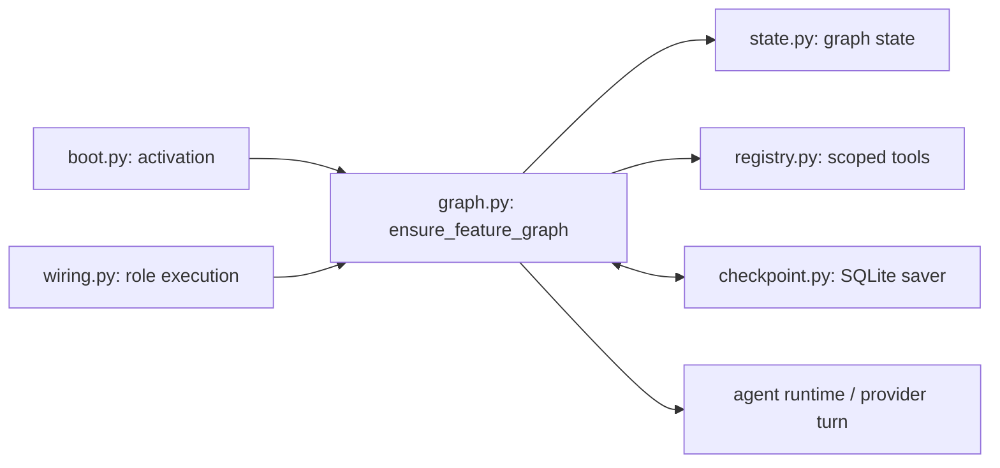

# Feature team design

Purpose: run the persistent tactical team that decomposes Features, responds to review, and coordinates Task integration. Interfaces are Feature graph/boot/wiring, guarded Task creation, publication/review polling, comments, briefing, and branch recovery. Owns `REQ-FEATURE-001` (Feature context survives Task turnover) and `DEC-FEATURE-001` (Task writes and ancestor reads are guarded).

## Implementation and navigation

The [C4 team view](../../architecture/target-9f61bc6d6f8ae8cb7d196c8b327650d5/views.dsl) has key
`cascade-team-components`; the parent view is `cascade-supervisor-components`.
See the [cross-team execution diagram](../DESIGN.md#team-execution).
This team is a checkpointed LangGraph, not a separate operating-system service.
The lead and architect execute within the supervisor's bounded turn lifecycle.

| Implementation | Responsibility |
|---|---|
| [boot.py](boot.py) | Seeds activation context and model selections. |
| [graph.py](graph.py) | Compiles the graph, ingests events, and executes role turns. |
| [state.py](state.py) | Defines checkpointed role, message, and queue state. |
| [checkpoint.py](checkpoint.py) | SQLite state under `.cascade/checkpoints/<work-id>.sqlite`; thread ID is the work ID. |
| [registry.py](registry.py) and [wiring.py](wiring.py) | Scoped tool registration and execution wiring. |
| [role skills](../watchdog/role_skills.py) | Resolves the default playbooks, including design authoring/review. |

## Turn lifecycle

Ending an invocation does not mean the work item is complete. Later events resume
the work's graph state. Queue offsets prevent already consumed events from being
treated as new input. Checkpoints retain execution context; Markdown work state,
Git history, and durable action receipts remain the delivery evidence.

Provider failures, tool authorization failures, and blocked review gates do not
authorize advancing lifecycle state. Recovery inspects durable state and the
preserved worktree before resuming the owning team. See
[shared supervision](../team_supervision.py) and
[branch recovery](../team_branch_recovery.py).

Verification: [graph and lifecycle tests](../../tests/feature/).

The two roles run sequentially within each invocation. Their durable context survives child work turnover; the graph does not spawn a parallel role process for each node.

Libraries, provider/MCP wiring, and the precise sandbox boundaries are described in [Team libraries, wiring, and isolation](../DESIGN.md#team-libraries-wiring-and-isolation).

The integrated Structurizr code view is `cascade-feature-code`. From the supervisor components view, Explore **Feature team**; select a code node for its pinned source. This view is the navigable implementation structure; the diagrams above supplement it with lifecycle context.

## Child admission and recovery

`REQ-FEATURE-REPAIR-001`: Task recovery preserves direct-child scope and checks
current execution ownership before resuming delivery.
`DEC-FEATURE-REPAIR-001`: Use the existing supervised Task recovery and final
validation boundary; a Feature tool cannot declare its own merge successful.
[mint_task](mint.py) serializes child creation with the lifecycle lock and refuses
blocked parents. It does not itself reactivate a completed Feature.
[recover_task](recovery.py) delegates to
[supervisor_recover_task_delivery](../task/supervisor_recovery.py).
Both entries appear in `cascade-feature-code`, linked from the scoped registry.
The [Boss closeout](../boss/DESIGN.md#delivery-and-closeout) and
[Workspace ownership](../workspace/DESIGN.md#work-ownership-and-retirement)
contracts govern the receiving parent and checkout. Failed target preflight
retains the Task; no graph checkpoint substitutes for delivery evidence.
