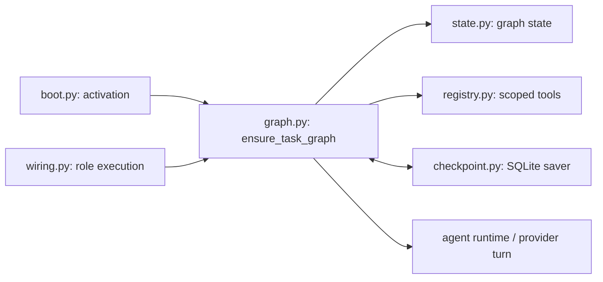
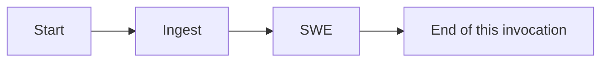

# Task execution design

Purpose: run one bounded implementation team in an isolated worktree with supervised file, test, commit, and lifecycle tools. Interfaces are Task graph/boot/wiring, SWE MCP, path guards, action recovery, lifecycle locks, and execution views. Owns `REQ-TASK-001` (implementation stays in assigned scope) and `DEC-TASK-001` (green post-commit supervised validation gates delivery).

Evidence: `cascade/task/`, `tests/task/`, and lifecycle tests at baseline `d932f48764cc0ceb2f4810cdd4487bef0c9ef084`; inventory digest `d86a5977ca42a2fd7da1ca80dc7b3251a8522f1a427e836c0abed741a816f1b6`.

Known gaps: receipts are absent for many historical Tasks, including A-F handoff children.

## Interrupted review publication attempts

Review-rebase attempts claimed through `resume_action` additionally persist the
owning process identity. `reconcile_abandoned_review_publications` runs before the
watchdog reads team boards, so a malformed conflict resolution cannot hide a dead
publication owner. Under the existing reentrant lifecycle lock it verifies death,
enqueues a claim-specific `BranchActionRecoveryRequested` before committing the
state transition, and closes the unfinished attempt as `owner_decision`. Replay
checks the stable event identity. Completed attempt history is preserved and the
same logical action is reused. Live, inaccessible and legacy-unidentified owners
are not reclaimed. This path does not retry Git or assert that a local merge commit
was published; the team must inspect the preserved checkout and remote evidence.
See `cascade/DESIGN.md` for publication validation and timeout requirements.

## Implementation and navigation

The [C4 team view](../../architecture/target-9f61bc6d6f8ae8cb7d196c8b327650d5/views.dsl) has key
`cascade-team-components`; the parent view is `cascade-supervisor-components`.
See the [cross-team execution diagram](../DESIGN.md#team-execution).
This team is a checkpointed LangGraph, not a separate operating-system service.
The SWE execute within the supervisor's bounded turn lifecycle.

| Implementation | Responsibility |
|---|---|
| [boot.py](boot.py) | Seeds activation context and model selections. |
| [graph.py](graph.py) | Compiles the graph, ingests events, and executes role turns. |
| [state.py](state.py) | Defines checkpointed role, message, and queue state. |
| [checkpoint.py](checkpoint.py) | SQLite state under `.cascade/checkpoints/<work-id>.sqlite`; thread ID is the work ID. |
| [registry.py](registry.py) and [wiring.py](wiring.py) | Scoped tool registration and execution wiring. |
| [role skills](../watchdog/role_skills.py) | Resolves the default playbooks, including design authoring/review. |

## Turn lifecycle

Ending an invocation does not mean the work item is complete. Later events resume
the work's graph state. Queue offsets prevent already consumed events from being
treated as new input. Checkpoints retain execution context; Markdown work state,
Git history, and durable action receipts remain the delivery evidence.

Provider failures, tool authorization failures, and blocked review gates do not
authorize advancing lifecycle state. Recovery inspects durable state and the
preserved worktree before resuming the owning team. See
[shared supervision](../team_supervision.py) and
[branch recovery](../team_branch_recovery.py).

Verification: [graph and lifecycle tests](../../tests/task/).

Task graphs use one SWE node. Delivery additionally passes supervised validation and integration gates in [graph.py](graph.py); checkpoint cleanup is explicit in [checkpoint.py](checkpoint.py).
