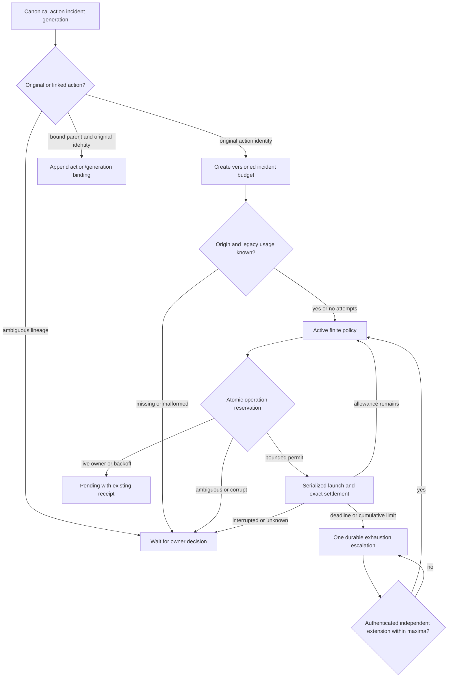
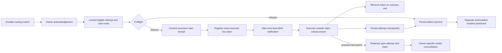
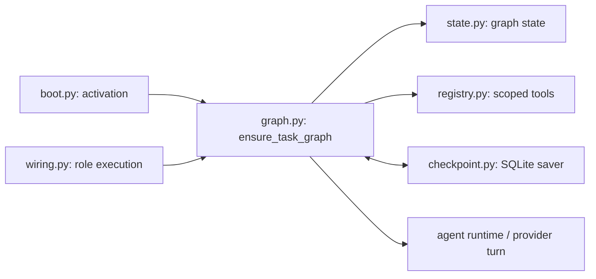
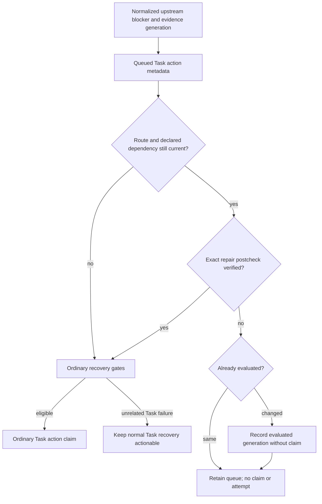
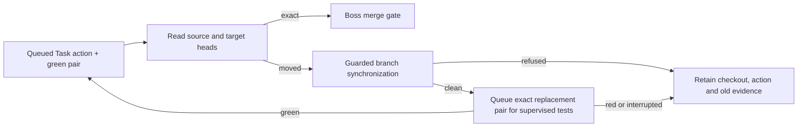

# Task execution design

Purpose: run one bounded implementation team in an isolated worktree with supervised file, test, commit, and lifecycle tools. Interfaces are Task graph/boot/wiring, SWE MCP, path guards, action recovery, lifecycle locks, and execution views. Owns `REQ-TASK-001` (implementation stays in assigned scope) and `DEC-TASK-001` (green post-commit supervised validation gates delivery).

## Durable incident lineage and policy

`REQ-RECOVERY-BUDGET-001`: Every recovery action and material generation that
belongs to one original incident shares one durable, finite policy record. A
replacement or child action must cite an already-bound parent action; its own
identity cannot create another allowance. Ambiguous legacy consumption waits
for an owner decision. Exhaustion retains one escalation identity, and only an
independently authenticated, finite extension within trusted maxima can make
the record active again.

`DEC-RECOVERY-BUDGET-001`: Store versioned `incident_budgets` beside `actions`
in tracking-root `.cascade/executions.json`, using the existing lifecycle lock
and atomic replacement. The record keeps original admission time, action and
generation bindings, policy ID/version/defaults/maxima, consumption quality,
charged and in-flight totals, unique operation receipts, the live top-level
claim, append-only extension receipts, and the first exhaustion escalation.
The original admission time is the earliest valid durable action/attempt time;
missing or malformed legacy time requires an owner decision instead of renewing
the elapsed allowance. This avoids a generation-local counter and introduces no
scheduler or database.

[bind_incident_budget](incident_budget.py) verifies the current action incident
contract before anchoring an original identity. A new original identity must
equal its existing action identity; subsequent actions need both the original
identity and a parent already present in the binding list. The action incident
envelope carries `original_incident_id` separately from
`authoritative_generation`, so material evidence can change without resetting
the policy. [read_incident_budget](incident_budget.py) projects one record and
remaining allowance without creating state.

[extend_incident_budget](incident_budget.py) accepts the request-scoped
`AuthenticatedHuman` produced by the human-facing boundary, rejects the
recovering team's identity, hashes the complete extension facts into an
idempotent receipt, and enforces the trusted maxima. Actor text or action-owner
state is not extension authority. [record_incident_budget_exhaustion](incident_budget.py)
derives one stable escalation identity and retains its first reason across
replay and later extension.

[reserve_incident_operation](incident_budget.py) is the versioned operation-consumer
boundary. Under `task_lifecycle_lock` it verifies the bound current generation,
trusted policy version, accounting integrity, persisted transient backoff,
original elapsed deadline, a single live claim, operation serialization, and
charged plus reserved allowance in every dimension. Its admitted result carries
a bounded permit and durable receipt. Pending, exhausted, and owner-decision
results carry the policy version and any existing receipt; replay never returns
a new permit. Claim age is not proof of abandonment. A different live caller
waits, while proven-dead or uncertain work requires authoritative reconciliation.

[settle_incident_operation](incident_budget.py) removes the exact in-flight
reservation and adds actual known or estimated process attempts, paid turns,
process/model seconds, and known tokens exactly once. Interrupted or unknown
work charges its full reservation and retains the claim for reconciliation.
Elapsed time is measured from the original incident start rather than summed as
runtime. Nested provider, MCP, tool, and validator work reuse the top-level claim
but receive separate serialized receipts. A provider child must cite the live
parent operation identity; sharing the claim string alone grants no nesting
authority, and unrelated competitors wait. `claim_complete` releases that claim
only after its owner has settled the final operation.

The record meters both process work and paid provider work; this component does
not itself launch a provider turn. The Agent boundary's
[admit_provider_turn / settle_provider_turn](../agent/provider_metering.py)
uses the same operation API immediately around physical provider dispatch.
Known tokens are charged only from provider evidence, while unavailable usage
remains honest and retains the reserved paid-turn/runtime/token bounds without
publishing those bounds as observed token totals. The lifecycle
flock serializes ledger mutation across local processes; permits bound allowance
but do not claim operating-system, network, or remote-provider isolation.
Unknown legacy use is marked unavailable rather than inferred, and caller-
supplied legacy totals alone cannot establish trusted historical accounting.
Focused temporary-repository verification is in
[`tests/task/test_incident_budget.py`](../../tests/task/test_incident_budget.py).

Review publication is a concrete consumer of this API. Its material generation
contains exact source and target heads, prospective result commit/tree, review
URL/identity/generation, the approved validation profile and command, coverage
class, policy owner and approval revision, finite timeout and attempt budget,
budget policy ID/version, and effective interpreter digest, dependency bytes and
import roots. Material admission cannot increase `attempt_bound`. Candidate
feasibility and its physical board are established before reservation. Before a
real validator process starts,
the Teams component reserves one tool attempt and the configured worst-case
process runtime under the original incident and stable top-level publication
claim. The validator carries a distinct operation receipt and settles on success,
red result, launch error, timeout, or interruption. Each receipt retains the
JSON-safe launch `attributes`; a validator nested under a provider operation uses
`attributes.parent_operation_id` to bind that exact parent and claim. For a
`review_validator` whose original action is `review_rebase`, the same receipt also
stores `material_fingerprint` for the admitted source tree, command, timeout,
policy and runtime identity together with the complete immutable JSON-safe
`exact_validation_material`. A deterministic failure fences that exact material
across restart and A–B–A cycles. A different source SHA, including an empty commit,
is new material and can
reserve only the original incident's remaining allowance; numerical exhaustion
still requires an independent finite extension. A legacy deterministic
`review_rebase` validator receipt without a verified fingerprint fails closed
after restart. Validators linked to non-`review_rebase` owner actions retain their
parent/claim attributes but receive no material exception, so deterministic
failure conservatively exhausts the whole incident. A normal success settles the
same receipt without a retry fence. Transient failure uses the ledger's persisted
5-second then 10-second jittered backoff and three-operation ceiling. Unknown
classification waits for owner reconciliation. Extensions keep all prior
attempts, decisions, charges and the first escalation.

The Teams publication owner attaches the settled receipt identity to the matching
review generation. Boss acceptance and Watchdog's later repair postcheck call the
same `match_review_validation_receipt` reader through the review adapter; neither
creates a new operation or allowance. Duplicate callbacks and restart reuse a
settled green, preserve a deterministic-red fence, and fail closed on legacy,
in-flight, changed-generation or incomplete evidence. Task continues to own
admission and charging; forge acceptance and merged-revision CI remain separate.

Profile resolution and feasibility do not grant allowance: the executable and
working directory must exist, then `reserve_incident_operation` must issue the
matching live receipt. Command or timeout drift after reservation refuses before
spawn. Task validation, review publication validation and Epic product acceptance
remain distinct coverage classes.

The Task gate exposes paid-turn and model/token dimensions to the Agent-owned
consumer. Provider receipts retain provider/model/invocation identity and explicit
validated launch-route attribution for direct, manual, periodic, audit, briefing,
provider-switch, parent and replacement-action entry points, plus explicit
known, estimated or unavailable token evidence in each operation observation;
cached input is not added to known input plus output. Interrupted provider work
retains its complete reservation. Review publication does not itself meter those
turns. The full Task validation gate remains separate from repository review
validation, and Epic product acceptance remains a later lifecycle obligation.

## Action evidence and transcript boundary

`REQ-TASK-RECOVERY-EVIDENCE-001`: An attempt's claim, number and outcome belong
to the action ledger under `task_lifecycle_lock`. A recovery display cannot grant
repair authority or treat an attempt result as independent incident verification.

`DEC-TASK-RECOVERY-EVIDENCE-001`: Reuse the tracking-root
`.cascade/executions.json` action records and atomic replacement boundary.
The [action implementation](action_recovery.py) exposes
`acknowledge_team_recovery` (timestamp the matching routed owner),
`_claim_resume_attempt` (append an open attempt and claim),
`record_action_checkpoint` (idempotent per-attempt checkpoint), and
`finalize_attempt` (outcome, classification, completion time and claim release).
Each material write appends a schema-v1 receipt with the action generation,
affected work, attempt/claim identity and a monotonic action-local sequence in
the same atomic replacement. `resume_action` commits `execution_started` only
after preflight succeeds and before it releases the lifecycle critical section
for the executor. `resume_action` registers an ephemeral live token projected by
`_executor_live_identity` before handing that committed start to the progress
publisher, then retains the token through the actual executor call. The token
matches the worker runtime/process generation and the receipt's exact graph,
action generation, attempt and claim. It expires within 30 seconds unless a
matching registered worker refreshes it, ends earlier with claim expiry, and is
invalid immediately after executor exit or observed worker death/restart.
Unknown, legacy, inaccessible, expired or mismatched identity never establishes
execution. These observations cannot reclaim a claim, change retry policy, or
replace the durable start/outcome receipts. A refusal instead commits `preflight_refused` and never
constitutes execution evidence. Review-publication claims also bind process
identity; other claims do not universally contain that proof.
The ledger remains monolithic: every transition loads and atomically replaces
the complete JSON document, so write cost grows with retained actions and
receipts. The notification fast path does not make source writes byte-bounded.

The [model](../../architecture/target-9f61bc6d6f8ae8cb7d196c8b327650d5/model.dsl)
and `cascade-task-code` in the [views](../../architecture/target-9f61bc6d6f8ae8cb7d196c8b327650d5/views.dsl)
expose these functions beneath `cascade-team-components`. Receipts remain in the
authoritative action record after transcript acknowledgement and continue to be
the source evidence. The after-lock publisher notification carries the committed
receipt and snapshot to the owning Epic/Feature transcript before progress
references are published; it may be missed or fail and never changes repair
authority or outcome. Restart consumers replay the retained sequence and the
receipt-keyed graph index returns the same message. The [War Room design](../war_room/DESIGN.md#recovery-summaries-and-planning-transcripts)
owns current presentation limits; [Watchdog](../watchdog/DESIGN.md#recovery-admission-and-active-path-authority)
owns independent verification. [Action recovery tests](../../tests/task/test_action_recovery.py)
exercise claim races, persisted attempts, checkpoints and restart behavior.
[Transition receipt tests](../../tests/task/test_transition_receipts.py) cover
missed notification, concurrent action writes, generation/attempt identity,
preflight refusal and a held executor whose start is visible before completion.
[Live observation tests](../../tests/workspace/test_live_observations.py)
cover held execution, exact matching, expiry, inaccessible/dead processes and
worker generation changes.

The Watchdog-owned [current progress publisher](../watchdog/DESIGN.md#current-recovery-progress-publication)
consumes these receipts after commit and by restart replay. Its SQLite index is
derived and disposable: it does not replace `executions.json`, allocate claims,
or authorize a retry. Consequently an enqueue, `mutation_ready`, execution-start
receipt, successful attempt, or completed publication remains evidence of only
that transition; none establishes verified resolution without the independent
same-generation postcheck.

## Interrupted review publication attempts

Review-rebase attempts claimed through `resume_action` additionally persist the
owning process identity. `reconcile_abandoned_review_publications` runs before the
watchdog reads team boards, so a malformed conflict resolution cannot hide a dead
publication owner. Under the existing reentrant lifecycle lock it verifies death,
enqueues a claim-specific `BranchActionRecoveryRequested` before committing the
state transition, and closes the unfinished attempt as `owner_decision`. Replay
checks the stable event identity. Completed attempt history is preserved and the
same logical action is reused. Live, inaccessible and legacy-unidentified owners
are not reclaimed. This path does not retry Git or assert that a local merge commit
was published; the team must inspect the preserved checkout and remote evidence.
See `cascade/DESIGN.md` for publication validation and timeout requirements.

## Implementation and navigation

The [C4 team view](../../architecture/target-9f61bc6d6f8ae8cb7d196c8b327650d5/views.dsl) has key
`cascade-team-components`; the parent view is `cascade-supervisor-components`.
See the [cross-team execution diagram](../DESIGN.md#team-execution).
This team is a checkpointed LangGraph, not a separate operating-system service.
The SWE execute within the supervisor's bounded turn lifecycle.

| Implementation | Responsibility |
|---|---|
| [boot.py](boot.py) | Seeds activation context and model selections. |
| [graph.py](graph.py) | Compiles the graph, ingests events, and executes role turns. |
| [state.py](state.py) | Defines checkpointed role, message, and queue state. |
| [checkpoint.py](checkpoint.py) | SQLite state under `.cascade/checkpoints/<work-id>.sqlite`; thread ID is the work ID. |
| [registry.py](registry.py) and [wiring.py](wiring.py) | Scoped tool registration and execution wiring. |
| [role skills](../watchdog/role_skills.py) | Resolves the default playbooks, including design authoring/review. |

## Turn lifecycle

Ending an invocation does not mean the work item is complete. Later events resume
the work's graph state. Queue offsets prevent already consumed events from being
treated as new input. Checkpoints retain execution context; Markdown work state,
Git history, and durable action receipts remain the delivery evidence.

Dispatch pins the Feature plan in the Task and `TaskDispatched` event before
cutting the execution branch. The boot hook verifies the dispatched parent
revision and task/feature identities; a later sibling mint does not invalidate
a valid dispatched pin. Task wiring loads the role skills and transitions the
worktree from `booting` to `coding`. Both direct kickoff and queued delivery
refuse to start a Task that is not active or whose run is still booting. The
scripted-provider recovery tests install these same boot hooks instead of
bypassing the gate.

Provider failures, tool authorization failures, and blocked review gates do not
authorize advancing lifecycle state. Recovery inspects durable state and the
preserved worktree before resuming the owning team. See
[shared supervision](../team_supervision.py) and
[branch recovery](../team_branch_recovery.py).
An incident-related SWE turn carries the original incident, claim and unique
provider-operation identity through the shared Agent runner; missing or refused
budget admission launches no provider.

Verification: [graph and lifecycle tests](../../tests/task/).

Task graphs use one SWE node. Delivery additionally passes supervised validation and integration gates in [graph.py](graph.py); checkpoint cleanup is explicit in [checkpoint.py](checkpoint.py).

Libraries, provider/MCP wiring, and the precise sandbox boundaries are described in [Team libraries, wiring, and isolation](../DESIGN.md#team-libraries-wiring-and-isolation).

The integrated Structurizr code view is `cascade-task-code`. From the supervisor components view, Explore **Task team**; select a code node for its pinned source. This view is the navigable implementation structure; the diagrams above supplement it with lifecycle context.

## Durable delivery collaborators

`cascade-task-code` exposes [resume_action](action_recovery.py),
[_record_execution_start](action_recovery.py),
[_append_action_transition](action_recovery.py), the after-lock notification
boundary, and the incident
budget lineage/reserve/settle/read/extension/escalation entry points in
[incident_budget.py](incident_budget.py),
[queue_task_merge](../task_rollup.py),
[execution_lease_is_live](execution.py), and [swe_run_tests](git_tools.py)
alongside the graph and tool registry.
The action ledger in tracking-root `.cascade/executions.json` preserves attempts,
claims and final validation evidence across worker restart. Recovery retains the
Task identity and checks live execution ownership. [Boss](../boss/DESIGN.md#delivery-and-closeout)
consumes the validated source/target pair; [Workspace](../workspace/DESIGN.md#work-ownership-and-retirement)
checks the receiving parent. Source or target movement requires the supervised
validation workflow, not a manually edited queue record.
When a current repair action owns the Task, the queued delivery metadata also
stores that action ID, generation, and Feature ID. This joins the exact green
pair to its repair obligation without changing the stable queued-action ID.
The queue persists and binds the original incident budget before advertising the
scheduling index, so a first merge refusal cannot become ambiguous legacy use.
It advances a matching repair receipt to `delivery_pending`; when repair is
admitted after the queue entry already exists, successful merge reapplies the
same immutable validation pair to advance that receipt. Replay retains the
original Task and repair identities.

`ParentLifecycleMismatch` is stored additively on that same queued action when
the Boss merge gate returns `not_active` for a completed Feature. Its
`authoritative_generation` fingerprints the registered owner and parent status,
delivery/repair identities, tested source/target pair, current review record,
approval/comment/dependency gates and execution lease. The first refusal remains
an immutable attempt. Before any later merge claim,
[retry_pending_task_merges](../task_rollup.py) recomputes the generation; an
unchanged observation performs no merge, turn, message or publication. A live
Task/Feature turn and `busy` remain scheduling waits and spend no attempt.
The Task boundary supplies the preserved validation pair and completed delivery
action to the Watchdog postcheck. It does not treat a request, worker completion,
or local status move as verification; original action and incident history remain
inspectable after authoritative resolution.

`REQ-TASK-DELIVERY-003`: A downstream delivery blocked by an upstream open
review stores the upstream blocker identity and its material evidence generation
separately from the downstream Task failure and attempt history. Repeated polls
of unchanged evidence do not claim the Task action or consume another attempt.
A changed generation admits one reevaluation through the ordinary delivery,
dependency and recovery gates. An unrelated Task failure remains owned by its
normal recovery classification.

`DEC-TASK-DELIVERY-003`: Keep the fence as additive metadata on the existing
queued action. [record_upstream_review_observation](../task_rollup.py) receives
the Watchdog's normalized blocker and evidence identities, while
[retry_pending_task_merges](../task_rollup.py) records the generation it actually
evaluated without claiming the Task action or charging its incident budget.
Release requires the matching Feature repair action's independent `verified`
postcheck; a green poll alone is not merge or intended-target evidence. This adds
neither a ledger nor a scheduler. The observer selects only Tasks whose direct
Feature owner declares the observed Feature as a dependency in the same Epic,
and only when the review route is exactly `feat/{upstream}` to
`epic/{shared-parent}`. The relationship is rechecked before every wait, so
removed dependencies or changed ownership cannot retain a stale fence. The
Watchdog-to-Task edge in `cascade-team-components` exposes the observation
interface, and `cascade-task-code` exposes its persistence and dependency-proof
entry points. Verification: [queued-delivery tests](../../tests/task/test_rollup_queue.py)
cover exact-route selection, unchanged evidence, changed generations, verified
release and unrelated Task failure ownership.

`REQ-TASK-DELIVERY-002`: A queued delivery is valid only for its exact Task
source and Feature target heads. [retry_pending_task_merges](../task_rollup.py)
uses branch synchronization before
[_request_delivery_revalidation](../task_rollup.py) withdraws stale scheduling,
records the replacement pair, and queues the original Task for supervised final
validation. The old validation and every action attempt remain in the ledger;
only a later green result may replace the current queue evidence.
Before Git integration, [merge_task_branch](../boss/merge.py) rechecks the
canonical merged-board Feature and requires its exact active column. This keeps a
historical product-side document in a split project from authorizing delivery
after the tracking owner has completed the parent.

