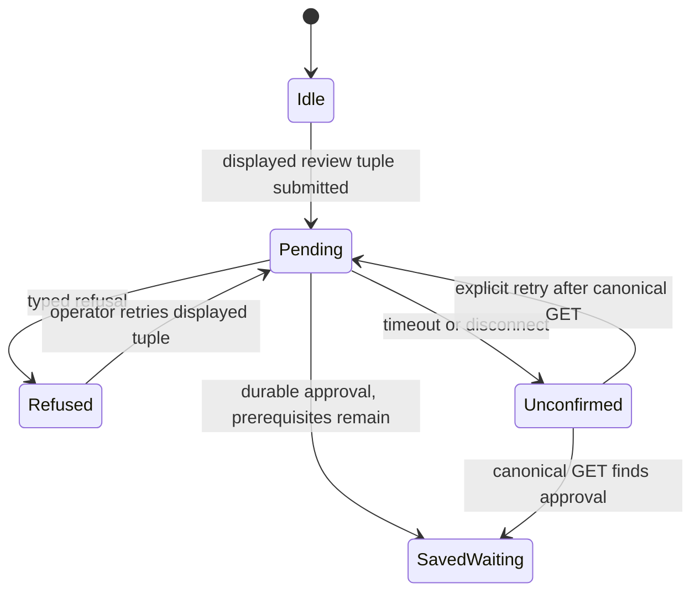

# War Room design

Purpose: expose the loopback operator UI/API for status, approvals, chat attachment, review, recovery, and diagnostics. Interfaces are `serve`, route modules, serializers/views, authenticated human actions, and static/template assets covered by this owner. Owns `REQ-WARROOM-001` (operator actions are explicit) and `DEC-WARROOM-001` (the UI projects canonical services rather than owning state).


Known gaps: unavailable forge descriptions limit historical attribution. Local
audit fixtures do not establish post-deployment live acceptance.

## Accountable open-review projection

`REQ-WARROOM-REVIEW-001`: Board rows, Feature room metadata, and
`GET /api/open-reviews` expose one consistent read-only projection of an original
Feature review. The projection identifies the review URL and number, accountable
Feature and Epic, source implementation status, delivery phase, bounded CI and
feedback evidence with freshness, latest repair request and generation, typed
admission/execution/verification flags, and the next prerequisite. A completed
Feature with an open review remains `review_pending` and visible as awaiting
review; a review without generation metadata is represented as generation zero.

`REQ-WARROOM-REVIEW-002`: Missing policy, check, feedback, occurrence-time, or
Feature metadata remains explicit `unknown` or `unavailable`. Presentation does
not infer green checks from an empty set or infer freshness without a persisted
observation time. Check detail is limited to twenty sorted, single-line rows and
reports the omitted count. Check names and string generations retain exact
identity through 256 UTF-8 bytes; integer generations retain at most 64 decimal
digits, including zero. A normalized persisted observation is at most 32 KiB.
Oversized or malformed authoritative identity is projected as unavailable, not
truncated into another identity or inferred green. The open-review endpoint
returns at most one hundred rows and marks an omitted tail as `truncated`.

`REQ-WARROOM-REVIEW-003`: `POST /api/open-reviews/repair` accepts only a
request-scoped authenticated local human and one complete, bounded repair
envelope. The envelope binds a stable request ID, reason and JSON evidence to
the exact original review URL, forge, source/target refs and observed heads and
generation. Its response keeps admission, acknowledgement, live-owner join,
execution, refusal, verification and next-prerequisite fields distinct; HTTP
success is not completion. Identical content rejoins its durable action while
changed content, stale evidence, another writer, policy/approval waits and
closed-unmerged reviews retain the adapter's typed refusal or prerequisite.

`DEC-WARROOM-REVIEW-001`: [`feature_review_views`](../review.py) joins the durable
review registry and Feature delivery projection with
[`latest_feature_repair_records`](../feature/repair.py). The latter performs one
canonical action-ledger read for a request and retains the latest waiting,
active, refused, or verified open-review generation for explanation without
granting execution authority. [`handle_get_open_reviews`](review_routes.py),
board serialization, and Feature document serialization consume that shared
projection. They do not call tracking transport, refresh forge evidence, start a
provider, enqueue work, or publish recovery progress. Product-root review
identity and tracking-root plans/actions remain joined through the configured
project context. The authorized Watchdog health pass persists a bounded
observation through [`record_feature_review_evidence`](../review.py) after its
forge query; unavailable publication remains a typed health wait rather than
allowing an action to proceed with evidence that readers cannot inspect.

`DEC-WARROOM-REVIEW-002`: [`handle_post_review_repair`](review_routes.py)
authenticates through the request verifier, validates the closed HTTP envelope,
and delegates once to
[`request_feature_review_repair`](../team_supervision.py). The route does not
create a launcher, ledger, replacement review or browser authority. Board and
room rendering and [`createOpenReviewsPane`](static/open_reviews_pane.js) show
the accountable Feature, original review, implementation/delivery distinction,
CI/feedback freshness, repair generation and typed next prerequisite. Only the
explicit form submits POST. Refresh and background reconciliation use the
read-only open-review GET, and response tokens prevent an older GET or action
response from replacing newer browser state.

The authoritative [model](../../architecture/target-9f61bc6d6f8ae8cb7d196c8b327650d5/model.dsl)
and [views](../../architecture/target-9f61bc6d6f8ae8cb7d196c8b327650d5/views.dsl)
represent this path in `cascade-war-room-components` and
`cascade-dashboard-code` as router → open-review handler → shared review
projection → canonical repair projection. `cascade-war-room-http-code` connects
the authenticated repair handler to the existing operator verifier and durable
team-supervision adapter.

```mermaid
sequenceDiagram
    participant UI as Board, room, or open-review GET
    participant R as Shared review projection
    participant V as Durable review registry
    participant A as Canonical repair action ledger
    UI->>R: Read requested Feature rows
    R->>V: Load persisted review identities and generations
    R->>A: Load latest open-review repairs once
    R-->>UI: Accountable state and typed prerequisite
    alt Missing or stale health evidence
        R-->>UI: Explicit unknown/unavailable or stale evidence
    else Oversized or malformed current, legacy, request, or postcheck evidence
        R-->>UI: Unavailable, not fresh or verified; refresh_review_observation
    end
    Note over UI,A: No forge query, provider start, queue write, or lifecycle mutation
```

The same flow applies after process restart: the reader reloads the registry and
action ledger, validates the complete selected evidence payload before projecting
it, and never repairs either file. A valid normalized observation retains exact
names and generations while displaying only its sorted row window. An oversized
legacy row or fallback postcheck produces no green rows, no verified repair flag,
unknown freshness and the safe refresh prerequisite until an authorized Watchdog
observation replaces it.

```mermaid
sequenceDiagram
    participant H as Local human
    participant UI as Open-review pane
    participant G as Read-only open-review GET
    participant P as Authenticated repair POST
    participant V as Request verifier
    participant A as Durable repair adapter
    H->>UI: Submit stable ID and reason
    UI->>P: Exact review identity and bounded evidence
    P->>V: Verify this request
    alt Unauthenticated or malformed
        P-->>UI: Typed HTTP refusal; no adapter call
    else Authenticated
        P->>A: AuthenticatedHuman and complete request
        A-->>P: Admission, acknowledgement, execution, refusal, verification, next prerequisite
        P-->>UI: Preserve typed result
        UI->>UI: Ignore stale response tokens
        UI->>G: Subsequent refresh
    end
```

Verification: [open-review API tests](../../tests/war_room/test_open_reviews_api.py)
cover current repair evidence, missing evidence, completed/open legacy rows,
split product/tracking roots, shared board/room shapes, and read-only lifecycle
files, authenticated delegation, malformed and unauthenticated refusal.
[Board UI coverage](../../tests/war_room/test_ui_render.py) preserves the active
awaiting-review lane for a completed Feature and drives a real Chromium action
through pending, failed, admitted, executing, approval-wait and verified
presentation while refreshes remain GET-only.

## Recovery summaries and planning transcripts

`REQ-WARROOM-PROGRESS-001`: A safe current recovery entry distinguishes
requested/queued, acknowledged, investigating, executing, waiting/blocked with
a prerequisite and owner, retryable failure, exhausted attempts, verification
pending, verified completion, and stale/unavailable evidence. It carries stable
action/generation/attempt identity, nullable source occurrence time, observation
freshness, safe next step, sanitized target/reason and bounded receipt references.
Concurrent entries order unresolved blockers first, other unresolved work next,
and verified completion last; material occurrence and stable entry identity break
ties. A stale entry retains its last supported blocker priority.

`DEC-WARROOM-PROGRESS-001`: The safe presentation contract is version 1 and is
published ahead of GET under product-root work-ID hashes. Public consumers use
only an atomic pointer, its immutable manifest and bounded pages. The producer's
writer index and raw action/incident ledgers are not read surfaces. Missing,
expired, corrupt, identity-mismatched or incomplete evidence must remain explicit
pending/unavailable metadata rather than a healthy empty result.

The Watchdog [materializes this contract](../watchdog/DESIGN.md#current-recovery-progress-publication).
`GET /api/recovery/progress` and board serialization share
[`read_recovery_progress`](recovery_progress.py). The route defaults to 50 and
caps at 100 entries; its opaque cursor binds exact work ID, immutable revision
and row offset. A superseded revision returns a typed restart conflict. The
compatible `recovery_incident` board field is derived from the same selected
entry and carries additive version, revision, entry, freshness, count and
continuation metadata under `recovery_progress`, including a compact safe primary
with bounded receipt and milestone references. Across board rows, reads share
the 100-entry, 1 MiB source budget and each response remains below 256 KiB.

The dashboard renders that shared primary persistently on its board row and reads
the same immutable pages beside Historical for ordered concurrent incidents. The
room binds asynchronous results to work ID and projection revision, restarts a
superseded continuation, and never splices a late graph or revision into the
current panel. Historical polling starts a single-flight current-progress read
alongside each incremental transcript read, so committed notifications and their
milestones can appear independently while an authored reply remains pending. A
background read retains the displayed projection until its typed result arrives
and does not reset transcript scroll, paging cursors or high-water. State, stage,
owner, occurrence, freshness and delivery lag remain distinct; queued work is not
presented as execution and publication is not presented as verified completion.
Recovery text is assigned through DOM text nodes, while actions accept only local
root-relative URLs and committed milestone references resolve to stable transcript
fragments.

`REQ-WARROOM-TRANSCRIPT-001`: Historical chat preserves the owning Epic or
Feature's human and presentable role messages. Reading chat does not invoke a
graph or backfill a checkpoint. Task teams do not accept persistent-room chat.

`REQ-WARROOM-TRANSCRIPT-002`: Transcript writers serialize by graph across
processes. A successful append means its exact JSONL line reached durable storage
before its unique message/source key and byte range committed. Recovery completes
only an empty, complete, or matching partial intended tail; conflicting bytes or
an uncertain room owner stay pending without truncation. A completely visible
pending line is fsynced with its parent directory before its index row commits.

`REQ-WARROOM-TRANSCRIPT-003`: Each retained committed recovery receipt can add
one concise `System · Recovery` line to its owning Epic or Feature room. The
line preserves receipt and entry identity, action generation, attempt and
transition sequence, nullable occurrence, safe target/source reference and
direct, reconciled or legacy-unknown provenance. Neither model output nor an
observation timestamp can mint or deduplicate a recovery line.
The recovery fast path supplies one monotonic deadline to append admission,
graph thread/process fences and SQLite waits. Each sequential schema or lookup
statement recomputes its busy timeout from that same deadline. Exhaustion remains pending and
replayable; an admitted JSONL append/fsync is an indivisible filesystem mutation
and is not represented as a hard real-time guarantee.

`REQ-WARROOM-TRANSCRIPT-004`: Room movement remains recoverable across process
death after copy, source removal, owner publication, or incarnation reset. A
pending move blocks other transcript writers, accepts only its fingerprinted
destination, and never rewrites conflicting source or destination bytes.

`REQ-WARROOM-TRANSCRIPT-005`: Historical GETs expose at most 100 rows from no
more than 1 MiB of immutable projection source and serialize at most 256 KiB.
Versioned cursors bind graph, room incarnation, direction, append sequence and
older-page high-water. Missing or unsafe publication is pending, and a changed
incarnation requires restart. The compatible chat route returns only the latest
window with explicit completeness, incarnation and older-continuation headers.
An oversized body remains available as UTF-8-aligned immutable chunks of at
most 64 KiB after a labeled bounded preview; a cursor inside a UTF-8 character
is refused with typed `400 invalid_request`. Every successful incomplete detail
read advances its byte offset positively, and no row is silently deleted.

`REQ-WARROOM-TRANSCRIPT-006`: The Historical browser consumes versioned latest,
older and after pages while keeping transcript incarnation independent from the
current recovery projection revision. It merges rows only when graph and
incarnation match, preserves the older-page high-water and scroll position, and
restarts instead of mixing a stale page or detail response. Durable message IDs
provide keyboard-focusable anchors. Recovery milestones are labeled
`System · Recovery` separately from human and authored role replies; nullable
occurrence, append time and provenance remain visible. Incomplete import and
pending publication are explicit. Oversized previews open through bounded detail
continuations, and only allowlisted local references become links.

`DEC-WARROOM-TRANSCRIPT-001`: Keep authored history in the owning room's
`docs/_war_room/chat/<graph-id>.jsonl`. The room follows registered document
ownership, including a backlog Feature's parent and a completed Epic's surviving
tracking checkout. History and a current recovery summary have different
evidence sources; an authored conclusion does not change an action's state.
Epic and Feature role nodes persist a durable message ID. Direct kickoff and
explicit writer backfill use that ID with checkpoint lineage and message ordinal
as the role-reply source identity. Replaying one reply returns its committed row,
while distinct replies with identical author and body remain distinct. An older
author/body-only match is retained with null occurrence time and
`legacy_unknown` provenance rather than being assigned a fabricated identity.

`DEC-WARROOM-TRANSCRIPT-002`: JSONL remains authoritative. A writer-only SQLite
index under the canonical tracking runtime root records message/source
uniqueness, append sequence, offsets, room incarnation and one durable exact-line
intent. A rewrite intent records the original fingerprint, exact replacement and
target incarnation before replacing JSONL. Restart either repeats replacement
from matching original bytes or finishes index reset from matching replacement
bytes; other bytes remain pending. The adjacent graph-hashed advisory lock
fences append, explicit sync, rollback rewrite and room movement across
processes. Legacy rows are indexed in resumable passes of at most 100 rows and
1 MiB without rewriting their IDs or append timestamps; their source occurrence
remains unknown. Dispatch and terminal checkout retirement persist a move intent
with source fingerprint and target incarnation before copying committed history.
They durably remove the source, publish the new registered owner, and atomically
reset offsets and clear the intent under the same fence. Retry reuses that
incarnation. When terminal owner publication removes the checkout, routing
evidence at the destination can finish the retained move intent without
reopening the removed owner.

`DEC-WARROOM-TRANSCRIPT-003`: Use `recovery:<receipt-id>` as the unique transcript
source key. Route Task receipts through their current owning Feature, reject
ambiguous or unsafe evidence as typed pending, and return the committed message,
incarnation and append sequence only after the graph fence releases. Replaying a
receipt therefore returns the existing message without a second JSONL line.
Receipt-to-entry/graph/message mappings remain immutable across room rewrites and
moves. Their incarnation and append sequence are refreshed only from the current
fenced source acknowledgement. That private lookup opens only an existing,
compatible index read-only; it performs no schema initialization, repair,
legacy import or projection publication. The publisher opens its write
transaction before the fence and commits the mapping and entry references before
releasing it, so delayed acknowledgements cannot restore stale routing metadata.
Its bounded fenced lookup reads only complete intent-free index state; repair,
import and projection publication remain outside the publisher transaction, and
pending state remains eligible for replay.

`DEC-WARROOM-TRANSCRIPT-004`: After index commit, writers publish
content-addressed transcript pages and oversized-body blobs, then atomically
replace a graph-hashed direct pointer under the tracking runtime root. GET opens
only that no-follow pointer, its immutable manifest and the pages or detail blob
named by the request. It never opens writer SQLite, scans authoritative JSONL,
loads a checkpoint, repairs history or probes Git, providers or processes.
Rollback and legacy-label rewrites invalidate the pointer before replacement and
republish under the new incarnation, so interrupted mutation is unavailable
rather than stale healthy history.

`DEC-WARROOM-TRANSCRIPT-005`: Browser paging state is scoped to the selected
graph and published room incarnation. Latest reads replace that state; older and
after reads deduplicate by durable message ID and retain their supplied cursors.
A typed cursor restart discards the affected browser state and reloads latest.
Late responses from an earlier graph, incarnation or detail request are ignored.
The compatible chat array remains an API surface but is not the Historical
browser's paging authority.

The authoritative [model](../../architecture/target-9f61bc6d6f8ae8cb7d196c8b327650d5/model.dsl)
and [views](../../architecture/target-9f61bc6d6f8ae8cb7d196c8b327650d5/views.dsl)
connect `cascade-context` → `cascade-containers` →
`cascade-war-room-components` → `cascade-dashboard-code`. The Dashboard
component owns these implementation nodes, even when a supervisor caller uses
the transcript library within the same Python runtime.

| Entry point | Input, output and boundary |
|---|---|
| [read_recovery_progress / read_recovery_progress_many](recovery_progress.py) | Open only a work-hashed direct no-follow pointer, its immutable manifest and requested pages. Validate exact work/repository identity, freshness, revision and row shape while enforcing aggregate source, row and response budgets. Missing, stale, corrupt and wrong-root evidence is typed pending. |
| [board_recovery_projection](recovery_progress.py) | Preserve the coarse `recovery_incident` surface while selecting its action and revision from the same safe entry returned to room consumers. Presentation never grants retry authority. |
| [loadCurrentRecoveryProgress](static/war_room.js) | Read and present revision-bound current and concurrent entries beside Historical, restart changed continuations, reject late graph responses and allow only local action or committed milestone links. Background reads retain the prior projection until the typed replacement arrives. |
| [handle_get_transcript / handle_get_chat](sidecar_routes.py) | Validate the versioned page/detail or compatible latest-window request and map invalid input, cursor restart and unavailable publication to typed 400, 409 or 503 responses. The compatible array adds `Link` and transcript completeness headers. |
| [publish_transcript_projection](transcript_pages.py) | Project only committed append-sequence/offset rows into content-addressed pages, bounded previews and exact detail blobs, then atomically advance the direct graph pointer. Partial legacy import is published as incomplete coverage. |
| [read_transcript_page / read_transcript_detail](transcript_pages.py) | Open only regular no-follow projection artifacts, enforce 50-default/100-maximum rows, 1 MiB aggregate source and 256 KiB response ceilings, and return incarnation/high-water cursors or UTF-8-aligned 64 KiB detail chunks. |
| [pollChatSidecar](static/war_room.js) | Refresh graph/incarnation-scoped Historical state, merge after pages by durable ID, and single-flight the independent current-progress read without changing transcript scroll or page high-water. Latest, older and bounded detail helpers restart typed stale cursors without mixing history. |
| [graph_transcript_fence / _connect_index](chat_store.py) | Lock a graph at a stable tracking-root path across threads and processes and open its writer-only full-synchronous intent/offset index. Caller deadlines bound lock and SQLite waits, with the remaining busy timeout refreshed before each schema statement; admitted lock-file and database opens remain filesystem work. The SQLite file is not a GET surface. |
| [fenced_transcript_source_acknowledgement / _connect_existing_index](chat_store.py) | Hold the graph fence while opening only an existing compatible index read-only and yielding complete current source-key routing. Schema and routing queries each use the remaining caller deadline. Missing schema, pending intents, incomplete indexing, exhausted time or an unavailable room fail pending without initialization, repair, import or page publication. |
| [append_transcript_message / remove_message](chat_store.py) | Reconcile only an exact pending tail, durably stage intent, append and fsync JSONL, then commit uniqueness/offset before acknowledgement. Rollback and legacy-label rewrites journal the original fingerprint, replacement and target incarnation before replacement, then reset and re-import the index. Restart accepts only matching original or replacement bytes, retains message/source identity and leaves conflicts pending. |
| [move_transcript_room / resume_transcript_room_move](chat_store.py) | Journal the source fingerprint, destination and target incarnation before durable copy; remove the matching source and publish the lifecycle owner inside the graph fence; then rebuild offsets and clear the journal. Retry or terminal lifecycle recovery accepts only the journaled destination. Conflicting bytes remain untouched and pending. |
| [append_committed_recovery_receipt](recovery_milestones.py) | Validate safe receipt fields, resolve the owning graph across registered roots, and carry one remaining deadline through deterministic append and current fenced acknowledgement. Unknown routing, unsafe target/reference, contention or incomplete evidence remains pending and replayable. |
| [append_planning_turn_to_chat](planning_transcript.py) | Sanitize and append new role messages supplied by [graph invocation](../workspace/kickoff.py), carrying checkpoint ID, persisted ordinal and durable message ID. Provider failure details become a bounded system message without exposing raw output. |
| [sync_planning_transcript_to_chat](planning_transcript.py) | Explicit writer work loads the owning graph checkpoint and replays the same stable role-reply source keys. It does not invoke a role or run from GET. |

```mermaid
sequenceDiagram
    participant K as Workspace kickoff
    participant G as Owning graph and checkpoint
    participant T as Planning transcript library
    participant F as Graph OS fence and intent index
    participant C as Owning room JSONL
    participant P as Immutable page projection
    participant UI as Historical GET
    K->>G: Invoke admitted role turn
    G->>G: Persist role messages
    G-->>K: Return
    K->>T: New message slice + checkpoint lineage/ordinal
    T->>F: Fence graph; reconcile exact pending tail
    F->>F: Commit exact-line intent and expected offset
    F->>C: Append line and fsync
    F->>F: Commit unique key/offset; clear intent
    F->>P: Publish committed pages; advance direct pointer
    F-->>T: Release fence; acknowledge
    UI->>P: Read pointer, manifest and requested pages only
    alt Return-to-append interruption
        K->>T: Explicit checkpoint sync
        T->>G: Read saved messages and durable IDs
        T->>F: Replay the same source keys through durable append
    else Crash before index commit
        T->>F: Retry
        F->>C: Complete only matching empty/partial intended tail
        F->>F: Commit key/offset once
    else Unexpected tail or owner
        F-->>T: Pending; preserve all unrelated bytes
    end
```

```mermaid
sequenceDiagram
    participant L as Workspace lifecycle
    participant F as Graph fence and move intent
    participant S as Source room
    participant D as Destination room
    participant R as Owner registry
    L->>F: Persist source fingerprint and target incarnation
    F->>D: Copy and fsync history and parent
    F->>S: Remove matching source and fsync parent
    F->>R: Publish idempotent owner switch
    F->>F: Reset offsets; install incarnation; clear intent
    alt Restart at any boundary
        L->>F: Resume retained intent
        F->>D: Verify exact fingerprint
        F->>R: Retry switch or verify destination routing
        F->>F: Finish index transition once
    else Conflicting source or destination
        F-->>L: Pending; preserve both sides
    end
```

Action attempts and acknowledgements persist independently in the
[Task-owned ledger](../task/DESIGN.md#action-evidence-and-transcript-boundary).
Chat stores source occurrence and append times separately. Its recovery lines
are deterministic projections of committed receipts; they do not authorize a
retry or establish execution/verified resolution beyond the cited receipt.
Verification: [bounded progress scenarios](../../tests/war_room/test_recovery_progress_api.py),
[projection scenarios](../../tests/war_room/test_recovery_incident_projection.py),
[transcript scenarios](../../tests/war_room/test_planning_transcript.py) and
[read routing](../../tests/war_room/test_chat_poll_routing.py), and
[durability/recovery scenarios](../../tests/war_room/test_durable_chat_store.py)
exercise these boundaries, including two real writer processes, exact-tail crash
states, bounded legacy import, every durable room-move boundary, split roots,
terminal checkout removal, replacement-before-index rewrite recovery and GET
without graph construction.
[Recovery milestone integration](../../tests/recovery_progress/test_transcript_milestones.py)
checks duplicate receipt replay, distinct sequences, nullable occurrence,
after-commit notification and restart reconciliation with ordered references.
[Bounded transcript API scenarios](../../tests/war_room/test_transcript_pages_api.py)
check latest, older and incremental pages, legacy continuation headers, typed
restart/unavailable responses, projection-only GET, response ceilings and exact
multi-chunk UTF-8 detail reconstruction. The Chromium Historical journey in the
same file checks distinct milestone/authored rendering, keyboard anchors, older
scroll retention, incremental appends and preview-to-detail continuation. The
[browser refresh race harness](../../tests/war_room/war_room_refresh_races.mjs)
checks that Historical polling refreshes progress and transcript projections
together without duplicate reads.

## Bounded health-audit projection reads

`REQ-WARROOM-AUDIT-001`: Dashboard consumers read only the current projection
pointer, its one immutable manifest, and the requested current, coverage, or
history pages. Regular-file no-follow opens cap total source bytes at 1 MiB,
rows at 100, and the serialized result at 256 KiB. Missing, stale, corrupt,
incompatible, or wrong product/tracking evidence is typed `pending`; it never
becomes an empty healthy result.

`DEC-WARROOM-AUDIT-001`: `audit_projection_reader.py` validates the bounded
manifest header and each page it actually visits instead of calling the
producer's full-epoch validator. Filters are normalized exact work ID, owner,
verification status, and UTC occurrence bounds. Opaque cursors bind those
filters to section, epoch, page, and row offset and contain no path. A newer
pointer returns an explicit epoch restart. Budget exhaustion returns an
incomplete page and continuation while preserving producer `source_ref`,
legacy provenance, and `detail_truncated` without opening a recovery ledger.

## Refresh latency and coherent read projections

`REQ-WARROOM-LIFECYCLE-FEEDBACK-001`: Activating an Epic team and approving
Epic plans or individual Features acknowledge the first operator click immediately, with a disabled
pending control that survives board redraws. A successful write shows an
acknowledgement before the follow-up board GET completes. The actual column,
readiness, and approval state still come from the canonical board; the UI must
not fabricate lifecycle state or require a full page reload. A refused write
shows its reason directly on the affected work row across polling; a lost response
is an unconfirmed outcome, not proof of failure. The activation route returns a
JSON conflict for known board/workspace errors rather than dropping its connection.
The Epic plan viewer shows pending and confirmed plan approval independently
from the Feature plan viewer's individual approval control. The Feature control
retains the exact review tuple, submits those displayed bytes, and shows typed
waiting, refusal, and unconfirmed outcomes beside the plan. A board Feature action first
loads and visibly presents its scoped review tuple, then submits that same tuple.
Its row-local status renders the typed approval result, canonical approval state,
explanation, affected work IDs, execution state, and readiness reasons. A timeout
or disconnect requires a fresh canonical board read before retry becomes available.

`DEC-WARROOM-LIFECYCLE-FEEDBACK-001`: The 10-second read deadline is not a
suitable mutation deadline: recorded activation and approval requests lasted
10.3 and 25.3 seconds respectively. The HTTP server gives activation the same 60-second connection deadline as
approval, rather than closing after the generic 10 seconds. Board activation,
Epic plan approval, and individual Feature approval use a 120-second client write
deadline. The corresponding action identity is keyed by operation and work ID to
suppress duplicate clicks across renders. A durable `ok` acknowledgement remains disabled until
canonical board state confirms the transition, including when a refresh fails.
An action response triggers a fresh single-flight board read; flight and Boss
panels refresh independently. Polling can also observe the durable transition
while the POST is still running. Background board reads defer their DOM update
across a pressed button's pointer gesture so a poll cannot remove the click
recipient between pointerdown and click. Only the latest deferred snapshot is
applied. The plan page protects its approval control from concurrent readiness
updates and checks `meta.plan_approved` after a lost response. The board keeps only
an in-memory Feature action presentation; canonical approval and readiness replace
or confirm it, while an older poll cannot erase a newer pending, saved, refused,
or unconfirmed result. No retry POST is issued automatically, no authorization or
dispatch gates change, and no client state is persisted as board truth.



Regression coverage: `tests/war_room/war_room_refresh_races.mjs` exercises
slow writes, rerenders, acknowledgement before a slow or failed GET, duplicate
clicks, explicit refusal, ambiguous responses, and pointer gestures;
`tests/war_room/test_board_feature_readiness.py` drives the API-backed Feature
action through Chromium with exact tuple display, delayed and repeated clicks,
row replacement, typed refusal, ambiguous transport reconciliation and ARIA focus;
`tests/war_room/epic_plan_readiness_integration.mjs` exercises pending approval,
concurrent readiness updates, reviewed context, dispatch warnings and durable
readback after a lost response;
`tests/war_room/feature_plan_approval_integration.mjs` covers the corresponding
Feature plan state machine, and `tests/war_room/test_board_feature_readiness.py`
drives its loopback document and approval APIs through Chromium. The real Chromium test in
`tests/war_room/test_ui_render.py` drives both buttons through a held pointer
gesture, delayed POSTs, intervening polls and canonical lane/approval updates
without navigating away. The HTTP deadline regression in
`tests/war_room/test_dispatch_routes.py` proves a slow activation response
arrives past the generic request deadline.

`REQ-WARROOM-REFRESH-001`: first board rendering must not wait for independent
flight, boss, chat, audit or provider panels. The board and pending-brief
cancellation lookup run concurrently, but both must finish before board actions
are enabled; cancellation safety is not traded for responsiveness. Optional panel
requests do not delay startup polling. Existing forced post-action freshness and
single-flight board reads remain intact.

`DEC-WARROOM-REFRESH-001`: serialize Epic readiness from the same request-scoped
board snapshot used for the rest of the response. `project_epic_plan_readiness`
is explicitly a read projection; it does not refresh all registered worktrees per
Epic. `compute_epic_plan_readiness` and approval/sign-off/dispatch boundaries still
fetch authoritative dependency evidence independently of a supplied or cached board.
A UI snapshot is never permission to execute a lifecycle action.

Cold scans parse thousands of frontmatter records across retained worktrees. The
board parser prefers PyYAML's `CSafeLoader` when libyaml is available and falls back
to `SafeLoader`; both retain safe-constructor semantics, schema validation, dates,
round-trip behavior and rejection of Python object tags. This is parser acceleration,
not an additional stale-state cache or a relaxation of document validation.

Regression evidence: `tests/epic/test_plan_readiness.py` verifies no per-Epic fresh
scan in board serialization while authorization still refreshes; board parser
compatibility and unsafe-tag rejection are covered in `tests/board/test_parse.py`.
The refresh race harness covers cancellation lookup, optional-panel independence,
and forced post-action reads.

Board serialization also batches completed-Epic staging checks into one integration
registry snapshot, and shares one durable recovery-action snapshot between incident
and task-delivery projections. These snapshots live only for that response; the next
request rereads the registries, and existing locks and standalone action-boundary
reads remain unchanged. `tests/war_room/test_projection_batching.py` verifies the
read count, empty snapshots, and refresh across requests.

## Health-audit HTTP consumer

`REQ-WARROOM-AUDIT-002`: `GET /api/health/audit` exposes verified current incidents,
producer-published aggregate coverage, freshness, and bounded receipt/failure
metadata. `GET /api/health/audit/coverage` and `/api/health/audit/history` serve
epoch-pinned pages with a default of 50 and maximum of 100 rows. Exact work ID,
owner, status, and UTC occurrence-time filters preserve unknown and unverifiable
evidence as nonmatches. Malformed query input is a 400; a changed epoch or cursor
filter mismatch gives a bounded restart response. Each response names the epoch,
continuation, and completeness, stays within 256 KiB serialized bytes, and
preserves stable source references instead of reading large raw details. An empty
verified-current page with incomplete coverage does not claim health.
Parent lifecycle rows also carry the bounded typed Task, Feature/Epic, recovery
generation, blocked owner/operation, original validation, prior/required review,
request/acknowledgement/execution, freshness and verified outcome published by
Watchdog. A resolved generation leaves current only after a fresh authoritative
postcheck and remains in history across restart. Missing or malformed detail is
pending or truncated, never inferred as health.

`DEC-WARROOM-AUDIT-002`: GET routes use the
[bounded projection reader](#bounded-health-audit-projection-reads)
at the resolved product repository root. They do not inspect recovery ledgers,
canonical board/worktrees, Git, providers, or schedule audit/recovery work.
`POST /api/health/audit` remains the authenticated manual admission route.
Repository identity, freshness and read-budget failures are visible as pending or
unknown status. The shared boundary is owned by
[the package design](../DESIGN.md#health-audit-read-boundary).

Verification locations: [route tests](../../tests/war_room/test_health_audit_routes.py)
and [reader tests](../../tests/war_room/test_audit_projection_reader.py) cover filtered pagination,
epoch/filter restart, stale and corrupt evidence, and strict source/response
budgets. The [integrated fixture](../../tests/war_room/test_audit_integrated_experience.py) follows real
producer output through the loopback routes across a new epoch and split
product/tracking roots, while the [browser race harness](../../tests/war_room/war_room_refresh_races.mjs) verifies
single-flight, read-only browser refreshes. The [GET benchmark](../../tests/war_room/benchmark_audit_get.py)
records warm loopback GET p95 and actual source/response bytes for a representative
10,000-attempt fixture. Local smoke evidence is not post-deployment acceptance.

## Feature activation explanations and new-work attention

`REQ-WARROOM-READINESS-001`: Activation explanations preserve `approved` and
`blockers` consumers. The board exposes a versioned summary, reasons, satisfied
prerequisites, owners, existing actions, observation freshness and actual dispatch
attempt evidence when available. A fresh human-action blocker takes precedence,
followed by unknown required evidence, known work/system waits, and evaluated
readiness awaiting dispatch. Passing gates never claims execution; historical
refusals remain separate from a newer evaluation. The browser renders these
projections without implementing eligibility rules.

Each Feature readiness object also exposes `approval.result`, `approval.state`,
`approval.eligibility`, `approval.eligible`, `approval.explanation`, and
`approval.affected_work_ids`. This approval-only projection is independent of
the compatible execution `blockers`: a current receipt remains `approved` while
ordinary predecessor, sibling, required integration, review, provider,
software, parent, or dispatch-base facts keep execution waiting. Missing or
stale receipt evidence never projects an approved state. Board GETs use the
request-scoped board and cached provider facts and do not write receipts,
dispatch work, or refresh external authority.

`DEC-WARROOM-READINESS-001`: Board responses reuse request-scoped facts. Missing
cached evidence remains unknown; polling does not discover providers, perform
expensive per-feature Git probes, dispatch, or mutate lifecycle state. Action
boundaries re-evaluate their gates. This preserves truthful explanations without
turning browser refreshes into execution or repeated discovery.

`REQ-WARROOM-ATTENTION-001`: New-feature markers and collapsed-epic counts remain
separate from lifecycle and activation summaries. Viewing or rendering a feature
never acknowledges it. Workspace-shared **Mark seen** requires the request-scoped
human verifier, records actor/time, and does not approve, dispatch, edit plans or
clear blockers. Keyboard navigation, contrast and screen-reader labels support
both markers and actions.

`DEC-WARROOM-ATTENTION-001`: The UI consumes the canonical tracking-workspace
attention ledger through `feature_attention_routes.py`. A monotonic revision
prevents an older poll response from undoing an acknowledgement. Unavailable or
corrupt state remains visibly unavailable and disables acknowledgement; it never
silently resets the baseline. Ledger persistence belongs to
[`feature_attention.py`](../feature_attention.py), which shares state across
managed worktrees and split repositories using atomic writes and locking.
Completed, cancelled and retired children leave pending-attention aggregates
without deleting provenance; replay and plan edits do not recreate acknowledged
newness.

Verification: [readiness evidence](../../tests/war_room/test_feature_readiness_evidence.py),
[board readiness](../../tests/war_room/test_board_feature_readiness.py), and
[attention API/browser scenarios](../../tests/war_room/test_feature_attention_api.py)
cover missing/stale evidence, explicit acknowledgement, concurrent revisions,
refresh persistence and storage failure.

## Architecture review boundary

The War Room presents revision-pinned architecture resources and review state.
Snapshot view limits are maxima. [snapshot_projection](architecture_routes.py)
reduces a view page when its shared target/navigation metadata and requested
views exceed the 256 KiB response cap. Each page carries the targets represented
by its views plus any unrepresented semantic inventory on the first page; the
browser merges targets by semantic ID while following the strictly advancing
view continuation. This keeps large native Code inventories navigable without
repeating every target on every page. If one view and its targets cannot fit,
the route returns HTTP 413; it never raises the cap or returns a nonadvancing
empty page. [HTTP coverage](../../tests/war_room/test_architecture_http.py)
exercises lossless view and target continuation and the minimum-page refusal.
Publication, artifact ownership, destination, generation, ancestry and byte-digest
validation belong to the [workspace design](../workspace/DESIGN.md), specifically
[REQ-WORKSPACE-001](../workspace/DESIGN.md),
[REQ-WORKSPACE-002](../workspace/DESIGN.md) and
[DEC-WORKSPACE-001](../workspace/DESIGN.md). Registered owning
lineage determines each artifact's current revision; tracking and product
revisions remain distinct in split repositories. The UI does not grant permission
to publish or accept a stale review. Supported retries retain failure history and
exact proposal evidence.

The repository-owned [C4 model](../../architecture/target-9f61bc6d6f8ae8cb7d196c8b327650d5/model.dsl)
is authoritative; its [views](../../architecture/target-9f61bc6d6f8ae8cb7d196c8b327650d5/views.dsl)
represent the War Room, supervisor and repository boundaries. Readiness,
attention and audit presentation stay within these components.
[Architecture HTTP tests](../../tests/war_room/test_architecture_http.py) and
[tab UI tests](../../tests/war_room/test_architecture_tab_ui.py) verify the local
consumer boundary; [publication tests](../../tests/workspace/test_architecture_publication.py)
verify owner-lineage and exact-revision enforcement.

## Integrated C4 exploration and source inspection

- `REQ-WARROOM-C4-001`: Operators can navigate system context → containers →
  components → authored Code views through verified semantic targets. Both branch
  browsing and comparison review start at system context when one is available;
  explicit view selections and deep links take precedence. Landscape is an
  optional overview in the view selector, not a parent level: Level up stops at
  context and never returns a landscape. If context is absent, choose an available
  non-landscape view, falling back to landscape for landscape-only models. Explore
  opens the broadest available next-level view directly; the view selector retains
  focused alternatives. In comparison review, Explore requires a
  unique same-level destination whose target set contains all alternatives
  when there are multiple choices; otherwise a named chooser is scrolled into view and focused, with Escape to dismiss.
  Referencing an element in another view does not imply that the view expands
  it. Comparison Level up prefers the verified originating parent from navigation
  history, then the broadest nearest parent when there is no origin;
  browser history and deep links restore snapshot, view, level and selection.
- `REQ-WARROOM-C4-002`: Selecting a code element exposes its declaration kind,
  source path and symbol, and an authorized source resource at the snapshot's
  code revision. Comparison details use the declaration kind from each side's
  semantic model.
  Source previews render plain text, never Markdown or executable HTML. Advancing
  HEAD cannot change the bytes of an existing source URL. Invalid opaque resource
  IDs fail rather than accepting caller-supplied paths.
- `REQ-WARROOM-C4-003`: Repeated navigation reuses immutable SVG responses and
  the bounded browser SVG cache. Selecting an element preserves the existing SVG
  and zoom in the branch browser. Comparison rebuilds preserve
  zoom and pan for each unchanged pinned combined diagram across background refresh,
  selection, discussion updates and consecutive renders before SVG loading
  completes. Fit explicitly resets that diagram; a new diagram identity starts
  fitted. Destroyed viewers cannot install late responses. Implementation
  designs are discoverable from the pinned ownership mapping, with Mermaid
  rendering for supplementary behavior diagrams.

`DEC-WARROOM-C4-001`: Native Structurizr custom views with validated component
scope appear as `codeViews` in the API and Code in the selector. Code nodes remain
verified SVG hit targets, not a separate documentation-only navigation system.
Requirements links and ownership context remain distinct; a source link does not
assert requirement coverage. Snapshot discovery/refresh is explicit, and diagrams
exclude uncommitted changes.

[architecture_routes.py](architecture_routes.py) projects authorized snapshots,
view scopes, design resources and pinned code resources.
[architecture_tab.js](static/architecture_tab.js) coordinates navigation and
previews; [plan_viewer.js](static/plan_viewer.js) owns shared SVG interaction.
Rendering and identity guarantees belong to
[the workspace design](../workspace/DESIGN.md#c4-code-model-and-rendering-contract).

Verification: [HTTP tests](../../tests/war_room/test_architecture_http.py),
[tab tests](../../tests/war_room/test_architecture_tab_ui.py), and
[comparison navigation](../../tests/war_room/paired_c4_review_cases.mjs).
The authored team views are in the repository
[view inventory](../../architecture/target-9f61bc6d6f8ae8cb7d196c8b327650d5/views.dsl).


`DEC-WARROOM-C4-002`: The comparison saves its viewer's viewBox before replacing
its DOM and destroys the discarded viewer. The restoration key includes side,
view key/level, repository, revision and SVG reference. At most 32 saved entries
are retained for the review instance; a pending viewer with no viewBox does not
overwrite saved coordinates. The default 15-second background refresh must not
reset the viewport to Fit. Viewport state is local presentation state, not review
evidence.

## Committed planning comparisons and project previews

- `REQ-WARROOM-COMPARE-001`: Plan and DESIGN.md comparisons cover the registered
  planning branch base through its latest committed HEAD, including multiple
  commits. Undispatched work uses its nearest registered planning ancestor.
  Ownership cycles, checkout/branch mismatches, unavailable revisions and an
  uncommitted proposed plan produce an unavailable result. The plan comparison
  excludes frontmatter; design comparison includes every changed DESIGN.md,
  including additions and removals, with full unchanged context on both sides.
- `REQ-WARROOM-COMPARE-002`: The Work tab (labeled Epic / feature / task)
  initially shows the plan alone. When an
  original brief exists, the operator can reveal its comparison and revision
  labels. The Design tab (labeled DESIGN.md changes) presents documents with rendered block
  highlighting. A directory tree includes unchanged design owners as context;
  only changed documents are selectable, with green additions, amber changes
  and red removals. Each side offers previous/next changed-block navigation
  with a position indicator; narrow screens stack the tree and two sides.
  Comparisons include integrated task/feature commits regardless of author,
  but exclude uncommitted edits and work not yet integrated into the owner branch.
  C4 uses the full review width, while contextual documentation belongs in the Design tab.
- `REQ-WARROOM-COMPARE-003`: Opening C4 requests the current project integration
  revision versus the expected project after applying the selected committed
  proposal. Work already integrated into the project must remain in the preview.
  Merge conflicts are visible failures. Preview generation does not move real
  refs or alter the operator checkout/index, publish a review, grant approval,
  or promote accepted lineage. Tasks can preview without separate architecture
  approval. Split architecture repositories require a published review.
- `REQ-WARROOM-COMPARE-004`: Polling retains the authorized snapshot pair and
  reports when the project or proposal advances. Explicit comparison refresh
  reloads the page to obtain new pins. Once project preview is requested, late
  publication responses or failures cannot replace it with publication data or
  an empty accepted baseline. Transient preview failures retry via the project
  loader. A merge conflict lists the affected paths and pauses polling until
  the operator retries. Uncommitted source changes are excluded.
- `REQ-WARROOM-COMPARE-005`: One diagram contains the union of both revisions:
  removals are red, additions green, semantic edits amber, and unchanged targets
  remain as context. Reviewed renames remain one changed target. A rewired
  relationship shows its old connection in red and new connection in green.
  Selection/focus remains visible without hiding change color; relationships use
  native SVG strokes. Dashed amber signals changes in deeper verified views
  without reclassifying an unchanged parent as edited.

`DEC-WARROOM-COMPARE-001`: [plan_comparison.py](plan_comparison.py) resolves Git
inputs on the server. Document comparisons use the registered branch base;
project diagrams use the latest project target HEAD when the preview is created.
These baselines answer different review questions. A private temporary index and
worktree perform a three-way merge; a deterministic commit object pins divergent
projections without moving a branch. Ancestor cases reuse the appropriate commit.
Git document reads have a 10-second timeout and 2 MiB output cap; changed design
text has a cumulative 2 MiB cap. The `design_tree` inventory covers the union of
both revisions' design paths, including unchanged documents. File presence
classifies additions and removals independently of empty content. The browser
builds ancestor directories from those paths and renders only the selected
changed document. `renderDocumentComparison` highlights rendered blocks;
`appendChangeNavigation` installs per-side controls after Markdown rendering,
wraps at each end and focuses the target without changing the pinned revisions.
Selection survives review rerenders while its document remains changed.
Projection Git operations have 30-second timeouts.

```mermaid
sequenceDiagram
    participant UI as Design tab
    participant API as Document API
    participant Git as Registered owner branch
    UI->>API: Load work document and comparison
    API->>Git: Read base and committed HEAD
    alt Revisions unavailable or read limit exceeded
        API-->>UI: Explicit unavailable comparison
    else Comparison available
        API-->>UI: Design path inventory and changed document bodies
        UI->>UI: Build directory tree; select changed module
        UI->>UI: Render both sides and highlight changed blocks
        UI->>UI: Previous/next focuses a highlighted block
    end
```

`DEC-WARROOM-COMPARE-002`: `POST /api/architecture/plan-preview` accepts a work ID
and optionally the current/proposed opaque snapshot IDs. Server-resolved context,
shared projection evidence and ancestor checks bind the pair to its project and
proposal. It delegates rendering to the bounded snapshot scheduler. Draft payloads
have no approval context or reviewed tuple. Staged publications in
[review-units.json](../../architecture/review-units.json) retain their original
accepted baselines and pinned references; the project comparison does not
rewrite publication evidence or establish acceptance of working-tree edits.

`DEC-WARROOM-COMPARE-003`: Semantic target classification is shared across both
sides, with previous IDs inheriting reviewed rename state. Descendant-change
markers are derived for navigation without mutating the review payload. Viewer
installation removes exported inline pixel dimensions so the container controls
SVG sizing while the viewBox controls zoom, pan and Fit.

Verification: [comparison tests](../../tests/war_room/test_plan_comparison.py)
cover ownership, multi-commit document context, design inventory, project integration,
conflicts and pinned polling; [design browser scenarios](../../tests/war_room/test_design_tree_browser.py)
cover module selection, unchanged context, additions/removals, change navigation
and narrow screens; [comparison review scenarios](../../tests/war_room/paired_c4_review_cases.mjs)
cover navigation, descendant markers and zoom/pan restoration, including explicit
Fit and revision changes. [Chromium scenarios](../../tests/war_room/test_project_c4_colors.py)
cover semantic colors, responsive SVG sizing, drill/parent choices and publication
versus project-preview races. These fixtures do not claim live deployment acceptance.


## Single-diagram architecture differences

`REQ-WARROOM-C4-004`: The comparison uses one canvas with Zoom in, Zoom out and
Fit. It has no linked-view preference or alternate two-pane mode. All targets in
either revision's selected view remain inspectable, including removed views.
Clicking an expandable element (or pressing Enter/Space) opens its verified deeper
view, using the destination chooser when ambiguous. Clicking a leaf or relationship
selects it and exposes before/after semantic attributes, identity, parent, relationship
endpoints and available source metadata; absence is explicit. The Semantic targets
list allows inspection of expandable elements without navigation. Explore selected
element also opens verified deeper views from the inspection panel.
Removed targets navigate using current evidence, and surviving/new targets use
proposed evidence. An unavailable combined render shows pending/failure status,
never a proposed-only diagram that would hide removals.

`DEC-WARROOM-C4-003`: [initPairedC4Review](static/plan_viewer.js) retains its API
name and underlying two-revision navigation/review evidence, but creates only one
[createSemanticC4Viewer](static/plan_viewer.js). The display graph is a derived
comparison artifact, not either revision's actual architecture. It uses a fresh
layout of the union, with C4 element types as labels. Parent/containment changes
are inspected in before/after details rather than presenting conflicting parent
hierarchies as one real hierarchy. This avoids maintaining viewport alignment
between independently laid-out revisions. Rendering belongs to
[the workspace comparison contract](../workspace/DESIGN.md#derived-comparison-rendering).

The authoritative [model](../../architecture/target-9f61bc6d6f8ae8cb7d196c8b327650d5/model.dsl)
and [views](../../architecture/target-9f61bc6d6f8ae8cb7d196c8b327650d5/views.dsl)
expose `cascade-war-room-components`, `cascade-diagram-review-code` and
`cascade-comparison-render-code`. The diagram-review component coordinates the
browser and project-preview endpoint; Workspace owns derived graph construction
and bounded rendering. These responsibilities remain inside the existing runtime
and repository boundaries.

```mermaid
sequenceDiagram
    participant UI as Comparison page
    participant API as Project preview
    participant Union as Combined graph builder
    participant Scheduler as Render scheduler
    UI->>API: Request pinned comparison
    API->>Union: Authorized current/proposed projections
    Union->>Scheduler: Admit or reuse derived source closure
    alt Render pending or failed
        API-->>UI: Explicit state; no incomplete diagram
    else Verified artifact ready
        Scheduler-->>Union: Bound native SVG
        API-->>UI: Single diagram and before/after target metadata
        UI->>UI: Restore viewport; inspect semantic changes
    end
```

Verification: [combined browser flow](../../tests/war_room/test_single_c4_comparison.py)
uses a real bounded render to check the single canvas, removals/additions/edits,
selection details, revision-side routing, refresh preservation and Fit.
[Navigation scenarios](../../tests/war_room/test_project_c4_colors.py) cover drill
and parent selection in the combined canvas. [Viewport regression scenarios](../../tests/war_room/paired_c4_review_cases.mjs)
cover rapid rerenders and new pinned revisions.
