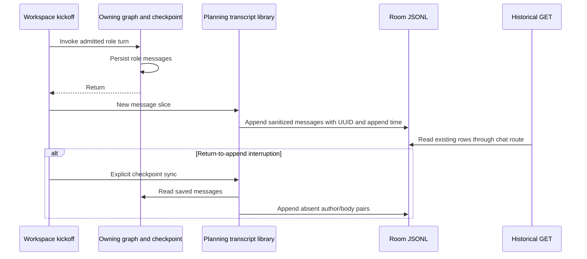

# War Room design

Purpose: expose the loopback operator UI/API for status, approvals, chat attachment, review, recovery, and diagnostics. Interfaces are `serve`, route modules, serializers/views, authenticated human actions, and static/template assets covered by this owner. Owns `REQ-WARROOM-001` (operator actions are explicit) and `DEC-WARROOM-001` (the UI projects canonical services rather than owning state).


Known gaps: unavailable forge descriptions limit historical attribution. Local
audit fixtures do not establish post-deployment live acceptance.

## Recovery summaries and planning transcripts

`REQ-WARROOM-TRANSCRIPT-001`: Historical chat preserves the owning Epic or
Feature's human and presentable role messages. Reading chat does not invoke a
graph or backfill a checkpoint. Task teams do not accept persistent-room chat.

`DEC-WARROOM-TRANSCRIPT-001`: Keep authored history in the owning room's
`docs/_war_room/chat/<graph-id>.jsonl`. The room follows registered document
ownership, including a backlog Feature's parent and a completed Epic's surviving
tracking checkout. History and a current recovery summary have different
evidence sources; an authored conclusion does not change an action's state.

The authoritative [model](../../architecture/target-9f61bc6d6f8ae8cb7d196c8b327650d5/model.dsl)
and [views](../../architecture/target-9f61bc6d6f8ae8cb7d196c8b327650d5/views.dsl)
connect `cascade-context` → `cascade-containers` →
`cascade-war-room-components` → `cascade-dashboard-code`. The Dashboard
component owns these implementation nodes, even when a supervisor caller uses
the transcript library within the same Python runtime.

| Entry point | Input, output and boundary |
|---|---|
| [recovery_incidents_by_work_id / recovery_incident_from_action](recovery_incident.py) | Consume the shared action snapshot, omit completed actions and select one summary per affected work item by update time. Explicit blockers produce blocked; an enqueued routing marker produces investigating; otherwise the summary is failed. This coarse label does not prove an executing attempt. |
| [handle_get_chat](sidecar_routes.py) | Validates the graph ID and returns the existing JSONL rows through `read_messages`; no sync occurs on GET. |
| [read_messages / _chat_read_path](chat_store.py) | Resolve the registered room without building the merged board, read the whole file and ignore malformed JSON lines. Missing history returns an empty list. This interface has no pagination or source-byte bound. |
| [append_transcript_message / remove_message](chat_store.py) | Append a UUID, author, body and append-time `ts`; remove a failed human-ingest row by rewriting the file. Both use `process_lock`, which fences threads only. |
| [append_planning_turn_to_chat](planning_transcript.py) | Sanitize and append new role messages supplied by [graph invocation](../workspace/kickoff.py). Provider failure details become a bounded system message. |
| [sync_planning_transcript_to_chat](planning_transcript.py) | Explicitly load the owning graph checkpoint and append absent author/body pairs. This can coalesce separate identical replies; it is not durable event-identity deduplication. |



Action attempts and acknowledgements persist independently in the
[Task-owned ledger](../task/DESIGN.md#action-evidence-and-transcript-boundary).
Chat has no cross-process uniqueness fence, source-occurrence timestamp or
live attempt milestone protocol. A queued summary, checkpoint or historical
message therefore cannot establish live execution or verified resolution.
Verification: [projection scenarios](../../tests/war_room/test_recovery_incident_projection.py),
[transcript scenarios](../../tests/war_room/test_planning_transcript.py) and
[read routing](../../tests/war_room/test_chat_poll_routing.py) exercise these
current boundaries, including GET without graph construction.

## Bounded health-audit projection reads

`REQ-WARROOM-AUDIT-001`: Dashboard consumers read only the current projection
pointer, its one immutable manifest, and the requested current, coverage, or
history pages. Regular-file no-follow opens cap total source bytes at 1 MiB,
rows at 100, and the serialized result at 256 KiB. Missing, stale, corrupt,
incompatible, or wrong product/tracking evidence is typed `pending`; it never
becomes an empty healthy result.

`DEC-WARROOM-AUDIT-001`: `audit_projection_reader.py` validates the bounded
manifest header and each page it actually visits instead of calling the
producer's full-epoch validator. Filters are normalized exact work ID, owner,
verification status, and UTC occurrence bounds. Opaque cursors bind those
filters to section, epoch, page, and row offset and contain no path. A newer
pointer returns an explicit epoch restart. Budget exhaustion returns an
incomplete page and continuation while preserving producer `source_ref`,
legacy provenance, and `detail_truncated` without opening a recovery ledger.

## Refresh latency and coherent read projections

`REQ-WARROOM-REFRESH-001`: first board rendering must not wait for independent
flight, boss, chat, audit or provider panels. The board and pending-brief
cancellation lookup run concurrently, but both must finish before board actions
are enabled; cancellation safety is not traded for responsiveness. Optional panel
requests no longer delay startup polling. Existing forced post-action freshness and
single-flight board reads remain intact.

`DEC-WARROOM-REFRESH-001`: serialize Epic readiness from the same request-scoped
board snapshot used for the rest of the response. `project_epic_plan_readiness`
is explicitly a read projection; it does not refresh all registered worktrees per
Epic. `compute_epic_plan_readiness` and approval/sign-off/dispatch boundaries still
fetch authoritative dependency evidence independently of a supplied or cached board.
A UI snapshot is never permission to execute a lifecycle action.

Cold scans parse thousands of frontmatter records across retained worktrees. The
board parser prefers PyYAML's `CSafeLoader` when libyaml is available and falls back
to `SafeLoader`; both retain safe-constructor semantics, schema validation, dates,
round-trip behavior and rejection of Python object tags. This is parser acceleration,
not an additional stale-state cache or a relaxation of document validation.

Regression evidence: `tests/epic/test_plan_readiness.py` verifies no per-Epic fresh
scan in board serialization while authorization still refreshes; board parser
compatibility and unsafe-tag rejection are covered in `tests/board/test_parse.py`.
The refresh race harness covers cancellation lookup, optional-panel independence,
and forced post-action reads.

Board serialization also batches completed-Epic staging checks into one integration
registry snapshot, and shares one durable recovery-action snapshot between incident
and task-delivery projections. These snapshots live only for that response; the next
request rereads the registries, and existing locks and standalone action-boundary
reads remain unchanged. `tests/war_room/test_projection_batching.py` verifies the
read count, empty snapshots, and refresh across requests.

## Health-audit HTTP consumer

`REQ-WARROOM-AUDIT-002`: `GET /api/health/audit` exposes verified current incidents,
producer-published aggregate coverage, freshness, and bounded receipt/failure
metadata. `GET /api/health/audit/coverage` and `/api/health/audit/history` serve
epoch-pinned pages with a default of 50 and maximum of 100 rows. Exact work ID,
owner, status, and UTC occurrence-time filters preserve unknown and unverifiable
evidence as nonmatches. Malformed query input is a 400; a changed epoch or cursor
filter mismatch gives a bounded restart response. Each response names the epoch,
continuation, and completeness, stays within 256 KiB serialized bytes, and
preserves stable source references instead of reading large raw details. An empty
verified-current page with incomplete coverage does not claim health.
Parent lifecycle rows also carry the bounded typed Task, Feature/Epic, recovery
generation, blocked owner/operation, original validation, prior/required review,
request/acknowledgement/execution, freshness and verified outcome published by
Watchdog. A resolved generation leaves current only after a fresh authoritative
postcheck and remains in history across restart. Missing or malformed detail is
pending or truncated, never inferred as health.

`DEC-WARROOM-AUDIT-002`: GET routes use the
[bounded projection reader](#bounded-health-audit-projection-reads)
at the resolved product repository root. They do not inspect recovery ledgers,
canonical board/worktrees, Git, providers, or schedule audit/recovery work.
`POST /api/health/audit` remains the authenticated manual admission route.
Repository identity, freshness and read-budget failures are visible as pending or
unknown status. The shared boundary is owned by
[the package design](../DESIGN.md#health-audit-read-boundary).

Verification locations: [route tests](../../tests/war_room/test_health_audit_routes.py)
and [reader tests](../../tests/war_room/test_audit_projection_reader.py) cover filtered pagination,
epoch/filter restart, stale and corrupt evidence, and strict source/response
budgets. The [integrated fixture](../../tests/war_room/test_audit_integrated_experience.py) follows real
producer output through the loopback routes across a new epoch and split
product/tracking roots, while the [browser race harness](../../tests/war_room/war_room_refresh_races.mjs) verifies
single-flight, read-only browser refreshes. The [GET benchmark](../../tests/war_room/benchmark_audit_get.py)
records warm loopback GET p95 and actual source/response bytes for a representative
10,000-attempt fixture. Local smoke evidence is not post-deployment acceptance.

## Feature activation explanations and new-work attention

`REQ-WARROOM-READINESS-001`: Activation explanations preserve `approved` and
`blockers` consumers. The board exposes a versioned summary, reasons, satisfied
prerequisites, owners, existing actions, observation freshness and actual dispatch
attempt evidence when available. A fresh human-action blocker takes precedence,
followed by unknown required evidence, known work/system waits, and evaluated
readiness awaiting dispatch. Passing gates never claims execution; historical
refusals remain separate from a newer evaluation. The browser renders these
projections without implementing eligibility rules.

`DEC-WARROOM-READINESS-001`: Board responses reuse request-scoped facts. Missing
cached evidence remains unknown; polling does not discover providers, perform
expensive per-feature Git probes, dispatch, or mutate lifecycle state. Action
boundaries re-evaluate their gates. This preserves truthful explanations without
turning browser refreshes into execution or repeated discovery.

`REQ-WARROOM-ATTENTION-001`: New-feature markers and collapsed-epic counts remain
separate from lifecycle and activation summaries. Viewing or rendering a feature
never acknowledges it. Workspace-shared **Mark seen** requires the request-scoped
human verifier, records actor/time, and does not approve, dispatch, edit plans or
clear blockers. Keyboard navigation, contrast and screen-reader labels support
both markers and actions.

`DEC-WARROOM-ATTENTION-001`: The UI consumes the canonical tracking-workspace
attention ledger through `feature_attention_routes.py`. A monotonic revision
prevents an older poll response from undoing an acknowledgement. Unavailable or
corrupt state remains visibly unavailable and disables acknowledgement; it never
silently resets the baseline. Ledger persistence belongs to
[`feature_attention.py`](../feature_attention.py), which shares state across
managed worktrees and split repositories using atomic writes and locking.
Completed, cancelled and retired children leave pending-attention aggregates
without deleting provenance; replay and plan edits do not recreate acknowledged
newness.

Verification: [readiness evidence](../../tests/war_room/test_feature_readiness_evidence.py),
[board readiness](../../tests/war_room/test_board_feature_readiness.py), and
[attention API/browser scenarios](../../tests/war_room/test_feature_attention_api.py)
cover missing/stale evidence, explicit acknowledgement, concurrent revisions,
refresh persistence and storage failure.

## Architecture review boundary

The War Room presents revision-pinned architecture resources and review state.
Publication, artifact ownership, destination, generation, ancestry and byte-digest
validation belong to the [workspace design](../workspace/DESIGN.md), specifically
[REQ-WORKSPACE-001](../workspace/DESIGN.md),
[REQ-WORKSPACE-002](../workspace/DESIGN.md) and
[DEC-WORKSPACE-001](../workspace/DESIGN.md). Registered owning
lineage determines each artifact's current revision; tracking and product
revisions remain distinct in split repositories. The UI does not grant permission
to publish or accept a stale review. Supported retries retain failure history and
exact proposal evidence.

The repository-owned [C4 model](../../architecture/target-9f61bc6d6f8ae8cb7d196c8b327650d5/model.dsl)
is authoritative; its [views](../../architecture/target-9f61bc6d6f8ae8cb7d196c8b327650d5/views.dsl)
represent the War Room, supervisor and repository boundaries. Readiness,
attention and audit presentation stay within these components.
[Architecture HTTP tests](../../tests/war_room/test_architecture_http.py) and
[tab UI tests](../../tests/war_room/test_architecture_tab_ui.py) verify the local
consumer boundary; [publication tests](../../tests/workspace/test_architecture_publication.py)
verify owner-lineage and exact-revision enforcement.

## Integrated C4 exploration and source inspection

- `REQ-WARROOM-C4-001`: Operators can navigate system context → containers →
  components → authored Code views through verified semantic targets. Both branch
  browsing and comparison review start at system context when one is available;
  explicit view selections and deep links take precedence. Landscape is an
  optional overview in the view selector, not a parent level: Level up stops at
  context and never returns a landscape. If context is absent, choose an available
  non-landscape view, falling back to landscape for landscape-only models. Explore
  opens the broadest available next-level view directly; the view selector retains
  focused alternatives. In comparison review, Explore requires a
  unique same-level destination whose target set contains all alternatives
  when there are multiple choices; otherwise a named chooser is scrolled into view and focused, with Escape to dismiss.
  Referencing an element in another view does not imply that the view expands
  it. Comparison Level up prefers the verified originating parent from navigation
  history, then the broadest nearest parent when there is no origin;
  browser history and deep links restore snapshot, view, level and selection.
- `REQ-WARROOM-C4-002`: Selecting a code element exposes its declaration kind,
  source path and symbol, and an authorized source resource at the snapshot's
  code revision. Comparison details use the declaration kind from each side's
  semantic model.
  Source previews render plain text, never Markdown or executable HTML. Advancing
  HEAD cannot change the bytes of an existing source URL. Invalid opaque resource
  IDs fail rather than accepting caller-supplied paths.
- `REQ-WARROOM-C4-003`: Repeated navigation reuses immutable SVG responses and
  the bounded browser SVG cache. Selecting an element preserves the existing SVG
  and zoom in the branch browser. Comparison rebuilds preserve
  zoom and pan for each unchanged pinned combined diagram across background refresh,
  selection, discussion updates and consecutive renders before SVG loading
  completes. Fit explicitly resets that diagram; a new diagram identity starts
  fitted. Destroyed viewers cannot install late responses. Implementation
  designs are discoverable from the pinned ownership mapping, with Mermaid
  rendering for supplementary behavior diagrams.

`DEC-WARROOM-C4-001`: Native Structurizr custom views with validated component
scope appear as `codeViews` in the API and Code in the selector. Code nodes remain
verified SVG hit targets, not a separate documentation-only navigation system.
Requirements links and ownership context remain distinct; a source link does not
assert requirement coverage. Snapshot discovery/refresh is explicit, and diagrams
exclude uncommitted changes.

[architecture_routes.py](architecture_routes.py) projects authorized snapshots,
view scopes, design resources and pinned code resources.
[architecture_tab.js](static/architecture_tab.js) coordinates navigation and
previews; [plan_viewer.js](static/plan_viewer.js) owns shared SVG interaction.
Rendering and identity guarantees belong to
[the workspace design](../workspace/DESIGN.md#c4-code-model-and-rendering-contract).

Verification: [HTTP tests](../../tests/war_room/test_architecture_http.py),
[tab tests](../../tests/war_room/test_architecture_tab_ui.py), and
[comparison navigation](../../tests/war_room/paired_c4_review_cases.mjs).
The authored team views are in the repository
[view inventory](../../architecture/target-9f61bc6d6f8ae8cb7d196c8b327650d5/views.dsl).


`DEC-WARROOM-C4-002`: The comparison saves its viewer's viewBox before replacing
its DOM and destroys the discarded viewer. The restoration key includes side,
view key/level, repository, revision and SVG reference. At most 32 saved entries
are retained for the review instance; a pending viewer with no viewBox does not
overwrite saved coordinates. The default 15-second background refresh must not
reset the viewport to Fit. Viewport state is local presentation state, not review
evidence.

## Committed planning comparisons and project previews

- `REQ-WARROOM-COMPARE-001`: Plan and DESIGN.md comparisons cover the registered
  planning branch base through its latest committed HEAD, including multiple
  commits. Undispatched work uses its nearest registered planning ancestor.
  Ownership cycles, checkout/branch mismatches, unavailable revisions and an
  uncommitted proposed plan produce an unavailable result. The plan comparison
  excludes frontmatter; design comparison includes every changed DESIGN.md,
  including additions and removals, with full unchanged context on both sides.
- `REQ-WARROOM-COMPARE-002`: The Work tab (labeled Epic / feature / task)
  initially shows the plan alone. When an
  original brief exists, the operator can reveal its comparison and revision
  labels. The Design tab (labeled DESIGN.md changes) presents documents with rendered block
  highlighting. A directory tree includes unchanged design owners as context;
  only changed documents are selectable, with green additions, amber changes
  and red removals. Each side offers previous/next changed-block navigation
  with a position indicator; narrow screens stack the tree and two sides.
  Comparisons include integrated task/feature commits regardless of author,
  but exclude uncommitted edits and work not yet integrated into the owner branch.
  C4 uses the full review width, while contextual documentation belongs in the Design tab.
- `REQ-WARROOM-COMPARE-003`: Opening C4 requests the current project integration
  revision versus the expected project after applying the selected committed
  proposal. Work already integrated into the project must remain in the preview.
  Merge conflicts are visible failures. Preview generation does not move real
  refs or alter the operator checkout/index, publish a review, grant approval,
  or promote accepted lineage. Tasks can preview without separate architecture
  approval. Split architecture repositories require a published review.
- `REQ-WARROOM-COMPARE-004`: Polling retains the authorized snapshot pair and
  reports when the project or proposal advances. Explicit comparison refresh
  reloads the page to obtain new pins. Once project preview is requested, late
  publication responses or failures cannot replace it with publication data or
  an empty accepted baseline. Transient preview failures retry via the project
  loader. A merge conflict lists the affected paths and pauses polling until
  the operator retries. Uncommitted source changes are excluded.
- `REQ-WARROOM-COMPARE-005`: One diagram contains the union of both revisions:
  removals are red, additions green, semantic edits amber, and unchanged targets
  remain as context. Reviewed renames remain one changed target. A rewired
  relationship shows its old connection in red and new connection in green.
  Selection/focus remains visible without hiding change color; relationships use
  native SVG strokes. Dashed amber signals changes in deeper verified views
  without reclassifying an unchanged parent as edited.

`DEC-WARROOM-COMPARE-001`: [plan_comparison.py](plan_comparison.py) resolves Git
inputs on the server. Document comparisons use the registered branch base;
project diagrams use the latest project target HEAD when the preview is created.
These baselines answer different review questions. A private temporary index and
worktree perform a three-way merge; a deterministic commit object pins divergent
projections without moving a branch. Ancestor cases reuse the appropriate commit.
Git document reads have a 10-second timeout and 2 MiB output cap; changed design
text has a cumulative 2 MiB cap. The `design_tree` inventory covers the union of
both revisions' design paths, including unchanged documents. File presence
classifies additions and removals independently of empty content. The browser
builds ancestor directories from those paths and renders only the selected
changed document. `renderDocumentComparison` highlights rendered blocks;
`appendChangeNavigation` installs per-side controls after Markdown rendering,
wraps at each end and focuses the target without changing the pinned revisions.
Selection survives review rerenders while its document remains changed.
Projection Git operations have 30-second timeouts.

```mermaid
sequenceDiagram
    participant UI as Design tab
    participant API as Document API
    participant Git as Registered owner branch
    UI->>API: Load work document and comparison
    API->>Git: Read base and committed HEAD
    alt Revisions unavailable or read limit exceeded
        API-->>UI: Explicit unavailable comparison
    else Comparison available
        API-->>UI: Design path inventory and changed document bodies
        UI->>UI: Build directory tree; select changed module
        UI->>UI: Render both sides and highlight changed blocks
        UI->>UI: Previous/next focuses a highlighted block
    end
```

`DEC-WARROOM-COMPARE-002`: `POST /api/architecture/plan-preview` accepts a work ID
and optionally the current/proposed opaque snapshot IDs. Server-resolved context,
shared projection evidence and ancestor checks bind the pair to its project and
proposal. It delegates rendering to the bounded snapshot scheduler. Draft payloads
have no approval context or reviewed tuple. Staged publications in
[review-units.json](../../architecture/review-units.json) retain their original
accepted baselines and pinned references; the project comparison does not
rewrite publication evidence or establish acceptance of working-tree edits.

`DEC-WARROOM-COMPARE-003`: Semantic target classification is shared across both
sides, with previous IDs inheriting reviewed rename state. Descendant-change
markers are derived for navigation without mutating the review payload. Viewer
installation removes exported inline pixel dimensions so the container controls
SVG sizing while the viewBox controls zoom, pan and Fit.

Verification: [comparison tests](../../tests/war_room/test_plan_comparison.py)
cover ownership, multi-commit document context, design inventory, project integration,
conflicts and pinned polling; [design browser scenarios](../../tests/war_room/test_design_tree_browser.py)
cover module selection, unchanged context, additions/removals, change navigation
and narrow screens; [comparison review scenarios](../../tests/war_room/paired_c4_review_cases.mjs)
cover navigation, descendant markers and zoom/pan restoration, including explicit
Fit and revision changes. [Chromium scenarios](../../tests/war_room/test_project_c4_colors.py)
cover semantic colors, responsive SVG sizing, drill/parent choices and publication
versus project-preview races. These fixtures do not claim live deployment acceptance.


## Single-diagram architecture differences

`REQ-WARROOM-C4-004`: The comparison uses one canvas with Zoom in, Zoom out and
Fit. It has no linked-view preference or alternate two-pane mode. All targets in
either revision's selected view remain inspectable, including removed views.
Clicking an expandable element (or pressing Enter/Space) opens its verified deeper
view, using the destination chooser when ambiguous. Clicking a leaf or relationship
selects it and exposes before/after semantic attributes, identity, parent, relationship
endpoints and available source metadata; absence is explicit. The Semantic targets
list allows inspection of expandable elements without navigation. Explore selected
element also opens verified deeper views from the inspection panel.
Removed targets navigate using current evidence, and surviving/new targets use
proposed evidence. An unavailable combined render shows pending/failure status,
never a proposed-only diagram that would hide removals.

`DEC-WARROOM-C4-003`: [initPairedC4Review](static/plan_viewer.js) retains its API
name and underlying two-revision navigation/review evidence, but creates only one
[createSemanticC4Viewer](static/plan_viewer.js). The display graph is a derived
comparison artifact, not either revision's actual architecture. It uses a fresh
layout of the union, with C4 element types as labels. Parent/containment changes
are inspected in before/after details rather than presenting conflicting parent
hierarchies as one real hierarchy. This avoids maintaining viewport alignment
between independently laid-out revisions. Rendering belongs to
[the workspace comparison contract](../workspace/DESIGN.md#derived-comparison-rendering).

The authoritative [model](../../architecture/target-9f61bc6d6f8ae8cb7d196c8b327650d5/model.dsl)
and [views](../../architecture/target-9f61bc6d6f8ae8cb7d196c8b327650d5/views.dsl)
expose `cascade-war-room-components`, `cascade-diagram-review-code` and
`cascade-comparison-render-code`. The diagram-review component coordinates the
browser and project-preview endpoint; Workspace owns derived graph construction
and bounded rendering. These responsibilities remain inside the existing runtime
and repository boundaries.

```mermaid
sequenceDiagram
    participant UI as Comparison page
    participant API as Project preview
    participant Union as Combined graph builder
    participant Scheduler as Render scheduler
    UI->>API: Request pinned comparison
    API->>Union: Authorized current/proposed projections
    Union->>Scheduler: Admit or reuse derived source closure
    alt Render pending or failed
        API-->>UI: Explicit state; no incomplete diagram
    else Verified artifact ready
        Scheduler-->>Union: Bound native SVG
        API-->>UI: Single diagram and before/after target metadata
        UI->>UI: Restore viewport; inspect semantic changes
    end
```

Verification: [combined browser flow](../../tests/war_room/test_single_c4_comparison.py)
uses a real bounded render to check the single canvas, removals/additions/edits,
selection details, revision-side routing, refresh preservation and Fit.
[Navigation scenarios](../../tests/war_room/test_project_c4_colors.py) cover drill
and parent selection in the combined canvas. [Viewport regression scenarios](../../tests/war_room/paired_c4_review_cases.mjs)
cover rapid rerenders and new pinned revisions.
