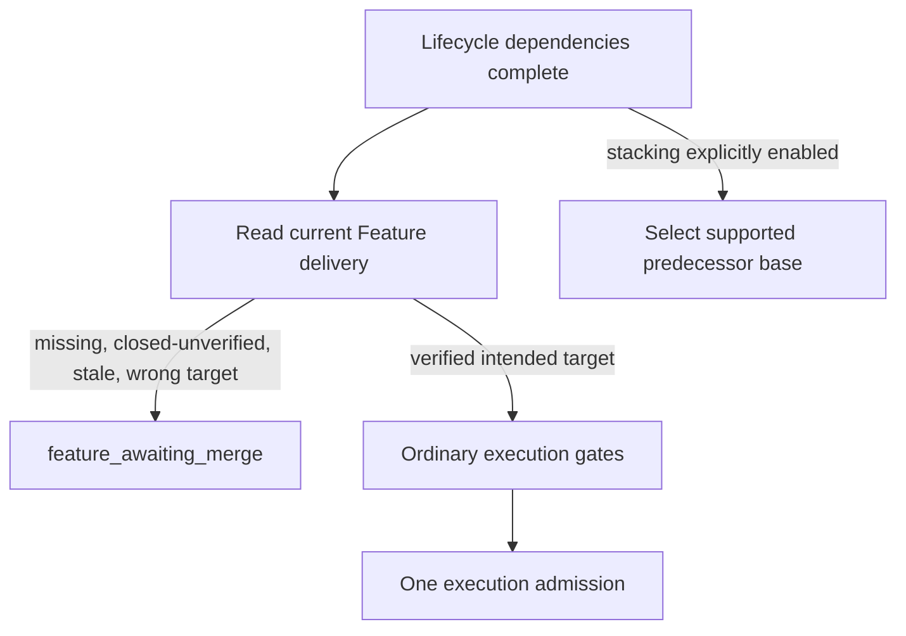
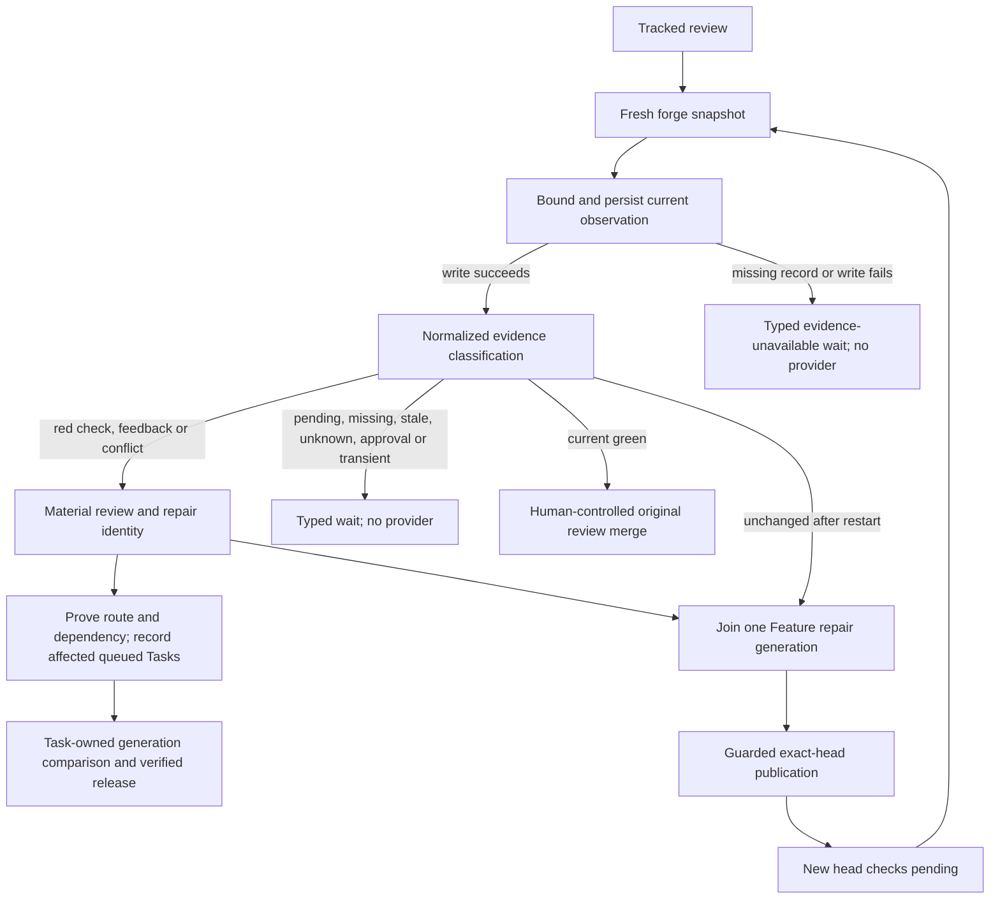
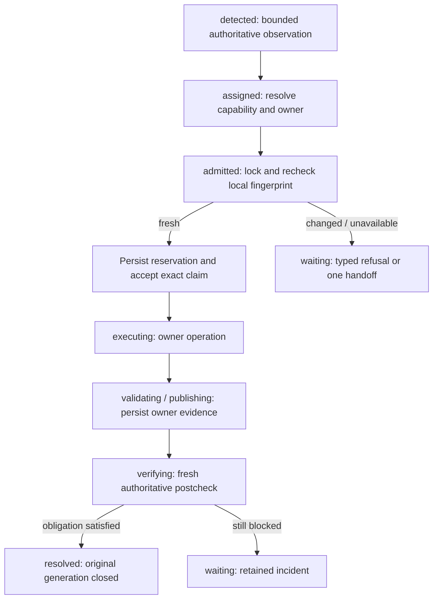

# Watchdog design

Purpose: observe canonical state, admit dependency-ready work, and coordinate bounded recovery. Interfaces are dispatch/activation, queues, poll loop, capability registry, incidents/reservations, health audit, and model resolution. Owns `REQ-WATCHDOG-001` (automation obeys lifecycle gates) and `DEC-WATCHDOG-001` (generation-bound reservations converge recovery).

## Interrupted Epic provisioning

`DEC-WATCHDOG-ACTIVATION-001`: An existing registry row does not, by itself,
prove that planning started. A new explicit human activation may resume a
single-repository backlog Epic's existing checkout only when no return manifest,
plan approval, child work, current/archived checkpoint or `EpicActivated` queue
evidence exists. Recheck dependency and provider admission on the current
reviewed brief. Workspace must prove the exact unlocked registered branch/path,
clean Git status and `original base ≤ checkout HEAD ≤ reviewed base` ancestry.
Fast-forward to the approved base, prepare the checkout and refresh its base
registration without deleting or resetting a branch. Dirty, divergent,
branch-only or previously activated runs remain refused and preserved. The usual
activation inserts one durable event and starts one run only after materializing
the live document. No GET or automatic retry admits this action.

Regression tests in `tests/test_backlog_snapshot.py` reproduce remote historical
duplicate child documents and reuse a staged checkout on a newer approved base;
`tests/watchdog/test_dispatch.py` covers refusal of actual work or activation
evidence.


## Current recovery progress publication

The significant producer, its SQLite projection state, fenced transcript mapping
protocol, pending behavior and restart replay are owned by the
[Recovery progress design](../recovery_progress/DESIGN.md). Watchdog calls
[`drain_recovery_progress`](../recovery_progress/publisher.py) at the beginning
of `watchdog_tick`, before `process_lock` and slow lifecycle, Git or provider
work. It supplies authoritative receipts and postcheck observations but does not
own the projection's requirements or decisions. War Room owns transcript
durability and the bounded read surface.

The `cascade-watchdog-code` view links the tick, bounded drain and immutable
publisher, including the durable mapping writer; `cascade-dashboard-code` owns
receipt serialization, graph append, deadline-bound graph fence and read-only
existing-index source-key lookup. Publisher and transcript lock/SQLite waits
consume one caller deadline; admitted filesystem/source work remains a separately
measured baseline and can leave replayable pending work.

## Dispatch ownership transition

Feature dispatch binds the dependency-checked board selection to its source
checkout before registering the destination Feature worktree. Registration
transfers mutation ownership, so the selected document is then relocated into
that exact checkout and activated before the dispatch event is emitted. This
ordering admits backlog documents retained outside the Epic checkout without
allowing a sibling copy to win by board rank, and it prevents the empty newly
registered checkout from being mistaken for the relocation source. Tasks
minted after this transition are owned by the Feature checkout and follow the
ordinary Task dispatch and supervised validation path.

The temporary-repository acceptance matrix in
[`tests/test_late_repair_convergence.py`](../../tests/test_late_repair_convergence.py)
crosses this transition before exercising late repair, review generation and
parent integration. The existing supervisor component and Watchdog code views
remain accurate: the change does not add a runtime boundary, persistent store,
public interface or new implementation symbol.

## Feature delivery dependency gate

`REQ-WATCHDOG-DISPATCH-001`: Integration-required execution starts only when
each completed Feature dependency has current evidence of integration on its
intended Epic target, or an explicit supported terminal disposition.
`DEC-WATCHDOG-DISPATCH-001`: Keep lifecycle planning readiness in
[`evaluate_dependencies`](../dependency_evaluation.py) and apply the shared
read-only [Feature delivery projection](../review.py) as a separate action gate.

[`_dependency_review_pending`](dispatch.py) reads one bulk delivery projection
for the Task's Feature dependencies. Missing review evidence, a closed review
without accepted current-generation heads, a later generation than the accepted
one, or an accepted commit absent from the intended target returns
`feature_awaiting_merge`. [`dispatch_task`](dispatch.py) performs this check for
ordinary and recovery dispatch because [`retry_task`](../feature/recovery.py)
re-enters the same canonical boundary. Planning status is unchanged and does not
claim that delivery is verified.

Serial Feature admission uses
[`feature_dispatch_blockers`](../stacked_dispatch.py) with the same delivery
predicate. When stacked dispatch is explicitly enabled, a dependent Feature may
instead use the supported predecessor branch as its base; this is an execution
contract exception, not fabricated Epic-target integration. Current verified
intended-target evidence releases an eligible consumer through the normal
approval, capacity, provider and lifecycle gates, which admit only one active
execution.



Verification is in
[`tests/test_feature_delivery_consumer_gates.py`](../../tests/test_feature_delivery_consumer_gates.py),
using temporary Git repositories and normal activation and approval.


## Publication-owner liveness

The first step of `watchdog_tick` reconciles proven-dead review-publication process
claims before any board projection or dispatch. It performs no model call, Git
mutation or automatic retry. The existing owner-recovery event path receives one
claim-specific inquiry and remains available for completed teams with unfinished
review obligations. Board errors later in the pass cannot leave these identified
dead claims indefinitely running. Unknown process identity is not proof of death.
See `cascade/task/DESIGN.md` and `cascade/DESIGN.md` for the durable transition and
publication validation contract.

Review-validator admission does not add a second Watchdog budget or capability.
The Teams publication path consumes the same Task-owned cumulative gate directly;
Watchdog continues to own observation, proven-dead owner reconciliation and the
independent postcheck. Landscape, context, container and `cascade-watchdog-code`
remain unchanged because no Watchdog source symbol, persistent store or runtime
boundary changes at this interface.

## Original recovery incident identity

Watchdog incident envelopes preserve `original_incident_id` independently from
`authoritative_generation`. The generation continues to fingerprint current
material evidence and capability authority; changing it does not create or own
another cumulative allowance. Task owns the durable lineage, trusted policy,
extensions, and escalation under
[`REQ-RECOVERY-BUDGET-001`](../task/DESIGN.md#durable-incident-lineage-and-policy).
Watchdog remains an observation and capability consumer and does not maintain a
second budget store. Existing envelopes without an original identity remain
readable; expensive admission must not infer fresh allowance from that absence.

[`incident_budget_identity`](incidents.py) reads the original identity without
substituting the work ID or material generation. After the ordinary capability
reservation is accepted, [`reserve_budgeted_operation`](reservations.py) passes
that identity, the exact Watchdog claim token, operation identity and worst-case
charge to Task's cumulative gate. Its returned permit is distinct from the audit
observation and capability claim. [`settle_budgeted_operation`](reservations.py)
settles the corresponding Task receipt on success, refusal, timeout or
interruption. The wrappers do not keep allowance, reclaim a claim by lease age,
or launch work when Task returns pending, exhausted or owner-decision.

[`record_result`](reservations.py) distinguishes completion of the bounded
adapter invocation from completion of the wider lifecycle incident. A known
deferred, refused or no-op owner result charges the attempted invocation and
releases its budget claim; it does not manufacture lifecycle success or turn a
completed invocation into an unclassified execution failure. Adapter errors and
unsafe results retain failure settlement semantics. This permits a later owner
or restart to use the remaining original allowance while the independent
postcheck continues to decide whether the incident itself is resolved.

The `cascade-watchdog-code` view includes
[`incident_record`](incidents.py) as the envelope boundary and the reserve/settle
consumer functions above. Focused lineage and
restart coverage is in
[`tests/task/test_incident_budget.py`](../../tests/task/test_incident_budget.py),
while [`tests/watchdog/test_incidents.py`](../../tests/watchdog/test_incidents.py)
retains generation/history compatibility coverage. Watchdog settlement mapping
is covered by
[`tests/watchdog/test_reservations.py`](../../tests/watchdog/test_reservations.py),
and the real-repository post-push/restart path is covered by
[`tests/test_late_repair_convergence.py`](../../tests/test_late_repair_convergence.py).

## Health-audit projection contract

`REQ-WATCHDOG-002`: Projection source decoding preserves durable references,
identity and provenance while bounding reads and exposing failures as coverage.
`DEC-WATCHDOG-002`: Use a versioned projection schema and typed source references
so consumers can pin a consistent epoch without interpreting raw ledgers.

`audit_projection.py` owns schema version `3`, the source decoder, and the typed
producer models.  The canonical ignored publication root is
`.cascade/health_audit/projections/` under the resolved product repository.  A
manifest records the immutable epoch, observation/freshness times, interval,
product and tracking identities, page counts for `current`, `coverage`, and
`history`, plus per-source revision/failure markers.  Every summary repeats the
schema version and keeps occurrence, latest attempt, and latest successful
verification as separate timestamps.  Recovery-ledger success is an attempt
result and does not populate `last_verified_at`; canonical audit reconciliation
supplies that timestamp.  The audit lane publishes complete epochs;
the War Room consumes them without importing source classification logic.

`source_ref` is an opaque tuple of a fixed store name, its durable row key, and
an optional zero-based `incident_history` ordinal.  It never contains a path.
The compatible stores and collections are:

| Store | Runtime file | Collection |
|---|---|---|
| `action_recovery` | `executions.json` | `actions` |
| `orphan_delivery` | `orphan_delivery_recoveries.json` | `recoveries` |
| `remediation_dispositions` | `remediation_dispositions.json` | `dispositions` |

The decoder uses regular-file, no-follow reads capped at 1 MiB per source and
does not write those ledgers.  Missing, unreadable, malformed, non-regular, or
oversized sources become typed coverage failures.  A malformed row or history
item affects only its own reference, so readable neighbors remain visible.
Summaries indicate `detail_truncated` once a source record exceeds the bounded
detail allowance; they retain a reference and selected identity/state fields,
not evidence objects, provider prompts, credentials, arbitrary result payloads,
or hidden reasoning.

A modern source row qualifies as a current candidate only when its `work_id` is typed and
unambiguous (including agreement with nested `work.work_id`), its generation is
a complete SHA-256 incident identity, its failure class is nonempty, and its
outcome is not successful.  Its source attempt is also indexed in
history.  Prior `incident_history` entries remain historical and are addressed
by ordinal.  Rows lacking one of those identity elements are historical and
unverifiable, with explicit coverage.  The legacy remediation shape—incident
`child_id`, `observed_child_sha`, and `supervisor_id` plus outer `action`,
`result`, `reason`, and `observed_at`—is always historical/unverifiable.  The
child SHA is provenance only and is never promoted to an authoritative
generation.

Producer state transitions are conservative: a valid unresolved modern source
attempt may be a `proven_incident` candidate; an authoritative successful verification is
retained as history with its own success timestamp; unavailable, ambiguous, or
legacy evidence is `pending`/`unverifiable`; and freshness expiry is represented
as `stale` during reconciliation.  Only a fresh authoritative observation may
move a row into or keep it in `current`, and only authoritative satisfaction of
the relevant obligation may resolve it.  Request delivery, acknowledgement,
result text, or a reported fix is follow-up state, not verification.

The focused compatibility fixtures live in
`tests/watchdog/test_audit_projection.py`.  They cover all three stores, current
and prior generations, the legacy shape, malformed adjacent rows, bounded large
evidence, stable references, and byte-for-byte source immutability.  Pages built
from these models are intended for 50-row default/100-row maximum pagination
and the 256 KiB response ceiling.

## Bounded candidate reassessment

`REQ-WATCHDOG-003`: Each completed audit pass fairly revisits ongoing work and
historical unresolved obligations, advances beyond unavailable candidates, and
keeps selection and observation within the pass budget.
`DEC-WATCHDOG-003`: Persist separate tier positions for the ongoing and
historical pools, plus a counter that reserves at least every fourth admission
for history while both pools contain candidates. This prevents a continuous
stream of active work from starving retained obligations across restarts.

Candidate inventory reads the canonical board from the tracking repository and
registered worktrees, with product-side Git and worktree references. Nonterminal
and recently completed work enters the ongoing pool. Older completed work enters
the historical pool when an unresolved action, review, reconciliation, cleanup,
or registered worktree names it. Multiple references to one typed work ID
produce one candidate with all reasons and source references. A missing or
malformed canonical document remains an unavailable candidate for later retry.

The receipt's opaque cursor carries both pool positions, tier rotation, and the
historical admission counter. Each selected candidate has its own continuation
so a timeout, unavailable document, or completed prefix can advance without
skipping the unobserved suffix. The audit worker shares a read-only board
snapshot within one pass; every repair still rechecks canonical state. The
worker admits at most 100 candidates and 60 seconds per pass, and gives each
observation at most two seconds. A process boundary reaps the worker and its
subprocesses when the whole pass cannot finish. Candidate failures retain a
retry reason and do not turn missing evidence into a healthy result.

`tests/watchdog/test_audit_candidates.py` verifies pool rotation, retained
references, split-root identity, unavailable evidence, and cursor continuation.
`tests/watchdog/test_audit_lane.py` verifies observation deadlines, timeout
advancement, partial-page continuation, snapshot reuse, and worker cleanup.

## Projection publication

`REQ-WATCHDOG-004`: A completed audit pass publishes consistent current,
coverage, and history evidence without treating an interrupted write as a
completed pass. A missing or invalid epoch is pending rather than healthy.
`DEC-WATCHDOG-004`: Write immutable pages and a manifest before atomically
replacing one epoch pointer. Readers pin the pointer's epoch so a concurrent
publication cannot mix pages from different observations.

The producer reconciles source attempts with canonical audit observations.
Only a matching work ID, generation, and failure class can place an incident
in `current`. Unmatched attempts and observation failures stay in `coverage`;
prior current rows become stale coverage when their verification expires.
History retains prior source attempts and legacy provenance across passes.
Completed passes also carry forward pending coverage when a candidate was not
reassessed. The manifest includes source revision and failure markers. The
producer checks them again before writing and aborts if it detects a change.

`REQ-WATCHDOG-005`: The immutable schema-2 manifest carries bounded aggregate
verification counts by status and reason, section row/page counts, observation
and freshness times, interval, and product/tracking repository identities. These
counts are produced with the epoch so consumers can report coverage without
scanning all pages.

`DEC-WATCHDOG-005`: Coverage counts are grouped by verification status and by
at most 64 most-common reason strings; the remaining reason count is explicit
in `other_reasons`. Status and reason totals each equal the coverage row total,
and section page/row totals agree with the 100-row page ceiling. A pass with a
legacy schema-2 manifest lacking these fields republishes even when its rows
are unchanged. The full-epoch validator checks every page before declaring an
epoch complete. The bounded dashboard reader is owned by
[War Room](../war_room/DESIGN.md#bounded-health-audit-projection-reads) and
validates the pinned header and only the requested pages. The shared
[package boundary](../DESIGN.md#health-audit-read-boundary) keeps source
classification with the producer.

Each page contains at most 100 rows and 256 KiB of serialized JSON. The
producer writes and syncs every page and its manifest under a new epoch,
then replaces `current.json` and syncs the publication directory. An
interruption before pointer replacement leaves the prior epoch readable and
the incomplete directory unreferenced. The lane records publication failure
without advancing its receipt cursor. An unchanged pass reuses the prior epoch
and writes no projection files. `read_projection_manifest` checks the pinned
epoch and returns a pending reason for missing, malformed, incompatible, or
invalid pages.

`tests/watchdog/test_audit_projection.py` verifies matching authority, page
bounds, restart reconciliation, unchanged publication, corrupt pages, and an
interrupted pointer swap. `tests/watchdog/test_audit_lane.py` verifies that a
publication failure leaves the pass pending.

The bounded War Room consumer is owned by
`cascade/war_room/audit_projection_reader.py`; it does not call the full-epoch
`read_projection_manifest` publication check.

## Architecture authoring skill delivery

`REQ-WATCHDOG-SKILLS-001`: Epic Manager, Epic Architect, Feature Lead, Feature
Architect, SWE and Boss defaults include the repository design skill. Task-specific
skills extend and deduplicate SWE defaults; missing or escaping skill paths fail
validation. Planning and Boss prompts load effective playbook text; Task activation
loads SWE playbooks into graph state for subsequent turns.

`DEC-WATCHDOG-SKILLS-001`: [role_skills.py](role_skills.py) owns defaults and
resolution. [The design skill](../../skills/design/SKILL.md) owns the authoring
contract, including integrated component-to-code navigation, real source symbols,
lifecycle/isolation detail and verification. Planning establishes architecture,
SWE reconciles it with implementation, and review checks coverage. Planning prompts
explicitly require an impact inventory through integrated Code views and Task
acceptance criteria; SWE, self-review and Boss playbooks reference the same
depth contract. Merely having
a rendered diagram is not proof of completeness.

Verification: [role defaults and loading](../../tests/watchdog/test_role_skills.py),
[Task playbooks](../../tests/task/test_skills_context.py),
[SWE prompt delivery](../../tests/task/test_swe_turn.py), and
[Boss prompt delivery](../../tests/boss/test_model_turn.py).

## Repository health-audit configuration

The tracked [cascade.toml](../../cascade.toml) disables periodic health auditing
with `automation.health_audit.enabled = false`. Normal work automation remains
enabled independently. The authenticated manual audit entry point remains
available; disabling the schedule does not certify health or erase previous
audit evidence. [config.py](config.py) validates these independent settings;
[worker.py](../workspace/worker.py) wires the lane and conditionally starts
automatic investigations. This is a repository operational choice, not a
requirement for responsive architecture rendering.

## Open-review observation

`REQ-WATCHDOG-REVIEW-001`: A registered open review is healthy only when its
normalized current-head evidence is green. Failed required checks, actionable
feedback and a confirmed merge conflict are actionable even when the forge
reports clean mergeability. Pending or missing checks, stale evidence, unknown
policy, approval-only waits and transient forge failures remain typed waits and
cannot enqueue a provider turn.

`DEC-WATCHDOG-REVIEW-001`: Route all actionable evidence for one Feature review
through its existing generation-bound Feature repair owner. The durable request
evidence binds the original review and route, source/target head pair, failing
check generation or feedback identity, and repair generation. An identical poll
or restart rejoins that action and retains its attempts and budgets. Changed
material evidence receives one new content-addressed request identity, still
subject to the single-writer and ordinary repair gates.

[reconcile_open_review_health](../review_health.py) reads registered reviews and
uses [merge_request_snapshot](../tracking.py) for the normalized original-review
identity, exact heads, mergeability, policy, current check generations and human
feedback. Before classification can route work,
[record_feature_review_evidence](../review.py) bounds check names, generations,
heads, feedback counts and diagnostic text and stores the current observation in
the canonical review registry. Exact check names and string generations are
limited to 256 UTF-8 bytes, integer generations to 64 decimal digits, check
presentation to twenty rows plus an omitted count, and the serialized normalized
observation to 32 KiB. Oversized or malformed authoritative identity writes a
bounded unavailable marker when the registry remains writable and refuses the
observation. The registry write is serialized and atomically replaced. If the
review record is missing or persistence fails, reconciliation returns the typed
`review_evidence_persistence_failed` prerequisite and does not route repair from
evidence that read-only consumers cannot later inspect.
Classification also requires every target-required check to carry the observed
source head and a nonempty, non-boolean generation; a status-only green map is
stale evidence. The independent repair postcheck repeats that rule for the fresh
source/target pair before the Feature ledger can record verification. Integer
zero remains a valid generation.
[_route_actionable_review_health](../review_health.py) constructs the material
identity and calls
[request_feature_review_repair](../team_supervision.py), whose existing action
ledger and single-writer gate retain repair ownership across restart. The Feature
owner creates any repair Task and uses the guarded resolution publication path;
the observer never reruns CI, executes forge text, opens another review or merges
the original review.

The same actionable observation calls the Task-owned
[record_upstream_review_observation](../task_rollup.py) boundary for queued
deliveries owned by dependent Features. Watchdog supplies the normalized blocker,
material generation and observed source/target route but does not claim or retry
a downstream Task. Task admits the observation only when the route names the
observed Feature and its Epic and the queued Task's direct owner declares that
same-Epic Feature dependency. The
[Task delivery contract](../task/DESIGN.md#durable-delivery-collaborators) owns
generation comparison, attempt charging and release after the independent
verified repair postcheck. The Watchdog-to-Task observation edge is visible in
`cascade-supervisor-components` and `cascade-team-components`; each endpoint
opens its owning Code view. Task persistence nodes retain their Task component
ownership.



Green observation does not merge a review or prove intended-target integration.
The [shared review contract](../DESIGN.md#delivery-and-review-boundaries) and
[Boss closeout](../boss/DESIGN.md#delivery-and-closeout) retain acceptance and
integration ownership. Snapshot, classification and actionable routing are
native nodes in `cascade-watchdog-code`, below `cascade-supervisor-components`;
the existing direct-parent adapter and Feature action remain visible in their
owning team Code views in the
[authoritative views](../../architecture/target-9f61bc6d6f8ae8cb7d196c8b327650d5/views.dsl).
Verification: [review-health tests](../../tests/test_review_health.py).
The postcheck cases in
[parent lifecycle postcheck tests](../../tests/watchdog/test_parent_lifecycle_postcheck.py)
cover changed heads, red results and malformed generations without weakening the
exact repair-generation fence.

## Recovery admission and active-path authority

`REQ-WATCHDOG-REPAIR-001`: Audit repair requires a fresh canonical incident,
a supported capability for its accountable owner, and a matching durable claim.
An attempt result cannot replace authoritative health verification.
`DEC-WATCHDOG-REPAIR-001`: Recheck local fingerprints under the lifecycle lock
and run bounded external observation outside that critical section. Reuse
reservations to reject stale generations and duplicate claims.
`DEC-WATCHDOG-REPAIR-002`: Persist attributable stage receipts in the selected
owner ledger and reserve terminal resolution for a fresh Watchdog postcheck.
Each persisted stage is enriched with the incident source/generation, original
incident when known, work, attempt/claim and a monotonic source sequence. The
sequence, rather than message text or timestamp, distinguishes repeated equal
stages. Restart reuses the committed sequence and a missed notification is
replayed from it; missing capability retains one executable handoff or the
probe's precise operator prerequisite.

The [model](../../architecture/target-9f61bc6d6f8ae8cb7d196c8b327650d5/model.dsl)
and [views](../../architecture/target-9f61bc6d6f8ae8cb7d196c8b327650d5/views.dsl)
connect `cascade-context` → `cascade-containers` →
`cascade-supervisor-components` → `cascade-watchdog-code`, owned by
`element.component.watchdog`. The [package](../DESIGN.md#delivery-and-review-boundaries)
connects the team adapters and [Boss](../boss/DESIGN.md#delivery-and-closeout)
delivery consumer. War Room consumes the bounded projection described above.

| Source entry | Contract |
|---|---|
| [watchdog_tick / _authorized](loop.py) | Reconcile dead publication claims, scan active documents, and match an authorizing queue event to the active path introduction. |
| [dispatch_audit_recovery](audit_recovery.py) | Bounded observation/admission → exact capability resolution → claim acceptance → executor. |
| [CapabilityRegistry](capabilities.py) | Owner/tier/failure-specific capability metadata and finite retry policy. |
| [reserve_after_recheck / accept_claim / record_result](reservations.py) | Canonical fingerprint, generation and claim-token comparison; persist attempts in the selected durable store. |
| [recovery_stage_receipt / transition_receipt_v1](incidents.py) | Bind actor, capability, permitted evidence keys and result, then enrich the persisted stage with source, generation, work, attempt/claim and monotonic sequence identity. |
| [_incident_contract](audit_recovery.py) | Bind a completed-parent Task mismatch to its exact Feature owner and mismatch generation before reservation. |
| [_bind_original_incident](audit_recovery.py) | Bind the queued delivery action and its canonical generation to the sole Task-owned incident allowance before owner work. |
| [_execute_reservation](audit_recovery.py) | Invoke the selected owning-team adapter after exact claim acceptance and record its structured result. |
| [reconcile_parent_lifecycle_incident](incident_postcheck.py) | Re-read the exact owner, delivery, repair/review generation from the adapter acknowledgement, accepted heads, lease, descendant and retirement facts, then require a fresh host inspection of the reviewed worker receipt and capability generation. |
| [reconcile_open_review_repair](incident_postcheck.py) | Observe the original forge review and normalized required-check policy/results outside lifecycle critical sections, then re-read the exact action, review generation and evidence digest under the owner fence before recording verification. |
| [_required_checks](incident_postcheck.py) | Require current-target policy and a green, source-bound, generation-bearing result for every required name. |
| [verify_incident_postcheck](reservations.py) | Atomically close only the matching generation and retain its deferred attempt in history. |
| [_incident_projection](audit_projection.py) | Serialize bounded typed lifecycle evidence into immutable pages. |



Reservations and action attempts survive restart. Interrupted claims are
reconciled using their exact token and execution identity; a live process is not
reclaimed just because time elapsed. Dispatch returns whether execution was
admitted, not whether the obligation is healthy. Reservation, result and
postcheck writers notify the deterministic publisher only after their ledger
replacement and lock release. Notification failure is ignored because the
retained incident receipt is replayable and the notification grants no repair
capability. The active-path scanner accepts
`FeatureReadyToPlan` for Features, `TaskDispatched` for Tasks and `EpicActivated`
for Epics, checking introduction timestamps. For a generation-bound repair,
[repair_event_authorizes](../feature/repair.py) joins `FeatureRepairAuthorized`
to the live action, exact owner/path/ref bindings, and the committed introduction
blob. Open-review repair authority additionally binds the canonical request
digest, original review URL and generation, observed head pair, and retained
claim/budget identities. An arbitrary active-path move or replay for changed
review evidence therefore lacks recovery authority. Only the greatest live
generation is eligible; mutation-owner changes and an introduction commit/blob
that is no longer on the current owner head also refuse the event.

`REQ-WATCHDOG-REPAIR-POSTCHECK-001`: An open-review repair remains verification
pending until fresh forge evidence names the original URL and route, the current
published generation and corrected source head, and an accepted merge reachable
from the intended Epic target. The postcheck consumes authoritative normalized
`required_check_policy` and `required_check_results` evidence for that same head;
missing, unavailable, stale or non-green evidence returns a typed prerequisite.
Each required result names its current forge run or pipeline generation and
corrected source head. A persisted green result is not reused: every Boss
closeout rereads the original review, current target head, authoritative policy
and newest normalized results. The local intended Epic ref equals that fresh
target head and contains the forge-accepted merge object.
It does not infer success from mergeability, Feature/Task status, queue
acknowledgement, publication, or validation of an older head.

Verification for `REQ-WATCHDOG-REPAIR-POSTCHECK-001` is in
[the parent-lifecycle postcheck tests](../../tests/watchdog/test_parent_lifecycle_postcheck.py):
`test_open_review_postcheck_marks_only_exact_current_green_generation` checks
the original review, corrected head and intended-target proof;
`test_open_review_postcheck_retains_generation_when_check_policy_is_missing`
checks the retained pending generation when authoritative policy is unavailable.

```mermaid
sequenceDiagram
    participant Boss
    participant Watchdog as reconcile_open_review_repair
    participant Forge
    participant Ledger as action/review stores
    Boss->>Watchdog: pre-closeout verification request
    Watchdog->>Ledger: read current action, review generation and corrected source
    Watchdog->>Forge: fresh original review, target policy and check generations
    alt identity, head, policy, checks and Epic integration agree
        Watchdog->>Ledger: re-read digest under owner/lifecycle fence
        Watchdog->>Ledger: persist exact verified receipt
    else missing, stale or changed evidence
        Watchdog-->>Boss: verification pending + typed prerequisite
    end
    Note over Watchdog,Ledger: Restart retains the receipt; closeout still refreshes forge and target evidence
```

The parent-lifecycle postcheck treats missing, unverified, dead, stale, dirty,
mixed-root, unintegrated or capability-mismatched runtime evidence as pending.
Review validation and accepted Git heads cannot substitute for that process-local
proof. It records only bounded receipt identities in the incident result and uses
the existing exact-generation verification transition; it does not create a
runtime success setter or a second lifecycle ledger.

The `feature.feature_repair` capability is limited to Task-tier
`parent_lifecycle_mismatch` incidents owned by the exact direct Feature. Its
required evidence includes the document revision, Feature identity, and durable
mismatch generation; its action-recovery store permits three finite attempts.
Admission freshly observes the Task, reserves the audit generation, accepts the
exact claim token, and then calls Feature `recover_task` with the separately
fenced mismatch generation. Feature repair repeats owner, status, approval,
comment, dependency, checkout, head, and live-lease checks under the lifecycle
lock. Changed evidence refuses the stale request. The result retains selected
operation/owner, request, acknowledgement, execution, refusal, next prerequisite,
and verification independently. Parent reactivation is execution evidence but
remains deferred until a later authoritative postcheck verifies the original
validation pair, completed Task delivery, current immutable repair and review
generations at accepted heads, parent integration, descendant survival, retired
leases and registered worktrees. Deferred mismatch generations remain postcheck
candidates after the board becomes healthy, so restart and repeated sweeps use
the same check without replaying merge, worker, message, repair or publication.
Unknown legacy acceptance and changed facts remain pending.

The stage record is not a sandbox or a second queue. Its permitted-input list
records the evidence keys authorized by the selected descriptor; the owner tool
still rechecks actual values and all approval, comment, credential, installation,
scope, dependency and mutation gates. The Task-owned operation receipt is charged
before an executable owner adapter. Exhaustion therefore refuses repeated paid
recovery while unrelated incident claims remain independently eligible.

If the capability is missing or broken, its probe records the exact resume
prerequisite and the existing investigation outbox creates one generation-keyed
handoff to an eligible planning owner. Repeated unchanged reassessment is
coalesced by the investigation fingerprint and reservation cooldown. The outbox
message and any graph wakeup are coordination evidence only; neither is recorded
as an executed repair. If no legal owner can receive the handoff, the durable
probe prerequisite remains the operator action.

Verification: [authorization](../../tests/watchdog/test_watchdog.py),
[audit recovery](../../tests/watchdog/test_audit_recovery.py),
[parent lifecycle recovery](../../tests/watchdog/test_parent_lifecycle_recovery.py), and
[parent lifecycle postcheck](../../tests/watchdog/test_parent_lifecycle_postcheck.py), and
[reservations](../../tests/watchdog/test_reservations.py).
