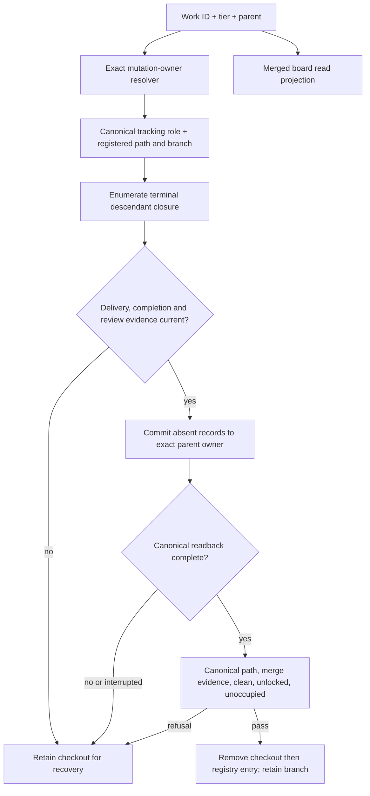

# Workspace and architecture design

Purpose: resolve repository roles, manage integration worktrees, and enforce revision-pinned architecture/C4 review contracts. Interfaces are `ProjectContext`, ownership/artifact references, C4 closure/render/diff/review, integration worktrees, inventory, and receipts. Owns `REQ-WORKSPACE-001` (repository roles/destinations are explicit), `REQ-WORKSPACE-002` (reviewed artifacts are revision-bound), and `DEC-WORKSPACE-001` (unreviewed proposals never become accepted lineage).

## Repository initialization and guidance

`REQ-WORKSPACE-INIT-001`: Initialization in a Git repository creates board columns,
default configuration, runtime ignore entries, and missing role/design playbooks
and the design template under `skills/`. Existing configuration and guidance
remain unchanged, including repository customizations. Repeating initialization
restores missing guidance files. No project design is invented from placeholders.

`DEC-WORKSPACE-INIT-001`: The repository's `skills/` tree is packaged as
`cascade._skill_templates`, giving installed distributions and source checkouts
the same authoring guidance without a separately maintained copy. Exclusive file
creation preserves existing files. Agents read the installed repository copies,
so guidance changes follow normal repository review and version control.

Implementation: [initialization](init.py) and [package mapping](../../setup.py).
Verification: [initialization tests](../../tests/workspace/test_init.py) exercise
fresh role-context loading, customization preservation and missing-file repair.
Documentation ownership and semantic review requirements belong to the
[design skill](../../skills/design/SKILL.md).

## C4 code model and rendering contract

- `REQ-WORKSPACE-C4-001`: A code view is a native Structurizr custom view whose
  `cascade.codeComponent` names an existing component semantic ID. Custom code
  elements declare `cascade.parent`, a confined repository-relative
  `cascade.sourcePath`, and a qualified `cascade.sourceSymbol`. Stable IDs and
  the versioned source contract bind model elements, relationships and views.
  Source paths and scope metadata are validated before use; numeric renderer IDs
  never substitute for semantic identity.
- `REQ-WORKSPACE-C4-002`: Rendering validates the pinned source closure, exports
  semantic/static artifacts, and captures all SVGs and semantic bindings in one
  bounded browser session. Sanitization, exact hit-target bindings, artifact
  hashes and provenance remain mandatory. A failed render cannot publish partial
  success. The default total render deadline remains 180 seconds; batching does
  not relax resource or cancellation bounds.
- `REQ-WORKSPACE-C4-003`: Completed snapshots remain readable across renderer
  upgrades using their original persisted identity inputs and source provenance.
  The supported legacy schema-3 identity is explicitly recognized and requires
  its original manifest. Tampered identity/provenance fails. A pending operation
  whose renderer identity changed fails with refresh guidance instead of
  publishing new renderer output under an old identity.
- `REQ-WORKSPACE-C4-004`: Resolving an already-selected checkout inspects only
  that checkout's Git state, while retaining registered identity and branch
  checks. Full catalog discovery can inspect all registered checkouts. Cached
  SVG validation is reused only for identical bytes, view key and bindings;
  files are reread so changed or missing content is detected.

`DEC-WORKSPACE-C4-001`: Code diagrams use Structurizr custom elements/views rather
than inventing deployable containers for functions and types. The HTTP projection
maps validated code views to the fourth-level navigation contract. Each code
element uses the native metadata field for its source declaration kind. The
[C4 guide](../../architecture/target-9f61bc6d6f8ae8cb7d196c8b327650d5/README.md#integrated-code-level)
defines the labels and their corresponding declarations. Supplementary
sequence diagrams in owning designs explain behavior without replacing the code
view.

`DEC-WORKSPACE-C4-002`: One trusted binding adapter produces both SVG and binding
metadata for every view, avoiding per-view Java/browser startup and a redundant
stock SVG export. Artifact schema 4 distinguishes this pipeline. New admissions
use current renderer identity inputs; completed reads use pinned inputs, allowing
upgrades without silently changing historical evidence.

Implementation: [source contract](c4_source.py), [renderer](c4_render.py),
[trusted adapter](RendererBindingAdapter.java), [binding validation](c4_bindings.py),
[scheduler](c4_scheduler.py), [semantic projection](c4_review.py), and
[checkout resolution](architecture_browsing.py).

Verification: [source validation](../../tests/workspace/test_c4_source.py),
[real renderer and cache](../../tests/workspace/test_c4_render.py),
[bindings](../../tests/workspace/test_c4_bindings.py),
[semantic code metadata](../../tests/workspace/test_c4_review.py),
[upgrade/tamper handling](../../tests/workspace/test_c4_scheduler.py), and
[selected-checkout isolation](../../tests/workspace/test_architecture_browsing.py).

## Work ownership and retirement

`REQ-WORKSPACE-OWNER-001`: Lifecycle writes resolve exactly one owner from the
work ID, tier and parent lineage, canonical tracking-repository role, registered
checkout identity and expected branch. Epic and Feature registrations own their
documents; a Task document is owned by its registered parent Feature checkout.
Returned graphs are an admitted reconstruction owner. Remote backlog snapshots
are read-only. Missing, conflicting, detached or changed ownership raises an
actionable `MutationOwnerError`; a sibling historical copy never authorizes a
write. Document reads may still project registered checkouts, returned graphs,
backlog snapshots and historical copies.
`DEC-WORKSPACE-OWNER-001`: Keep `merged_board` and `_meta_preference` as read
projections. Lifecycle mutation uses `resolve_mutation_owner`, not column rank or
generic worktree-path bonuses.

`REQ-WORKSPACE-RETIRE-001`: Retirement preserves a branch and refuses a
noncanonical, dirty, locked or currently occupied checkout. Merge ancestry or an
explicit forge merge confirmation gates removal. Before removal, Workspace walks
the registered parent's declared and reverse-linked descendant closure. Every
required descendant must be canonically terminal and have Task merge or Feature
completion/review provenance. The exact parent owner is the only persistence
destination: absent terminal descendants are committed there and re-read before
removal, while nonterminal, conflicting, ambiguous, unmerged, or unresolved-review
state returns a reason and owner action without changing the branch, checkout, or
registry. Repeated proof after an interrupted commit reuses the terminal rows
already present and never creates a second registry or ledger.

The integrated `cascade-workspace-code` view belongs to
`element.component.workspace` in the [model](../../architecture/target-9f61bc6d6f8ae8cb7d196c8b327650d5/model.dsl).
Navigate from `cascade-context` through `cascade-containers` and
`cascade-supervisor-components` to Workspace → Code in the
[views](../../architecture/target-9f61bc6d6f8ae8cb7d196c8b327650d5/views.dsl).
The model and [source contract](../../architecture/target-9f61bc6d6f8ae8cb7d196c8b327650d5/workspace.contract.json)
are authoritative; renders are revision-bound derived artifacts.

| Entry point | Inputs, output and state |
|---|---|
| [resolve_doc_worktree](doc_root.py) | Work ID and board → registered checkout; Tasks follow their Feature parent. Missing work raises `NotFound`. |
| [resolve_mutation_owner / doc_filesystem_root](integration_worktree.py) | Work identity, parent lineage, repository role, registry path and branch → one writable owner or actionable `MutationOwnerError`. |
| [merged_board / _meta_preference](integration_worktree.py) | Tracking board, registry and snapshot provenance → preferred documents with retained approval metadata. Ranking includes column and generic worktree-path bonuses; it does not prove exact mutation ownership. |
| [preflight_lifecycle_merge_target](branch_synchronization.py) | Source/target work IDs and branches → synchronization check or typed refusal, including `not_active`. |
| [prove_terminal_retirement / TerminalRetirementProof](integration_worktree.py) | Registered parent, exact destination, descendant closure, Git/event/review evidence → canonical terminal readback or an actionable refusal. |
| [terminal_doc_persisted_outside_worktree](integration_worktree.py) | Compatibility Boolean backed by the same descendant-aware proof. |
| [retire_integration_worktree](integration_worktree.py) | Registered identity and merge evidence → removal Boolean; refusal preserves registry and checkout. |

Registry JSON persists under `.cascade/`; Git retains branch identity and Markdown
holds lifecycle state. Delivery actions and reviews remain the existing provenance
stores; the retirement proof derives from them and does not persist another state
machine. Restart reconstructs the board from surviving roots and repeats canonical
readback, so a commit made before interruption is reused.
Registry cleanup follows successful worktree removal; missing-path cleanup checks
Git's worktree registration. This is repository ownership enforcement, not an OS
sandbox.

Verification: [worktree tests](../../tests/workspace/test_integration_worktrees.py),
[document resolution](../../tests/war_room/test_resolve_worktree.py), and
[branch synchronization](../../tests/workspace/test_branch_synchronization.py).
The caller's closeout boundary is owned by [Boss](../boss/DESIGN.md#delivery-and-closeout).

## Server-resolved preview snapshots

`REQ-WORKSPACE-C4-005`: A trusted server-resolved architecture selection can pin
code, mapping and documentation revisions independently of the checkout's later
HEAD. Creating that snapshot preserves the same descriptor identity, source
validation, rendering bounds and persisted failure behavior as normal context
selection; it does not change the checkout or accepted review lineage.

`DEC-WORKSPACE-C4-003`: `ArchitectureSnapshotStore.create` resolves a context and
then delegates to `create_selection`. The latter is an internal authority boundary,
not an API for arbitrary client revisions. HTTP callers must authorize selections
before invoking it. The War Room uses this entry point for immutable project
projection commits and binds preview pairs to server-generated association
evidence; preview policy is owned by the
[War Room comparison design](../war_room/DESIGN.md#committed-planning-comparisons-and-project-previews).

Verification: [snapshot tests](../../tests/workspace/test_architecture_snapshots.py)
cover a server-selected base remaining pinned after HEAD advances, distinct
snapshot identities and an unchanged checkout HEAD. Existing snapshot and scheduler
validation applies to these selections as well.

## Derived comparison rendering

`REQ-WORKSPACE-C4-006`: A comparison graph is derived only from the authorized,
pinned current/proposed semantic projections. It retains removed elements and
relationships, merges reviewed renames, and renders both old and new connections
when relationship endpoints change. Distinct displayed graphs have independent
derived identity mappings so changes in another scope cannot overwrite their
labels or connections. Views with identical
semantic identities, labels, types, descriptions and connection endpoints reuse
one layout, preventing arbitrary dependency reordering between levels. Their
navigation, diff states and before/after metadata remain specific to each view.
Missing endpoint evidence and ambiguous derived identities fail explicitly.

`DEC-WORKSPACE-C4-004`: [c4_comparison.py](c4_comparison.py) materializes a temporary
Structurizr custom-view source closure and submits it to the existing durable
[C4RenderScheduler](c4_scheduler.py). This projection flattens conflicting
containment into labeled graph elements; original parent and source metadata stay
in the comparison details. It does not modify authored C4 source, accepted
snapshots, publications, or Git refs. The source digest includes both snapshot
identities; scheduler persistence, cache validation, resource limits and native
SVG binding checks remain in force. Derived bound IDs map back to the original
per-view targets only after validated artifact loading. Internal label
suffixes satisfy Structurizr's global name/relationship uniqueness constraints;
only those generated suffixes are removed from the bound SVG before delivery,
retaining the original rendered labels. Color and interaction are applied by the
shared viewer.

`REQ-WORKSPACE-C4-007`: Combined rendering is bounded to 100 views, 5,000 target
occurrences and 2 MiB of generated source. A response permits at most 4 MiB per
SVG and 16 MiB of combined SVG text. Exceeding a bound is an explicit error, never
a truncated comparison. Pending or failed renders never become a ready graph.
Polling reuses the same render identity and pinned inputs.

Verification: [comparison tests](../../tests/workspace/test_c4_comparison.py)
cover semantic union, reviewed renames, endpoint rewiring, native rendering,
verified SVG delivery and scheduler/cache reuse. The authored
`cascade-comparison-render-code` view links the graph builder, source closure and
scheduler to their actual source functions.
