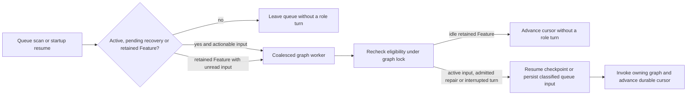
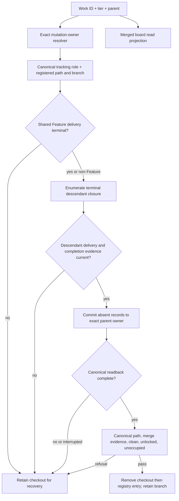

# Workspace and architecture design

Purpose: resolve repository roles, manage integration worktrees, and enforce revision-pinned architecture/C4 review contracts. Interfaces are `ProjectContext`, ownership/artifact references, C4 closure/render/diff/review, integration worktrees, inventory, and receipts. Owns `REQ-WORKSPACE-001` (repository roles/destinations are explicit), `REQ-WORKSPACE-002` (reviewed artifacts are revision-bound), `REQ-WORKSPACE-RUNTIME-001` (loaded repair evidence binds reviewed, integrated, installed and executing identities), `DEC-WORKSPACE-001` (unreviewed proposals never become accepted lineage), and `DEC-WORKSPACE-RUNTIME-001` (bootstrap authority and worker attestation are separate fail-closed checks).


## Epic checkout admission and provisioning

The worktree creator accepts a preparation callback before registry publication
and transcript ownership handoff. Epic activation uses it to remove inherited
Feature/Task documents in a single-repository project, so a newly registered
checkout never contributes those stale copies to the board. A previous unregistered
checkout or branch is preserved rather than force-removed by a provisioning retry.
For an interrupted
activation, `resume_unstarted_epic_worktree` verifies canonical identity, an
unlocked and clean checkout and ancestor-only history against the latest approved
base; it fast-forwards and refreshes the registry without rewriting history.
Watchdog separately proves absent activation evidence and current admission gates.
See [Epic preparation](../epic/DESIGN.md#initial-activation-checkout-preparation)
and [Watchdog provisioning](../watchdog/DESIGN.md#interrupted-epic-provisioning).


## Worker lifecycle and runtime identity

`REQ-WORKSPACE-RUNTIME-001`: A reviewed runtime repair is current only when an
accepted source revision, its guarded integrated target, an authenticated
installation receipt and installed-source digest, and the executing worker's
independently inspected process and import closure all agree. The process proof
includes PID, host boot and process-start identities, module origins and
digests, and the capability generation. Missing, dirty, stale, mixed-root or
conflicting evidence remains unverified and cannot close a recovery incident.

`DEC-WORKSPACE-RUNTIME-001`: Keep installation authority, worker self-report and
host verification as separate fail-closed boundaries, using the existing
supervision/health receipt and recovery stores. A broken recovery adapter is
bootstrapped only through the separately authorized drain, install and restart
path. This prevents the adapter under repair, a healthy endpoint, or a
caller-supplied revision from attesting its own deployment, while avoiding a
second runtime or recovery ledger.

The [package index](../DESIGN.md#architecture-navigation) and authoritative
[model](../../architecture/target-9f61bc6d6f8ae8cb7d196c8b327650d5/model.dsl)
connect `cascade-cli-components` → `cascade-workspace-commands-code`.
`element.component.workspace-commands` owns launcher/worker lifecycle code;
`cascade-workspace-code` owns repository identity and retained worktrees.
These are collaborating implementation responsibilities, not extra deployments.

| Source entry | Current behavior |
|---|---|
| [run_launcher_loop](launcher.py) | Own the listen socket, spawn workers with a readiness handshake and Python safe-path mode, classify exits and bound startup retries/backoff. Safe-path mode prevents an unreviewed `cascade/` in the product root from shadowing the reviewed import root. |
| [run_worker](worker.py) | Start HTTP, watchdog and recovery lanes; exit for stop, update or crash. |
| [drain_and_shutdown](worker.py) | Stop admitting work, join handlers and wait for/cancel live agent turns before shutdown. |
| [create_runtime_authority](runtime_identity.py) | Authenticate an installation actor's signed receipt, then bind its accepted review and guarded integration lineage to two clean exact checkouts and installed Python bytes. It does not issue approval or install software. |
| [validate_runtime_authority](runtime_identity.py) | Reauthenticate the manifest and reject moved, dirty, stale, unintegrated or byte-mismatched evidence before each spawn. |
| [loaded_runtime_identity](runtime_identity.py) | Report the importing worker's repair/delivery/postcheck module origins and digests, PID/start identity, executable, workspace and capability generation without self-asserting verification. |
| [verify_loaded_runtime_identity](runtime_identity.py) | Independently inspect the live child through Linux `/proc`, re-read module/package bytes and compare the launcher generation, returning `current`, `pending` or `refused`; only `current` sets `verified`. |
| [verify_current_loaded_runtime_identity](runtime_identity.py) | Reinspect a launcher-verified receipt before incident closeout, including the live PID/start identity, import root, module bytes, clean reviewed/integrated checkouts, ancestry and capability generation. |
| [_worker_supervisor_status](worker.py) | Publish lifecycle state and the worker receipt through the existing health projection. Missing authority is explicitly unverified. |

```mermaid
stateDiagram-v2
    [*] --> Starting: launcher spawns worker
    Starting --> Running: readiness; host verification when authority supplied
    Starting --> Backoff: startup failure
    Backoff --> Starting: bounded retry
    Backoff --> Degraded: startup allowance exhausted
    Running --> Draining: update or stop
    Running --> Draining: crash or launcher lost
    Draining --> Starting: update / supervised restart
    Draining --> [*]: stop
```



The launcher retains process supervision while a worker restarts. The
editable-source fingerprint update path replaces the worker process, not the
in-memory launcher. The current launcher accepts the plain readiness line and
the structured readiness identity; an older launcher may not accept a newer
worker receipt. A protocol-changing update therefore requires stopping and
restarting the full launcher with the intended environment. Startup retry and
backoff are bounded; coordinated compatibility admission and automatic rollback
of launcher upgrades are not implemented.

Durable queues, graph checkpoints, action claims and registered worktrees belong to their existing
owners; restart does not reset delivery or grant authority. Drain cancellation
uses the [Agent registry](../agent/DESIGN.md#state-failure-and-isolation).
[kickoff_graph_queue_event](kickoff.py) compares the durable queue byte cursor
with the graph checkpoint and schedules only pending delivery.
[graph_turn_owner_is_live](kickoff.py) detects the process-local serialized owner;
the Feature review-repair adapter defers to that owner instead of launching a
competing turn. Admission remains in `executions.json`, the stable event remains
in the existing queue, and restart delivery reuses the same checkpoint path—no
repair scheduler or wakeup store is introduced. A scheduled job acknowledges
delivery intent only; `_run_queue_delivery_locked` advances the cursor and the
Feature graph owns subsequent execution.
The operator first obtains a signed deployment receipt and trust key from the
separate installation authority. `runtime-bootstrap` authenticates that receipt,
requires exact clean accepted-review and guarded-integration checkouts, proves
review ancestry, and matches receipt, checkout and installed bytes. `cascade up`
reauthenticates the manifest before every spawn and passes only its immutable
snapshot to the worker. The worker imports and reports the registered repair,
delivery, publication, postcheck and capability callables. The launcher reads
the live PID's Linux boot/start identity, executable and selected `PYTHONPATH`
root, re-reads every reported module and independently computes the capability
generation before it sets `verified`. A restart clears the old receipt and
requires a new process-local observation.
The worker starts with Python safe-path mode, so a product checkout that contains
the adapter being repaired cannot outrank the reviewed source selected by the
launcher. The independent Watchdog postcheck reopens the process and source facts;
a stale status file or dead prior worker cannot close the incident.
The versioned receipt names the accepted review URL, authorized actor,
environment, repository identities/revisions and installed source digest. Its
HMAC trust key is an external credential: possessing it is deployment-receipt
authority, so Cascade neither creates nor recovers it.

```mermaid
sequenceDiagram
    actor Operator
    participant Bootstrap as runtime-bootstrap
    participant Launcher
    participant Worker
    participant Health as /api/health
    Operator->>Bootstrap: signed install receipt + trust key + exact checkouts
    Bootstrap->>Bootstrap: authenticate; prove clean lineage and installed digest
    Operator->>Launcher: up --runtime-authority manifest + trust key
    Launcher->>Launcher: reauthenticate receipt binding before spawn
    Launcher->>Worker: immutable authority snapshot + inherited descriptors
    Worker->>Worker: import registered callables and report origins/digests
    Worker-->>Launcher: readiness + unverified process-local report
    Launcher->>Launcher: inspect /proc, import root, bytes and capability generation
    Launcher-->>Health: publish serving status and receipt
```

Ordinary local startup without a manifest remains available and is host-observed,
but its receipt is
`runtime_authority_missing` and cannot prove deployment. Invalid supplied
authority or Linux process evidence prevents verified startup. These facts do not waive review acceptance,
integration, pending delivery or product postchecks, and the manifest is not an
installation credential. The worker and launcher share an OS process tree and
environment; the evidence does not claim container or credential isolation.

Verification references: [startup recovery](../../tests/workspace/test_worker_startup_recovery.py)
and [runtime identity integration](../../tests/workspace/test_runtime_identity.py).

## Graph invocation and transcript handoff

### Queue eligibility and restart

[deliver_queue_kickoffs](kickoff.py) selects active teams and teams named by
pending durable recovery actions when their queue is ahead of its saved cursor.
It also retains a completed Feature whose shared delivery projection is
nonterminal, preserving its original review and graph identity.
[resume_inflight_graphs](kickoff.py) applies the same eligibility boundary to
interrupted turns, unread events and unanswered staged input. A completed-path
Feature with an open, missing, stale or otherwise nonterminal review remains in
this boundary. A generic queued message advances its checkpoint cursor but does
not admit repair or start a role turn; an interrupted checkpoint or current
admitted repair resumes the same graph.

[_schedule_queue_delivery](kickoff.py) coalesces process-local jobs.
[_run_queue_delivery_locked](kickoff.py) rechecks eligibility under the graph
lock before resuming checkpointed work or staging new input. Queue offsets and
staged messages persist in the graph checkpoint; scheduling entries and locks
are process-local. Restart reconstructs eligible jobs from durable inputs.



These entry points appear in `cascade-workspace-code`, reached through the
[supervisor component view](../../architecture/target-9f61bc6d6f8ae8cb7d196c8b327650d5/views.dsl).
The [completed-recovery kickoff tests](../../tests/workspace/test_completed_recovery_kickoff.py)
exercise eligible recovery and completed-team refusal. Shared authority remains
owned by [the package recovery contract](../DESIGN.md#delivery-and-review-boundaries).

### Invocation evidence

`REQ-WORKSPACE-TURN-EVIDENCE-001`: Process-local graph ownership and persisted
graph state have different lifetimes. Neither a saved next node nor pending
queue work proves that an action executor is running.

`DEC-WORKSPACE-TURN-EVIDENCE-001`: [kickoff.py](kickoff.py) serializes graph
turns with process-local locks and queues. `graph_turn_owner_is_live` observes
unfinished queue work or a held graph lock; it is conservative owner protection,
not attempt-specific liveness. After lifecycle admission and graph-lock
acquisition, `_run_kickoff` brackets the actual graph call with
[begin/end live observations](../recovery_progress/live.py). An action-bound
invocation token names the worker runtime generation, PID, boot and process-start
identity, graph, action generation, attempt and claim. A queued job has no such
token. Matching registered tokens may be refreshed for at most 30 seconds at a
time and never beyond claim expiry; exit, observed process death, changed process
identity, or worker restart removes live support. Inaccessible process identity
is unknown rather than live. `_invoke_role_turn` reads the message count,
invokes the graph, then forwards the new message slice, persisted checkpoint
configuration and starting message ordinal to
[append_planning_turn_to_chat](../war_room/planning_transcript.py).
Checkpoint state survives restart while the local lock and queue evidence do not.
Epic and Feature role messages carry a durable ID before checkpoint commit. An
interruption after that commit but before chat append leaves the same role-reply
source identity for explicit writer
[transcript sync](../war_room/DESIGN.md#recovery-summaries-and-planning-transcripts);
the sync performs no provider turn.
Creating an Epic or Feature integration worktree resolves the current room before
registry publication, then calls
[move_transcript_room](../war_room/chat_store.py) to copy committed history and
publish the new registry owner within the transcript's tracking-root graph fence.
The room incarnation changes, so readers cannot continue an earlier ownership
generation as if it were the same immutable history.
Terminal Epic and Feature retirement performs the inverse operation: after
delivery proof and cleanliness checks, the fenced room move invokes checkout
removal and registry retirement as its owner switch, then publishes the
surviving parent/trunk room with another incarnation. The transcript store
journals the copy and fixed target incarnation before that callback. If the
process dies after checkout removal, a repeated retirement observes the missing
registry owner, verifies routing and the copied destination against the retained
journal, and calls
[resume_transcript_room_move](../war_room/chat_store.py) to finish the index
transition without recreating the checkout.
Committed recovery receipts use the same document ownership resolution: Task
identity is lifted to its owning Feature while Feature and Epic identity retain
their rooms. Multiple resolved owners, missing plans and unsafe work IDs remain
pending. Split product/tracking roots follow the registered document worktree,
while the graph fence remains anchored at the canonical tracking runtime root.

The [model](../../architecture/target-9f61bc6d6f8ae8cb7d196c8b327650d5/model.dsl)
and [views](../../architecture/target-9f61bc6d6f8ae8cb7d196c8b327650d5/views.dsl)
place the invocation and live-observation functions in `cascade-workspace-code`, below
`cascade-supervisor-components`. The handoff sequence is owned by the linked
War Room design; the broader graph lifecycle is owned by
[the package design](../DESIGN.md#team-execution).
Verification: [live observation tests](../../tests/workspace/test_live_observations.py),
[kickoff tests](../../tests/workspace/test_kickoff.py), and
[transcript tests](../../tests/war_room/test_planning_transcript.py).

## Repository initialization and guidance

`REQ-WORKSPACE-INIT-001`: Initialization in a Git repository creates board columns,
default configuration, runtime ignore entries, and missing role/design playbooks
and the design template under `skills/`. Existing configuration and guidance
remain unchanged, including repository customizations. Repeating initialization
restores missing guidance files. No project design is invented from placeholders.

`DEC-WORKSPACE-INIT-001`: The repository's `skills/` tree is packaged as
`cascade._skill_templates`, giving installed distributions and source checkouts
the same authoring guidance without a separately maintained copy. Exclusive file
creation preserves existing files. Agents read the installed repository copies,
so guidance changes follow normal repository review and version control.

Implementation: [initialization](init.py) and [package mapping](../../setup.py).
Verification: [initialization tests](../../tests/workspace/test_init.py) exercise
fresh role-context loading, customization preservation and missing-file repair.
Documentation ownership and semantic review requirements belong to the
[design skill](../../skills/design/SKILL.md).

## C4 code model and rendering contract

- `REQ-WORKSPACE-C4-001`: A code view is a native Structurizr custom view whose
  `cascade.codeComponent` names an existing component semantic ID. Custom code
  elements declare `cascade.parent`, a confined repository-relative
  `cascade.sourcePath`, and a qualified `cascade.sourceSymbol`. Stable IDs and
  the versioned source contract bind model elements, relationships and views.
  Source paths and scope metadata are validated before use; numeric renderer IDs
  never substitute for semantic identity.
- `REQ-WORKSPACE-C4-002`: Rendering validates the pinned source closure, exports
  semantic/static artifacts, and captures all SVGs and semantic bindings in one
  bounded browser session. Sanitization, exact hit-target bindings, artifact
  hashes and provenance remain mandatory. A failed render cannot publish partial
  success. The default total render deadline remains 180 seconds; batching does
  not relax resource or cancellation bounds.
- `REQ-WORKSPACE-C4-003`: Completed snapshots remain readable across renderer
  upgrades using their original persisted identity inputs and source provenance.
  The supported legacy schema-3 identity is explicitly recognized and requires
  its original manifest. Tampered identity/provenance fails. A pending operation
  whose renderer identity changed fails with refresh guidance instead of
  publishing new renderer output under an old identity.
- `REQ-WORKSPACE-C4-004`: Resolving an already-selected checkout inspects only
  that checkout's Git state, while retaining registered identity and branch
  checks. Full catalog discovery can inspect all registered checkouts. Cached
  SVG validation is reused only for identical bytes, view key and bindings;
  files are reread so changed or missing content is detected.

`DEC-WORKSPACE-C4-001`: Code diagrams use Structurizr custom elements/views rather
than inventing deployable containers for functions and types. The HTTP projection
maps validated code views to the fourth-level navigation contract. Each code
element uses the native metadata field for its source declaration kind. The
[C4 guide](../../architecture/target-9f61bc6d6f8ae8cb7d196c8b327650d5/README.md#integrated-code-level)
defines the labels and their corresponding declarations. Supplementary
sequence diagrams in owning designs explain behavior without replacing the code
view.

`DEC-WORKSPACE-C4-002`: One trusted binding adapter produces both SVG and binding
metadata for every view, avoiding per-view Java/browser startup and a redundant
stock SVG export. Artifact schema 4 distinguishes this pipeline. New admissions
use current renderer identity inputs; completed reads use pinned inputs, allowing
upgrades without silently changing historical evidence.

Implementation: [source contract](c4_source.py), [renderer](c4_render.py),
[trusted adapter](RendererBindingAdapter.java), [binding validation](c4_bindings.py),
[scheduler](c4_scheduler.py), [semantic projection](c4_review.py), and
[checkout resolution](architecture_browsing.py).

Verification: [source validation](../../tests/workspace/test_c4_source.py),
[real renderer and cache](../../tests/workspace/test_c4_render.py),
[bindings](../../tests/workspace/test_c4_bindings.py),
[semantic code metadata](../../tests/workspace/test_c4_review.py),
[upgrade/tamper handling](../../tests/workspace/test_c4_scheduler.py), and
[selected-checkout isolation](../../tests/workspace/test_architecture_browsing.py).

## Work ownership and retirement

`REQ-WORKSPACE-OWNER-001`: Lifecycle writes resolve exactly one owner from the
work ID, tier and parent lineage, canonical tracking-repository role, registered
checkout identity and expected branch. Epic and Feature registrations own their
documents; a Task document is owned by its registered parent Feature checkout.
Returned graphs are an admitted reconstruction owner. Remote backlog snapshots
are read-only. Missing, conflicting, detached or changed ownership raises an
actionable `MutationOwnerError`; a sibling historical copy never authorizes a
write. Document reads may still project registered checkouts, returned graphs,
backlog snapshots and historical copies.
`DEC-WORKSPACE-OWNER-001`: Keep `merged_board` and `_meta_preference` as read
projections. Lifecycle mutation uses `resolve_mutation_owner`, not column rank or
generic worktree-path bonuses.

`REQ-WORKSPACE-RETIRE-001`: Retirement preserves a branch and refuses a
noncanonical, dirty, locked or currently occupied checkout. Merge ancestry or an
explicit forge merge confirmation gates removal. Before removal, Workspace walks
the registered parent's declared and reverse-linked descendant closure. Feature
retirement first requires the shared delivery phase to be `verified_integrated`,
`terminal_cancelled`, or `terminal_closed`; open, unknown, closed-unmerged, stale,
or locally unsynchronized review evidence refuses before descendant persistence.
Every required descendant must then be canonically terminal and have Task merge
or Feature completion/review provenance. The exact parent owner is the only
persistence destination: absent terminal descendants are committed there and
re-read before removal, while nonterminal, conflicting, ambiguous, unmerged, or
unresolved-review state returns a reason and owner action without changing the
branch, checkout, or registry. Repeated proof after an interrupted commit reuses
the terminal rows already present and never creates a second registry or ledger.

The integrated `cascade-workspace-code` view belongs to
`element.component.workspace` in the [model](../../architecture/target-9f61bc6d6f8ae8cb7d196c8b327650d5/model.dsl).
Navigate from `cascade-context` through `cascade-containers` and
`cascade-supervisor-components` to Workspace → Code in the
[views](../../architecture/target-9f61bc6d6f8ae8cb7d196c8b327650d5/views.dsl).
The model and [source contract](../../architecture/target-9f61bc6d6f8ae8cb7d196c8b327650d5/workspace.contract.json)
are authoritative; renders are revision-bound derived artifacts.
Pinned implementation-design discovery uses the target-owned
[design mapping](../../architecture/design-mappings.json); distinct child
subsystems, including [Recovery progress](../recovery_progress/DESIGN.md), retain
their own design artifact and owner rather than inheriting the package document.

| Entry point | Inputs, output and state |
|---|---|
| [resolve_doc_worktree](doc_root.py) | Work ID and board → registered checkout; Tasks follow their Feature parent. Missing work raises `NotFound`. |
| [resolve_mutation_owner / doc_filesystem_root](integration_worktree.py) | Work identity, parent lineage, repository role, registry path and branch → one writable owner or actionable `MutationOwnerError`. |
| [merged_board / _meta_preference](integration_worktree.py) | Tracking board, registry and snapshot provenance → preferred documents with retained approval metadata. Ranking includes column and generic worktree-path bonuses; it does not prove exact mutation ownership. |
| [preflight_lifecycle_merge_target](branch_synchronization.py) | Source/target work IDs and branches → synchronization check or typed refusal, including `not_active`. |
| [prove_terminal_retirement / TerminalRetirementProof](integration_worktree.py) | Registered parent, shared Feature delivery phase, exact destination, descendant closure, Git/event/review evidence → canonical terminal readback or an actionable refusal. |
| [terminal_doc_persisted_outside_worktree](integration_worktree.py) | Compatibility Boolean backed by the same descendant-aware proof. |
| [retire_integration_worktree](integration_worktree.py) | Registered identity and merge evidence → removal Boolean; refusal preserves registry and checkout. |



Registry JSON persists under `.cascade/`; Git retains branch identity and Markdown
holds lifecycle state. Delivery actions and reviews remain the existing provenance
stores; the retirement proof derives from them and does not persist another state
machine. Restart reconstructs the board from surviving roots and repeats canonical
readback, so a commit made before interruption is reused.
Registry cleanup follows successful worktree removal; missing-path cleanup checks
Git's worktree registration. This is repository ownership enforcement, not an OS
sandbox.

Verification: [worktree tests](../../tests/workspace/test_integration_worktrees.py),
[document resolution](../../tests/war_room/test_resolve_worktree.py), and
[branch synchronization](../../tests/workspace/test_branch_synchronization.py).
The caller's closeout boundary is owned by [Boss](../boss/DESIGN.md#delivery-and-closeout).


## Server-resolved preview snapshots

`REQ-WORKSPACE-C4-005`: A trusted server-resolved architecture selection can pin
code, mapping and documentation revisions independently of the checkout's later
HEAD. Creating that snapshot preserves the same descriptor identity, source
validation, rendering bounds and persisted failure behavior as normal context
selection; it does not change the checkout or accepted review lineage.

`DEC-WORKSPACE-C4-003`: `ArchitectureSnapshotStore.create` resolves a context and
then delegates to `create_selection`. The latter is an internal authority boundary,
not an API for arbitrary client revisions. HTTP callers must authorize selections
before invoking it. The War Room uses this entry point for immutable project
projection commits and binds preview pairs to server-generated association
evidence; preview policy is owned by the
[War Room comparison design](../war_room/DESIGN.md#committed-planning-comparisons-and-project-previews).

Verification: [snapshot tests](../../tests/workspace/test_architecture_snapshots.py)
cover a server-selected base remaining pinned after HEAD advances, distinct
snapshot identities and an unchanged checkout HEAD. Existing snapshot and scheduler
validation applies to these selections as well.


## Derived comparison rendering

`REQ-WORKSPACE-C4-006`: A comparison graph is derived only from the authorized,
pinned current/proposed semantic projections. It retains removed elements and
relationships, merges reviewed renames, and renders both old and new connections
when relationship endpoints change. Distinct displayed graphs have independent
derived identity mappings so changes in another scope cannot overwrite their
labels or connections. Views with identical
semantic identities, labels, types, descriptions and connection endpoints reuse
one layout, preventing arbitrary dependency reordering between levels. Their
navigation, diff states and before/after metadata remain specific to each view.
Missing endpoint evidence and ambiguous derived identities fail explicitly.

`DEC-WORKSPACE-C4-004`: [c4_comparison.py](c4_comparison.py) materializes a temporary
Structurizr custom-view source closure and submits it to the existing durable
[C4RenderScheduler](c4_scheduler.py). This projection flattens conflicting
containment into labeled graph elements; original parent and source metadata stay
in the comparison details. It does not modify authored C4 source, accepted
snapshots, publications, or Git refs. The source digest includes both snapshot
identities; scheduler persistence, cache validation, resource limits and native
SVG binding checks remain in force. Derived bound IDs map back to the original
per-view targets only after validated artifact loading. Internal label
suffixes satisfy Structurizr's global name/relationship uniqueness constraints;
only those generated suffixes are removed from the bound SVG before delivery,
retaining the original rendered labels. Color and interaction are applied by the
shared viewer.

`REQ-WORKSPACE-C4-007`: Combined rendering is bounded to 100 views, 5,000 target
occurrences and 2 MiB of generated source. A response permits at most 4 MiB per
SVG and 16 MiB of combined SVG text. Exceeding a bound is an explicit error, never
a truncated comparison. Pending or failed renders never become a ready graph.
Polling reuses the same render identity and pinned inputs.

Verification: [comparison tests](../../tests/workspace/test_c4_comparison.py)
cover semantic union, reviewed renames, endpoint rewiring, native rendering,
verified SVG delivery and scheduler/cache reuse. The authored
`cascade-comparison-render-code` view links the graph builder, source closure and
scheduler to their actual source functions.

### Durable architecture publication reconciliation

Authenticated planning publication persists the pinned intent and exact affected
work hold before starting bounded rendering. The existing watchdog maintenance
pass replays up to four pending or unreleased terminal publication operations per
pass in fair order, even if their originating role has exited or the service
restarted. Per-operation OS locks serialize agent discovery and supervisor
replay without holding the lifecycle lock across rendering. Terminal success,
failure and supersession are persisted before the matching hold is released;
a restart repairs an interrupted release, without clearing a successor's hold
or authorizing an unreviewed architecture tuple. Board polling remains read-only.

### Retained Feature queue discovery cost

Startup and ordinary queue discovery batch completed-Feature delivery projections
through one read-only board/registry scan per pass rather than rescanning every
registered checkout for each completed Feature. This is advisory selection only;
the locked delivery path independently rechecks the exact owner before any turn.
