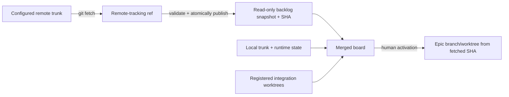

# Board backlog update fix

## Intent

Keep the War Room backlog current while epic and feature work is in flight. A newly merged brief on the configured remote product trunk must become visible and activatable within the existing seconds-scale polling cadence, without requiring the operator checkout or any active integration branch to fast-forward.

### Success criteria

- A brief merged on remote trunk while local trunk and integration work are ahead/diverged appears on the board shortly after the merge.
- The brief can be activated through the normal human gate.
- Synchronization never checks out, resets, stashes, merges, or rebases the operator checkout or an active worktree.
- Failures preserve the last valid board snapshot and return an actionable error on forced refresh.

## Macro-architecture

Use Git fetch and the configured remote-tracking product-trunk ref as the transport and provenance boundary. After fetch, Cascade publishes a managed read-only snapshot containing only backlog epic documents plus the fetched SHA. The merged-board layer overlays that snapshot beneath local trunk and registered integration worktrees: remote backlog contributes previously unseen epic IDs, while existing local active/completed state remains authoritative.

Activation accepts a snapshot-only epic through the existing human authorization path. It creates the epic integration branch/worktree from the recorded fetched SHA that contains the approved brief, materializes the live epic there, and preserves existing dispatch, pointer, and registry semantics without moving the operator checkout.

## Cross-module constraints

- The filesystem board remains lifecycle truth; the snapshot is an input view of approved remote backlog, not a second mutable lifecycle store.
- Snapshot scope is backlog epics only. Remote feature/task documents and remote active/completed lifecycle mutations are ignored.
- Local trunk and integration-worktree entries take precedence for known IDs. Conflicts must be surfaced rather than silently replacing local/live state.
- Refresh must be atomic for concurrent watchdog and HTTP readers. A failed refresh retains the prior valid snapshot.
- The fetched SHA is persisted with the snapshot and used for activation so the brief viewed and the brief activated have reproducible provenance.
- Existing `automation.enabled`, remote selection, poll interval, human activation gate, approvals, dependencies, and task parallelism remain unchanged.
- No forge API or new service is required; offline or missing-remote failures must not make the existing board unusable.
- Tests should emphasize the end-to-end divergent-history scenario and focused precedence/failure checks rather than broad mock duplication.

## Core dependencies

- Existing automation cadence and War Room forced-refresh route.
- Git fetch and product-trunk resolution.
- Merged-board caching and integration-worktree registry.
- Epic activation, branch creation, and dispatch authorization.
- Existing board schema validation and toast/event delivery.

No new external dependency is required.

## Feature breakdown

1. **feat_006 — Remote-backed brief backlog synchronization**
   - Build and atomically refresh the validated remote backlog snapshot.
   - Include snapshot-only epics in board reads with explicit local/live precedence.
   - Activate a snapshot brief from its recorded fetched SHA without mutating the operator checkout.
   - Retain current polling/button behavior, diagnostics, and idempotent import toasts.
   - Update the architectural contract and add a high-signal divergent-history integration scenario.

This is intentionally one feature: snapshot refresh, visibility, and activation form one inseparable user-visible outcome. Splitting them would create an intermediate state where a brief appears but cannot safely dispatch.

## Open questions

- The feature team may choose a detached managed worktree or an atomic materialized docs directory. Prefer the smaller mechanism that gives concurrent readers a complete snapshot and activation an immutable source SHA.
- Exact on-disk snapshot layout is implementation detail, but it must live under ignored Cascade runtime state and survive process restart.
- If a remote brief ID conflicts with any local or integration document, fail/diagnose that entry and preserve the local authoritative row; do not broaden this epic into general branch reconciliation.

## Decision log

- 2026-10-21 · Human · Brief approved through merge request review.

## Amendment log

_(none)_
