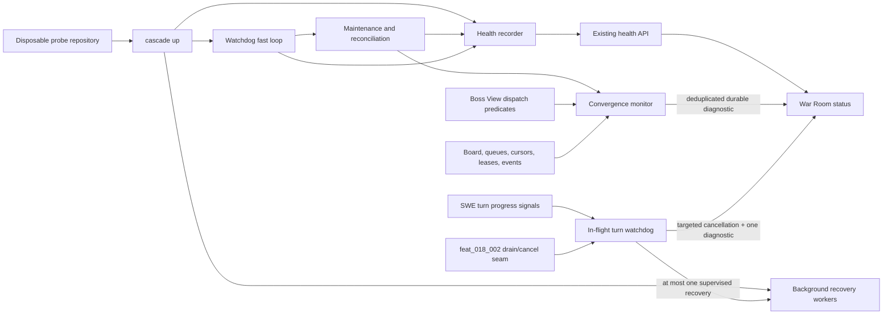

# Supervisor readiness and convergence health

## Intent

Make Cascade distinguish HTTP availability, process/transport liveness, and useful lifecycle progress. Detect both dispatchable work that is not converging and an in-flight model turn whose provider await remains connected while provider events, tool completions, checkpoints, and task files make no progress. Operators should receive a bounded, actionable diagnosis and one safe recovery attempt without losing dirty task work or taking down the War Room.

### Success criteria

Expose supervisor startup and readiness state; report whether the watchdog and automation reconciliation loops are running; detect dispatchable work and in-flight turns that remain without useful progress beyond bounded thresholds; emit durable War Room diagnostics naming the item, evidence, cancellation outcome, and recovery disposition; keep long model-turn recovery from blocking watchdog startup; preserve dirty task work during targeted turn cancellation; schedule at most one supervised recovery per unchanged stall episode; and provide a disposable synthetic lifecycle probe that never mutates the live board.

## Macro-architecture

The supervisor owns a process-local health recorder with an immutable read projection. Startup, the fast watchdog event loop, and the slower lifecycle-maintenance/reconciliation pass publish phase, last-started, last-success, and last-error evidence. The existing health API and War Room consume that projection, explicitly reporting HTTP liveness separately from automation readiness. Recovery performs structural repair synchronously but queues resumable model work onto the existing per-graph background workers before watchdog polling begins.

Convergence monitoring runs on the existing watchdog maintenance cadence. It reuses the authoritative Boss View/dispatch predicates to select approved features and dependency-ready tasks, then correlates durable board state, queue size/cursors, execution leases, and lifecycle events into a stable observation signature. A dispatchable item whose signature has not changed for the configured bounded interval produces one durable War Room event containing the item id, elapsed time, and best-known blocker. A changed signature or loss of eligibility clears the episode; a later stall may emit again. The monitor observes and diagnoses only—it never dispatches or changes lifecycle state.

An in-flight turn progress watchdog consumes explicit progress signals from provider events, completed tool calls, checkpoint advancement, and task-worktree file/content advancement. A pending provider await, open transport, live bridge process, or lease renewal is liveness evidence only. When useful progress remains unchanged past the configured monotonic deadline, it uses the turn-scoped drain/cancellation primitive delivered by `feat_018_002`, bounds graceful termination and targeted force-kill to that provider/bridge process tree, preserves checkpoint and dirty worktree state, appends one durable diagnostic, and schedules at most one supervised recovery for the unchanged episode. The supervisor, War Room, unrelated turns, and graph workers remain live.

A synthetic probe exercises the same public supervisor/lifecycle seams in a temporary initialized git repository. It drives a success path and a controlled stall, asserts readiness and diagnostic transitions, and removes the workspace afterward unless explicit debug retention is requested. Production board paths are not valid probe mutation targets.

## Cross-module constraints

- The filesystem board remains lifecycle truth.
- Readiness and convergence observation are read-only against live work. For a bounded in-flight no-progress episode, the only permitted remediation is turn-scoped cancellation through the `feat_018_002` seam plus at most one supervised recovery; durable task files, checkpoint evidence, and dirty worktree content are preserved.
- Readiness and dispatch-convergence code must not dispatch, bypass approval/dependency/parallelism gates, alter work status, or spawn duplicate graph work. In-flight recovery must be episode-idempotent and may enqueue no more than one replacement turn.
- One authoritative dispatchability predicate must serve Boss View and convergence monitoring; do not fork the gate logic.
- Use monotonic time for in-process elapsed thresholds and UTC timestamps for operator-facing evidence. Tests inject time rather than sleep.
- A successful HTTP response means only that the local server is live. Automation readiness additionally requires startup recovery to be scheduled and the watchdog and reconciliation loops to have completed successfully within their expected bounds.
- Diagnostic deduplication and recovery idempotency must survive normal polling, cancellation callbacks, and supervisor restarts without hiding a later distinct stall episode; durable event history remains append-only.
- Process/transport liveness, lease renewal, and a pending provider await never refresh useful-progress time. Only provider events, completed tool calls, checkpoint advancement, or task-worktree file/content advancement do.
- Cancellation targets the affected turn's provider/bridge process tree only. Any escalation from graceful termination to force-kill is bounded and must not signal the supervisor, War Room, watchdog, unrelated turns, or broad process-name matches.
- Keep status payloads free of credentials, prompts, and model output. Blocker details are bounded and operator-actionable.
- Prefer integration tests across supervisor/API/event seams. Add unit tests only for clock/deduplication edge behavior not economically covered there.

## Core dependencies

- `cascade.workspace.up` startup ordering and existing per-graph background kickoff workers.
- `cascade.watchdog.loop` fast polling and maintenance cadence.
- `cascade.completion_reconcile` lifecycle reconciliation.
- `cascade.boss.view.compute_boss_view` and central dispatch law.
- Queue cursor, task execution lease, and durable watchdog event stores.
- Existing War Room health/API rendering and Toast event path.
- Workspace initialization and temporary git-repository test helpers.
- `feat_018_002` graceful worker drain and turn-scoped cancellation primitives. `feat_012_004` must wait for that feature and reuse its seam; it must not concurrently introduce another `swe_turn`/execution cancellation path.

No new daemon, database, hosted monitor, or alternate lifecycle store is required.

## Feature breakdown

1. **feat_012_001 — Supervisor readiness state and non-blocking recovery**
   Establish the health projection, startup ordering, API/War Room presentation, and evidence that recovered model turns cannot hold watchdog startup.
2. **feat_012_002 — Bounded convergence detection and durable diagnostics**  
   Depends on feat_012_001. Reuse dispatch law, track durable progress signatures, and emit deduplicated actionable stall diagnostics.
3. **feat_012_003 — Disposable synthetic lifecycle readiness probe**  
   Depends on feat_012_001 and feat_012_002. Validate ready, progressing, stalled, and recovered behavior in an isolated temporary workspace.
4. **feat_012_004 — Bounded in-flight turn progress watchdog and single recovery**  
   Depends on feat_012_002 and external `feat_018_002`. Distinguish connected-process liveness from useful turn progress, perform targeted cancellation through the shared Epic 18 seam, preserve dirty work, emit one actionable diagnostic, and schedule at most one supervised recovery.

The first three features retain their readiness/convergence sequence. Feature 004 is deliberately gated behind Epic 18's cancellation work so planning may proceed without concurrent implementation in the same `swe_turn`/execution surface.

## Acceptance scenarios

1. The War Room HTTP endpoint is serving during startup recovery, while health reports automation as not ready and names the current startup phase.
2. A resumable model turn takes longer than a watchdog interval; the watchdog and reconciliation activity timestamps still advance.
3. A fully approved/dependency-ready item remains dispatchable with no relevant board, queue, cursor, lease, or lifecycle progress beyond the threshold; one durable diagnostic names the item and observed blocker.
4. Repeated polls with identical evidence do not spam events. Relevant progress clears the episode, and a later independent stall can emit a new diagnostic.
5. Gated, unapproved, at-capacity, already-running, completed, or otherwise non-dispatchable work is not falsely diagnosed as stalled.
6. The disposable probe demonstrates healthy convergence and a controlled stall, returns a bounded pass/fail result, and leaves the live board byte-for-byte untouched.
7. A provider call stays connected forever while producing no provider event or completed tool call and causing no checkpoint or task-file advancement; lease renewal does not mask the stall, and the injected-clock regression reaches the no-progress deadline without sleeping.
8. Expiry cancels only the stalled turn's provider/bridge process tree, including bounded targeted force-kill when graceful termination is ignored; the War Room, supervisor, watchdog, unrelated turns, dirty task worktree, and last checkpoint/result evidence survive.
9. Concurrent polls and cancellation callbacks yield one actionable durable diagnostic and at most one supervised replacement for the unchanged episode. The diagnostic includes task/turn/provider identity, last useful progress, elapsed time, cancellation outcome, preserved-work state, and recovery disposition.

## Scope cuts

- No automatic remediation or task cancellation except the narrowly scoped, episode-idempotent `feat_012_004` behavior: cancel one provably no-progress turn through the `feat_018_002` turn-scoped seam and schedule at most one supervised recovery. No gate bypass, whole-supervisor restart, broad process kill, unrelated-turn cancellation, dirty-work reset, or unbounded retry.
- No generic metrics platform, historical dashboard, alert routing, or remote telemetry.
- No separate health database or new queue format.
- No always-on synthetic canary and no probe execution against a live workspace.
- No attempt to diagnose arbitrary model quality, impose a blanket maximum turn duration, or guarantee completion time; this epic detects lack of observable lifecycle progress.

## Open questions

None blocking feature planning. Feature owners may choose exact field names and the default threshold, provided the shared contract remains bounded, configurable through the existing project configuration path where appropriate, and covered by injected-clock tests.

## Decision log

- 2026-10-22 · Human · Brief approved through merge request review.

- `dec_001` · 2026-10-23 · Epic Manager · **Architecture**
  Chose Use one supervisor health projection to separate HTTP liveness from automation readiness, fed by startup, watchdog, and reconciliation activity..
  Rationale: Operators need an authoritative contract rather than unrelated endpoint and loop signals; a read-only process-local projection fits the single-supervisor architecture without adding storage.
  Honors: Success criteria: expose startup/readiness and loop state; cross-module constraint: separate local process liveness from workflow convergence..

- `dec_002` · 2026-10-23 · Epic Manager · **Convergence**
  Chose Define stalled work as unchanged, currently dispatchable work beyond a bounded threshold, using Boss View dispatch predicates plus durable progress signatures and one diagnostic per unchanged episode..
  Rationale: Reusing dispatch law prevents false positives from approval, dependency, sibling, review, and capacity gates; episode deduplication makes the signal durable without toast spam.
  Honors: Constraints: no gate bypass, no duplicate work, reuse Boss View, queue cursors, watchdog cadence, and War Room toasts..

- `dec_003` · 2026-10-23 · Epic Manager · **Delivery scope**
  Chose Deliver three sequenced features: readiness/non-blocking recovery, convergence diagnostics, then an isolated synthetic lifecycle probe..
  Rationale: This is the smallest dependency-ordered slice that establishes the observable contract, builds diagnosis on it, and validates the integrated lifecycle without introducing an always-on canary or mutating the live board.
  Honors: Product-manager scope discipline and the success criterion for a disposable synthetic probe..

- `dec_004` · 2026-10-23 · Epic Manager · **Incident containment and recovery**
  Chose Treat a pending provider await, live bridge process, and lease renewal as transport/process liveness only. After a configurable bounded interval with no provider event, completed tool call, checkpoint advancement, or task-worktree file/content advancement, cancel only the affected turn through the feat_018_002 drain/cancellation seam, preserve dirty task state, emit one durable actionable diagnostic, and schedule at most one supervised recovery for the unchanged episode..
  Rationale: The incident showed that supervisor-coroutine heartbeat renewal can report healthy for an indefinitely connected but useless provider turn. A separate progress clock catches that failure while a turn-scoped, episode-idempotent response contains the hung bridge without killing the War Room, discarding recoverable work, or creating a retry storm. Depending on feat_018_002 avoids concurrent, conflicting changes in swe_turn/execution.
  Honors: Human incident request for process/transport versus progress liveness, bounded no-progress detection, targeted cancellation, dirty-work preservation, one diagnostic, at most one recovery, a forever-connected provider regression, and sequencing with Epic 18..
## Amendment log

_(none)_
