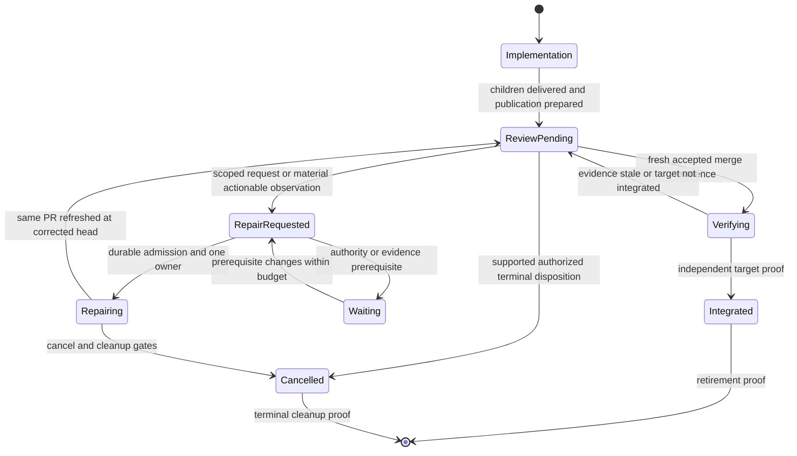

# Keep feature teams accountable through review merge and repair

## Intent

A Feature Team owns delivery until its existing integration merge request is verified merged into the owning Epic, not merely until Tasks finish or a PR opens. Epic 048 exposed the gap: feat_048_001 was marked completed while PR #251 remained open with a failing Recovery contract check. Epic recover_feature returned pending_feature_result/durable_result=false; its queued messages could not wake the completed Feature because queue delivery accepts only active teams or teams with a pending durable recovery action. The Feature was unable to initiate the repair it was asked to perform, and downstream task_048_004_003 repeatedly failed the same test. Make review ownership actionable through the ordinary team lifecycle, including existing conflict checks and review-health monitoring, without requiring a human to edit branches or bypass CI.

### Success criteria

1. Distinguish implementation complete, review pending, repair requested/in progress, verified merged, and terminal close/cancel states. Keep the same Feature owner, branch, PR, checkpoints and worktree available while review is open; only retire after independently verified merge into the intended target (or supported terminal disposition). Idle review-pending teams must be wakeable, not continuously burning model tokens.
2. Extend the existing review-health supervision path to observe fresh source/target heads, mergeability/conflicts, required CI check failures/pending/unknown, and actionable review feedback. Route conflicts and fixable red checks to the owning Feature Team; distinguish expected pending checks, transient forge outages, and human-only approvals. A failing required check cannot be deemed healthy or bypassed.
3. Accept scoped human and direct-parent fix requests against an open Feature review even if implementation is recorded complete. Admit a durable request/repair generation before scheduling a wakeup; the owning Feature may use its normal guarded Task mint/dispatch and review publication tools. Keep original review identity and repair history, scope and approval boundaries, budget, claims, and one writer. Return typed acknowledgement, admission, execution, refusal and verified outcome, not merely queued success. A completed legacy Feature with an unmerged PR must have a supported reconciliation route.
4. Deduplicate repeated observations and requests, fence stale heads and concurrent workers, preserve recovery/CI evidence across restart, and retry only on appropriate evidence within finite budget. Avoid redispatch loops on downstream tasks whose only blocker is unchanged upstream CI. Reconcile the exact corrected head, required checks and merge disposition independently; preserve review comments and do not force-merge or override protections.
5. War Room exposes the open PR URL, accountable team, review/check status, repair request and next prerequisite; distinguish awaiting review from inactive/terminal. Use existing review state and transcript mechanisms; do not wake teams from a GET/UI poll.
6. Acceptance: reproduce the PR #251 scenario with an implementation-complete Feature and open red CI, parent fix request, durable admitted task/repair on the existing branch, check rerun green, verified merge and only then retirement. Exercise conflict/target movement, review feedback, stale/duplicate requests, restart between admission and wakeup, concurrent repair, missing forge data, required human approval, cancellation and legacy completed-but-open review. Use real temporary Git repositories and normal production adapters, with scripted forge/check transport where required. Prove no extra PR, no approval bypass, no paid turns on unchanged idle checks, and no downstream rerun storm.

## Macro-architecture

### Delivery contract and scope

This is proposed behavior. The existing source and baseline checks below establish the starting point, not implementation of this plan.

Keep the existing board schema and completed-source-document convention needed by review publication. Add a coherent **Feature delivery phase** to the current review/obligation projection so implementation staging cannot be mistaken for terminal delivery. Its inputs remain the existing review generations, repair actions, canonical owner, child delivery and target-integration evidence. Do not create another lifecycle ledger. The shared predicate must be consumed by queue eligibility, startup resume, completion, retirement, dependency/recovery gates and War Room.

| Phase | Required meaning and next transition |
|---|---|
| Implementation complete | Child delivery/closeout gates passed; publication may still be pending. This does not retire the owner. |
| Review pending | The original review is open; the same team, branch, worktree, queue and checkpoints remain available. Expected CI/review waits do not start paid turns. |
| Repair requested / admitted | A scoped human, direct-parent or actionable supervisor request is durable; admission binds its authority, identity and observed generation before wakeup. Requested and admitted are distinct results. |
| Repair in progress | One admitted generation owns guarded Task work and publication on the existing Feature branch/review. |
| Merge verification pending | Green checks or forge merge alone do not prove delivery; independently recheck the corrected head, required-check evidence and intended Epic integration. Stacked acceptance remains nonterminal until that integration is proved. |
| Verified integrated | Current-generation acceptance and intended-target integration satisfy the existing closeout/retirement proof. |
| Terminal cancellation / supported closure | Only an explicit supported disposition and its cleanup/parent gates release resources. Closed-unmerged, missing or unknown reviews alone never imply success or authorize retirement. |

Proposed state flow:



### Implementation boundaries and durable evidence

| Owner | Existing entry points to extend | Responsibility and persistence |
|---|---|---|
| Shared review / Boss | `cascade/review.py::ensure_feature_review`, `feature_review_pending`, `feature_review_view(s)`, `reconcile_feature_review_completions`; `cascade/boss/rollup.py::current_feature_obligation`, `try_complete_feature` | Review identity and immutable generations in `.cascade/reviews.json`; stage implementation independently of delivery, fence acceptance, preserve target integration and descendant retirement proof. |
| Feature / Epic | `cascade/feature/repair.py::feature_repair`, `reserve_repair_child`, `repair_event_authorizes`; `cascade/feature/mint.py::mint_task`; `cascade/team_supervision.py::supervise_child`; `cascade/epic/recovery.py::recover_feature` | Admit scoped review repair in the existing `executions.json` action ledger; preserve request/child reservations, authority, generation and history. Parent adapters return typed results instead of treating queued messages as execution. |
| Workspace | `cascade/workspace/kickoff.py::deliver_queue_kickoffs`, `resume_inflight_graphs`, `_run_queue_delivery_locked`; `integration_worktree.py::prove_terminal_retirement` | One graph writer; actionable queue cursor delivery and interrupted-turn resume; retain registered checkout, checkpoint and queue until obligations are terminal. |
| Tracking / Watchdog | `cascade/tracking.py::merge_request_snapshot`; `cascade/review_health.py::reconcile_open_review_health`; existing `cascade/watchdog/loop.py`, `cascade/watchdog/audit_recovery.py`, `cascade/watchdog/incident_postcheck.py`, `cascade/watchdog/reservations.py::verify_incident_postcheck` | Fresh forge and check observations, deduplicated routing through current incident/claim/budget machinery, independent exact-generation verification. |
| Task recovery | `cascade/task_rollup.py::retry_pending_task_merges` and existing Task action/recovery generation and dependency gates | Record which upstream review evidence blocks downstream recovery; unchanged evidence neither admits another repair attempt nor redispatches the downstream Task. Unrelated downstream failures retain their own recovery. |
| War Room | `cascade/war_room/serialize.py`, existing review routes/static UI, `cascade/recovery_progress/` and committed transcript publisher | Read the same safe delivery and repair evidence, show owner/PR/CI/next prerequisite, and submit explicit authenticated requests through the shared repair adapter. GET is passive. |

The [shared review contract](../../../cascade/DESIGN.md#delivery-and-review-boundaries) owns `REQ-REVIEW-REPAIR-001/002` and `REQ-CASCADE-RECOVERY-001`. Link rather than duplicate these in [Feature](../../../cascade/feature/DESIGN.md), [Epic](../../../cascade/epic/DESIGN.md), [Boss](../../../cascade/boss/DESIGN.md#delivery-and-closeout), [Workspace](../../../cascade/workspace/DESIGN.md#work-ownership-and-retirement), [Watchdog](../../../cascade/watchdog/DESIGN.md#recovery-admission-and-active-path-authority) and [War Room](../../../cascade/war_room/DESIGN.md). New requirements/decisions receive subsystem IDs in exactly one owning design during implementation.

### Admission, observation and recovery contract

A request binds stable request ID, origin/authority, scoped reason/evidence, accountable Feature, original review identity/route, observed source and target heads, current review/repair generation, approval/scope reference and existing incident/claim/budget identity. Return action/generation identity and separate request acknowledgement, admission, execution, refusal/wait, verification pending and verified outcome, including the next prerequisite. A generic coordination message is not this receipt.

Persist admission before scheduling. Replays use the same request and reserved child; changed content under the same ID refuses. Under the existing owner/lifecycle locks, recheck direct parentage or authenticated human authority, active approval/scope, dependencies/comments, review identity and head freshness, worktree/branch ownership, cancellation, execution lease and finite budget. A live owner causes a join/defer result, never a second writer. Review feedback may authorize work within approved scope; it cannot silently expand scope or require resolution of its own fix request as a precondition to addressing it.

```mermaid
sequenceDiagram
    participant Request as Parent / human / review supervisor
    participant Repair as Feature repair admission
    participant Ledger as Existing action and review stores
    participant Queue as Workspace queue and checkpoint
    participant Team as Retained Feature and guarded Tasks
    participant Verify as Independent review / target postcheck
    Request->>Repair: scoped request + observed review generation
    Repair->>Ledger: recheck authority and persist admission / reservation
    Repair->>Queue: stable generation event
    Queue->>Team: one actionable turn
    Team->>Ledger: guarded Task result and same-PR publication evidence
    Verify->>Ledger: fresh checks, merge and intended target proof
    Verify->>Queue: terminal completion / retirement eligibility
    Note over Ledger,Queue: Restart rejoins durable admission and cursor; no duplicate child
```

Forge normalization covers GitHub and GitLab. Required-check requirements and results must be authoritative and tied to the observed head/check-run generation; absent policy or checks are unknown, not green. Separate fixable failed checks and conflicts from expected pending checks, transient outages and human-only approval waits. A mergeable review with a failed required check is unhealthy. No arbitrary command from forge feedback is executed. Reuse conflict validation and publication safeguards.

Fingerprint material observations by review identity, heads, relevant check-run/feedback identity and repair generation. Repeated unchanged observations preserve the same receipt and do not spend provider/validation budget. Changed evidence may justify one bounded reevaluation through current gates. Persist waiting prerequisites and upstream blocker identity so restart cannot reset budget or cause a downstream rerun storm. A green result for an old head, stale callback or target change cannot verify a newer generation. Missing evidence retains resources and exposes a next prerequisite.

### Diagram-impact inventory

Authoritative source: [workspace.dsl](../../../architecture/target-9f61bc6d6f8ae8cb7d196c8b327650d5/workspace.dsl), its confined `model.dsl` / `views.dsl` closure and `workspace.contract.json`. Existing rendered artifacts are derived, revision-pinned evidence. Do not rewrite accepted snapshots.

| Level / affected view keys | Design owner and implementation coverage | Planned change, delivery owner and required verification |
|---|---|---|
| Landscape / context: `cascade-landscape`, `cascade-context` | Root `DESIGN.md`; operator, Cascade, forge, provider, renderer | No new actor or external system is planned: repair stays in the current supervisor/forge boundary. feat_051_001 reviews ownership wording; feat_051_004 reconciles this concrete no-structural-change claim against the final diff and actual navigation. |
| Containers: `cascade-containers` | Root and `cascade/DESIGN.md`; Service, War Room, repository artifacts | No new runtime or store: use existing actions/reviews/checkpoints and UI. feat_051_001 documents lifecycle ownership; feat_051_004 verifies the rendered boundary and that no module is represented as a separately deployed service. |
| Components: `cascade-supervisor-components`, `cascade-team-components` | Package, Feature, Epic, Boss, Workspace, Watchdog designs | feat_051_001–003 review/update relationships for admission, queue delivery, observation and independent verification. Preserve stable component IDs; verify registry/tool wiring and both sides of each interface. |
| Code: `cascade-boss-code`, `cascade-workspace-code` | Boss/Workspace; review and rollup functions, kickoff admission/resume, retirement proof listed above | feat_051_001 updates native nodes/relationships for shared delivery predicates and retained owner lifecycle. Check normal open-review wait and refusal/retirement paths against source, source kinds and metadata. |
| Code: `cascade-feature-code`, `cascade-epic-code`, `cascade-watchdog-code`; affected `cascade-task-code`, `cascade-teams-code` | Feature/Epic/Watchdog/Task/package; repair, reservation, parent adapter, scoped tools, budgets and postchecks | feat_051_002 owns request/admission/resume wiring; feat_051_003 owns observation/CI/deduplication/downstream blocking. Include actual source symbols for new helpers only after they exist; show one writer, persistent generations and failure/restart fences. |
| War Room components/Code: `cascade-war-room-components`, `cascade-dashboard-code`, affected `cascade-war-room-http-code` | War Room and, only if its contract changes, Recovery progress design; serialization, authenticated action and safe progress/transcript consumers | feat_051_004 updates projection/action relationships and native source-linked nodes. Verify passive GET, owner/state/next-prerequisite display and real browser request/result flow. |
| Supplementary behavior | Feature, Boss, Workspace, Watchdog and War Room designs | Each owning Feature updates normal and failure/restart Mermaid flows with inputs, outputs and persistent state. feat_051_004 traces the complete red-CI repair journey and all changed cross-owner interfaces. |

Every affected Feature carries this inventory into Task acceptance. Source-contract validation, supported pinned rendering, real context → container → component → Code navigation, Level up, deep-link restoration and opening pinned source are required at delivery. Verify stale renamed/deleted symbols and changed component ownership. Record cold/warm measurements and artifact reuse; preserve renderer bounds and one batch session rather than per-view process startup. A successful render does not prove lifecycle correctness or interactive navigation.

## Cross-module constraints

- Retain original Feature/review/branch identity for an open review. Existing already-merged-review follow-up behavior remains compatible but is not the route for this brief.
- Keep canonical mutation-owner, one-writer, current approval/scope, comments, dependencies, incident budgets, claims and independent postcheck gates. Neither a completed Markdown path nor a queued/acknowledged request is verification.
- Preserve human merge policy and protections; no force-merge, CI bypass, arbitrary forge-command execution or blanket reactivation of all completed teams.
- Preserve split product/tracking ownership and existing stacked-dispatch/integration policy. Forge acceptance on a stacked predecessor does not release Epic-integration obligations.
- Reuse the recovery contracts and progress/transcript surfaces already present from Epic 048 and Epic 049. Their work records remain historical context, not new cross-epic execution dependencies. New conflicts with their contracts must be escalated as a specific amendment.
- No new scheduler, ledger, dashboard framework, general CI orchestrator, live deployment, dependency installation or upgrade. Keep idle pending/unknown/approval waits token-free.
- Feature teams own implementation and Task planning; this epic defines shared contracts and acceptance. All four children remain backlog until normal Epic plan approval and eligibility.

## Core dependencies

Canonical software manifest revision **3** is **ready** with no dependency blockers. Declaration began at expected_revision=0 before general planning or child creation; subsequent revisions corrected authoring fields to match the verifier's path and literal-result semantics. All checks succeeded without installation.

The declared target is the existing local verification host `ip-172-31-37-14`, Linux x86_64, host sandbox, runner of the same name, repository/check-executor worktree `/home/ubuntu/dev/CascadeCode`, runtime `/opt/conda/bin/python3.12`, container_digest `not_applicable`. This explicitly targets local verification; it does not infer a deployment destination from the observed executor. Product edits belong only to the Epic integration checkout `/home/ubuntu/dev/CascadeCode/.cascade/worktrees/epic_epic_051`.

Exact existing prerequisites: Python 3.12.8; PyYAML 6.0.3; cursor-sdk 1.0.37; langgraph 1.2.14; langgraph-checkpoint-sqlite 3.1.1; pytest 9.0.3; Git 2.34.1; Node 20.20.2; Docker 28.0.0; Playwright 1.64.0; Chromium 156.0.8078.4/build 1248; Structurizr 2026.09.19-playwright at `sha256:c89b54231c42da90484e6bf4e398f36a40123cb4b12c9d5f09c27eef3dc9644c`. The canonical manifest owns exact source/install locations, executable or installed RECORD digest identities and bounded verification recipes. These are existing-installation checks, not new dependency constraints for users or installation authority. Acceptance uses scripted forge/provider transport with production adapters and needs no live forge credentials or paid provider calls.

## Feature breakdown

| Feature | Depends on | Shippable responsibility and success criteria |
|---|---|---|
| feat_051_001 — Keep Feature delivery ownership alive until verified integration | none | Shared delivery phase, retained/wakeable ownership, compatible legacy projection, integration/retirement gates; success criteria 1 and lifecycle parts of 3–4. |
| feat_051_002 — Admit durable scoped repairs for open Feature reviews | feat_051_001 | Human/parent adapter, durable admission before wake, normal guarded repair Tasks/publication, typed results, one writer/budget/restart and independent postcheck; success criteria 3–4. |
| feat_051_003 — Route actionable review health without idle or downstream retry loops | feat_051_002 | Forge CI/feedback normalization, fresh evidence, bounded deduplication, current repair routing and upstream-wait suppression; success criteria 2 and 4. |
| feat_051_004 — Expose accountable review state and prove the complete repair journey | feat_051_003 | Existing War Room surfaces and explicit repair action, end-to-end acceptance, final architecture/browser reconciliation; success criteria 5–6 and integration of 1–4. |

Sequence shared lifecycle before admission, admission before automatic observation, then the UI and full acceptance. The serial dependency chain limits competing edits to shared review/action/C4 files. Each Feature still owns focused tests and design reconciliation; final acceptance is not a substitute for those checks. No child is minted solely for ceremony, dependency installation or documentation cleanup.

## Acceptance and validation

| Scenario | Primary owner and required evidence |
|---|---|
| Implementation complete + open review; legacy completed-open; verified integration and retirement; local-review-disabled and stacked paths | feat_051_001: real Git identity/target proof, retained resources, zero premature terminal events and idle turns. |
| Parent/human request; reservation/queue/checkpoint crash windows; concurrent/stale/duplicate requests; scope/approval/lease/cancellation/budget refusal | feat_051_002: durable production adapter receipts, one child/writer, replay after restart and unchanged original PR. |
| Required CI failed/pending/green/unknown/stale; target movement/conflicts; actionable feedback; transient outage; human-only approval | feat_051_003: scripted GitHub/GitLab transport through production normalization and routing, exact head/check-run evidence and bounded retries. |
| Unchanged upstream CI blocks a downstream Task | feat_051_003: repeat supervisor passes and restart produce no downstream redispatch; materially changed evidence re-evaluates once; unrelated failures remain actionable. |
| Complete motivating repair journey and passive UI | feat_051_004: real temporary Git plus normal guarded orchestration, scripted external transport; red → admitted repair Task → same PR/new head → green → independently verified Epic merge → retirement. Preserve comments/history and prove no duplicate PR, approval bypass, idle paid turns or rerun storm. |
| Integrated design and C4 coverage | Each owning Feature then feat_051_004: final-diff inventory, source/design links, exact symbols/kinds, model/contract validation, pinned render and actual browser navigation/source checks, normal/failure/restart traces and measured cache reuse. |

Extend existing high-signal suites: `tests/test_review_health.py`, `tests/test_review_recovery_journey.py`, `tests/test_late_repair_convergence.py`, `tests/feature/test_repair.py`, `tests/feature/test_review_generations.py`, `tests/epic/test_parent_lifecycle_recovery.py`, `tests/workspace/test_completed_recovery_kickoff.py`, Watchdog postchecks, tracking adapters and publication safeguards. Final delivery runs the repository's bounded Recovery contract selection and relevant browser/C4 checks; include the new journey in the gate if otherwise uncovered. Do not claim full-suite, live deployment or live-forge acceptance from scripted transport.

## Planning design review and evidence

Reviewed root `DESIGN.md`, `cascade/DESIGN.md`, and Feature, Epic, Boss, Workspace, Watchdog and War Room owning designs against current review, tracking, repair, rollup and queue code. Current source confirms that mergeability can be treated as healthy without required CI evidence and that generic parent recovery can queue a message without executable repair admission.

Focused current-fact correction in `cascade/boss/DESIGN.md`: completed-parent `not_active` is a generation-bound `parent_lifecycle_mismatch`, not an unconditional transient merge retry. The statement now agrees with `task_rollup.py`, the shared design and Feature repair contract; it introduces no planned behavior or delivery chronology. No model change is needed for this correction: existing Task/parent mismatch and Feature repair nodes already represent that path.

Actual baseline verification:

- `python3 -m pytest -q tests/test_review_health.py tests/workspace/test_completed_recovery_kickoff.py tests/epic/test_parent_lifecycle_recovery.py tests/feature/test_repair.py --tb=short`: **22 passed in 11.27s**.
- `python3 -m pytest -q tests/workspace/test_c4_render.py::test_real_pinned_renderer_publishes_one_validated_handoff_and_cache --tb=short`: **1 passed in 54.15s**. Exercises current source-contract validation, pinned local renderer, Code view source symbol/kind coverage, interactive bindings, cache reuse and corrupted-artifact rejection. This is test duration, not a UI latency promise.
- All 12 canonical prerequisite checks passed; no installation occurred.

Remaining delivery evidence is explicitly assigned above: new repair behavior, new CI policy normalization, full red-CI convergence and actual War Room navigation/action/browser verification have not been implemented or run during planning. Proposed behavior stays in work records until implementation reconciles owning designs and native Code views. Architect review confirms this contract and the four sequential Feature scopes; current-revision role sign-offs remain canonical lifecycle evidence.


### Architect review and publication evidence

The architect read the Epic and all four canonical child specs, checked current admission, queue/resume, review-health, parent recovery and closeout paths, and reviewed root/package, Feature, Epic, Boss, Workspace, Watchdog and War Room designs. The existing Feature scopes already require planners to carry the diagram-impact inventory and normal/failure/restart cases into Task acceptance; no child scope change is needed.

The owned architecture proposal adds seven real Function nodes and six relationships to `cascade-workspace-code`, `cascade-watchdog-code` and `cascade-boss-code`. They expose queue selection, startup resume, coalesced scheduling, locked delivery, forge observation, review health and pending-review staging. Model and source contract agree, including the current proposal owner. Workspace and Watchdog designs add current execution and failure/restart flows; Boss adds its pending-review entry point. The existing component hierarchy, context, containers, repair/reservation/postcheck nodes and stable requirement owners remain accurate. No runtime behavior is changed by these planning edits.

The final design/model pin is `58e46f4f0eac1df5186c5f9562b7ef96def35e27`. The [architect evidence](../../epic_artifacts/epic_051_architecture_evidence.json) records per-level impact, reviewed paths, source traces, checks and limitations; the [browser receipt](../../epic_artifacts/epic_051_architecture_browser.json) records actual navigation, pinned-source and render reuse measurements. Independent focused baseline validation passed 22 tests; C4 source/review validation passed 27 tests; the pinned renderer test passed. Browser checks use production architecture routes and rendering with unrelated operational panels isolated. Timing is observed evidence, not a latency guarantee. All added symbols are module-level Functions, changed design links resolve, and no existing symbol/component ownership was renamed or deleted.

Publication uses `architecture_impact=diagram_change` and the exact committed plan, root design and model closure through `publish_architecture_review`; the exact request is retained in [epic_051_architecture_review.json](../../epic_artifacts/epic_051_architecture_review.json). The accepted `epic:epic_051` lineage was empty when reviewed, so the expected generation is null. Pending publication must be discovered with the identical request on a later turn, without changing pins or accepted snapshots. The Epic Manager must re-review and sign the final plan revision before human approval. Full repair behavior, CI normalization, final UI flow and red-CI convergence remain Feature delivery obligations, not results of this baseline review.

## Open questions

No product-scope question blocks Feature planning. The following implementation risks have assigned decisions and acceptance rather than an open-ended spike:

1. Completed-document staging versus active delivery: use the additive shared delivery predicate; feat_051_001 must inventory every eligibility/retirement consumer before changing behavior.
2. Required-check policy differs by forge or is unavailable: feat_051_003 normalizes authoritative facts and returns unknown/wait when proof is missing; it must not assume green or widen credentials.
3. Durable admission can race a live team, cancellation or branch movement: feat_051_002 must prove request/reservation replay and ownership/head fences before automatic routing lands.
4. Shared artifact drift: sequential Features reconcile diagrams and cross-module contracts at each delivery; feat_051_004 verifies the final inventory. Any material unsupported route must be reported to this Epic through the amendment path.

## Decision log

- 2026-11-25 · Human · Brief approved through merge request review.

- `dec_001` · 2026-11-26 · Epic Manager · **Macro-architecture / Delivery contract and scope**
  Chose Keep the current board status schema and completed-source review staging; make delivery ownership explicit through the shared review/obligation phase consumed by queue, resume, closeout, dependency and UI paths..
  Rationale: The publication path stages completed source documents before forge merge. Changing board enums would widen scope; a shared nonterminal delivery contract preserves compatibility while preventing staged completion from retiring or disabling the accountable owner.
  Honors: Success criteria 1, 3 and 5; original Feature/branch/review identity; existing review and owner contracts..

- `dec_002` · 2026-11-26 · Epic Manager · **Macro-architecture / Admission, observation and recovery contract**
  Chose Extend existing repair actions, claims, finite budgets and queue delivery with durable scoped admission before wakeup; route CI/conflict/feedback observations and parent/human requests through that same adapter..
  Rationale: Generic queued coordination cannot authorize a completed Feature to mint repair work. One generation-bound route provides actionable ownership, replay and one-writer guarantees without a duplicate scheduler or ledger; unknown checks and approval waits remain explicit.
  Honors: Success criteria 2–4; current approval/scope boundaries, no paid unchanged idle turns, no downstream rerun storm, independent verification..

- `dec_003` · 2026-11-26 · Epic Manager · **Feature breakdown / Acceptance and validation**
  Chose Sequence four Features: delivery lifecycle → durable repair admission → review-health routing → War Room and complete acceptance. Every Feature owns its design/Code updates and focused tests; the final Feature reconciles the integrated inventory and red-CI journey..
  Rationale: The serial chain limits shared-file contention and establishes safe admission before automated observations can request work. Real temporary Git and scripted external transport provide reproducible acceptance without live forge/provider credentials or deployment.
  Honors: All six success criteria; frugal-engineering scope; design implementation-depth and revision-pinned publication requirements; no installation authority..

- `dec_004` · 2026-11-26 · Epic Architect · **Macro-architecture / Diagram-impact inventory**
  Chose Publish the current implementation baseline with seven source-verified Function nodes and six relationships in the Workspace, Watchdog and Boss Code views; retain proposed delivery/repair semantics in this plan and the four sequenced Feature scopes..
  Rationale: Existing views omitted the queue eligibility/resume and review-health entry points central to this change. Explicit baseline coverage makes the completed-team wakeup gap and mergeability-only health behavior inspectable without presenting unimplemented CI or repair behavior as current architecture. Context, containers, component ownership and existing Feature repair/reservation/verification nodes remain accurate; each Feature must reconcile its changed behavior and Task acceptance against the inventory.
  Honors: Design implementation-depth and native Code navigation; single-owner requirements and durable ledgers; current-fact design prose; original Feature/branch/review identity; revision-pinned publication and explicit implementation acceptance..
## Amendment log

_(none)_
