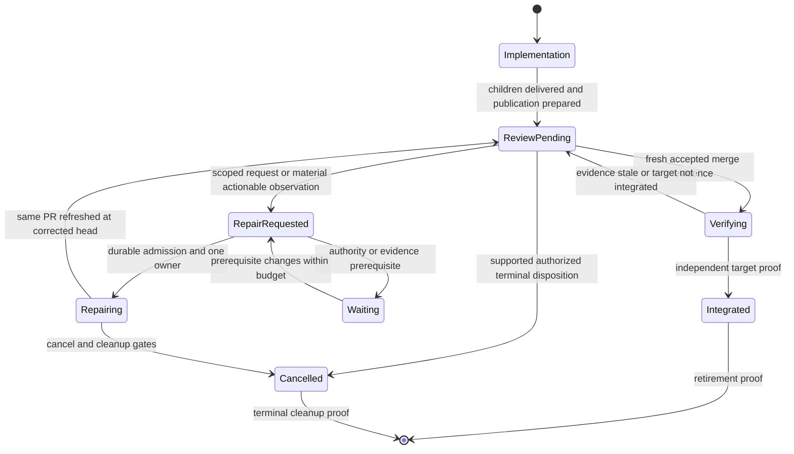

# Keep feature teams accountable through review merge and repair

## Intent

A Feature Team owns delivery until its existing integration merge request is verified merged into the owning Epic, not merely until Tasks finish or a PR opens. Epic 048 exposed the gap: feat_048_001 was marked completed while PR #251 remained open with a failing Recovery contract check. Epic recover_feature returned pending_feature_result/durable_result=false; its queued messages could not wake the completed Feature because queue delivery accepts only active teams or teams with a pending durable recovery action. The Feature was unable to initiate the repair it was asked to perform, and downstream task_048_004_003 repeatedly failed the same test. Make review ownership actionable through the ordinary team lifecycle, including existing conflict checks and review-health monitoring, without requiring a human to edit branches or bypass CI.

### Success criteria

1. Distinguish implementation complete, review pending, repair requested/in progress, verified merged, and terminal close/cancel states. Keep the same Feature owner, branch, PR, checkpoints and worktree available while review is open; only retire after independently verified merge into the intended target (or supported terminal disposition). Idle review-pending teams must be wakeable, not continuously burning model tokens.
2. Extend the existing review-health supervision path to observe fresh source/target heads, mergeability/conflicts, required CI check failures/pending/unknown, and actionable review feedback. Route conflicts and fixable red checks to the owning Feature Team; distinguish expected pending checks, transient forge outages, and human-only approvals. A failing required check cannot be deemed healthy or bypassed.
3. Accept scoped human and direct-parent fix requests against an open Feature review even if implementation is recorded complete. Admit a durable request/repair generation before scheduling a wakeup; the owning Feature may use its normal guarded Task mint/dispatch and review publication tools. Keep original review identity and repair history, scope and approval boundaries, budget, claims, and one writer. Return typed acknowledgement, admission, execution, refusal and verified outcome, not merely queued success. A completed legacy Feature with an unmerged PR must have a supported reconciliation route.
4. Deduplicate repeated observations and requests, fence stale heads and concurrent workers, preserve recovery/CI evidence across restart, and retry only on appropriate evidence within finite budget. Avoid redispatch loops on downstream tasks whose only blocker is unchanged upstream CI. Reconcile the exact corrected head, required checks and merge disposition independently; preserve review comments and do not force-merge or override protections.
5. War Room exposes the open PR URL, accountable team, review/check status, repair request and next prerequisite; distinguish awaiting review from inactive/terminal. Use existing review state and transcript mechanisms; do not wake teams from a GET/UI poll.
6. Acceptance: reproduce the PR #251 scenario with an implementation-complete Feature and open red CI, parent fix request, durable admitted task/repair on the existing branch, check rerun green, verified merge and only then retirement. Exercise conflict/target movement, review feedback, stale/duplicate requests, restart between admission and wakeup, concurrent repair, missing forge data, required human approval, cancellation and legacy completed-but-open review. Use real temporary Git repositories and normal production adapters, with scripted forge/check transport where required. Prove no extra PR, no approval bypass, no paid turns on unchanged idle checks, and no downstream rerun storm.

## Macro-architecture

### Delivery contract and scope

This is proposed behavior. The existing source and baseline checks below establish the starting point, not implementation of this plan.

Keep the existing board schema and completed-source-document convention needed by review publication. Add a coherent **Feature delivery phase** to the current review/obligation projection so implementation staging cannot be mistaken for terminal delivery. Its inputs remain the existing review generations, repair actions, canonical owner, child delivery and target-integration evidence. Do not create another lifecycle ledger. The shared predicate must be consumed by queue eligibility, startup resume, completion, retirement, dependency/recovery gates and War Room.

| Phase | Required meaning and next transition |
|---|---|
| Implementation complete | Child delivery/closeout gates passed; publication may still be pending. This does not retire the owner. |
| Review pending | The original review is open; the same team, branch, worktree, queue and checkpoints remain available. Expected CI/review waits do not start paid turns. |
| Repair requested / admitted | A scoped human, direct-parent or actionable supervisor request is durable; admission binds its authority, identity and observed generation before wakeup. Requested and admitted are distinct results. |
| Repair in progress | One admitted generation owns guarded Task work and publication on the existing Feature branch/review. |
| Merge verification pending | Green checks or forge merge alone do not prove delivery; independently recheck the corrected head, required-check evidence and intended Epic integration. Stacked acceptance remains nonterminal until that integration is proved. |
| Verified integrated | Current-generation acceptance and intended-target integration satisfy the existing closeout/retirement proof. |
| Terminal cancellation / supported closure | Only an explicit supported disposition and its cleanup/parent gates release resources. Closed-unmerged, missing or unknown reviews alone never imply success or authorize retirement. |

Proposed state flow:



### Implementation boundaries and durable evidence

| Owner | Existing entry points to extend | Responsibility and persistence |
|---|---|---|
| Shared review / Boss | `cascade/review.py::ensure_feature_review`, `feature_review_pending`, `feature_review_view(s)`, `reconcile_feature_review_completions`; `cascade/boss/rollup.py::current_feature_obligation`, `try_complete_feature` | Review identity and immutable generations in `.cascade/reviews.json`; stage implementation independently of delivery, fence acceptance, preserve target integration and descendant retirement proof. |
| Feature / Epic | `cascade/feature/repair.py::feature_repair`, `reserve_repair_child`, `repair_event_authorizes`; `cascade/feature/mint.py::mint_task`; `cascade/team_supervision.py::supervise_child`; `cascade/epic/recovery.py::recover_feature` | Admit scoped review repair in the existing `executions.json` action ledger; preserve request/child reservations, authority, generation and history. Parent adapters return typed results instead of treating queued messages as execution. |
| Workspace | `cascade/workspace/kickoff.py::deliver_queue_kickoffs`, `resume_inflight_graphs`, `_run_queue_delivery_locked`; `integration_worktree.py::prove_terminal_retirement` | One graph writer; actionable queue cursor delivery and interrupted-turn resume; retain registered checkout, checkpoint and queue until obligations are terminal. |
| Tracking / Watchdog | `cascade/tracking.py::merge_request_snapshot`; `cascade/review_health.py::reconcile_open_review_health`; existing `cascade/watchdog/loop.py`, `cascade/watchdog/audit_recovery.py`, `cascade/watchdog/incident_postcheck.py`, `cascade/watchdog/reservations.py::verify_incident_postcheck` | Fresh forge and check observations, deduplicated routing through current incident/claim/budget machinery, independent exact-generation verification. |
| Task recovery | `cascade/task_rollup.py::retry_pending_task_merges` and existing Task action/recovery generation and dependency gates | Record which upstream review evidence blocks downstream recovery; unchanged evidence neither admits another repair attempt nor redispatches the downstream Task. Unrelated downstream failures retain their own recovery. |
| War Room | `cascade/war_room/serialize.py`, existing review routes/static UI, `cascade/recovery_progress/` and committed transcript publisher | Read the same safe delivery and repair evidence, show owner/PR/CI/next prerequisite, and submit explicit authenticated requests through the shared repair adapter. GET is passive. |

The [shared review contract](../../../cascade/DESIGN.md#delivery-and-review-boundaries) owns `REQ-REVIEW-REPAIR-001/002` and `REQ-CASCADE-RECOVERY-001`. Link rather than duplicate these in [Feature](../../../cascade/feature/DESIGN.md), [Epic](../../../cascade/epic/DESIGN.md), [Boss](../../../cascade/boss/DESIGN.md#delivery-and-closeout), [Workspace](../../../cascade/workspace/DESIGN.md#work-ownership-and-retirement), [Watchdog](../../../cascade/watchdog/DESIGN.md#recovery-admission-and-active-path-authority) and [War Room](../../../cascade/war_room/DESIGN.md). New requirements/decisions receive subsystem IDs in exactly one owning design during implementation.

### Admission, observation and recovery contract

A request binds stable request ID, origin/authority, scoped reason/evidence, accountable Feature, original review identity/route, observed source and target heads, current review/repair generation, approval/scope reference and existing incident/claim/budget identity. Return action/generation identity and separate request acknowledgement, admission, execution, refusal/wait, verification pending and verified outcome, including the next prerequisite. A generic coordination message is not this receipt.

Persist admission before scheduling. Replays use the same request and reserved child; changed content under the same ID refuses. Under the existing owner/lifecycle locks, recheck direct parentage or authenticated human authority, active approval/scope, dependencies/comments, review identity and head freshness, worktree/branch ownership, cancellation, execution lease and finite budget. A live owner causes a join/defer result, never a second writer. Review feedback may authorize work within approved scope; it cannot silently expand scope or require resolution of its own fix request as a precondition to addressing it.

```mermaid
sequenceDiagram
    participant Request as Parent / human / review supervisor
    participant Repair as Feature repair admission
    participant Ledger as Existing action and review stores
    participant Queue as Workspace queue and checkpoint
    participant Team as Retained Feature and guarded Tasks
    participant Verify as Independent review / target postcheck
    Request->>Repair: scoped request + observed review generation
    Repair->>Ledger: recheck authority and persist admission / reservation
    Repair->>Queue: stable generation event
    Queue->>Team: one actionable turn
    Team->>Ledger: guarded Task result and same-PR publication evidence
    Verify->>Ledger: fresh checks, merge and intended target proof
    Verify->>Queue: terminal completion / retirement eligibility
    Note over Ledger,Queue: Restart rejoins durable admission and cursor; no duplicate child
```

Forge normalization covers GitHub and GitLab. Required-check requirements and results must be authoritative and tied to the observed head/check-run generation; absent policy or checks are unknown, not green. Separate fixable failed checks and conflicts from expected pending checks, transient outages and human-only approval waits. A mergeable review with a failed required check is unhealthy. No arbitrary command from forge feedback is executed. Reuse conflict validation and publication safeguards.

Fingerprint material observations by review identity, heads, relevant check-run/feedback identity and repair generation. Repeated unchanged observations preserve the same receipt and do not spend provider/validation budget. Changed evidence may justify one bounded reevaluation through current gates. Persist waiting prerequisites and upstream blocker identity so restart cannot reset budget or cause a downstream rerun storm. A green result for an old head, stale callback or target change cannot verify a newer generation. Missing evidence retains resources and exposes a next prerequisite.

### Diagram-impact inventory

Authoritative source: [workspace.dsl](../../../architecture/target-9f61bc6d6f8ae8cb7d196c8b327650d5/workspace.dsl), its confined `model.dsl` / `views.dsl` closure and `workspace.contract.json`. Existing rendered artifacts are derived, revision-pinned evidence. Do not rewrite accepted snapshots.

| Level / affected view keys | Design owner and implementation coverage | Planned change, delivery owner and required verification |
|---|---|---|
| Landscape / context: `cascade-landscape`, `cascade-context` | Root `DESIGN.md`; operator, Cascade, forge, provider, renderer | No new actor or external system is planned: repair stays in the current supervisor/forge boundary. feat_051_001 reviews ownership wording; feat_051_004 reconciles this concrete no-structural-change claim against the final diff and actual navigation. |
| Containers: `cascade-containers` | Root and `cascade/DESIGN.md`; Service, War Room, repository artifacts | No new runtime or store: use existing actions/reviews/checkpoints and UI. feat_051_001 documents lifecycle ownership; feat_051_004 verifies the rendered boundary and that no module is represented as a separately deployed service. |
| Components: `cascade-supervisor-components`, `cascade-team-components` | Package, Feature, Epic, Boss, Workspace, Watchdog designs | feat_051_001–003 review/update relationships for admission, queue delivery, observation and independent verification. Preserve stable component IDs; verify registry/tool wiring and both sides of each interface. |
| Code: `cascade-boss-code`, `cascade-workspace-code` | Boss/Workspace; review and rollup functions, kickoff admission/resume, retirement proof listed above | feat_051_001 updates native nodes/relationships for shared delivery predicates and retained owner lifecycle. Check normal open-review wait and refusal/retirement paths against source, source kinds and metadata. |
| Code: `cascade-feature-code`, `cascade-epic-code`, `cascade-watchdog-code`; affected `cascade-task-code`, `cascade-teams-code` | Feature/Epic/Watchdog/Task/package; repair, reservation, parent adapter, scoped tools, budgets and postchecks | feat_051_002 owns request/admission/resume wiring; feat_051_003 owns observation/CI/deduplication/downstream blocking. Include actual source symbols for new helpers only after they exist; show one writer, persistent generations and failure/restart fences. |
| War Room components/Code: `cascade-war-room-components`, `cascade-dashboard-code`, affected `cascade-war-room-http-code` | War Room and, only if its contract changes, Recovery progress design; serialization, authenticated action and safe progress/transcript consumers | feat_051_004 updates projection/action relationships and native source-linked nodes. Verify passive GET, owner/state/next-prerequisite display and real browser request/result flow. |
| Supplementary behavior | Feature, Boss, Workspace, Watchdog and War Room designs | Each owning Feature updates normal and failure/restart Mermaid flows with inputs, outputs and persistent state. feat_051_004 traces the complete red-CI repair journey and all changed cross-owner interfaces. |

Every affected Feature carries this inventory into Task acceptance. Source-contract validation, supported pinned rendering, real context → container → component → Code navigation, Level up, deep-link restoration and opening pinned source are required at delivery. Verify stale renamed/deleted symbols and changed component ownership. Record cold/warm measurements and artifact reuse; preserve renderer bounds and one batch session rather than per-view process startup. A successful render does not prove lifecycle correctness or interactive navigation.

## Cross-module constraints

- Retain original Feature/review/branch identity for an open review. Existing already-merged-review follow-up behavior remains compatible but is not the route for this brief.
- Keep canonical mutation-owner, one-writer, current approval/scope, comments, dependencies, incident budgets, claims and independent postcheck gates. Neither a completed Markdown path nor a queued/acknowledged request is verification.
- Preserve human merge policy and protections; no force-merge, CI bypass, arbitrary forge-command execution or blanket reactivation of all completed teams.
- Preserve split product/tracking ownership and existing stacked-dispatch/integration policy. Forge acceptance on a stacked predecessor does not release Epic-integration obligations.
- Reuse the recovery contracts and progress/transcript surfaces already present from Epic 048 and Epic 049. Their work records remain historical context, not new cross-epic execution dependencies. New conflicts with their contracts must be escalated as a specific amendment.
- No new scheduler, ledger, dashboard framework, general CI orchestrator, live deployment, dependency installation or upgrade. Keep idle pending/unknown/approval waits token-free.
- Feature teams own implementation and Task planning; this epic defines shared contracts and acceptance. Child dispatch follows normal approved-plan eligibility and the declared dependency chain.

## Core dependencies

Canonical software manifest revision **3** is **ready** with no dependency blockers. Declaration began at expected_revision=0 before general planning or child creation; subsequent revisions corrected authoring fields to match the verifier's path and literal-result semantics. All checks succeeded without installation.

The declared target is the existing local verification host `ip-172-31-37-14`, Linux x86_64, host sandbox, runner of the same name, repository/check-executor worktree `/home/ubuntu/dev/CascadeCode`, runtime `/opt/conda/bin/python3.12`, container_digest `not_applicable`. This explicitly targets local verification; it does not infer a deployment destination from the observed executor. Product edits belong only to the Epic integration checkout `/home/ubuntu/dev/CascadeCode/.cascade/worktrees/epic_epic_051`.

Exact existing prerequisites: Python 3.12.8; PyYAML 6.0.3; cursor-sdk 1.0.37; langgraph 1.2.14; langgraph-checkpoint-sqlite 3.1.1; pytest 9.0.3; Git 2.34.1; Node 20.20.2; Docker 28.0.0; Playwright 1.64.0; Chromium 156.0.8078.4/build 1248; Structurizr 2026.09.19-playwright at `sha256:c89b54231c42da90484e6bf4e398f36a40123cb4b12c9d5f09c27eef3dc9644c`. The canonical manifest owns exact source/install locations, executable or installed RECORD digest identities and bounded verification recipes. These are existing-installation checks, not new dependency constraints for users or installation authority. Acceptance uses scripted forge/provider transport with production adapters and needs no live forge credentials or paid provider calls.

## Feature breakdown

| Feature | Depends on | Shippable responsibility and success criteria |
|---|---|---|
| feat_051_001 — Keep Feature delivery ownership alive until verified integration | none | Shared delivery phase, retained/wakeable ownership, compatible legacy projection, integration/retirement gates; success criteria 1 and lifecycle parts of 3–4. |
| feat_051_002 — Admit durable scoped repairs for open Feature reviews | feat_051_001 | Human/parent adapter, durable admission before wake, normal guarded repair Tasks/publication, typed results, one writer/budget/restart and independent postcheck; success criteria 3–4. |
| feat_051_003 — Route actionable review health without idle or downstream retry loops | feat_051_002 | Forge CI/feedback normalization, fresh evidence, bounded deduplication, current repair routing and upstream-wait suppression; success criteria 2 and 4. |
| feat_051_004 — Expose accountable review state and prove the complete repair journey | feat_051_003 | Existing War Room surfaces and explicit repair action, end-to-end acceptance, final architecture/browser reconciliation; success criteria 5–6 and integration of 1–4. |

Sequence shared lifecycle before admission, admission before automatic observation, then the UI and full acceptance. The serial dependency chain limits competing edits to shared review/action/C4 files. Each Feature still owns focused tests and design reconciliation; final acceptance is not a substitute for those checks. No child is minted solely for ceremony, dependency installation or documentation cleanup.

## Acceptance and validation

| Scenario | Primary owner and required evidence |
|---|---|
| Implementation complete + open review; legacy completed-open; verified integration and retirement; local-review-disabled and stacked paths | feat_051_001: real Git identity/target proof, retained resources, zero premature terminal events and idle turns. |
| Parent/human request; reservation/queue/checkpoint crash windows; concurrent/stale/duplicate requests; scope/approval/lease/cancellation/budget refusal | feat_051_002: durable production adapter receipts, one child/writer, replay after restart and unchanged original PR. |
| Required CI failed/pending/green/unknown/stale; target movement/conflicts; actionable feedback; transient outage; human-only approval | feat_051_003: scripted GitHub/GitLab transport through production normalization and routing, exact head/check-run evidence and bounded retries. |
| Unchanged upstream CI blocks a downstream Task | feat_051_003: repeat supervisor passes and restart produce no downstream redispatch; materially changed evidence re-evaluates once; unrelated failures remain actionable. |
| Complete motivating repair journey and passive UI | feat_051_004: real temporary Git plus normal guarded orchestration, scripted external transport; red → admitted repair Task → same PR/new head → green → independently verified Epic merge → retirement. Preserve comments/history and prove no duplicate PR, approval bypass, idle paid turns or rerun storm. |
| Integrated design and C4 coverage | Each owning Feature then feat_051_004: final-diff inventory, source/design links, exact symbols/kinds, model/contract validation, pinned render and actual browser navigation/source checks, normal/failure/restart traces and measured cache reuse. |

Extend existing high-signal suites: `tests/test_review_health.py`, `tests/test_review_recovery_journey.py`, `tests/test_late_repair_convergence.py`, `tests/feature/test_repair.py`, `tests/feature/test_review_generations.py`, `tests/epic/test_parent_lifecycle_recovery.py`, `tests/workspace/test_completed_recovery_kickoff.py`, Watchdog postchecks, tracking adapters and publication safeguards. Final delivery runs the repository's bounded Recovery contract selection and relevant browser/C4 checks; include the new journey in the gate if otherwise uncovered. Do not claim full-suite, live deployment or live-forge acceptance from scripted transport.

## Planning design review and evidence

Reviewed root `DESIGN.md`, `cascade/DESIGN.md`, and Feature, Epic, Boss, Workspace, Watchdog and War Room owning designs against current review, tracking, repair, rollup and queue code. Current source confirms that mergeability can be treated as healthy without required CI evidence and that generic parent recovery can queue a message without executable repair admission.

Focused current-fact correction in `cascade/boss/DESIGN.md`: completed-parent `not_active` is a generation-bound `parent_lifecycle_mismatch`, not an unconditional transient merge retry. The statement now agrees with `task_rollup.py`, the shared design and Feature repair contract; it introduces no planned behavior or delivery chronology. No model change is needed for this correction: existing Task/parent mismatch and Feature repair nodes already represent that path.

Actual baseline verification:

- `python3 -m pytest -q tests/test_review_health.py tests/workspace/test_completed_recovery_kickoff.py tests/epic/test_parent_lifecycle_recovery.py tests/feature/test_repair.py --tb=short`: **22 passed in 11.27s**.
- `python3 -m pytest -q tests/workspace/test_c4_render.py::test_real_pinned_renderer_publishes_one_validated_handoff_and_cache --tb=short`: **1 passed in 54.15s**. Exercises current source-contract validation, pinned local renderer, Code view source symbol/kind coverage, interactive bindings, cache reuse and corrupted-artifact rejection. This is test duration, not a UI latency promise.
- All 12 canonical prerequisite checks passed; no installation occurred.

Remaining delivery evidence is explicitly assigned above: new repair behavior, new CI policy normalization, full red-CI convergence and actual War Room navigation/action/browser verification have not been implemented or run during planning. Proposed behavior stays in work records until implementation reconciles owning designs and native Code views. Architect review confirms this contract and the four sequential Feature scopes; current-revision role sign-offs remain canonical lifecycle evidence.


### Architect review and publication evidence

The architect read the Epic and all four canonical child specs, checked current admission, queue/resume, review-health, parent recovery and closeout paths, and reviewed root/package, Feature, Epic, Boss, Workspace, Watchdog and War Room designs. The existing Feature scopes already require planners to carry the diagram-impact inventory and normal/failure/restart cases into Task acceptance; no child scope change is needed.

The owned architecture proposal adds seven real Function nodes and six relationships to `cascade-workspace-code`, `cascade-watchdog-code` and `cascade-boss-code`. They expose queue selection, startup resume, coalesced scheduling, locked delivery, forge observation, review health and pending-review staging. Model and source contract agree, including the current proposal owner. Workspace and Watchdog designs add current execution and failure/restart flows; Boss adds its pending-review entry point. The existing component hierarchy, context, containers, repair/reservation/postcheck nodes and stable requirement owners remain accurate. No runtime behavior is changed by these planning edits.

The final design/model pin is `58e46f4f0eac1df5186c5f9562b7ef96def35e27`. The [architect evidence](../../epic_artifacts/epic_051_architecture_evidence.json) records per-level impact, reviewed paths, source traces, checks and limitations; the [browser receipt](../../epic_artifacts/epic_051_architecture_browser.json) records actual navigation, pinned-source and render reuse measurements. Independent focused baseline validation passed 22 tests; C4 source/review validation passed 27 tests; the pinned renderer test passed. Browser checks use production architecture routes and rendering with unrelated operational panels isolated. Timing is observed evidence, not a latency guarantee. All added symbols are module-level Functions, changed design links resolve, and no existing symbol/component ownership was renamed or deleted.

Publication uses `architecture_impact=diagram_change` and the exact committed plan, root design and model closure through `publish_architecture_review`; the exact request is retained in [epic_051_architecture_review.json](../../epic_artifacts/epic_051_architecture_review.json). The accepted `epic:epic_051` lineage was empty when reviewed, so the expected generation is null. Pending publication must be discovered with the identical request on a later turn, without changing pins or accepted snapshots. The Epic Manager must re-review and sign the final plan revision before human approval. Full repair behavior, CI normalization, final UI flow and red-CI convergence remain Feature delivery obligations, not results of this baseline review.

## Feature 2 planning handoff

This handoff clarifies the approved scope and sequence; it does not amend the Epic contract. The canonical `feat_051_001` record is completed and the supplied dependency projection is satisfied. Its implementation is not present in this Epic checkout at `80fc382f` (`feature_delivery_view(s)` is absent). Feature 2 must inspect its actual inherited source and Feature 1 delivery evidence before fixing Task interfaces; the completed record alone is not implementation verification. Let normal supervisor integration deliver child changes; do not copy another team's files or infer a new dependency blocker from this checkout.

Before Task sign-off, `feat_051_002` records the following in its API/Task acceptance:

- One request contract for authenticated human and immediate-parent callers, extending the existing repair ledger. Bind request/content digest, authority/scope, original review route, observed heads and generation, current owner, claim and budget identity. Replays reuse admission and child reservation; changed content under the same ID refuses. Preserve accepted-review follow-up behavior separately from repair of an existing open review.
- Trace `recover_feature` → `supervise_child` → repair admission → retained queue/graph → guarded `mint_task`/`reserve_repair_child` → same-review publication → independent postcheck. The inspected Epic adapter currently forces `durable_result=False`; define its compatibility semantics and propagate typed admission/action/generation evidence without promoting queued acknowledgement or execution to verified delivery. Open-review repair must work without manufacturing a completed-parent Task mismatch.
- Recheck mutable authority, dependencies, governing comments, original review and heads, lease, cancellation and finite budget under the existing locks. A live owner joins/defers. An unresolved scoped fix request cannot block its own legitimate response, while unrelated governing blockers remain enforced. Consume the shared delivery/dependency contract from Feature 1 rather than adding another completed-column shortcut.
- Focused acceptance uses production adapters and temporary Git: parent and human entry, admission-before-enqueue crash, queue-before-checkpoint crash, child reservation replay, concurrent owner, changed request content, stale heads/generation, legacy completed-open review, cancellation and approval/scope refusal. Assert one child/writer, unchanged PR identity and durable budgets. Missing required-check evidence remains verification pending; neither Task success nor green evidence for an old head releases retirement.
- Feature 3 owns forge-wide CI/feedback normalization, automatic observation routing and downstream retry suppression; Feature 4 owns the final War Room flow and complete journey. Feature 2 supplies their reusable admission/receipt/postcheck interface and identifies any unavailable evidence explicitly. Do not defer Feature 2's existing human mutation entry or independent verification gates to those later teams.

Design review and diagram impact: reviewed `cascade/feature/DESIGN.md#generation-bound-late-repair` and child admission, `cascade/epic/DESIGN.md#immediate-child-recovery`, and `cascade/watchdog/DESIGN.md#recovery-admission-and-active-path-authority` against the local repair, parent adapter and supervision code. Their baseline descriptions still apply here. This handoff changes no source, deployment, persistence, component or diagram, so no new runtime test or render is justified. The existing inventory remains assigned: context/containers retain current actor/store boundaries; Feature 2 reconciles supervisor/team components, `cascade-feature-code`, `cascade-epic-code`, `cascade-watchdog-code` and affected Task/Teams Code views plus normal/failure/restart flows. Tasks must identify exact changed symbols, declaration kinds and owning designs, validate source contracts and pinned rendering, and verify Explore/Code, Level up, deep links and pinned source; final evidence must describe the implemented diff. Feature 1 integration evidence remains unverified in this checkout.

Architecture publication is **failed**, not pending: [the recovery receipt](../../epic_artifacts/epic_051_publication_recovery.json) records `internal_error` after interrupted automatic renderer recovery. The architecture/runtime owner must restore supported recovery for `c4-render-516e3cbc08e02b339eea510e082945e49d6e4664e3d46fde3018a5eca7749eed`; the Epic Architect then reviews the current plan revision and reconciles publication through the supported tool. This handoff changes the plan revision, so the saved `c56a8efa` request cannot be represented as current. Preserve all saved receipts and accepted snapshots; do not repeatedly replay a terminal failure. No amendment is open, and human plan approval already occurred.

## Feature 3 planning handoff

This handoff preserves the approved scope and four-Feature sequence. Canonical children show Features 1 and 2 completed, Feature 3 active with no Tasks yet, and Feature 4 in backlog; the supplied dependency projection is satisfied and no architecture amendment is open. This Epic checkout at `d8693edf` still contains the baseline observer and lacks the shared delivery projection. Before choosing Task interfaces, Feature 3 must inspect its actual inherited Feature 1/2 source, repair receipt contract and delivery evidence. A completed board row is not source verification; use normal supervisor integration and do not copy sibling worktrees or infer an unmet dependency from this checkout.

Before Task sign-off, `feat_051_003` carries these constraints into its data/API contracts and executable acceptance:

- Normalize GitHub and GitLab evidence at `tracking.merge_request_snapshot`: original review identity, source/target heads, authoritative required-check policy, check/run generation, feedback identity and explicit unavailable facts. Distinguish policy confirmed to require no checks from missing policy; preserve pending, stale, failed, unknown and human-approval states. A mergeable review or target ancestry cannot override failed/missing required-check evidence. Fixable red checks/conflicts and actionable scoped feedback may request repair; approval-only, expected pending and transient transport waits do not justify a paid turn.
- Route actionable observations through Feature 2's durable admission/receipt adapter and Feature 1's delivery predicate. Review-health and existing conflict resolution must join one accountable owner and generation on the original branch/PR, with the same claim and cumulative incident budget. Recheck evidence and owner gates before mutation; store admission before wakeup. Do not add a supervisor-specific Task launcher, parallel conflict writer or new ledger. Preserve Epic review-health compatibility without expanding Feature repair authority to unrelated teams.
- Persist a material fingerprint and its resulting admission/wait receipt in existing records. Bind review identity, head pair, relevant check-run/policy/feedback evidence and repair generation; polling timestamps alone are not new work. Duplicate observation, restart or a simultaneous human/parent request must rejoin the existing request/child or defer to its live owner. Changed evidence permits bounded reevaluation through current gates, never resets the original allowance, and is not itself proof that retry is authorized.
- Extend downstream recovery only where the failure is attributable to the upstream review blocker. Record its exact identity/evidence generation and next prerequisite on existing recovery evidence. Repeated unchanged upstream CI spends no downstream execution/validation attempt; a material change permits one gated reevaluation. Preserve unrelated downstream failures, their own budgets, and ordinary validation when the tested head pair changes. Do not apply blanket suppression to every child of a review-pending Feature.
- Separate healthy checks, repair execution, forge merge and independently verified intended-Epic integration. A green old-head result, missing policy, changed target, closed-unmerged review or stale callback cannot close the current repair or release retirement. Existing independent postcheck remains the owner of verified outcome. Supply Feature 4 safe typed state, owner/PR, observation/repair identity and next-prerequisite fields; final War Room UI and the complete journey remain Feature 4's responsibility.
- Use production adapters with scripted forge transport and temporary Git for the focused matrix: mergeable-but-red; absent policy versus authoritative empty policy; pending/unknown/outage/approval waits; conflict plus CI failure; actionable feedback; source/target/check-run movement; old-head green; duplicate/concurrent admission; restart around admission/delivery; unchanged upstream failure versus changed evidence; unrelated downstream failure; verified integration versus closed-unmerged/unknown disposition. Assert one original PR, child and writer, preserved budget/history, no provider calls on idle observations and no downstream rerun storm. Preserve existing conflict validation and publication safeguards; do not execute commands from forge text or rerun arbitrary CI.

Design review and Task ownership: reviewed `cascade/DESIGN.md#delivery-and-review-boundaries`, `cascade/watchdog/DESIGN.md#open-review-observation` and `#recovery-admission-and-active-path-authority`, and `cascade/task/DESIGN.md#durable-delivery-collaborators` against local tracking, review-health and queued-delivery code. Normal baseline observation treats clean mergeability as healthy; unavailable snapshots route a recovery prerequisite, and unchanged parent-lifecycle mismatch skips another merge claim. These are baseline traces, not proof of the proposed CI/downstream behavior. Current design prose correctly distinguishes mergeability health from CI/integration proof, so this coordination-only change needs no design rewrite.

The existing diagram-impact inventory remains binding. Context/landscape and containers retain their current actors, runtime boundaries and stores because this handoff adds none. Feature 3 Tasks reconcile `cascade-supervisor-components` / `cascade-team-components`, `cascade-watchdog-code` (tracking, observer, claims, postcheck), `cascade-task-code` (downstream evidence/retry), and affected `cascade-boss-code` / `cascade-teams-code`; review Feature/Epic/Workspace Code consumers if inherited admission interfaces change. Shared forge/check requirements belong in the package design, observation/admission in Watchdog, and downstream retry semantics in Task. Each Task identifies real changed source symbols, declaration kinds, ownership and normal/failure/restart flows, updates model/source contract and owning links together, and records source validation, pinned rendering, actual Explore-to-Code/Level-up/deep-link/pinned-source checks, stale-symbol checks and measured warm artifact reuse. This turn changes no code/model; runtime tests and rendering are not rerun. Final implementation evidence remains assigned to the Feature teams.

Architecture publication remains incomplete according to the latest saved [Architect review](../../epic_artifacts/epic_051_architect_review_c54121bc.json). The architecture/runtime owner must explicitly retry the original failed render through the supported scheduler; the Epic Architect then rechecks current plan/lineage and prepares current revision pins. The saved `c54121bc` publication request was not submitted and becomes stale after this handoff. Preserve receipts and accepted snapshots. Human approval already occurred; repeated sign-off calls previously refused in the approved lifecycle are not a recovery mechanism. Any material change to shared scope, sequence or authority must return through the amendment protocol.

## Feature 1 integration review and downstream handoff

The FeatureCompleted event is now backed by source in this owned Epic checkout: PR #270 merged at `bb93e1e6`, and the reviewed integration head is `d6cd35e1`. The delivered source head `da155e3d` is an ancestor. Canonical Feature 1 is completed with no reported supervision incidents. Its historical evidence links PR #270 but reports `reconciliation_receipt_missing`; local Git ancestry establishes source presence, not a replacement canonical acceptance receipt. Features 2/3 must inspect their inherited source independently; their board status alone is not evidence of integration here.

The implemented handoff is `feature_delivery_view(s)` in `cascade/review.py`: phase, accountable owner, original review URL, active `generation`, nullable `published_generation` (zero remains valid), evidence status, blocker, next prerequisite and actionability. Boss uses it before completed-path closeout, separates an unpublished delivered repair from a current open review, and requires current acceptance plus intended-Epic ancestry before completion. Workspace uses it for ordinary/startup/locked eligibility and before retirement. Open or unknown evidence retains resources; idle generic input advances the cursor without a role turn, while admitted repair or interrupted execution can resume under the graph lock. Reads use existing review/action/event/Git state and do not poll the forge or write a new ledger.

### Remaining acceptance and ownership

- **Feature 3, dependency/recovery consumers; Feature 4, final journey:** close the consumer-inventory check from dec_005. In this integrated source, `dependency_evaluation._evaluate_one` still accepts a completed board row, while `watchdog.dispatch._deps_met`, `_dependency_review_pending` and `stacked_dispatch.epic_blocks_feature_dispatch` separately use `feature_review_pending`. That helper returns false for any stored `closed` row, whereas the new delivery projection can retain a closed-unmerged, stale or not-yet-integrated review. Demonstrate which integration-required consumers remain blocked for those cases, including a missing review row, and reconcile any discrepancy through the shared delivery contract. Preserve deliberately separate lifecycle readiness and supported stacked-dispatch policy; do not indiscriminately turn every staged completed Feature into an unmet planning dependency. This is an unresolved acceptance check, not a claim that the supplied canonical dependency projection is unsatisfied. If correction requires changing accepted Feature work or shared scope, report the specific gap through the existing amendment/recovery protocol.
- **Feature 4, relevant acceptance fixtures:** the bounded integrated run produced 115 passed / 17 failed. All 17 failing cases reproduce in the two affected test files on an isolated archive of pre-Feature revision `5f4b5022` (23 passed / 17 failed): 16 kickoff cases fail at activation with `existing_child_work`, and `test_merged_review_releases_next_dependent_feature_on_next_pass` fails at approval with `ApprovalSelectionError: Agent configuration is missing`. These are baseline failures, not established Feature 1 regressions. Restore meaningful focused setup for cases needed by the final repair/dependency journey; do not bypass production activation or approval guards, nor claim an all-green integration suite.
- **Epic Architect, current implementation evidence:** Feature 1's historical architecture review is staged at plan/design pin `39f31030`, without acceptance/promotion evidence in the returned record. Its committed closeout lists Tasks but contains no final-diff browser/render receipt. Locate and reconcile actual final implementation evidence for the changed views; baseline Epic browser evidence cannot verify these new nodes. Keep render, navigation, source opening, deep-link restoration, Level up, stale-symbol checks and measured warm reuse explicit. The previous failed Epic publication remains a separate runtime recovery/reconciliation obligation; do not replay it as pending or alter saved pins to manufacture retries.

### Design and diagram closeout for this review

Reviewed `DESIGN.md`, `cascade/DESIGN.md`, `cascade/boss/DESIGN.md` and `cascade/workspace/DESIGN.md` against `5f4b5022..d6cd35e1`, plus dependency/dispatch consumers and the existing Feature/Watchdog handoff. Corrected the root workflow arrow and prose: exact current-generation acceptance and intended-Epic integration proof release closeout. The owning shared design adds `REQ-REVIEW-DELIVERY-001`; Boss/Workspace link its projection and retain their local ownership. Changed design prose describes current behavior without delivery attribution. Local file links in all four reviewed designs resolve.

| Level / view | Reconciled impact and verification |
|---|---|
| Landscape/context: `cascade-landscape`, `cascade-context` | No actor or external dependency was added by the implemented diff; current boundaries remain. Root workflow wording now agrees with target-proof behavior. |
| Containers: `cascade-containers` | Existing supervisor and repository review/action/checkpoint/Git stores remain; no runtime or persistence boundary was added. |
| Components: `cascade-supervisor-components`, `cascade-team-components` | Model/contract add Workspace consumption of shared Boss delivery eligibility. Reviewed both caller and projection source; final UI traversal remains Architect evidence work. |
| Code: `cascade-boss-code`, `cascade-workspace-code` | New `feature_delivery_view` and `_retained_feature_delivery` nodes, updated obligation/retirement descriptions and queue/resume/locked relationships match real Function declarations. Source contract and native view bindings validate. No implementation symbols were renamed/deleted in this slice; the obsolete obligation-to-review-generation relationship is replaced in model and contract. |
| Supplementary behavior | Package delivery state, Boss target-proof closeout and Workspace idle/resume/refusal flows agree with source traces. Normal accepted-target proof reaches completion; missing/stale evidence retains the owner, and restart rechecks the same projection under the existing writer lock. |

Verification commands on the integrated checkout:

- `/opt/conda/bin/python3.12 -m pytest -q tests/feature/test_review_generations.py tests/boss/test_completion_reconcile.py tests/boss/test_rollup.py tests/workspace/test_completed_recovery_kickoff.py tests/workspace/test_integration_worktrees.py tests/workspace/test_kickoff.py tests/test_completion_rollup_integration.py tests/test_feature_closeout_flow.py`: **115 passed, 17 failed**, 69.10s; failures classified above.
- The two failing files run from the isolated `git archive 5f4b5022`: **23 passed, the same 17 failed**, 7.61s.
- `/opt/conda/bin/python3.12 -m pytest -q tests/workspace/test_c4_source.py tests/workspace/test_c4_review.py`: **27 passed**, 3.58s.
- Direct `validate_c4_workspace`, AST verification of the two new Function declarations, and local file-link checks for the four reviewed designs passed. Whitespace validation passed.

No new render, browser run, architecture promotion, terminal publication recovery, or complete red-CI journey is claimed. Approved scope and sequencing remain unchanged. This work record updates integration evidence and assigns existing acceptance gaps; Epic completion is not recommended. Human approval already occurred, so repeated refused plan sign-off calls are not a recovery step.

## Feature 4 planning handoff

This handoff refines execution of the approved scope without changing its contract or sequence. Canonical children 1–3 are completed, Feature 4 is active without Tasks, and the supplied authoritative dependency projection is satisfied. This Epic checkout at `589932f1` contains the integrated Feature 1 projection; Features 2/3 have not been integrated here. Feature 4 must inspect its actual inherited source and delivery evidence before naming admission/CI interfaces in Tasks. Board completion is not source or acceptance verification. Normal supervisor integration owns delivery between teams; do not copy another worktree or infer a dependency refusal from this checkout.

Before Task sign-off, Feature 4 carries these constraints into its API contract and executable acceptance:

- Consume `feature_delivery_view(s)` and the inherited admission/health receipts. Preserve active `generation` separately from nullable `published_generation`; zero is valid. Board, open-review and room surfaces must agree on accountable owner, original PR, implementation versus delivery phase, evidence freshness, repair outcome and next prerequisite. Completed-source staging cannot hide an unresolved review. Missing policy, stale heads, closed-unmerged and unavailable evidence remain explicit waits, never green or verified.
- Reuse Feature 2's authenticated human mutation adapter and typed receipt. The UI cannot infer authority from presentation, an acknowledged request or a queued wakeup. Show admission, execution, refusal/wait and independent verification separately. Preserve request identity across response loss and refresh; a duplicate click or read must not create another repair generation. If the inherited adapter is absent or incompatible, route that concrete owning-interface gap through recovery/amendment rather than inventing a second adapter or claiming it exists.
- GET and polling remain passive, with no forge refresh, admission, lifecycle mutation or provider invocation. Opening/attaching must not become an implicit repair trigger; existing explicit attachment bookkeeping is not repair authority. Retain the bounded immutable recovery-progress and committed-transcript read contracts, including unavailable/stale metadata, graph/revision fencing and safe text/links. Use bulk/request-scoped projection reads for board rows rather than a new status store or per-row forge work.
- Extend the existing late-repair/review-recovery harness for the motivating parent request against implementation-complete/open-red-CI work: real temporary Git, production admission, guarded Task delivery and publication on the same branch/PR, scripted fresh green checks, intended-Epic merge proof, independent postcheck and retirement only afterward. Preserve comments, checkpoints and history; assert one Task/PR/writer, no approval bypass, no unchanged idle provider turns and no upstream-blocked downstream rerun storm. Include split product/tracking roots. Script only external transport where needed and name that boundary.
- Map the approved edge cases to focused assertions across inherited suites and new journey coverage: conflicts/target movement, actionable feedback, stale/duplicate requests, admission-before-wake restart, concurrency, absent forge/check policy, human approval, finite budget, cancellation/closed-unmerged and legacy completed-open. Reuse proven focused coverage instead of duplicating a full harness for every case. Close dec_008's integration-required consumer check without breaking supported stacked dispatch or conflating planning readiness with final delivery.
- Restore meaningful setup for the journey-related activation and approval failures recorded in dec_008 using normal configured approval/activation paths. Do not bypass guards or classify the 17 reproduced baseline failures as new regressions without evidence. The bounded Recovery contract already selects `tests/test_late_repair_convergence.py` and `tests/test_review_recovery_journey.py`; keep the new journey in that selection and retain its timeout. Record final results and remaining failures honestly.
- Real-browser acceptance must cover review wait, explicit repair action/result, stale/unavailable evidence and verified delivery; observe that GET-only activity causes no lifecycle writes or provider calls. Existing architecture navigation evidence is separate from this operational UI journey.

### Design review, diagram ownership and closeout

Reviewed `DESIGN.md`, `cascade/DESIGN.md#delivery-and-review-boundaries`, `cascade/war_room/DESIGN.md` (progress/transcript and coherent reads), and `cascade/recovery_progress/DESIGN.md` against the local delivery projection, serializers, attachment route, publisher/read contracts and Recovery workflow. Root lifecycle and completion-table summaries incorrectly equated completed staging or forge merge with terminal delivery; corrected them to link the single shared delivery owner and require integration/retirement proof. The shared, War Room and recovery-progress designs otherwise remain accurate for the inspected source. The local serializer still consumes `feature_review_view(s)`; Feature 4 owns its reconciliation with the inherited delivery/CI contracts. No new runtime behavior is claimed.

| Level / view keys | Feature 4 Task acceptance and ownership |
|---|---|
| Landscape/context: `cascade-landscape`, `cascade-context` | Root owner: verify final diff retains existing operator/forge/provider boundaries; current planning edit adds no actor. |
| Containers: `cascade-containers` | Root/shared owner: preserve existing service, UI and evidence stores; no new runtime, ledger or isolation guarantee. Root corrections change prose only. |
| Components: `cascade-war-room-components`; final `cascade-supervisor-components`, `cascade-team-components` | War Room owns presentation/action wiring; reconcile producer/consumer relationships with inherited Feature/Epic/Watchdog interfaces and route cross-owner gaps. |
| Code: `cascade-dashboard-code`, affected `cascade-war-room-http-code`; final Boss/Workspace/Feature/Epic/Watchdog/Task/Teams views | Update real serializer/action/browser source nodes and relationships where implementation changes. Verify kinds, component ownership, model/contract parity and renamed/deleted symbols. Existing nodes suffice for this prose-only correction. |
| Supplementary behavior | War Room owns passive-read/action/result and stale/restart flow; recovery-progress changes only if its public contract changes. Trace the complete normal repair journey and one failure/resume path across producer and consumer designs. |

Tasks must reconcile the final implemented inventory, keep stable single-owner requirement IDs and checkout-relative links, and verify source contracts, bounded pinned rendering, context → container → component → native Code, Level up, deep-link restoration and pinned source opening. Record cold/warm measurements and artifact reuse without per-view startup or latency promises. Current designs describe existing behavior; proposals and verification history stay in work records. The root correction introduces no model/source change, so this planning turn needs link/whitespace checks rather than another runtime suite or render.

Architecture status: the Architect's [integrated review receipt](../../epic_artifacts/epic_051_architect_review_06667792.json) records 33 architecture checks and actual pinned rendering/navigation for Feature 1, with its [publication request](../../epic_artifacts/epic_051_architecture_review_06667792.json) durably **pending**. This does not repair the earlier terminal failed publication or establish acceptance/promotion. Epic Architect owns discovering that saved request's outcome and reconciling the current-plan guard after this handoff changes the revision; preserve saved requests and receipts, do not silently substitute pins. Final Feature 4 evidence and accepted publication remain outstanding. No architecture amendment is open, no new dependency or installation is needed, and Epic completion is not recommended.

## Open questions

No product-scope question blocks Feature planning. The following implementation risks have assigned decisions and acceptance rather than an open-ended spike:

1. Completed-document staging versus active delivery: use the additive shared delivery predicate; feat_051_001 must inventory every eligibility/retirement consumer before changing behavior.
2. Required-check policy differs by forge or is unavailable: feat_051_003 normalizes authoritative facts and returns unknown/wait when proof is missing; it must not assume green or widen credentials.
3. Durable admission can race a live team, cancellation or branch movement: feat_051_002 must prove request/reservation replay and ownership/head fences before automatic routing lands.
4. Shared artifact drift: sequential Features reconcile diagrams and cross-module contracts at each delivery; feat_051_004 verifies the final inventory. Any material unsupported route must be reported to this Epic through the amendment path.

## Decision log

- 2026-11-25 · Human · Brief approved through merge request review.

- `dec_001` · 2026-11-26 · Epic Manager · **Macro-architecture / Delivery contract and scope**
  Chose Keep the current board status schema and completed-source review staging; make delivery ownership explicit through the shared review/obligation phase consumed by queue, resume, closeout, dependency and UI paths..
  Rationale: The publication path stages completed source documents before forge merge. Changing board enums would widen scope; a shared nonterminal delivery contract preserves compatibility while preventing staged completion from retiring or disabling the accountable owner.
  Honors: Success criteria 1, 3 and 5; original Feature/branch/review identity; existing review and owner contracts..

- `dec_002` · 2026-11-26 · Epic Manager · **Macro-architecture / Admission, observation and recovery contract**
  Chose Extend existing repair actions, claims, finite budgets and queue delivery with durable scoped admission before wakeup; route CI/conflict/feedback observations and parent/human requests through that same adapter..
  Rationale: Generic queued coordination cannot authorize a completed Feature to mint repair work. One generation-bound route provides actionable ownership, replay and one-writer guarantees without a duplicate scheduler or ledger; unknown checks and approval waits remain explicit.
  Honors: Success criteria 2–4; current approval/scope boundaries, no paid unchanged idle turns, no downstream rerun storm, independent verification..

- `dec_003` · 2026-11-26 · Epic Manager · **Feature breakdown / Acceptance and validation**
  Chose Sequence four Features: delivery lifecycle → durable repair admission → review-health routing → War Room and complete acceptance. Every Feature owns its design/Code updates and focused tests; the final Feature reconciles the integrated inventory and red-CI journey..
  Rationale: The serial chain limits shared-file contention and establishes safe admission before automated observations can request work. Real temporary Git and scripted external transport provide reproducible acceptance without live forge/provider credentials or deployment.
  Honors: All six success criteria; frugal-engineering scope; design implementation-depth and revision-pinned publication requirements; no installation authority..

- `dec_004` · 2026-11-26 · Epic Architect · **Macro-architecture / Diagram-impact inventory**
  Chose Publish the current implementation baseline with seven source-verified Function nodes and six relationships in the Workspace, Watchdog and Boss Code views; retain proposed delivery/repair semantics in this plan and the four sequenced Feature scopes..
  Rationale: Existing views omitted the queue eligibility/resume and review-health entry points central to this change. Explicit baseline coverage makes the completed-team wakeup gap and mergeability-only health behavior inspectable without presenting unimplemented CI or repair behavior as current architecture. Context, containers, component ownership and existing Feature repair/reservation/verification nodes remain accurate; each Feature must reconcile its changed behavior and Task acceptance against the inventory.
  Honors: Design implementation-depth and native Code navigation; single-owner requirements and durable ledgers; current-fact design prose; original Feature/branch/review identity; revision-pinned publication and explicit implementation acceptance..

- `dec_005` · 2026-11-26 · Epic Manager · **Feature planning handoff / feat_051_001**
  Chose Reaffirm the approved four-Feature sequence and existing scope without adding requirements. feat_051_001 establishes the shared delivery projection and retention/eligibility consumers; feat_051_002 owns durable request admission; feat_051_003 owns CI normalization, automatic routing and downstream retry suppression; feat_051_004 owns the user-facing flow and complete repair journey. Before Task sign-off, the first Feature records every completion, retirement, queue-scan, locked-invocation, restart and integration-dependency consumer, the shared predicate it will consume, and a focused acceptance case. Nonterminal ownership permits only existing authorized actionable input or interrupted work; it does not itself admit repair Tasks or justify polling turns.
  Rationale: The canonical first-Feature spec is active with no Tasks yet and already carries these obligations. Source inspection confirms three separate eligibility sites in cascade/workspace/kickoff.py (deliver_queue_kickoffs, resume_inflight_graphs and _run_queue_delivery_locked), current_feature_obligation in cascade/boss/rollup.py, and a completed-column shortcut in cascade/dependency_evaluation.py; planners must account for these consumers so presentation and dispatch cannot disagree about delivery. Review-disabled/local integration, stacked acceptance awaiting Epic integration, unknown or closed-unmerged reviews, legacy completed-open rows and cancellation remain the approved compatibility cases. Preserve the original Feature, review, branch, registry, queue and checkpoint identities. The first Feature hands later teams its projection contract, source symbols and verification references. Review of cascade/DESIGN.md#delivery-and-review-boundaries, cascade/boss/DESIGN.md#delivery-and-closeout and cascade/workspace/DESIGN.md queue/retirement sections confirms they describe the current baseline; this coordination-only decision changes no runtime or design/model, so no new render or test run is warranted. Carry the existing Epic diagram-impact inventory into Task acceptance: review context/container ownership wording, reconcile supervisor/team components and Boss/Workspace native Code views with actual source and normal/failure/restart behavior, and verify source contracts, pinned rendering, navigation, Level up, deep links and source opening at delivery. Prior test/browser receipts remain baseline evidence only. The saved architecture publication is still pending in its latest receipt; the Epic Architect owns replay of the unchanged request, with no replacement of pins or accepted snapshots. No architecture amendment is open. Any needed change to the approved shared contract or sequence must return through the amendment protocol before implementation
  Honors: Approved plan c4a9ef2534f34d5955bd5e18ed837087f649ac18; decisions dec_001–dec_004; success criteria 1–6; existing per-Feature design ownership; no new scope, lifecycle ledger, dependency installation or automatic repair authority.

- `dec_006` · 2026-11-26 · Epic Manager · **Feature 2 planning handoff**
  Chose Keep the approved sequence and scope. Feature 2 owns one durable open-review repair adapter for authenticated human and direct-parent requests, typed admission receipts through the retained Feature and guarded Tasks, replay/one-writer gates and independent verification; Features 3 and 4 retain automatic review-health routing and final UI/journey ownership..
  Rationale: Canonical Feature 1 is completed and dependency status is satisfied, but this Epic checkout lacks its delivery projection, so Feature 2 must bind interfaces to its actual inherited source and delivery evidence. Local recover_feature still overwrites durable_result with false; Task planning must define compatible typed receipt propagation without confusing acknowledgement, admission and verified outcome. The new handoff records precise crash/concurrency acceptance, design/Code ownership and verification, and the terminal renderer-recovery gap. No source or model changed and no scope amendment is requested.
  Honors: Approved plan and dec_001–dec_005; success criteria 1–6; current authority, comments, dependency, budget and one-writer gates; original Feature/branch/review identity; independent target verification; revision-pinned architecture publication; no installation or approval bypass..

- `dec_007` · 2026-11-27 · Epic Manager · **Feature 3 planning handoff**
  Chose Keep approved scope and sequencing. Feature 3 owns authoritative forge/check/feedback normalization, automatic observation through the inherited durable repair adapter, material-evidence deduplication and narrowly attributed downstream retry suppression. Feature 4 retains the final UI and complete repair journey..
  Rationale: Canonical prerequisites are satisfied, but the Epic checkout still exposes the baseline mergeability-only observer; Feature 3 must bind Tasks to actual inherited delivery/admission interfaces. The saved handoff specifies mergeable-but-red and unknown-policy behavior, one owner across conflict/CI/human requests, preserved cumulative budget, restart replay, exact-head independent verification and downstream waits that do not suppress unrelated failures. Reviewed shared, Watchdog and Task designs match local baseline source; no code/model changed, so no runtime or render rerun is justified. Tasks inherit the diagram-impact inventory and source/navigation acceptance. Architecture publication still requires supported runtime recovery followed by Architect reconciliation with the new plan revision.
  Honors: Approved plan and dec_001–dec_006; success criteria 2–4 and Feature 4 handoff; original review/branch identity, authority and one-writer gates, no idle paid turns or downstream rerun storm, no new ledger/installation/approval bypass; existing amendment and revision-pinned publication workflow..

- `dec_008` · 2026-11-27 · Epic Manager · **Feature 1 integration review and downstream handoff**
  Chose Keep approved scope and sequencing after Feature 1 integration. Carry its active-versus-published generation contract into later Features. Feature 3 owns the remaining integration-dependent consumer check, Feature 4 owns meaningful final-journey acceptance setup, and the Epic Architect owns reconciliation of final implementation architecture evidence and publication..
  Rationale: PR #270 source is present at d6cd35e1. The integrated review found completed-row dependency readiness and closed-row review-pending shortcuts that require explicit consumer verification without breaking supported stacked dispatch. Bounded checks returned 115 passes and 17 failures; all 17 reproduce before Feature 1. C4 validation passed 27 tests, source kinds and local design links passed, and root closeout wording was corrected. Returned architecture evidence is staged and lacks final-diff navigation/promotion proof, while the prior Epic publication remains failed. Record these as owned acceptance gaps rather than infer completion or reopen work by bypassing lifecycle tools.
  Honors: Approved plan and dec_001–dec_007; original Feature/review identity; shared delivery contract and independent intended-target proof; supported stacked dispatch; no installation, new ledger, scope expansion, approval bypass or accepted-snapshot rewrite..

- `dec_009` · 2026-11-27 · Epic Manager · **Feature 4 planning handoff**
  Chose Keep approved scope and sequence. Feature 4 owns coherent passive War Room delivery/CI/repair presentation, the inherited authenticated action flow, complete red-CI repair acceptance, meaningful fixture setup and final architecture reconciliation. Consume canonical delivery and receipt contracts; route missing upstream interfaces through the existing recovery/amendment path..
  Rationale: Canonical prerequisites are satisfied and Features 1–3 are completed, but this Epic checkout contains only Feature 1 integration. The shared plan now requires inherited-interface verification, active versus published generation handling, explicit typed action outcomes, passive bounded reads, production Git/Task/publication/verification acceptance and reuse of the existing bounded Recovery gate. Root lifecycle and completion-table wording was corrected to match current retention and target-proof behavior. No runtime or model changed; link/whitespace verification is appropriate. The latest integrated architecture publication is pending, distinct from earlier terminal failure, and the Architect must reconcile its pinned plan guard after this revision.
  Honors: Approved plan and dec_001–dec_008; success criteria 1–6; original Feature/branch/PR and one writer; existing authority, approval, comments, dependency and finite-budget gates; no idle paid turns or downstream rerun storm; single-owner designs and revision-pinned publication; no new ledger, installation or scope expansion..
## Amendment log

_(none)_
