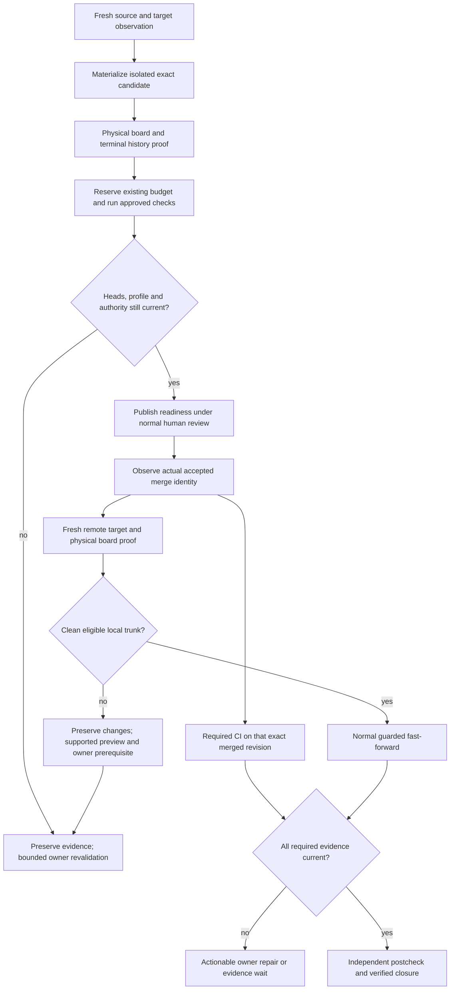

# Verify merge results and preserve canonical trunk integrity

## Intent

Make a review merge a verifiable delivery boundary rather than treating a clean PR or a green feature-branch check as proof that the integrated product is healthy. Epic 048 exposed three related facts: PR #256 was green on its reviewed Feature head, but the later Epic #259 merge into main encountered a Task boot contract already present on the target (3321179b), yielding two failing late-repair convergence tests; the merge also resurrected four stale backlog Feature records alongside their completed copies, making the War Room board unavailable in Epic 051's new checkout. The operator had to reconcile the merged main tree, remove only stale duplicate records, fast-forward the affected checkout, and synchronize local/remote main at 5c3cddc7. A subsequent corrective PR #260 was green while exact merged main failed a rapid equal-size Python edit/retest; PR #261 removed that fixture timing dependency, and exact main c0346bff passed 163 tests. Preserve the normal human review/merge authority, but ensure validation and board integrity are checked on the actual integration result, and keep post-merge recovery actionable without manual Git surgery.

### Success criteria

1. Bind each required review check to exact source and current target revisions, the prospective merge result/tree and the approved validation profile. For Feature-to-Epic and Epic-to-trunk review, validate the actual integration result rather than trusting source-only or an earlier green check. A target change invalidates stale evidence and triggers bounded revalidation without reopening unchanged work or duplicating reviews. Preserve task delivery validation and existing forge review protections; do not auto-merge or override human approvals.
2. Before publication/merge acceptance, independently scan the prospective physical board across all columns for malformed or duplicate IDs, stale moved records, parent/child identity and terminal history. Enforce one authoritative record per work ID in every publishable checkout. Reproduce Epic #259's stale backlog/completed duplicates and refuse the bad merge result before it can poison a new Epic worktree. Reuse the existing publication board validator, canonical owner resolution and guarded merge path; never silently choose a duplicate by column rank. Retain unrelated specifications and exact accepted cancellation feedback/history, even across divergent, split-root, squash/rebase and stacked review histories.
3. After an operator or forge merge, reconcile actual remote trunk commit and current local trunk, using a fresh remote observation. Fast-forward a clean eligible checkout automatically through the normal sync path; for divergence, dirty work or semantic conflict, retain changes, use a bounded supported reconciliation/preview path and identify actionable owner prerequisites. Never reset, overwrite, discard uncommitted work or force push. Report local/remote head identities, actual synchronization result and exact board availability. Ensure new integration checkouts cannot inherit a malformed or unverified trunk.
4. Observe required CI on the exact accepted merged revision. Distinguish prospective check green, actual merge, post-merge check pending/red/unknown, and independently verified closure. Route fixable post-merge failures to the accountable Epic/Feature or a supported corrective repair on the correct branch; preserve incident budgets, accepted review lineage and the current reviewed target. Coordinate with Epic 051's review ownership so no already-completed team is left with an unprocessable fix request. A failed check or missing evidence never becomes successful merely because a review merged. Preserve human release/approval policies and avoid repeated unchanged polling/model turns.
5. Validate from an isolated exact tested tree with reproducible declared dependencies and fresh effective source. Prevent stale generated artifacts, timestamp-based Python bytecode or other cache inputs from causing incorrect red/green evidence; do not modify product code merely to make a test fixture pass. Keep the original validation scope and bounded runtime, capture sanitized actionable diagnostics, and distinguish actual product failure from environment/fixture failure. Verify independently that the expected failed assertion really occurred in red-to-green regressions and that the corrected revision is the one validated.
6. Acceptance: use real temporary Git repositories/worktrees and production review/sync adapters with scripted forge transport where necessary. Reproduce all three Epic 048 cases: green Feature PR but changed-target boot contract causing a failed integrated gate; stale backlog Feature copy reintroduced by diverged merge, poisoning a newly activated Epic; same-second source edit and stale validator cache. Demonstrate pre-merge refusal or fresh exact merge-result check, verified repair, no duplicate IDs or history loss on final remote and local main, no unwanted checkout mutation, green exact merged-trunk CI, and correct reactivation/recovery ownership. Test target movement during checks, restart, offline forge, dirty/diverged main, split roots, duplicate delivery, stale review receipts and human-only gates. Check normal and failure paths through the War Room with explicit statuses and no mutations from UI polling.

## Macro-architecture

### Delivery boundary and shared contracts

This is a proposal for implementation after normal plan approval. Current behavior and durable architecture remain authoritative in [package design](../../../cascade/DESIGN.md#review-publication-safeguards), [Workspace](../../../cascade/workspace/DESIGN.md#work-ownership-and-retirement), [Board](../../../cascade/board/DESIGN.md#lifecycle-mutation-owner-interface) and [Boss](../../../cascade/boss/DESIGN.md#delivery-and-closeout). Extend those owners; do not create parallel services or ledgers.

The minimum delivery unit is one review generation with exact source, freshly observed target, prospective result tree/commit, approved validator profile and dependency/runtime identity. Prospective validation establishes only that candidate. Forge acceptance supplies a distinct actual merge SHA; required CI must name that exact revision. If remote trunk advances further, record its identity separately and validate that candidate before local sync/new checkout admission. A later green remote head cannot erase failed CI on the accepted merge.

| Boundary | Existing implementation entry points | Proposed contract and owner |
|---|---|---|
| Admission and candidate validation | `review_validation.approved_review_validation_profile/reserve_review_validation/run_review_validation`; `team_review_recovery.publish_team_review_resolution`; `review_rebase.check_and_publish_review_rebase` | Feature 1 owns an immutable candidate receipt and disposable exact-tree execution. Preserve coverage, finite budget, authority and fresh head rechecks. |
| Physical board and provenance | `review_validation.validate_publication_board`; `board.store.list_board`; `integration_worktree.resolve_mutation_owner/prove_terminal_retirement` | Feature 2 owns all-column candidate scan and terminal/hierarchy proof. Read-projection ranking cannot authorize choosing a duplicate. |
| Guarded merge and checkout | `branch_synchronization.preflight_lifecycle_merge_target/merge_lifecycle_source`; `integration_worktree.create_integration_worktree/resume_unstarted_epic_worktree`; `workspace.closeout.create_verified_trunk_workspace` | Feature 2 gates candidate provisioning before registry publication; Feature 3 uses that proof for actual target and sync. Existing preparation of managed activation pointers remains explicit. |
| Forge evidence and completion | `tracking.merge_request_snapshot`; `review.poll_feature_reviews/refresh_epic_review_snapshot/feature_delivery_view`; `boss.epic_complete._merged_epic_review_landed` | Feature 3 owns exact merged-revision required CI and a completion predicate that joins independent evidence without conflating it. |
| Trunk synchronization | `tracking.fast_forward_trunk`; `workspace.branch_synchronization.inspect_branch_synchronization/update_integration_branch` | Feature 3 reconciles freshly fetched remote with clean eligible local trunk; divergent/dirty/wrong-branch cases preserve work and expose bounded preview/owner prerequisites. |
| Recovery and presentation | `watchdog.incident_postcheck.reconcile_open_review_repair`; `feature.repair.admit_open_review_repair`; `war_room.review_routes` and shared persisted review projection | Feature 3 extends existing owner admission/postcheck and read-only projection. No mutation or forge probing from UI polling. |

Source links for the shared boundary: [validation](../../../cascade/review_validation.py), [publication](../../../cascade/review_rebase.py), [team recovery](../../../cascade/team_review_recovery.py), [review registry](../../../cascade/review.py), [forge/sync adapter](../../../cascade/tracking.py), [guarded synchronization](../../../cascade/workspace/branch_synchronization.py), [checkout lifecycle](../../../cascade/workspace/integration_worktree.py), [verified trunk workspace](../../../cascade/workspace/closeout.py), [physical board store](../../../cascade/board/store.py), [Epic closeout](../../../cascade/boss/epic_complete.py), [independent postcheck](../../../cascade/watchdog/incident_postcheck.py), [repair admission](../../../cascade/feature/repair.py) and [review HTTP routes](../../../cascade/war_room/review_routes.py).

### Evidence, lifecycle and failure behavior

Add versioned fields to existing review/action evidence, with explicit unavailable behavior for legacy receipts. Persist repository identity (including product/tracking distinction), review URL/route/generation, source/target/result identities, policy/command/coverage/runtime/dependency fingerprints, operation/claim/budget IDs, result class and bounded diagnostic references. Keep accepted-merge identity, exact check run/pipeline generations, current remote/local heads, board proof, sync outcome and recovery owner as separate facts. Observation timestamps do not establish identity or grant retry budget.

Restart reloads existing persisted generations/receipts and independently rechecks missing obligations. A crash between forge observation, receipt persistence, sync and completion cannot infer unrecorded success. Duplicate delivery rejoins the same action; changed material receives a new admitted generation within the original cumulative allowance. Unknown source/policy/environment/forge evidence remains unavailable. Deterministic failed material is fenced across A–B–A changes; transient retry uses existing finite backoff. Publication, pending CI, successful sync and repair acknowledgement each remain weaker than verified closure.

Completed-path work with an open review retains its existing owner, review and checkpoint. A closed accepted review requires a supported corrective scope against the current target and its normal approval, with original acceptance/history retained. Missing owner capability produces an explicit prerequisite rather than an unprocessable message or a replacement review.

Disposable worktrees separate validation files/caches from operator work; they are not an OS security sandbox. Fresh effective Python source must not depend on timestamp/size cache invalidation. Do not read shared stale bytecode or generated outputs, delete user caches, weaken assertions or modify product code to accommodate a fixture. Dependencies and effective import roots are evidence inputs.

### Diagram-impact inventory and ownership

Authoritative source: [workspace.dsl](../../../architecture/target-9f61bc6d6f8ae8cb7d196c8b327650d5/workspace.dsl), [model.dsl](../../../architecture/target-9f61bc6d6f8ae8cb7d196c8b327650d5/model.dsl), [views.dsl](../../../architecture/target-9f61bc6d6f8ae8cb7d196c8b327650d5/views.dsl) and [source contract](../../../architecture/target-9f61bc6d6f8ae8cb7d196c8b327650d5/workspace.contract.json). Code view ownership follows the existing component index in cascade/DESIGN.md. Every Feature planner must copy its rows into Task acceptance criteria and reconcile them against the final diff; source-linked Markdown alone cannot replace integrated Code coverage.

| Level / view keys | Owning designs and implementation | Required work / verification owner |
|---|---|---|
| Landscape/context: `cascade-landscape`, `cascade-context` | Root DESIGN.md; operator, local Cascade, existing forge/provider/renderer | No new actor or external dependency is proposed. Epic Architect verifies existing responsibility boundaries before sign-off; all Features report whether the actual diff changes this conclusion. |
| Containers: `cascade-containers` | Root and package designs; local Service, War Room, repository artifacts | No additional runtime, database or communication channel. Receipts remain in existing stores; isolated validation is workspace lifecycle, not a new deployed service. Feature 3 checks aggregate diff and labels. |
| Components: `cascade-supervisor-components`, `cascade-team-components` | Package, Boss, Workspace, Task, Feature, Watchdog | Features 1–3 update relationships for candidate validation, physical-board proof, accepted-merge observation and closeout; preserve one owner and local-process boundaries. |
| Components: `cascade-war-room-components` | War Room DESIGN.md; review routes/shared projection | Feature 3 records producer/consumer boundary; GET cannot invoke recovery or transport. |
| Code: `cascade-teams-code` | Package design; `publish_team_review_resolution`, `reserve_review_validation`, `ReviewValidationProfile/Operation`, `check_and_publish_review_rebase`, `run_review_validation` | Feature 1 extends the existing `element.component.teams` ownership, not a duplicate Boss-owned validator. Include exact candidate/cache/materialization collaborators and interruption handling. |
| Code: `cascade-task-code`, `cascade-workspace-code` | Task/Workspace designs; generation admission, budget permits, provisioning, guarded merge, sync | Feature 1 updates budget/materialization links; Feature 2 owns physical admission/history; Feature 3 owns sync consumer. Each resolves actual symbol kinds and persistence/restart gates. |
| Code: `cascade-board-code`, `cascade-boss-code` | Board/Boss designs; physical records, review orchestration, closeout | Feature 2 supplies scan/provenance nodes; Feature 3 supplies exact merge/check/sync closeout dependencies. |
| Code: `cascade-watchdog-code`, `cascade-feature-code` | Watchdog/Feature designs; independent postchecks, actionable repair admission | Feature 3 traces closed-review correction versus retained open-review owner; original budget/generation and authority remain visible. |
| Code: `cascade-dashboard-code`, `cascade-war-room-http-code` | War Room design; review routes and persisted status | Feature 3 shows explicit evidence states, owner prerequisites and read-only GET; no second truth store. |
| Supplementary behavior | Package, Workspace, Board, Boss, Watchdog, Feature and War Room owning designs | Each Feature adds/updates only its normal, refusal and interruption/resume flows. Feature 3 verifies end-to-end consistency. |

For changed Code views require native custom `cascade.codeComponent`, real `cascade.parent/sourcePath/sourceSymbol`, correct native declaration `element` kind and synchronized semantic/source contract. Verification includes source-contract validation, supported pinned local render, actual context → container → component → Code navigation, Level up, restored deep links and opening representative pinned source. Check renamed/deleted symbols and ownership changes. Measure cold/warm navigation and prove warm artifact reuse without per-view process startup or relaxed render limits. Do not rewrite accepted snapshots or bypass revision-pinned publication. Record exact results and unresolved gaps in work records, not DESIGN.md.

## Cross-module constraints

Reuse cascade/review_validation.py, review_rebase.py, team_review_recovery.py, review.py, tracking.py, boss/epic_complete.py, workspace/integration_worktree.py, board/store.py, workspace/branch_synchronization.py and existing Watchdog action, validation and review evidence. Coordinate with Epic 051 (review-pending owner lifecycle), Epic 053 (superseded child/canonical cancellation), Epic 049 (visibility) and Epic 048 (durable budgets and verified recovery). This brief owns merge-result validation, canonical publishable board integrity and post-merge trunk convergence, not replacement lifecycle, a new forge service, a parallel scheduler or a second incident ledger. Preserve existing review protections and original budget/authority; filing this brief authorizes no deployment, force merge, destructive checkout change or implementation before normal approval. Update owned designs and affected architecture views only against actual code.

## Core dependencies

The required declaration was completed before plan writing or child minting. Canonical manifest revision 2 is ready: Python 3.12.8, Git 2.34.1, Docker 28.0.0, PyYAML 6.0.3, cursor-sdk 1.0.37, langgraph 1.2.14, langgraph-checkpoint-sqlite 3.1.1, pytest 9.0.3, setuptools 80.9.0, and the existing Structurizr 2026.09.19-playwright image pinned to sha256:c89b54231c42da90484e6bf4e398f36a40123cb4b12c9d5f09c27eef3dc9644c. All ten existing-installation checks succeeded; no installation or upgrade occurred or is authorized. Initial verification-result text was corrected to the checker's supported success marker without weakening version/hash assertions.

The chosen declaration target is local development/test execution on host ip-172-31-37-14, Linux x86_64, /opt/conda/bin/python3.12, repository/check executor root /home/ubuntu/dev/CascadeCode. This is deliberately the local verification target, not proof of remote CI or a deployment environment. Implementation remains in the owned epic/child worktrees; declaration checks only inspect pre-existing software. Installed package metadata hashes identify observed distributions; they are not downloadable wheel hashes or a complete transitive lock. Feature 1 must bind effective dependency/runtime identity and any reproducibility inputs required by the production validator. Any different target or extra software requires an updated complete declaration and separate current installation authority if setup is needed.

Production-adapter tests use temporary local remotes and scripted forge transport, so authenticated live forge/provider CLIs are not prerequisites for those tests. Real remote required CI is observed through the configured forge at runtime; no live remote result or deployment is claimed here. Existing architecture image includes its rendering runtime.

Cross-epic compatibility is an interface constraint, not an invented execution dependency: preserve the checked-out review-owner, canonical cancellation, bounded visibility and incident-budget contracts named in the brief. If implementation requires an unavailable owning-team change, record a scoped amendment/blocker with evidence before depending on it. Do not infer unrelated board content or completion from the dependency projection.

## Feature breakdown

| Order | Feature | Depends on | Success criteria / delivery |
|---|---|---|---|
| 1 | feat_054_001 — Validate exact merge results with isolated fresh checks | none | Criteria 1 and 5; candidate evidence, isolated fresh-source validation and changed-target/cache regressions. |
| 2 | feat_054_002 — Preserve canonical board history across merge and checkout boundaries | feat_054_001 | Criterion 2 and admission part of 3; physical board/hierarchy/history gate, supported repair prerequisite and safe provisioning. |
| 3 | feat_054_003 — Verify merged revision CI and converge trunk through accountable recovery | feat_054_002 | Criteria 3, 4 and 6; actual-merge checks, clean trunk convergence, actionable owner recovery, read-only UI and integrated incident regressions. |

These are three cohesive deliveries sharing existing modules, sequenced to avoid competing receipt and gate contracts. Each owns its focused tests and actual design updates. The final slice owns the combined real-repository acceptance journey, not a separate test-only platform. No implementation starts before normal approval.

## Validation and planning review

Acceptance uses real temporary Git repositories/remotes/worktrees and production review/sync adapters, with scripted transport at the forge boundary. Mandatory scenarios are the three brief incidents plus target drift during checks/sync, restart between persistence steps, offline/unknown forge policy, dirty/diverged/wrong-branch trunk, split roots, squash/rebase/stacked delivery, stale review receipts, duplicate events, cancellation-history retention and human-only gates. Red-to-green fixtures must independently prove the intended failed assertion and corrected exact source; fixture/environment failure is classified separately. Final evidence must identify accepted merge and exact CI generations, final remote/local head identities, board availability, preserved history and absence of unintended checkout mutation.

Baseline checks run during planning: `python -m pytest -q tests/test_review_publication_safeguards.py --tb=short` passed 18 tests in 7.24 seconds; `validate_c4_workspace` accepted the current authoritative architecture source contract. These are baseline results, not verification of proposed behavior.

Reviewed affected design sections: root DESIGN.md product/review boundary; cascade/DESIGN.md publication safeguards and architecture navigation; Board lifecycle owner interface; Workspace provisioning, ownership/retirement and C4 contract; Boss delivery/closeout; Feature late repair; Watchdog review observation/postcheck; War Room accountable review projection; Task generation/budget ownership. Source inspection traced normal source validation → fresh remote recheck → publication, and duplicate-board refusal before validation; it also traced accepted Epic merge ancestry/document proof and fetched trunk fast-forward. Those current paths explain why candidate validation, exact merged CI and candidate board admission need implementation work.

No DESIGN.md/model edits are included in this planning turn: existing documents accurately limit current source-publication guarantees and code views already link validators under Teams. Proposed behavior is kept in this work record and child acceptance criteria until implemented. Existing source contract passes; no claim of a fresh render, browser navigation/performance run, remote CI, or implemented merge-result protection is made. Changed-view rendering/navigation and all behavior regressions are assigned above. Epic Architect must review boundaries, owner/source coverage, required design/model proposal scope and this inventory before its role sign-off. Material architecture gaps found in that review must be resolved and recorded before approval; a successful baseline contract check alone is insufficient.

## Open questions

- Prospective versus actual commit identity: keep distinct; even equal trees do not satisfy a required check tied to another commit. Unsupported forge result/merge strategy remains unavailable until exact proof is available.
- History preservation across split roots and managed pointers: use current canonical owner/terminal provenance; unknown or conflicting evidence refuses and names its owner. Do not solve ambiguity with column ranking.
- Closed review repair: retained open-review ownership is reusable only while that route is legal. Accepted/closed work uses supported corrective scope and normal approval; no silent reopen.
- Cache contamination: isolated effective source/import/cache inputs, explicit failed-assertion evidence and original validation coverage are required; sleep-based timestamp fixes and write-bytecode disabling alone are not the contract.
- Remaining planning review: Epic Architect review and revision-bound role sign-off. No product-policy question requires new human clarification at this point.

## Decision log

- 2026-11-25 · Human · Brief approved through merge request review.

- `dec_001` · 2026-11-27 · Epic Manager · **Scope and sequencing**
  Chose Deliver feat_054_001 → feat_054_002 → feat_054_003: exact candidate/fresh-source validation, canonical physical board/history admission, then exact merged CI/trunk convergence and accountable recovery..
  Rationale: These slices cover all six success criteria while ordering shared receipt and gate changes. Tests/design updates belong to each feature; the last slice proves the integrated incidents. Reuse existing stores, scheduler, owner lifecycle and incident-wide budget.
  Honors: All original success criteria; human review/approval gates; no implementation before approval; frugal engineering..

- `dec_002` · 2026-11-27 · Epic Manager · **Evidence and authority**
  Chose Keep prospective validation, actual accepted merge, exact merged-revision required CI, fresh remote/local sync, board proof and independently verified closure separate. Validate existing local prerequisites only; declaration does not authorize installation or establish remote CI/deployment..
  Rationale: Green source checks or a merged review cannot attest integrated target health. Unknown/stale evidence stays unavailable. Dirty/diverged work is preserved with supported owner prerequisites; no reset, force push, replacement ledger or implicit authority.
  Honors: Success criteria 1–6; declared software prerequisites and target identity; current review/incident/owner contracts..

- `dec_003` · 2026-11-27 · Epic Manager · **Architecture ownership and planning review**
  Chose Preserve validator/publication code under element.component.teams and cascade-teams-code. Assign every affected C4 level and owning design to the feature inventory; carry updates and source/render/navigation/recovery checks into Task acceptance. Keep unimplemented behavior in work records..
  Rationale: Existing source contract passes and 18 publication safeguard tests pass, but those results do not verify proposed behavior. Current designs describe the present limitations. Epic Architect review and changed-view runtime/UI verification remain explicit gates; accepted architecture snapshots are not rewritten.
  Honors: Design skill one-owner, implementation-depth, revision-pinned publication and review/closeout contract..
## Amendment log

_(none)_
