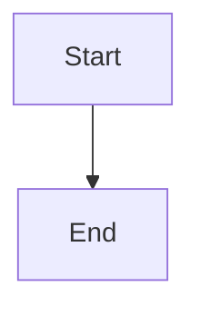

# Approval and dependency dispatch

## Parent Epic

epic_005

## Scope

# Approval and dependency dispatch

## Intent

Allow a feature to be approved independently while ensuring implementation starts only when both approval and dependency prerequisites are satisfied. Approving an epic approves all child features that exist at that time.

## Scope

- Persist feature approval independently from board lifecycle status.
- Add per-feature approval and epic-wide approval of current child features.
- Gate the central implementation dispatch path on feature approval and completion of every `depends_on` feature.
- Preserve the existing single-feature-awaiting-merge gate.
- Reconcile safely after restart without duplicate dispatch.

## Acceptance criteria

- An unapproved feature is never dispatched.
- An approved feature with an incomplete dependency is never dispatched.
- An approved feature dispatches once all dependencies are completed and the existing merge gate permits it.
- Epic approval approves every child feature present at approval time; later-added children still require explicit approval.
- Restart/reconciliation does not duplicate approval or dispatch effects.
- Focused integration tests exercise approval, dependencies, merge gating, and recovery.

## Out of scope

- Completion rollup.
- Open-MR dashboard.
- A second approval store or alternate dispatch path.

## Data structures

TBD.

## API contracts

TBD.

## Logic flow

## Task breakdown

_(empty — Feature Team mints tasks after dispatch)_

## Risks & upward questions

None.

## Decision log

None yet.
