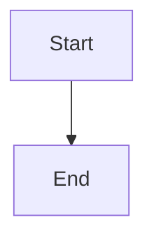

# Completion rollup and recovery

## Parent Epic

epic_005

## Scope

# Completion rollup and recovery

## Intent

Make feature and epic completion automatic, durable, and recoverable from the existing lifecycle state.

## Scope

- Complete a feature only when all of its tasks are complete and its merge request has merged.
- Complete an epic when all persisted child features are complete.
- Keep an epic active while any accepted follow-up exists as a persisted child feature.
- Make lifecycle reconciliation idempotent so restart recovery reaches the same state without duplicate transitions.

## Acceptance criteria

- Finishing all tasks while the merge request remains open does not complete the feature.
- Merging the feature after all tasks finish completes the feature automatically.
- Completing the last child feature completes the epic automatically.
- A persisted, incomplete follow-up child prevents epic completion.
- A merely suggested follow-up that has not been accepted and minted does not prevent completion.
- Repeated reconciliation and restart recovery are idempotent.
- Focused integration tests cover task/MR ordering, child rollup, persisted follow-ups, and recovery.

## Out of scope

- Creating follow-up features automatically from free-form suggestions.
- Open-MR dashboard.

## Data structures

TBD.

## API contracts

TBD.

## Logic flow

## Task breakdown

_(empty — Feature Team mints tasks after dispatch)_

## Risks & upward questions

None.

## Decision log

None yet.
