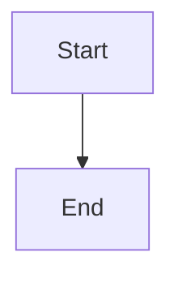

# Open merge requests dashboard

## Parent Epic

epic_005

## Scope

# Open merge requests dashboard

## Intent

Give reviewers a direct War Room view of open merge requests without requiring navigation through plans or teams.

## Scope

- Expose open review records through a read-only API derived from the existing durable review registry.
- Add an Open MRs War Room view.
- Show enough context to identify the epic/feature and current review state.
- Link each row directly to its merge request.
- Refresh from authoritative lifecycle data without introducing a second review store.

## Acceptance criteria

- The API returns currently open review records and excludes merged or closed reviews.
- The dashboard lists open merge requests with feature/epic context and working direct links.
- Lifecycle changes are reflected from the existing durable review registry.
- Empty, loading, and failure states are usable.
- One browser-level flow demonstrates an open MR appearing, linking correctly, and disappearing after merge; lower-level tests remain focused on query/filter behavior.

## Out of scope

- Editing or merging reviews from the dashboard.
- A new review persistence model.
- General dashboard redesign.

## Data structures

TBD.

## API contracts

TBD.

## Logic flow

## Task breakdown

_(empty — Feature Team mints tasks after dispatch)_

## Risks & upward questions

None.

## Decision log

None yet.
