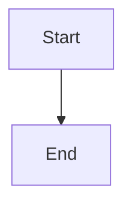

# Completion rollup and recovery

## Parent Epic

epic_005

## Scope

# Completion rollup and recovery

## Intent

Make feature and epic completion automatic, durable, and restart-safe once implementation and review obligations are actually finished.

## Scope

- Complete a feature only when every child task is completed and its merge request has merged.
- Derive epic completion from all persisted child features being completed.
- Keep an epic active when an accepted follow-up has been persisted as a child feature.
- Reconcile incomplete lifecycle transitions idempotently after restart.
- Preserve review visibility while an MR is still open.

## Acceptance criteria

- Finishing the final task does not complete a feature while its MR remains open.
- Merging the MR completes the feature when all tasks are complete.
- Completing the last child feature completes the epic.
- A persisted, non-completed follow-up child prevents epic completion.
- A suggested but unaccepted/unpersisted follow-up does not block completion.
- Repeated reconciliation and restart produce no duplicate transitions.
- Focused integration tests cover feature rollup, epic rollup, follow-up behavior, and recovery.

## Out of scope

- Approval and dependency dispatch.
- Dashboard presentation.
- Treating free-text suggestions as lifecycle state.

## Task breakdown

_(empty — Feature Team mints tasks after dispatch)_

## Data structures

TBD.

## API contracts

TBD.

## Logic flow

## Task breakdown

_(empty — Feature Team mints tasks after dispatch)_

## Risks & upward questions

None.

## Decision log

None yet.
