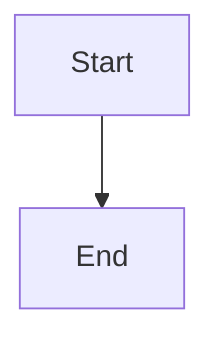

# Open merge requests dashboard

## Parent Epic

epic_005

## Scope

# Open merge requests dashboard

## Intent

Give reviewers one War Room view of currently open merge requests without requiring them to navigate through plans or team pages.

## Scope

- Expose open review records through a read-only API backed by the existing durable review registry.
- Add an Open MRs War Room view with direct links to each review.
- Reflect lifecycle changes without introducing a second review-state store.
- Provide a small sandbox/demo flow using Playwright (or the repository's existing browser harness) that demonstrates approval, dependency gating, completion rollup, and review discovery.

## Acceptance criteria

- The view lists current open MRs with enough feature/epic context to identify them.
- Each item links directly to its review.
- Merged or closed reviews disappear based on the durable registry state.
- Empty and loading/error states are usable.
- One browser-level scenario demonstrates the core lifecycle and Open MRs flow.
- API and UI do not duplicate review truth into another store.

## Out of scope

- Review editing or merge actions from the dashboard.
- A new review registry.
- Broad War Room redesign or exhaustive browser coverage.

## Task breakdown

_(empty — Feature Team mints tasks after dispatch)_

## Data structures

TBD.

## API contracts

TBD.

## Logic flow

## Task breakdown

_(empty — Feature Team mints tasks after dispatch)_

## Risks & upward questions

None.

## Decision log

None yet.
