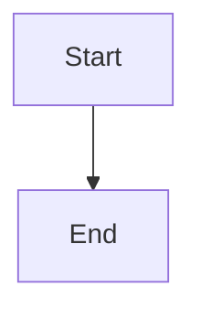

# Discover available providers and models

## Parent Epic

epic_006

## Scope

## Intent

Provide one authoritative backend inventory of providers that are installed, authenticated, and currently usable, with model identifiers sourced from each provider's real API.

## Scope

- Add a provider capability/discovery boundary implemented by provider adapters.
- Probe only configured or installed providers; authentication or API failures make that provider unavailable without breaking discovery for others.
- Normalize provider and model identifiers for consumers.
- Report supported reasoning levels and default behavior for provider/model combinations that expose configurable reasoning; indicate when no override is available.
- Use a small bounded cache around successful discovery so opening the brief does not repeatedly call external APIs; refresh on expiry or explicit request.
- Expose the inventory through the application boundary used by the brief UI.
- Add high-signal adapter and boundary tests for filtering, partial failure, and cache refresh.

## Acceptance criteria

- The inventory returns only providers that pass availability discovery.
- Every offered model originates from that provider's API response, not a static UI list.
- Reasoning capabilities are supplied by the provider integration and are scoped to the selected model; consumers can distinguish default-only models from those with supported overrides.
- A failure in one provider does not suppress healthy providers.
- The UI-facing response identifies refresh/loading failure without leaking credentials.
- Cached data has an explicit freshness policy and can be refreshed.

## Data structures

TBD.

## API contracts

TBD.

## Logic flow

## Task breakdown

_(empty — Feature Team mints tasks after dispatch)_

## Risks & upward questions

None.

## Decision log

None yet.
