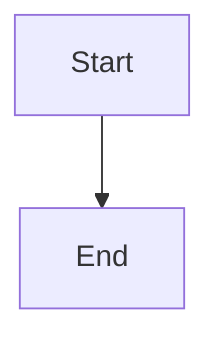

# Select provider and full-stack model defaults in brief

## Parent Epic

epic_006

## Scope

## Intent

Replace free-text model entry in brief creation with validated choices for every agent layer.

## Scope

- Load the provider/model inventory from the discovery boundary.
- Offer only available providers in the provider selector.
- For the selected provider, render model selectors for epic, feature, and task roles represented by the brief schema.
- For each role whose selected provider/model supports configurable reasoning, offer its supported levels plus a default choice; hide overrides for default-only combinations.
- Persist the selected provider and per-role model and reasoning defaults through the existing brief creation path.
- Prevent submission when a selection is absent from the current inventory.
- Preserve clear loading, empty, and recoverable error states.

## Acceptance criteria

- No model field used by epic, feature, or task agents accepts arbitrary text during brief creation.
- Changing provider clears or revalidates incompatible model selections.
- Changing provider or model clears or revalidates incompatible reasoning overrides; the server rejects unsupported overrides.
- The saved brief contains the selected provider and model defaults for the full agent stack.
- The saved brief preserves optional per-role reasoning overrides, and downstream epic, feature, and task work uses them; choosing default leaves provider behavior unchanged.
- Reloading or continuing the workflow uses those saved values.
- An empty inventory explains that no usable provider is available and disables submission.
- One end-to-end path proves discovery, selection, persistence, and reload.

## Data structures

TBD.

## API contracts

TBD.

## Logic flow

## Task breakdown

_(empty — Feature Team mints tasks after dispatch)_

## Risks & upward questions

None.

## Decision log

None yet.
