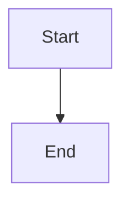

# Remote-backed brief backlog synchronization

## Parent Epic

epic_008

## Scope

# Remote-backed brief backlog synchronization

## Intent

Make newly merged epic briefs visible and activatable without requiring the operator's product-trunk checkout to fast-forward. Cascade must continue polling the configured remote on the existing automation cadence while epic and feature integration branches are in flight.

## Scope

- Replace the current `sync_briefs -> fast_forward_trunk` dependency with a Cascade-managed, read-only remote backlog snapshot derived from the configured `<remote>/<product-trunk>` ref.
- Refresh the snapshot after a successful fetch without checking out, merging, resetting, stashing, or otherwise mutating the operator checkout.
- Merge backlog epic metadata from that snapshot into the canonical board view while keeping active/completed work and runtime state authoritative in the existing trunk and registered integration worktrees.
- Activate a remotely visible backlog epic by materializing its approved brief into the new epic integration branch/worktree from the fetched remote revision, then retain the existing trunk-pointer and dispatch contracts where they remain applicable.
- Keep the War Room polling endpoint/button and watchdog cadence on the same synchronization path, with actionable errors for missing remotes/refs or malformed/duplicate briefs.
- Update product documentation that currently promises a trunk fast-forward.

## Non-goals

- Mirroring arbitrary source-code changes from the remote into the local operator checkout.
- Rebasing or merging active epic/feature/task branches.
- Replacing the integration-worktree registry or lifecycle board model.
- Adding a forge API dependency; Git fetch and remote-tracking refs remain the transport.
- Supporting remote mutation of active, completed, feature, or task documents.

## Behavioral contract

1. A successful refresh fetches only through normal Git operations and atomically publishes a read-only snapshot of backlog epic documents from the fetched product-trunk revision.
2. Existing local/integration work wins for any work ID already known outside the remote backlog. A conflicting duplicate is rejected or omitted with a surfaced diagnostic; it must never silently replace live state.
3. Board reads observe the refreshed snapshot within the existing board-cache bound, and `sync_briefs` reports exactly the newly visible epic IDs and emits each import toast once.
4. Activation of a snapshot-only epic is authorized exactly as today, creates `epic/<id>` from the fetched revision containing the brief, and does not require the operator checkout to change branches or fast-forward.
5. Refresh failure leaves the last valid snapshot and all dispatch behavior usable; the forced War Room action returns the concrete error.
6. Automation-disabled workspaces preserve their existing manual behavior.

## Acceptance criteria

- An integration test starts Cascade on a local trunk that has Cascade-only commits, merges a new brief on remote trunk, runs one refresh/tick, and observes the epic in `GET /api/board` and as dispatchable within the configured seconds-scale cadence.
- The same scenario can activate the epic successfully while the operator checkout HEAD, branch, tracked edits, and active integration worktrees remain unchanged.
- Repeated refreshes are idempotent: no duplicate board rows or import toasts.
- Remote ref absence, fetch failure, duplicate IDs, and malformed remote briefs fail safely and retain the previous valid snapshot.
- Existing active/completed board precedence and feature/task dispatch tests remain green.
- Focused tests cover snapshot refresh, merged-board precedence/cache invalidation, activation provenance, and the War Room forced-refresh response; avoid redundant mock-only coverage where the integration scenario already proves behavior.

## Likely touchpoints

- `cascade/automation.py`
- `cascade/tracking.py` or a small workspace snapshot module
- `cascade/workspace/integration_worktree.py`
- `cascade/watchdog/dispatch.py` and epic activation/checkout helpers
- `cascade/war_room/server.py`
- `tests/test_briefs.py`, board/dispatch integration tests, and `DESIGN.md`

## Open questions for feature planning

- Whether the snapshot is best represented as a detached managed worktree or an atomic materialized docs directory. Choose the smaller implementation that supports safe concurrent readers and activation from an immutable fetched SHA.
- How to persist the fetched SHA so activation and diagnostics are reproducible across restarts.

## Data structures

TBD.

## API contracts

TBD.

## Logic flow

## Task breakdown

_(empty — Feature Team mints tasks after dispatch)_

## Risks & upward questions

None.

## Decision log

None yet.
