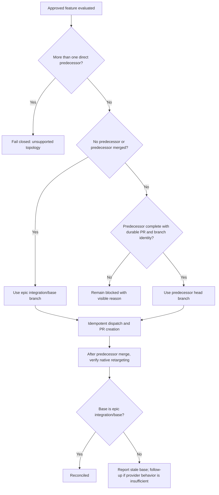

# Dispatch and retarget stacked feature PRs

## Parent Epic

epic_007

## Intent

Allow an approved feature in a linear dependency stack to begin before its single completed predecessor merges, while preserving declared feature order and making the predecessor's branch the pull request base.

## Scope

- Require a durable feature-to-pull-request link in project state before a feature can enter the completed state.
- Treat a single declared predecessor that is complete but unmerged as eligible for stacking.
- Use that predecessor's head branch as the new feature pull request base; use the epic's normal integration/base branch when there is no predecessor or the predecessor is already merged.
- Preserve the selected predecessor and base in durable feature/dispatch state so retries and restarts remain deterministic.
- After the predecessor merges, reconcile the downstream pull request by verifying that GitHub's native retargeting moved it to the epic's normal integration/base branch.
- Surface clear blocked or stale-state reasons when pull-request identity, predecessor branch, topology, or native retargeting cannot be safely resolved.

## Out of scope

- Dependency fan-in; features with more than one direct predecessor fail closed as an unsupported topology.
- Explicit provider-side pull request retargeting. If implementation evidence shows native retargeting is unavailable or unreliable, handle it in a follow-up feature.
- Arbitrary user-authored stack reordering.
- Stacks across different epics.
- Dispatch while a predecessor is implementing, failed, blocked, unapproved, or otherwise incomplete.
- A new merge queue or custom replacement for GitHub's pull request behavior.
- More than the minimal status and diagnostic changes needed to explain dispatch eligibility and stale retargeting.

## Acceptance criteria

1. A feature cannot enter the completed state until its durable feature-to-pull-request link has been populated.
2. Given linear features A then B, with A complete and unmerged and B approved, B is dispatched without waiting for A to merge.
3. B's pull request targets A's head branch while A remains unmerged.
4. B is not dispatched while A is implementing, failed, blocked, unapproved, or otherwise incomplete.
5. Once A merges, reconciliation verifies that GitHub's native retargeting moved B to the epic's normal integration/base branch; a stale base is reported visibly and is not explicitly retargeted in this feature.
6. For A → B → C, each newly dispatched feature targets its single direct completed-but-unmerged predecessor, without skipping an incomplete predecessor.
7. A feature with dependency fan-in is not eligible for stacked dispatch and fails closed with a visible unsupported-topology reason.
8. Missing or unresolvable predecessor pull-request or branch identity fails closed with a visible reason.
9. Dispatch and reconciliation are idempotent: retries do not duplicate work or create another pull request.
10. Existing non-stacked and first-feature dispatch behavior remains unchanged.

## Verification

Prefer focused integration tests around the feature lifecycle, scheduler/dispatcher, and pull-request adapter:

- completion is rejected until the durable feature-to-pull-request link exists;
- a complete-but-unmerged predecessor permits dispatch and supplies its branch as base;
- an incomplete or otherwise blocking predecessor still blocks;
- a merged predecessor falls back to the normal base;
- a three-feature linear chain selects each single direct predecessor;
- dependency fan-in blocks with a visible unsupported-topology reason;
- missing pull-request or branch identity fails closed;
- post-merge reconciliation accepts native retargeting and visibly reports a stale base;
- repeated dispatch and reconciliation remain idempotent.

Add lower-level tests only where these integration boundaries cannot exercise a consequential branch.

## Data structures

TBD.

## API contracts

TBD.

## Logic flow

## Task breakdown

_(empty — Feature Team mints tasks after dispatch)_

## Risks & upward questions

None.

## Decision log

None yet.
