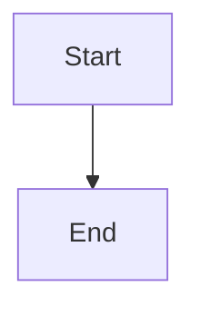

# Dispatch and retarget stacked feature PRs

## Parent Epic

epic_007

## Scope

# Dispatch and retarget stacked feature PRs

## Intent

Allow an approved feature to begin before its completed predecessor merges, while preserving the declared feature order and making the predecessor's branch the pull request base.

## Scope

- Treat a declared predecessor that is complete but unmerged as eligible for stacking.
- Dispatch only when every declared predecessor is either merged or complete and stackable.
- Choose the nearest unmerged predecessor's branch as the new feature pull request base; use the epic's normal integration/base branch when all predecessors are merged.
- Preserve the dependency relationship in durable feature/dispatch state so retries and restarts select the same base.
- Reconcile a stacked pull request after its predecessor merges so its base becomes the normal integration/base branch, relying on GitHub's native retargeting when it occurs and correcting stale state when necessary.
- Surface a clear blocked reason when the predecessor branch or pull request cannot safely be resolved.

## Out of scope

- Arbitrary user-authored stack reordering.
- Stacks across different epics.
- Parallel dispatch when a predecessor is still implementing, failed, blocked, or unapproved.
- A new merge queue or custom replacement for GitHub's pull request retargeting.
- More than the minimal status/diagnostic changes needed to explain dispatch eligibility.

## Acceptance criteria

1. Given features A then B, with A complete, approved, and unmerged and B approved, B is dispatched without waiting for A to merge.
2. B's pull request targets A's head branch while A remains unmerged.
3. B is not dispatched while A is implementing, failed, blocked, or otherwise incomplete.
4. Once A merges, B targets the epic's normal integration/base branch; native GitHub retargeting is accepted, and reconciliation repairs or reports a stale base.
5. For A → B → C, each newly dispatched feature targets the nearest unmerged predecessor, without skipping an incomplete predecessor.
6. Dispatch is idempotent: repeated scheduling or reconciliation does not duplicate work or create a second pull request.
7. Existing non-stacked and first-feature dispatch behavior remains unchanged.

## Verification

Prefer focused integration tests around the scheduler/dispatcher and pull-request adapter:

- complete-but-unmerged predecessor permits dispatch and supplies its branch as base;
- incomplete predecessor still blocks;
- merged predecessor falls back to the normal base;
- a three-feature chain selects the nearest unmerged predecessor;
- repeated dispatch/reconciliation is idempotent.

Add lower-level tests only where the integration boundary cannot exercise a consequential branch.

## Data structures

TBD.

## API contracts

TBD.

## Logic flow

## Task breakdown

_(empty — Feature Team mints tasks after dispatch)_

## Risks & upward questions

None.

## Decision log

None yet.
