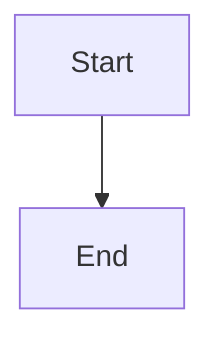

# Model provider flex capability and execution plumbing

## Parent Epic

epic_009

## Scope

# Model provider flex capability and execution plumbing

## Intent

Add a provider-neutral flex-mode capability and carry the selected value from a brief into Codex/OpenAI execution.

## Acceptance criteria

- Provider metadata exposes whether flex mode is supported; Codex/OpenAI advertises support only where the installed integration can honor it.
- New briefs default flex mode on for a supporting provider and cannot persist it as enabled for an unsupported provider.
- Codex/OpenAI invocations receive the flex setting through the existing provider boundary.
- Existing briefs and non-supporting providers retain current behavior.
- Focused integration tests cover supported, disabled, unsupported, and legacy-brief cases.

## Data structures

TBD.

## API contracts

TBD.

## Logic flow

## Task breakdown

_(empty — Feature Team mints tasks after dispatch)_

## Risks & upward questions

None.

## Decision log

None yet.
