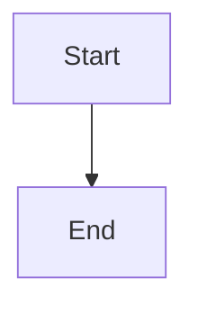

# Brief editor flex-mode control

## Parent Epic

epic_009

## Scope

# Brief editor flex-mode control

## Intent

Expose flex mode in provider selection when the selected provider supports it.

## Acceptance criteria

- A checkbox appears for a flex-capable Codex/OpenAI selection and is checked by default for a new brief.
- Changing to a provider without the capability hides the control and clears/normalizes the enabled value.
- Returning to a capable provider uses the form's current normalized value; saving and reopening preserves explicit opt-out.
- Submission uses the same brief field consumed by provider execution.
- A focused UI/system test covers visibility, default-on, opt-out persistence, and provider switching.

## Data structures

TBD.

## API contracts

TBD.

## Logic flow

## Task breakdown

_(empty — Feature Team mints tasks after dispatch)_

## Risks & upward questions

None.

## Decision log

None yet.
