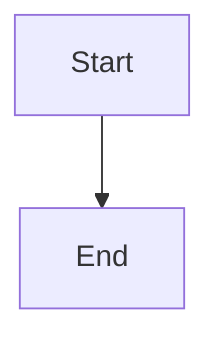

# Hierarchical ID allocation for new work

## Parent Epic

epic_004

## Scope

Deliver canonical hierarchical identifiers for newly created epics, features, and tasks across allocation, validation, persistence, and creation interfaces. Preserve existing non-backlog identifiers and reject collisions.

## Data structures

TBD.

## API contracts

TBD.

## Logic flow

## Task breakdown

_(empty — Feature Team mints tasks after dispatch)_

## Risks & upward questions

None.

## Decision log

None yet.
