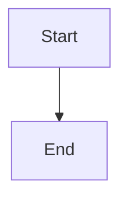

# Backlog epic ID migration

## Parent Epic

epic_004

## Scope

Renumber backlog epics and their descendant feature/task identifiers into the hierarchical scheme, updating all board-owned references atomically or failing safely. Active and completed work remain unchanged.

## Data structures

TBD.

## API contracts

TBD.

## Logic flow

## Task breakdown

_(empty — Feature Team mints tasks after dispatch)_

## Risks & upward questions

None.

## Decision log

None yet.
