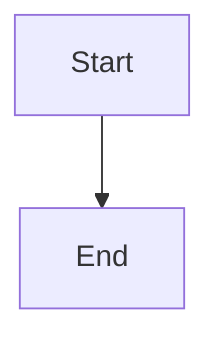

# Bound and collapse completed epics board

## Parent Epic

epic_011

## Scope

# Bound and collapse completed epics board

## Outcome

Keep the War Room useful as completed work accumulates: show only the most recent configured number of completed epics, start that section collapsed, and retain a repository link for older history.

## Scope

- Add a project-level Cascade YAML setting for the completed-epic display limit.
- Default the limit to 10 when the setting is absent or invalid.
- Apply the limit after the existing completed-epic ordering so the newest completed items are retained.
- Render the completed section collapsed on initial load.
- Keep a visible link to the repository's completed-epics location, including when no completed rows are shown.

## Acceptance criteria

1. With no new configuration, the completed section initially renders collapsed and contains at most 10 of the newest completed epics.
2. A valid positive configured limit N causes at most N of the newest completed epics to render.
3. Missing, non-positive, or malformed values safely fall back to 10.
4. Expanding and collapsing the section does not change which rows are selected.
5. A repository link for browsing all completed epic documents is visible beside the bounded section and resolves using the project's existing repository metadata/path conventions.
6. Focused render/integration coverage proves default collapse, default/configured bounds, ordering, fallback behavior, and link presence.

## Out of scope

- Pagination, search, or filtering of completed epics.
- Changing active or proposed epic lists.
- Persisting each user's expanded/collapsed preference.
- A new archive API or duplicate completed-work store.

## Data structures

TBD.

## API contracts

TBD.

## Logic flow

## Task breakdown

_(empty — Feature Team mints tasks after dispatch)_

## Risks & upward questions

None.

## Decision log

None yet.
