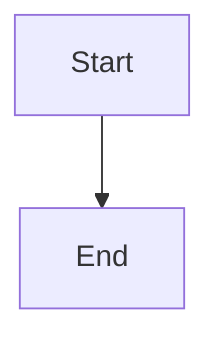

# Supervisor readiness state and non-blocking recovery

## Parent Epic

epic_012

## Scope

## Outcome

Expose one authoritative, read-only supervisor health projection that distinguishes HTTP liveness from automation readiness and reports startup recovery, watchdog-loop, and lifecycle-reconciliation state. Start watchdog supervision without waiting for long recovered model turns, and surface the projection through the existing health/War Room path.

## Required acceptance

- HTTP availability and automation readiness are separate fields/states.
- Startup phases and the last successful watchdog and reconciliation activity are observable with timestamps and actionable degraded reasons.
- Recovered model turns run in established background workers and cannot delay watchdog startup.
- Status observation does not mutate board lifecycle state or dispatch work.
- Focused integration coverage proves HTTP can be live while automation is not ready, then becomes ready.

## Data structures

TBD.

## API contracts

TBD.

## Logic flow

## Task breakdown

_(empty — Feature Team mints tasks after dispatch)_

## Risks & upward questions

None.

## Decision log

None yet.
