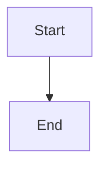

# Bounded convergence detection and durable diagnostics

## Parent Epic

epic_012

## Scope

## Outcome

Detect approved features and dependency-ready tasks that remain dispatchable without relevant progress beyond a bounded threshold. Emit a durable, deduplicated War Room diagnostic naming the work item, its observed blocker, and timing evidence, using the same readiness/dispatch predicates as Boss View and the supervisor health contract.

## Required acceptance

- Eligibility is derived from existing dispatch law/Boss View rather than a parallel approximation.
- Progress is measured from durable board, queue, cursor, and lifecycle evidence; process liveness alone is not convergence.
- The threshold is explicit, bounded, and testable with an injected clock.
- Diagnostics persist in the existing event/toast stream, identify item and blocker, and do not repeat every poll for unchanged evidence.
- Detection is read-only against live work and never dispatches, bypasses gates, or creates duplicate work.
- Integration coverage exercises stalled, progressing, gated, and recovered cases.

## Data structures

TBD.

## API contracts

TBD.

## Logic flow

## Task breakdown

_(empty — Feature Team mints tasks after dispatch)_

## Risks & upward questions

None.

## Decision log

None yet.
