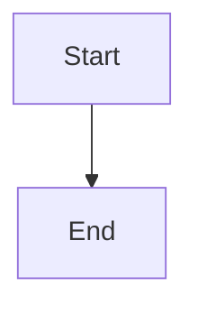

# Bounded in-flight turn progress watchdog and single recovery

## Parent Epic

epic_012

## Scope

## Outcome

Detect an in-flight SWE turn whose provider transport remains connected but produces no useful progress, cancel only that turn's provider/bridge process tree through the graceful turn-cancellation seam supplied by `feat_018_002`, preserve the task checkpoint and dirty worktree, emit one actionable durable diagnostic, and schedule at most one supervised recovery for the unchanged stall episode.

## Required acceptance

- Track transport/process liveness separately from progress liveness. Lease renewal or a pending provider await is not progress.
- Useful progress is limited to provider events, completed tool calls, checkpoint advancement, or task-worktree file/content advancement; evidence is timestamped and reduced to a stable episode signature.
- A configurable bounded no-progress deadline uses monotonic time and an injected clock in tests.
- On expiry, cancellation targets only the affected turn's provider/bridge process tree and does not terminate the supervisor, War Room, watchdog, or unrelated turns. Escalation from graceful termination to targeted force-kill is bounded.
- Cancellation and recovery preserve the dirty task worktree and last checkpoint/result evidence.
- Emit one durable diagnostic with task/turn/provider identity, last-progress kind/time, elapsed duration, cancellation outcome, preserved-work state, and recovery disposition; exclude prompts, credentials, and model output.
- Schedule no more than one supervised recovery for an unchanged episode. New useful progress establishes a new episode; repeated polls/callbacks remain idempotent.
- Regression coverage includes a fake provider call that stays connected forever, emits no events or tool completions, and never advances checkpoint/files. The test proves bounded detection, targeted cancellation, War Room survival, dirty-work preservation, one diagnostic, and at most one recovery.
- Do not begin implementation until `feat_018_002` has landed and its cancellation/draining seam is available; reuse that seam rather than introducing a competing swe_turn/execution cancellation path.

## Scope cuts

- No whole-supervisor or War Room restart.
- No cancellation of unrelated turns and no broad process-name kill.
- No repeated retry loop, provider quality scoring, arbitrary turn-duration limit, or guarantee of task completion.
- No cleanup/reset of a dirty task worktree.

## Data structures

TBD.

## API contracts

TBD.

## Logic flow

## Task breakdown

_(empty — Feature Team mints tasks after dispatch)_

## Risks & upward questions

None.

## Decision log

None yet.
