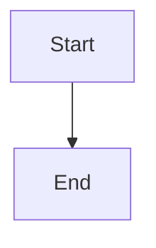

# Define canonical audit observations, incidents, and recovery authority

## Parent Epic

epic_013

## Scope

## Outcome
Define the shared Task/Feature/Epic health contract and generation-aware incident lifecycle on existing supervisor projections and durable recovery storage. This is the prerequisite for scheduling, repair adapters, and UI.

## Acceptance criteria
1. Read canonical board/lifecycle projections across tracking and product repositories; cover every field in epic criteria 3–6 and 21. Distinguish healthy, expected waiting, proven incident, and unavailable evidence. Human approval/comment/dependency waits are gates, not permission to advance.
2. Inspect all nonterminal work, completed work updated within seven days, and unresolved action/review/publication/cleanup references regardless of age. Use a bounded fair continuation cursor; no full completed-history rescan on every pass.
3. Extend existing recovery ledgers with typed work ID, tier, concrete accountable owner, failure class, authoritative generation, evidence, selected capability, request/acknowledgement/result, attempts, cooldown, and outcome. Do not create another lifecycle status database.
4. Fingerprints change with relevant lease, branch head, queue membership, validation/checkpoint, document revision, parent blockage, or capability changes. Only terminal success for an unchanged authoritative generation suppresses permanently. Claimed/error/refused/deferred/unsafe/no-op outcomes expire or re-evaluate; preserve history.
5. Define a named health_auditor role with an incident-scoped allowlist. Startup and per-incident checks prove registered operation, concrete owner authorization, required worktree/action reachability, and durable result path. Missing capability is an actionable incident retained for later retry.
6. Establish observation-versus-mutation interfaces: locked fresh preconditions, typed identity checks (Feature ID must never be parent_rev), bounded reservations, canonical lock ordering, and safe rollback/replay of interrupted claims.
7. Healthy observation is read-only; no agent turn, event, notification, Git commit, document/timestamp rewrite, or success-only external API call.

## Implementation boundaries
Reuse cascade/watchdog/health.py, workspace supervisor projections, task/action_recovery.py, task/orphan_delivery.py, task/supervisor_recovery.py, review_health.py, and canonical repository resolution. Pure projections must not call mutating sweeps. Keep all existing human authority and worktree protections.

## Validation
High-signal projection/ledger integration cases for all tiers, split repositories, healthy byte-for-byte silence, generation changes, expiry after crash, distinct typed identities, missing capability, repeated observations, and old unresolved completed work. Reuse existing recovery fixtures. No model or forge access is needed to validate observations.

## Out of scope
Scheduling, new generic status storage, repair execution, UI redesign, or external software installation. Epic criteria 3–8, 10–13, 19–21, 23–24 define the shared contract.

## Data structures

TBD.

## API contracts

TBD.

## Logic flow

## Task breakdown

_(empty — Feature Team mints tasks after dispatch)_

## Risks & upward questions

None.

## Decision log

None yet.
