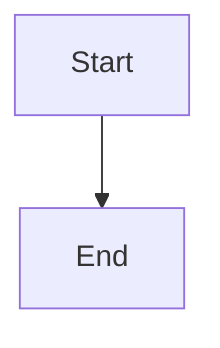

# Run bounded health audits in an independent supervisor lane

## Parent Epic

epic_013

## Scope

## Outcome
Schedule the shared audit independently of watchdog advancement and review polling, with one audit per canonical workspace and restart-safe, coalesced execution.

## Acceptance criteria
1. Parse [automation.health_audit] enabled (boolean, default true) and interval (default "30m"). Accept positive integer duration strings with s/m/h/d units; bounds are 1m through 24h inclusive. Reject malformed, fractional, zero, negative, and out-of-range values explicitly without bringing down unrelated delivery.
2. Missing new config preserves existing configuration behavior and supplies the specified audit defaults. The new enabled flag controls health audits independently of automation.enabled and the legacy supervisor-health cadence; document how legacy maintenance and audits converge through the same repair claims.
3. Supervisor-owned lane starts before blocking maintenance and is independent of fetch/review/model execution. Monotonic deadlines, nonnegative jitter capped at min(5% of interval, 60s), and a cross-process workspace claim prevent overlap. Restart restores last-run scheduling and coalesces overdue periods into one pass; backward/forward wall-clock jumps do not produce storms.
4. Bound a pass to 100 work items and 60 seconds of observer/coordinator work, with fair continuation so no tier starves. Bound every subprocess/network operation on this path with explicit timeout and cancellation. Long repair/model work uses existing supervised workers and durable actions outside the scheduler and global locks.
5. Scheduled, manual, and concurrent-parent recovery paths share incident claims and lifecycle preconditions. Manual requests coalesce with an in-flight audit and leave the periodic deadline unchanged. Disabled scheduled audits create no periodic work; an explicit guarded manual run remains available.
6. Persist only a small untracked supervisor audit receipt/cursor per completed pass (last/next time, duration, counts and schedule recovery data). This is the documented low-cost observability exception: it cannot trigger board watchers, dispatch, notifications, Git, or provider work.
7. Failures/timeouts produce durable actionable auditor evidence and retry/cooldown without blocking unrelated delivery. A skipped overdue pass is not reported as completed.

## Validation
Use controllable clocks and real isolated workspace coordination for restart, clock jumps, jitter bounds, duplicate/manual requests, slow and timed-out I/O, disabled/invalid configuration, and cross-process overlap. Prove audit progress while the ordinary maintenance chain is deliberately blocked and no catch-up storm after restart. Assert bounded continuation covers more than one pass.

## Scope
Epic criteria 1–3, 7–8, 12, 14–15, 18. Production default activation is released only with the final acceptance feature; this feature supplies the implementation and integration seam without waiving required repair coverage.

## Data structures

TBD.

## API contracts

TBD.

## Logic flow

## Task breakdown

_(empty — Feature Team mints tasks after dispatch)_

## Risks & upward questions

None.

## Decision log

None yet.
