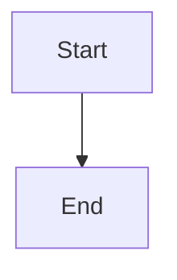

# Recover Task delivery incidents through canonical guarded adapters

## Parent Epic

epic_013

## Scope

## Outcome
Connect the audit to existing owner-scoped Task recovery and prove that lost queues and stale deliveries reach exactly one normal merge and rollup.

## Acceptance criteria
1. Use capabilities from completed Epics 041 and 042: supervisor_recover_task_delivery, concrete parent recovery, durable action retry/rearm, supervised checkpoint resume/revalidation, canonical queue/merge and rollup. Do not duplicate those algorithms.
2. Reproduce task_038_002_002: validated active Task, retryable merge action, absent pending-task-merges.json entry. The audit rechecks lease, ownership, current heads/evidence, gates and generation under the lifecycle lock, requeues through the canonical path, merges once, completes rollup and releases dependent work.
3. Handle stale leases and ownerless turns using pinned inputs; pass the authoritative Feature ID, never parent_rev or a SHA. Missing checkpoint, stale validation, dirty worktree, busy target and live/stale-but-live owner each receive the correct safe repair or precise durable refusal.
4. Material Feature-base movement requires fresh supervised validation and replacement exact-head delivery evidence before retrying the original action. Existing team-owned conflict recovery is routed to the actual work ID, wakes an idle/completed owner and persists acknowledgement/result; ambiguous semantic conflicts require the owning team/human.
5. Preserve user changes and history. No reset/clean/force-push, new replacement Task, approval/comment bypass, provider/credential change, or dependency install. Clear only matching derived parent blockers before resuming; preserve unrelated sibling/manual blockers.
6. Crash/restart, manual parent recovery and simultaneous audits converge without duplicate workers, validations, queues or merges. Negative outcomes and interrupted claims retry only under the shared bounded generation/cooldown rules.
7. Start a scoped auditor agent only for an incident requiring bounded diagnosis or an authorized recovery plan; deterministic repairs run without a model turn. Missing executable adapters remain visible and automatically re-evaluate when capability changes.

## Validation
Extend existing isolated-repository real recovery scenarios, especially tests/test_task_recovery_generations_regressions.py and tests/watchdog/test_health.py. Cross the actual owner route, wakeup, acknowledgement, owned-branch mutation, work-defined supervised checks, replacement evidence, blocker reconciliation and merge/rollup boundaries. Deterministic model/forge responses may be substituted, but event-only or mocked recovery callbacks do not establish acceptance. Assert original action identity and exactly one terminal completion.

## Scope
Epic criteria 4, 8–13, 16–17, 19–20, 22–24. Foundations and independent scheduling are prerequisites.

## Data structures

TBD.

## API contracts

TBD.

## Logic flow

## Task breakdown

_(empty — Feature Team mints tasks after dispatch)_

## Risks & upward questions

None.

## Decision log

None yet.
