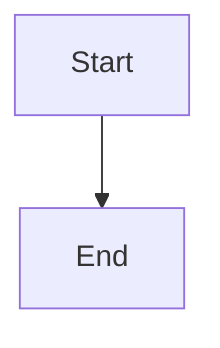

# Recover stalled Feature and Epic owners and publication lifecycles

## Parent Epic

epic_013

## Scope

## Outcome
Extend the audit's executable recovery to parent planning, dispatch, integration publication, reconciliation and closeout, using concrete owning teams.

## Acceptance criteria
1. Detect active Features/Epics without a live planning owner or pending input; dispatchable children with no progress; completed local integration work lacking review publication; stale parent inputs, graph inconsistencies, approval/comment/dependency gates, and return/cancellation or trunk/integration discrepancies. Pending review or expected human wait alone is not a stalled-work incident.
2. Prove lack of progress from repeated authoritative observations across at least one configured interval or an existing canonical expired lease/action deadline. Do not reclaim a live owner or use document age alone as proof.
3. Supply concrete Feature-parent and Epic-parent adapters for safe owner resume/wakeup, authorized dispatch restoration, durable review/publication retry, idempotent reconciliation and completion rollup. Reuse team supervision, review_health, team_review_recovery, team_branch_recovery, stacked-review recovery, completion reconciliation and existing authorization.
4. Each capability is checked at startup and per incident for registration, concrete owner/worktree/action reachability and request/acknowledgement/result. A sent event without an executable mutation/result path cannot count as recovered.
5. Preserve plan and feature approval, sign-offs, comment gates, stale revision admission, dependency readiness, cancellation intent, dirty worktrees and ambiguous conflicts. Retry only safe existing transitions. No inferred human decision.
6. Route Task incidents first to Feature, Feature to Epic, and Epic/system to human/Boss as appropriate, recording evidence, responsible work ID and exact resume action. Dedupe unchanged incidents/notifications, re-evaluate changed generations, and clear only matching derived blockers.
7. Unknown mergeability, missing worktrees, fetch/admission/validation/publication failures remain owned and retryable or actionable. Retain completed work until pending review/cleanup/rollup is reconciled, regardless of the seven-day completion window.

## Validation
Real isolated-repository Feature and Epic recovery flows must reach owned-branch publication and terminal reconciliation exactly once, crossing registered adapters rather than mocked callbacks. Cover absent/completed owners, pending input/review, live slow planning, approval/comment gates, split repository roots, restart after acknowledgement, sibling blockers, concurrent manual recovery, cancellation/return state, and stale generation recovery. Reuse Epic 042 review and completion tests.

## Scope
Epic criteria 5–6, 8–13, 17, 19–24. Task recovery establishes the shared executable-adapter pattern; no second review or dispatch subsystem.

## Data structures

TBD.

## API contracts

TBD.

## Logic flow

## Task breakdown

_(empty — Feature Team mints tasks after dispatch)_

## Risks & upward questions

None.

## Decision log

None yet.
