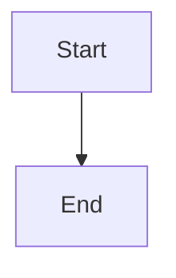

# Expose audit controls and prove default-on recovery acceptance

## Parent Epic

epic_013

## Scope

## Outcome
Ship the complete audit loop enabled by default every 30 minutes, with truthful War Room status and guarded manual execution.

## Acceptance criteria
1. War Room displays last audit time, next due time, duration, counts by tier/outcome, and active incidents with concrete owner, evidence, request/acknowledgement/result, retry/cooldown and exact resume action. No "investigating" state without a delivered pending/acknowledged request.
2. Add guarded "Run health audit now" using existing human request protections and the shared coordinator. Duplicate clicks/concurrent scheduled runs coalesce; the action does not alter the periodic deadline. Explicit manual execution is available when scheduled audits are disabled.
3. Document the config grammar/bounds/defaults, independent supervisor lane, work/pass limits, seven-day completed window plus unresolved references, generation retry semantics, capabilities/privilege boundaries, escalation and troubleshooting.
4. Document the only healthy-run writes: a compact untracked supervisor audit receipt/cursor that cannot trigger work. A healthy workspace has no lifecycle mutation, model turn, event/toast/chat, Git change, success-only external API call, or document timestamp rewrite.
5. Release default enablement only after Task lost-queue/stale-delivery, Feature owner/publication and Epic owner/closeout adapters pass real recovery acceptance through terminal outcomes. Missing capability paths must fail closed with precise actionable evidence and later automatic re-evaluation; they do not excuse missing required adapters.
6. End-to-end acceptance covers all 24 epic success criteria. Repeat named regressions through the audit entry point, including task_038_002_002 and Feature ID versus parent_rev, and verify recovery while ordinary watchdog I/O is blocked.
7. Concurrent manual/periodic/parent recovery, crash/restart, healthy silence, invalid/disabled intervals, bounded scans, blocked approval/comment gates, dirty worktrees and split repositories pass the selected integrated suite. No external package/service installation is required.

## Validation
Use the existing War Room route/JavaScript harness and real isolated-repository lifecycle fixtures. Assert visible status reflects durable state and the actual manual request path. Reuse adapter acceptance rather than creating redundant mock-heavy unit suites; document commands and observed outcomes for each epic criterion.

## Scope
Epic criteria 1–24 at release, with primary ownership of 7, 14 and rollout/acceptance. No analytics product, new notification channel, arbitrary repair console, or UI redesign.

## Data structures

TBD.

## API contracts

TBD.

## Logic flow

## Task breakdown

_(empty — Feature Team mints tasks after dispatch)_

## Risks & upward questions

None.

## Decision log

None yet.
