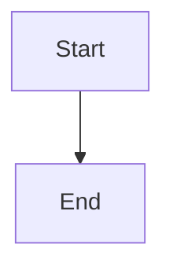

# Safe cancellation cleanup

## Parent Epic

epic_014

## Scope

Connect cancellation to the existing worktree/branch teardown path for in-flight work. Cleanup must be scoped to artifacts owned by the cancelled work item, preserve the canonical/base branch and unrelated or uncommitted user work, be retryable, and surface actionable partial-failure state rather than claiming clean cancellation.

## Data structures

TBD.

## API contracts

TBD.

## Logic flow

## Task breakdown

_(empty — Feature Team mints tasks after dispatch)_

## Risks & upward questions

None.

## Decision log

None yet.
