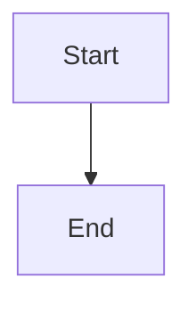

# Parent feedback and replanning gate

## Parent Epic

epic_014

## Scope

When a feature or task is cancelled, emit durable structured feedback to its parent and pause/gate the parent before further dispatch until the user chooses a disposition. Support continue with reduced scope, replace/replan, or cancel parent; record the choice in the owning plan/decision trail. Epic cancellation has no parent escalation. Verify the end-to-end user workflow.

## Data structures

TBD.

## API contracts

TBD.

## Logic flow

## Task breakdown

_(empty — Feature Team mints tasks after dispatch)_

## Risks & upward questions

None.

## Decision log

None yet.
