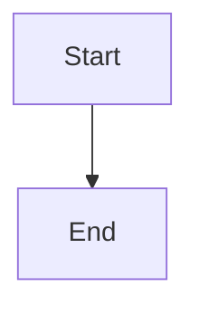

# Authoritative epic-plan readiness and approval gate

## Parent Epic

epic_015

## Scope

## Objective

Make epic-plan approval impossible until both required planning roles have signed the current plan revision and unresolved open questions are absent.

## Scope

- Persist independent Epic Manager and Epic Architect sign-offs against the canonical plan revision.
- Compute `planning` versus `ready_for_review` from current revision, valid sign-offs, and canonical unresolved-question state.
- Permit sign-off only for the matching role and reject it while unresolved open questions exist.
- Make repeated same-role/same-revision sign-off idempotent.
- Enforce the same readiness predicate in the plan-approval command.
- Surface readiness, valid role sign-offs, approval capability, and disabled reason through the existing read model.
- Preserve already-approved epics; active unapproved epics begin without valid sign-offs.

## Acceptance criteria

- New activation cannot be approved.
- One role's sign-off is insufficient.
- Either sign-off is rejected while unresolved questions exist.
- Both roles signing the current revision with no unresolved questions permits approval.
- A material plan revision makes older sign-offs insufficient.
- Direct and stale-client approval attempts are rejected using existing domain error conventions.
- Existing approved records remain approved.

## Verification

Use a domain/API transition table and one integration flow covering activation through approval. Avoid redundant selector-level unit tests.

## Data structures

TBD.

## API contracts

TBD.

## Logic flow

## Task breakdown

_(empty — Feature Team mints tasks after dispatch)_

## Risks & upward questions

None.

## Decision log

None yet.
