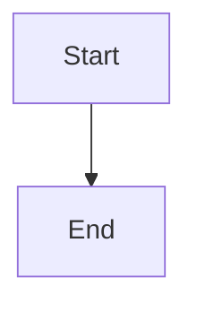

# Planning readiness in the epic UI

## Parent Epic

epic_015

## Scope

## Objective

Make the existing epic plan surface clearly communicate whether planning is still underway or ready for human review, and prevent premature approval interaction.

## Scope

- Consume the server-provided planning state, valid sign-offs, approval capability, and disabled reason.
- Keep the plan viewable throughout planning.
- Render **Approve plan** as semantically disabled until approval is allowed, with an explanatory reason.
- Show **Planning in progress** with a lightweight, reduced-motion-safe indicator while readiness conditions are unmet.
- Show **Ready for review** with a distinct success treatment that does not rely on color alone when both sign-offs are valid.
- On a stale-client server rejection, retain the plan, show the actionable error, and refresh readiness through the existing data flow.
- Do not add notifications, presence tracking, or redesign the viewer.

## Acceptance criteria

- Initial activation visibly shows planning status and a disabled approval control.
- Partial sign-off remains visibly blocked.
- Full current-revision sign-off changes the status to ready and enables approval.
- Keyboard and assistive-technology users receive the same disabled/status information.
- Reduced-motion preference removes nonessential animation.
- A stale-client rejection cannot appear as a successful approval.

## Verification

Add one UI integration test for disabled reason and planning-to-ready transition, plus coverage of the existing error path for a stale approval request.

## Data structures

TBD.

## API contracts

TBD.

## Logic flow

## Task breakdown

_(empty — Feature Team mints tasks after dispatch)_

## Risks & upward questions

None.

## Decision log

None yet.
