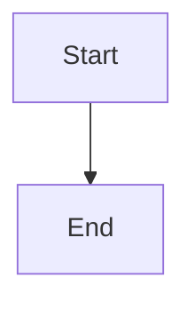

# War Room branch update action and actionable recovery

## Parent Epic

epic_016

## Scope

## Intent

Expose branch drift and safe recovery directly on active War Room cards using the synchronization result contract from feat_016_001.

## Scope

- Extend the board read model for active epics, features, and tasks with resolved base, ahead/behind counts, update eligibility, and a stable disabled reason.
- Add one update-branch POST endpoint that validates the work ID and delegates all Git policy to the shared service.
- Show Update branch only when the work branch is behind; disable it when the item is busy or otherwise ineligible.
- Refresh the board after success and keep the original task-merge or epic-close action available for retry.
- Translate typed failures into concise guidance for dirty_index, local_changes, branch_conflict, busy, and invariant failures; show validated conflict paths and never raw Git output.
- Keep remote fetch, automatic retries, stashing, conflict resolution, and new lifecycle workflows out of scope.

## Acceptance criteria

- Active epic, feature, and task cards show accurate ahead/behind state and expose Update branch only while behind.
- The endpoint returns a stable JSON result and appropriate conflict/client status without bypassing domain preconditions.
- A successful update refreshes counts and removes the action once current.
- Dirty or busy checkouts show why the action is unavailable and how the operator can recover.
- Conflict responses list blocking paths, confirm that the merge was aborted, and allow the operator to retry after manual resolution.
- Existing task-merge and epic-close failures use the same actionable vocabulary and retain their retry path.
- Route/serialization tests cover all tiers and error mappings; one browser-level interaction test covers visibility, success refresh, and recovery rendering.

## Data structures

TBD.

## API contracts

TBD.

## Logic flow

## Task breakdown

_(empty — Feature Team mints tasks after dispatch)_

## Risks & upward questions

None.

## Decision log

None yet.
