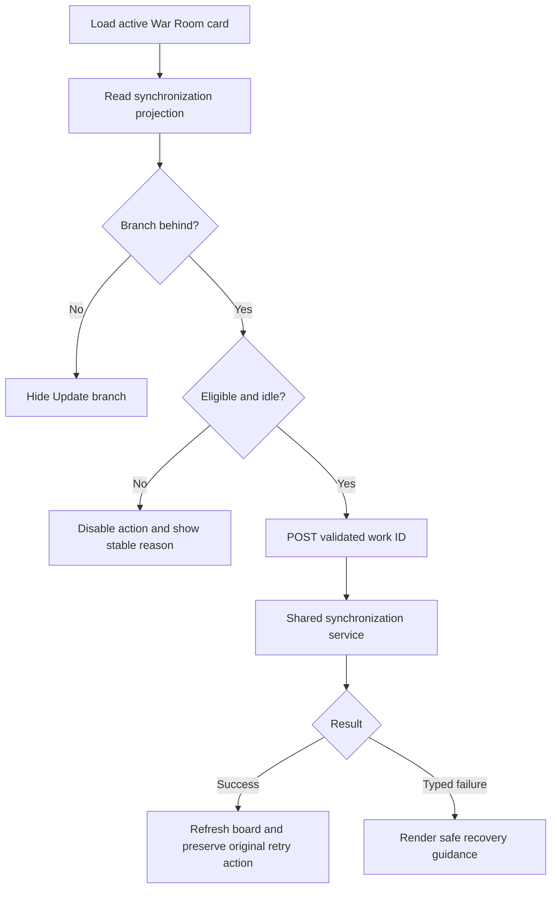

# War Room branch update action and actionable recovery

## Parent Epic

epic_016

## Intent

Expose branch drift and safe recovery directly on active War Room cards using the synchronization result contract from feat_016_001.

## Scope

- Extend the board read model for active epics, features, and tasks with resolved base, ahead/behind counts, update eligibility, and a stable disabled reason.
- Add one update-branch POST endpoint that validates the work ID and delegates all Git policy to the shared service.
- Show Update branch only when the work branch is behind; disable it when the item is busy or otherwise ineligible.
- Refresh the board after success and keep the original task-merge or epic-close action available for retry.
- Translate typed failures into concise guidance for dirty_index, local_changes, branch_conflict, busy, and invariant failures; show validated conflict paths and never raw Git output.
- Keep remote fetch, automatic retries, stashing, conflict resolution, and new lifecycle workflows out of scope.

## Acceptance criteria

- Active epic, feature, and task cards show accurate ahead/behind state and expose Update branch only while behind.
- The endpoint returns a stable JSON result and appropriate conflict/client status without bypassing domain preconditions.
- A successful update refreshes counts and removes the action once current.
- Dirty or busy checkouts show why the action is unavailable and how the operator can recover.
- Conflict responses list blocking paths, confirm that the merge was aborted, and allow the operator to retry after manual resolution.
- Existing task-merge and epic-close failures use the same actionable vocabulary and retain their retry path.
- Route/serialization tests cover all tiers and error mappings; one browser-level interaction test covers visibility, success refresh, and recovery rendering.

## Data structures

The active-card read model adds a branch synchronization projection:

- resolved base reference
- integer ahead and behind counts
- update eligibility
- stable disabled reason when ineligible

The update result uses the shared typed synchronization outcomes from feat_016_001. Public payloads contain stable outcome/reason identifiers, concise guidance, and validated conflict paths where applicable; raw Git output is never serialized.

## API contracts

- One POST update-branch route accepts a validated active work ID for an epic, feature, or task.
- The route delegates synchronization policy to the shared service and does not implement Git behavior itself.
- Success returns a stable JSON result suitable for refreshing the active board.
- Domain precondition and typed synchronization failures map to stable client/conflict HTTP statuses and safe actionable payloads.
- Existing task-merge and epic-close paths reuse the same public failure vocabulary without changing their retry semantics.

## Logic flow

## Task breakdown

- task_016_002_001 — Expose branch drift and safe update API.
- task_016_002_002 — Add War Room update action and recovery UI. Depends on task_016_002_001.

## Risks & upward questions

None.

## Decision log

See recorded Cascade decisions.

- `dec_001` · 2026-10-23 · Feature Lead · **Task breakdown**
  Chose Deliver the feature in two dependency-ordered tasks: establish the shared board/API contract first, then build the War Room interaction against it; mint no additional tasks..
  Rationale: This is the smallest shippable split that prevents UI/API contract drift while keeping route/serialization verification separate from the single high-value browser interaction test.
  Honors: Feature scope and acceptance criteria; frugal-engineering requirement for economical, high-signal testing..

## Closeout

Completed child work: `task_016_002_001` (Expose branch drift and safe update API), `task_016_002_002` (Add War Room update action and recovery UI).
